# RuleExam 界面演示说明

> 版本：2026-09-19 · 设计主题「公文藏蓝 · 印章朱红」· 5 轮界面优化后全量截图
> 截图环境：1440×900 桌面视口，本地联调环境（Mock AI），数据为演示种子数据

本文档是制度学习及考试系统（RuleExam）Web 端界面优化的演示说明：先介绍设计体系与五轮优化内容，再按「员工学习考试」与「管理员治理」两条主线做带截图的页面导览，最后附本地复现方式与验收记录。

---

## 1. 设计体系

界面优化以「制度 / 合规」的产品语境为出发点：深藏蓝承载**权威与秩序**，靛蓝作为**操作主色**，朱砂红只出现在「印章」式的签名时刻（品牌标识、考试通过章），正文保持冷静灰阶。

| 令牌 | 值 | 用途 |
| --- | --- | --- |
| 藏蓝 Ink | `#14203D` | 侧栏、深色品牌面板 |
| 靛蓝 Primary | `#3056D3` | 主按钮、链接、选中态、进度 |
| 朱砂 Seal | `#C2402A` | 品牌印章徽标、「通过」印章、关键警示点缀 |
| 云灰 Canvas | `#F4F6FA` | 页面画布（叠加极淡品牌色晕染） |
| 墨黑 / 灰阶 | `#1F2329` / `#51565F` / `#8A919C` | 标题 / 正文 / 辅助文字 |

- **字体**：正文与界面用系统中文无衬线（PingFang SC 等）；品牌字标与登录标语用衬线宋体（`Noto Serif SC` 回退 `Songti SC`），呼应公文标题传统；分数、倒计时、统计数字统一等宽字体（`re-mono`）呈现"仪表感"。
- **签名元素**：印章。登录页品牌徽标、侧栏 Logo、考试通过结果卡上的旋转朱红「通过」圆章，是全站记忆点。
- **动效**：页面入场轻浮入（0.28s）、卡片悬浮上浮、倒计时临界闪烁、印章盖章弹入；全部动效尊重 `prefers-reduced-motion`。
- **落地方式**：Element Plus CSS 变量整体映射（主色阶/圆角/边框/填充/阴影），全局 `style.css` 持有全部设计令牌，组件库原生控件无二次封装成本。

## 2. 五轮优化内容

| 轮次 | 范围 | 主要改动 |
| --- | --- | --- |
| 第 1 轮 | 设计体系与全局样式 | 设计令牌、Element Plus 主题映射（色板/圆角/阴影/填充）、表格/按钮/标签/分页/弹层/滚动条/焦点态全局样式、等宽数字、阅读排版、入场动效 |
| 第 2 轮 | 登录页与布局壳 | 登录页改左右分栏品牌叙事 + 印章徽标；侧栏改藏蓝渐变 + 分组导航（管理台/我的学习）+ 选中态光带；顶栏改用户徽章（头像/姓名/角色） |
| 第 3 轮 | 管理端页面 | 统一页头（眉题+标题+说明）；统计页 KPI 图标卡 + 分数分布条形图重设计；各列表页/详情页头部与操作区升级 |
| 第 4 轮 | 学习端 | 我的制度改学习卡片网格（进度/达标状态/CTA）；阅读页吸顶「学习控制台」（双进度仪表+状态徽章）；考试页控制台顶栏（等宽倒计时/切屏告警）+ 题卡序号章 + 选项悬浮/选中态 + 通过印章 |
| 第 5 轮 | 细节打磨 | 改密页、成绩明细（成绩英雄区 + 对错选项状态）、制度/试卷详情页头、空态文案、动效收尾；顺手修复制度上传回调失联的功能回归 |

---

## 3. 员工端演示

### 3.1 登录

左侧深藏蓝品牌面板陈述产品价值（学习留痕 / AI 出题 / 风控考试），右侧白色卡片承载登录表单；衬线标语「让每一条制度都被真正读过」点明产品立场。窄屏下品牌面板自动隐藏。


### 3.2 我的制度（学习入口）

学习任务以卡片网格呈现：制度图标、分类徽章、学习要求，以及**学习时长进度仪表**与达标状态；达标后按钮转为「继续阅读」。空态提供行动引导文案。

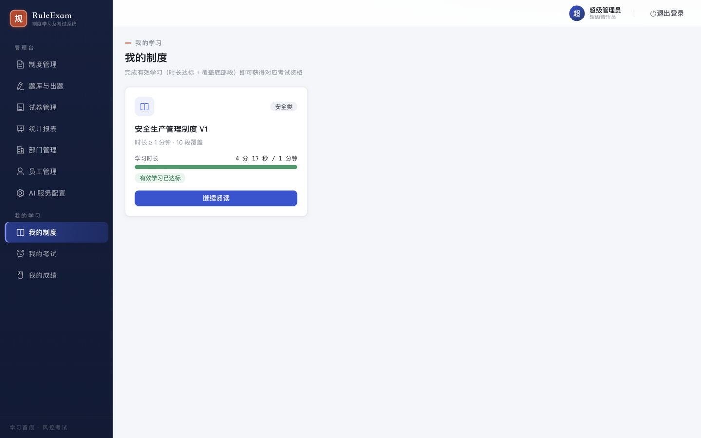

### 3.3 在线阅读（学习控制台）

吸顶控制台聚合关键学习状态：返回、制度名、**有效学习时长**与**滚动覆盖**双进度仪表、达标状态徽章；达标后出现「参加考试」主行动按钮。正文区为独立阅读排版（800px 舒适行宽、2 倍行距）。学习时长全部由服务端结算，界面只做忠实呈现。

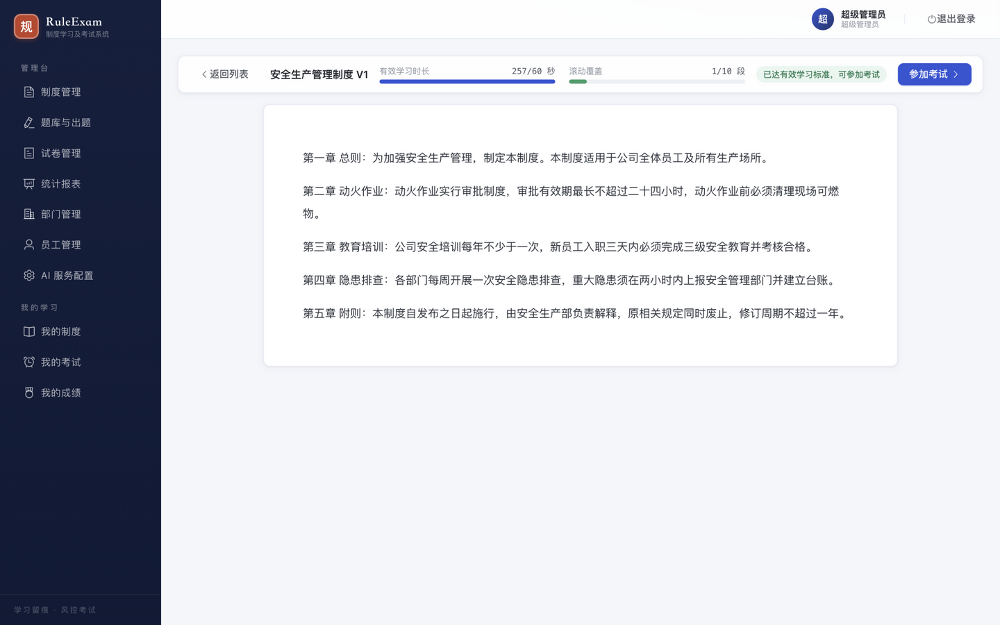

### 3.4 我的考试

考试资格由服务端判定：完成有效学习（时长达标 + 覆盖底部段）后「开始考试」按钮解锁，未达标时置灰并给出原因提示；最高分与作答次数等宽对齐。

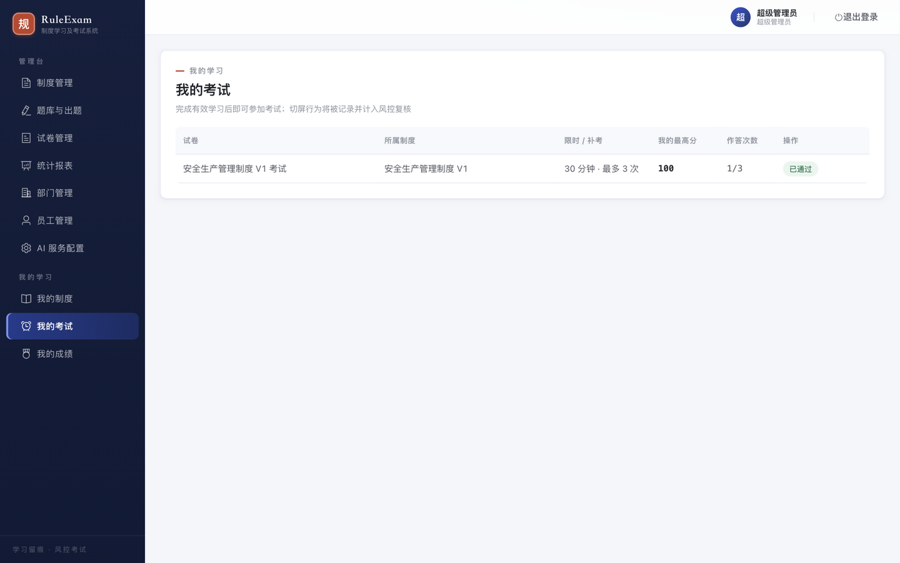

### 3.5 考试作答

考试控制台顶栏吸顶展示：试卷名、作答次数与及格线、**切屏风控告警**、大号等宽倒计时（最后 5 分钟转红闪烁）。题卡带序号章与题型分值徽章，选项纵向排布、悬浮与选中态明确（题目与选项顺序按 HMAC seed 乱序下发）。

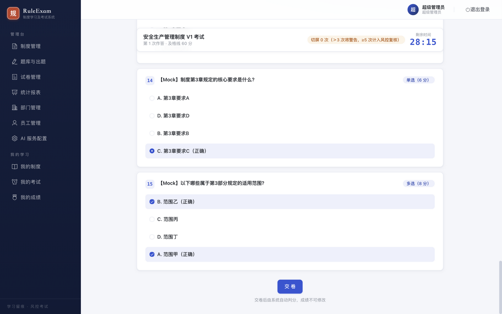

### 3.6 交卷与「通过印章」

交卷后系统即时判分。通过时，结果卡右上角盖下旋转朱红「通过」圆章——全站的印章签名时刻。

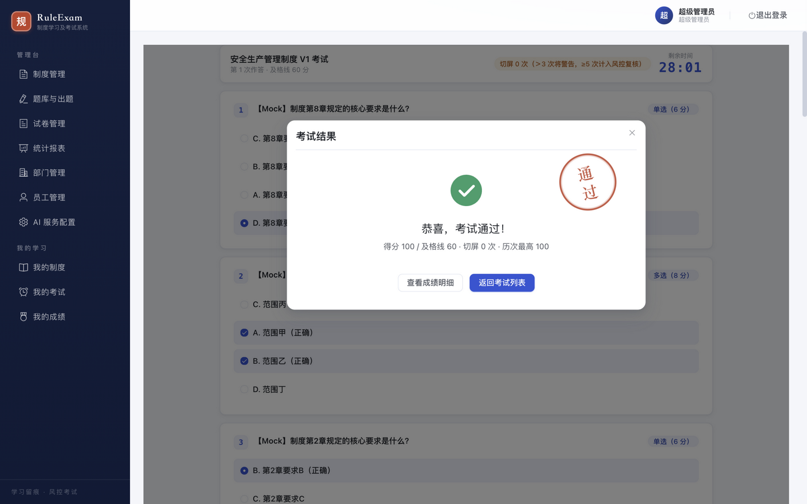

### 3.7 我的成绩与成绩明细

成绩列表的状态徽章与得分按通过/未通过着色；明细页顶部为**成绩英雄区**（状态、大号分数、及格线、切屏与历次最高），题目逐题回放：正确项绿章、错选项红章、我的选择与正确答案并列标注，附解析块。

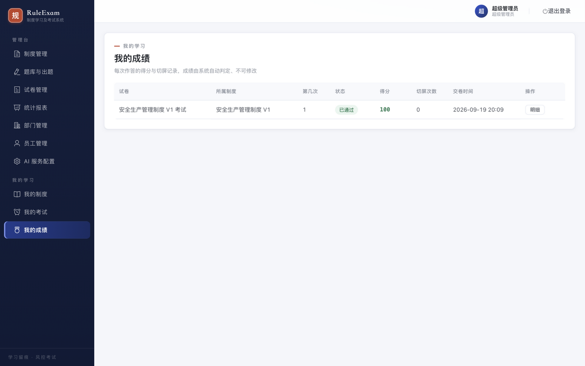

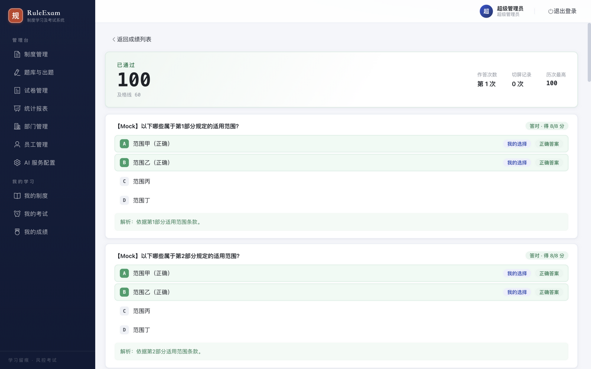

---

## 4. 管理端演示

### 4.1 统计报表

页头（红色眉题短横 + 标题 + 说明）下是四张 KPI 图标卡：应学人数、学习完成率、参考人数、通过率；第二排为分数分布条形图（左闭右开区间）、平均分与未完成人员（朱红大数字警示）；下方三个页签提供全部制度概览、部门维度对比、未完成人员清单，并支持三张 Excel 台账导出。

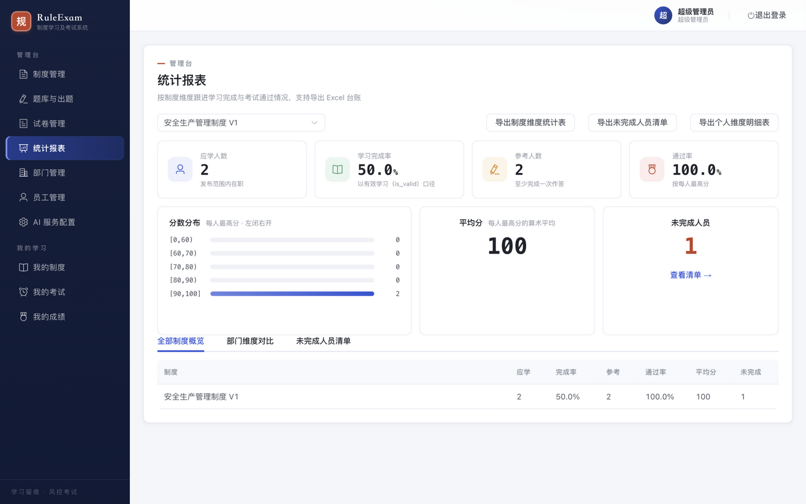

### 4.2 制度管理与制度详情

制度列表提供关键字/状态筛选与发布时间；详情页头聚合返回、标题、状态与发布/归档动作，四个页签覆盖版本管理（append-only 上传、异步解析状态、生效版本切换）、学习要求（时长/分段）、发布范围（全员或部门树）与内容预览。

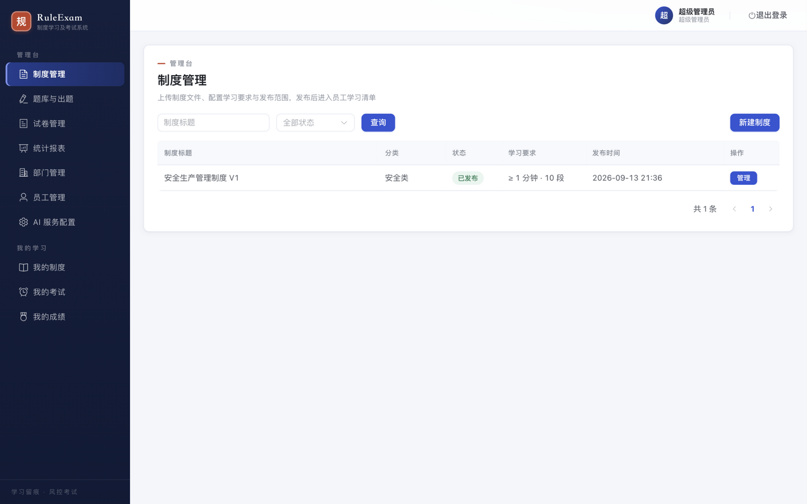

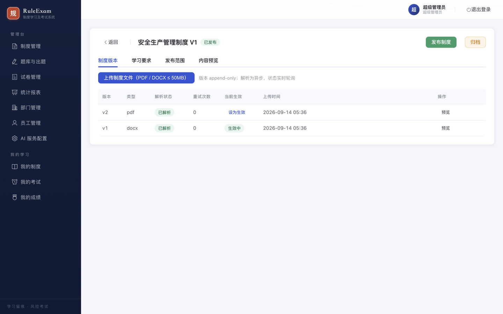

### 4.3 题库与出题

AI 依据制度原文生成题目进入待审核队列，人工「通过/驳回」把守入卷关口；支持人工录入与单题重新生成。分值合计实时校验 100 分。

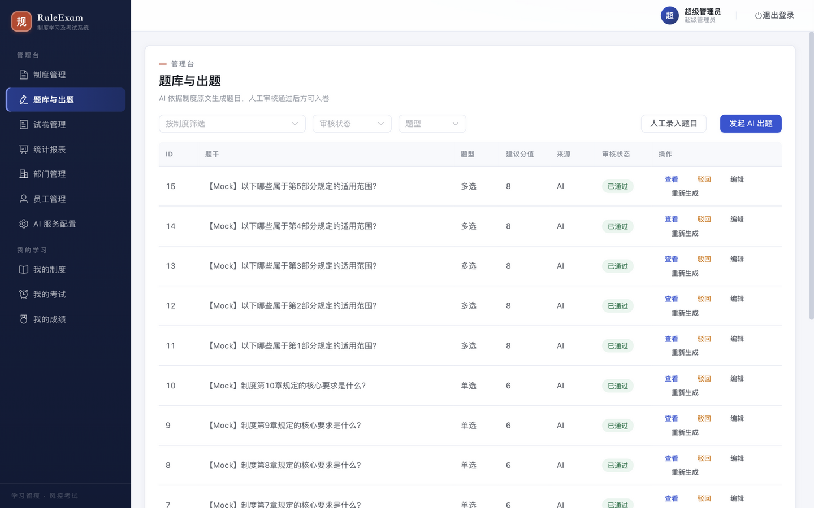

### 4.4 试卷管理与组卷

试卷列表呈现及格线/限时/补考策略摘要；详情页可调整考试策略（发布后题目组成锁定、策略仍可调）与题目组成（从已通过题目中选题入卷、逐题分值、SUM=100 校验发布）。

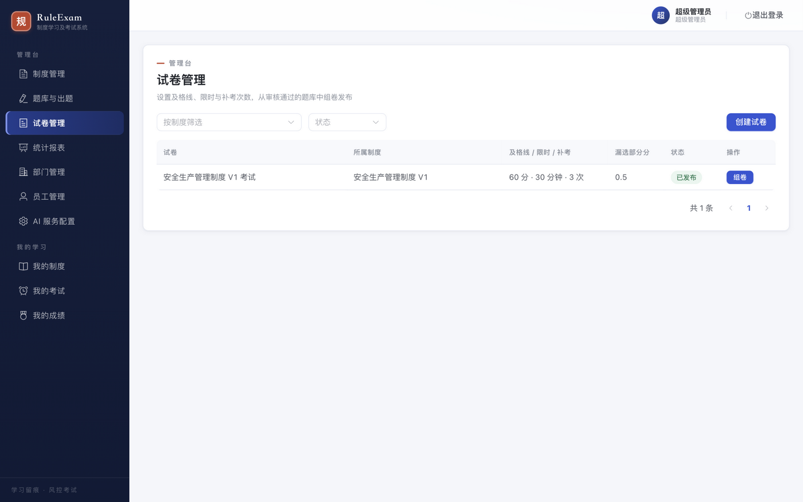

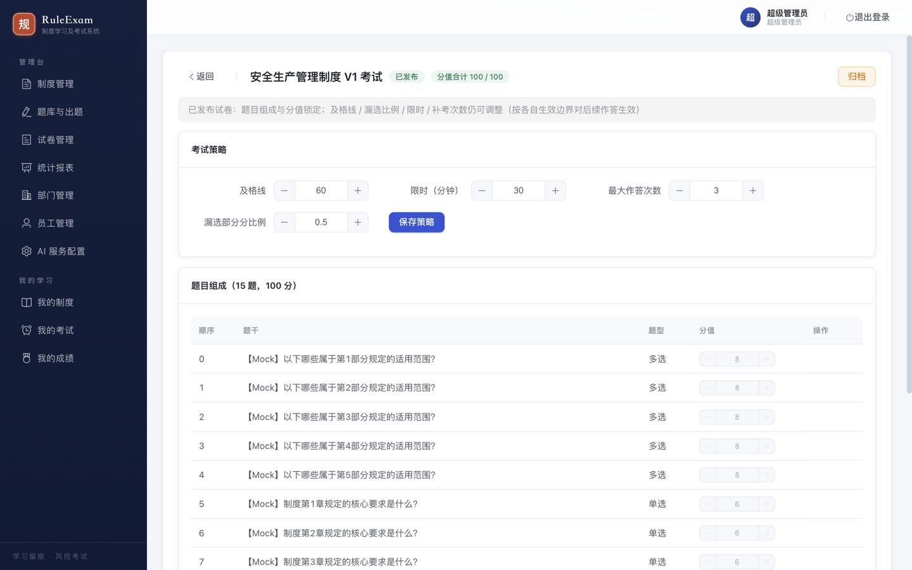

### 4.5 部门管理

树形结构管理发布范围与统计维度的组织基础；节点操作（添加子部门/编辑/移动/停用/删除）悬浮显现，受引用保护时引导转为停用。

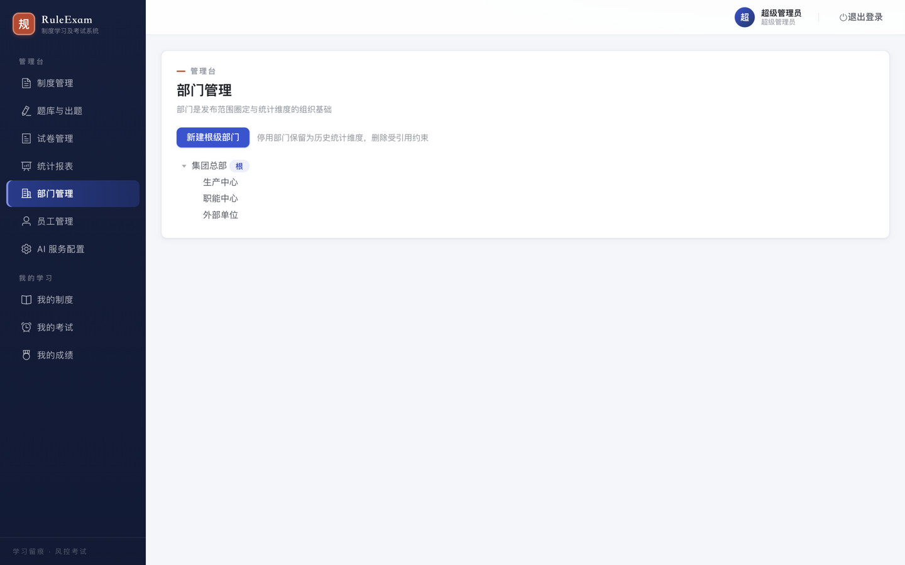

### 4.6 员工管理

账号全生命周期：筛选查询、新增、编辑、停用/启用、重置密码（重置即吊销旧令牌）、Excel 批量导入与结果回执。

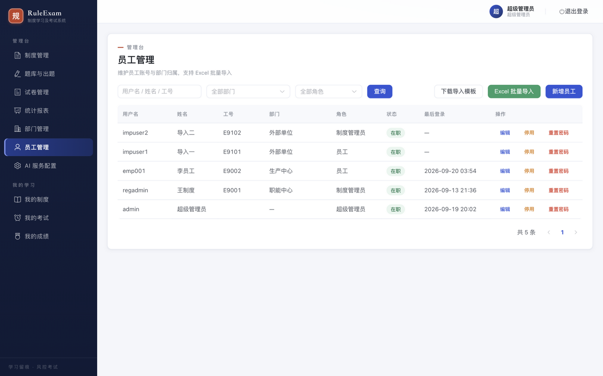

### 4.7 AI 服务配置

OpenAI 兼容端点配置（base_url / api_key / model），api_key 加密落盘、界面仅掩码回显，附连通性测试。

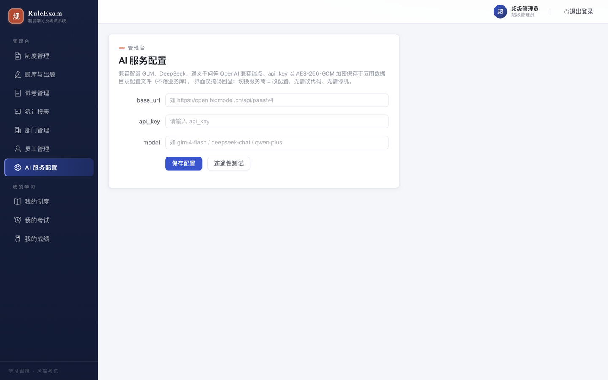

---

## 5. 本地复现

```bash
# 前置：本机 MySQL 8.0（127.0.0.1:3306）与 Redis（6379）；已完成 database/init.sql 建库与种子
node tests/gui-test-env/mock-ai.mjs                                   # Mock AI :9101
cd server && DB_USERNAME=root DB_PASSWORD=<DB口令> DB_DATABASE=ruleexam \
  AI_EGRESS_ALLOW_HOSTS=127.0.0.1 node dist/main.js                   # API :3000（先 npm run build）
cd web && npm run dev                                                 # Vite :5173（占用时自动 +1）
```

登录账号为环境准备时注入口令的 `admin` / `emp001`；演示数据（制度、题库、试卷）见 `tests/gui-test-env/seed-regulation.mjs` 与 e2e 流程。

## 6. 验收记录

- `npx vue-tsc --noEmit`：**0 错误**（本轮开始前基线为 7 错，已全部清除）。
- `npm run build`（vite build）：通过。
- 视觉门禁：14 页全量截图逐张评审，**14/14 通过**；门禁提出的 3 项非阻断跟进（部门页重复文案、制度详情「设为生效」截断、统计页 Tab 间距）已修复并重截。
- 顺手修复的功能回归：制度详情上传按钮回调失联（`onUpload` 引用不存在的函数，改为既有 `onUploadChange`），不影响其他逻辑。
- 功能红线未触碰：学习时长服务端结算链路、考试下发 payload 不含答案、乱序 seed、令牌吊销等后端口径均保持原状，本轮仅动模板与样式（含一处死引用修复）。
