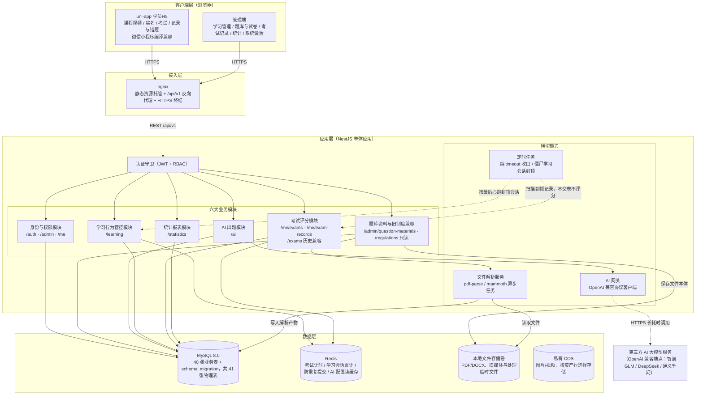
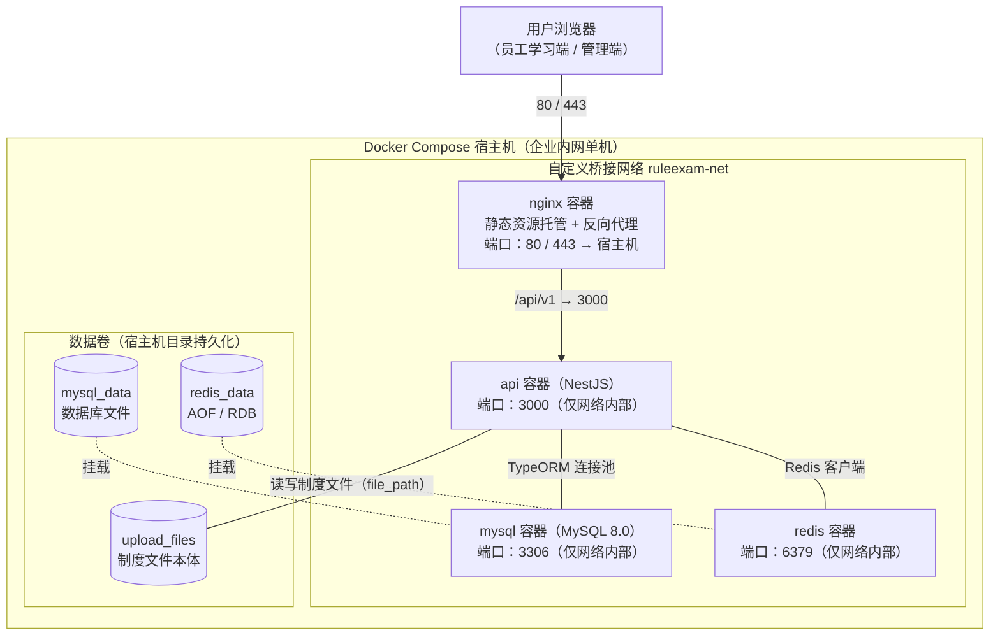

# 02 · 系统架构 —— 制度学习及考试系统（EmodorRuleExam）

> **本册定位**：给出 EmodorRuleExam 的总体分层架构、关键架构决策、十个技术层的详细选型论证（候选方案对比 → 定稿理由 → 风险与备选）、技术组合层间协同，以及 Docker Compose 部署架构与配置管理方案。全文术语、表名、字段名、枚举值、模块名与 [README.md](README.md) 第 3 章「设计约定速览」**逐字一致**；全部选型结论与 README 3.1 技术栈定稿完全一致；需求依据引自 [01-需求分析.md](01-需求分析.md)（功能需求 FR-XX-NN、非功能需求 NFR-NN、约束 C-NN、假设 A-NN）。

> **状态边界（2026-10-22）**：现行业务包括培训类别/学员/课程、题库资料与三类客观题、试卷、学员H5本地草稿与主动整卷提交、自动评分、考试记录、培训统计和系统设置。Task 13/14 / Gate H2 已实现并完成自动验证；真实后端浏览器全链、真实短信/腾讯、真实弱网和微信开发者工具/真机仍未验。PC只保留管理考试能力，旧制度学习、固定卷API和原统计由共享层兼容；图片作答、人工阅卷、实时监控和切屏采集不再注册应用入口。

---

## 1. 引言

### 1.1 架构设计目标

架构设计以 01 册第 6 章非功能需求为直接输入，形成以下六项设计目标：

| # | 设计目标 | 说明 | 对应需求 |
|---|---|---|---|
| G1 | 并发承载 | 单机支撑 500 名员工同时在线学习（心跳上报约 17 次/秒）与 100 名员工同时考试（含交卷评分峰值），无请求堆积 | NFR-01、NFR-02 |
| G2 | 响应与时效 | 常规接口 P95 ≤ 500ms、统计查询 P95 ≤ 3 秒（1 万员工规模）、万行级 Excel 导出 ≤ 30 秒；文件解析 ≤ 20MB ≤ 60 秒且异步不阻塞；AI 出题 120 秒内返回、超时可重试 | NFR-03、NFR-04、NFR-05 |
| G3 | 安全合规 | 全接口 JWT 认证 + RBAC 强制校验；学习侧心跳、失焦暂停、时长容差与滚动位图在服务端生效；考试侧采用实名、冻结题单、稳定选项ID、服务端期限、本地草稿、幂等主动交卷与答案隔离；密码哈希、`api_key` 加密、HTTPS 传输 | NFR-06 ~ NFR-10 |
| G4 | 可用与可靠 | 工作时间段（7×12）可用性 ≥ 99.5%；单点故障（如 Redis 不可用）不丢失已落库的学习与考试数据；学习/考试进度不因网络中断、误关闭页面而丢失 | NFR-11、NFR-12 |
| G5 | 兼容适配 | Chrome、Edge、Firefox、Safari 近两年主流版本行为一致（在线阅读、学习心跳、失焦暂停、倒计时、草稿保存）；学习阅读页响应式适配移动端浏览器 | NFR-13、NFR-14 |
| G6 | 可维护可演进 | 及格线、限时、补考次数、漏选部分分比例和 AI 服务参数可配置；Docker Compose 一键部署；关键链路日志可排查；当前 40 张业务表及迁移元数据按同步政策演进 | NFR-15、NFR-16、A-05 |

### 1.2 文档范围与读者

**范围**：本册覆盖架构层内容——总体分层架构与各层职责、关键架构决策（AD-01 ~ AD-07）、十个技术层的选型论证（第 3 章，本册核心）、技术组合总览与层间协同、部署架构（拓扑 / 环境规划 / 配置管理）。**不涉及**：数据表字段定义（见 [03-数据库设计.md](03-数据库设计.md)）、REST 接口契约与错误码明细（见 [04-API设计.md](04-API设计.md)）、模块内部组成（见 [05-模块设计.md](05-模块设计.md)）、端到端流程时序（见 [06-关键流程.md](06-关键流程.md)）、安全与非功能指标细化（见 [07-安全与非功能设计.md](07-安全与非功能设计.md)）；亦不含任何系统代码实现（遵循 README 第 5 章文档边界）。

**读者**：架构评审者（重点审第 2、3 章）、开发人员（全册）、运维人员（重点审第 5 章）。

---

## 2. 总体架构

### 2.0 PC 作者原稿与学员内容分层（2026-10-23）

PC 固定卷设计器使用 Tiptap 3.32.0 的真实依赖闭包，保留原三栏、工具栏与属性/解析/布局面板；人工新增和编辑保留原表单宿主。`QuestionAuthoringService` 负责精确版本装配、批量事务提交与幂等回执，`QuestionVersionService` 同事务同步既有表单修订的原稿与受控内容。原稿只写 `question_version`，纸张布局只写 `exam_paper`，不建立另一份可漂移的整卷答案副本。

内容 `schema 2` 沿用既有严格白名单，`schema 3` 使用独立校验器与安全投影；发布/个人题单冻结精确内容版本。mobile 通过 uni 原生节点递归只读渲染，不引入 Tiptap、HTML 或作者控件。能力头 `X-Question-Content-Version` 只负责显示能力，不扩大身份、权限和媒体授权。022 为可续跑的纯追加迁移，旧原稿/布局保持 NULL，不改历史题目、答案或成绩；生产执行不由源码或临时库验证代替。

### 2.1 分层架构总览

系统采用四层架构：**客户端层 → 接入层 → 应用层 → 数据层**，应用层为 NestJS 模块化单体，内含六大业务模块与四项横切能力：

### 2.2 各层职责说明

**客户端层**：PC `web/` 为Vue 3管理应用，固定五个根菜单：业务首页、学习管理、考试管理、统计分析、系统设置；`/my/exams` 与 `/my/exams/:paperId` 学员考试路由、菜单及深链接已关闭，题库编辑/预览、组卷、只读考试记录保留。独立 `mobile/` 使用uni-app + Vue 3 + TypeScript、Wot UI v2与Pinia，共用NestJS后端，首版面向H5并保留微信小程序编译兼容。制度阅读继续采用滚动位置与30秒心跳，移动视频协议独立。考试不采集切屏、设备或连接状态。

**移动考试（Task 13/14，Exam Contract v1）**：`/me`考试只接受当前mobile employee；未实名可浏览列表，新开考、恢复进行中题面与主动交卷须有权威实名事实。开考冻结record/题面/期限；在考仅投影受限Tiptap JSON及稳定item/option ID。答案按用户和record写本地草稿，题面只驻内存，不调用服务端draft/heartbeat。提交由学员二次确认触发，服务端锁记录后取accepted_at，只有严格早于deadline才整卷校验并评分；重复提交读取首次结果。到期、恢复/状态查询、任务清扫及legacy Redis事件统一纯timeout，不评分、不生成答案；timeout保留历史记录但排除finalized成绩/排名分母。题图以`exam_record_question/item_id`精确引用签短票，在考只开放题干/选项，主动结果及历史已评分timeout按冻结结果保留题干/选项/解析图片权限，新纯timeout不开放题图。

**移动视频（Task 12冻结设计）**：依据D18/D19及 `Video Contract v1`，使用uni-app原生video；浏览课程不自动创建学习会话，主动播放才调用start。视频 `/me`接口仅当前mobile employee，start与视频短票签发/读取须复核启用账号、实名、published课程、current video version与ready资产的精确引用。external/institution同资格，缺类别或跨类别不阻断课程学习。start返回session/version、`media:{asset_id,ticket:{content_url,expires_at}}`和权威progress，初始paused；实际play首拍建立锚点，按30秒心跳、45秒封顶、2秒容差、95%去重覆盖由MySQL权威结算。

媒体层区分Bearer管理预览与learner-only视频短票授权：保留PC `courses:read`预览，普通学员必须实名且published/current，video不以“上传者相同”绕过版本引用；短票签发/续签和 proxy 内容读取均复核学员当前角色/权限及引用；COS 已发链接在到期前仍有效。移动端onHide暂停、报background并停心跳，onUnload尽力close；断网使用原生buffering/loading，最终失败简单重试，无离线补时或重放队列。H5 的 proxy/local/实名内容保留同源相对 content_url；COS 普通媒体可返回准确配置域名下的签名 URL；MP-WEIXIN适配器可用构建配置 `VITE_API_ORIGIN` 转换为HTTPS完整地址，缺失配置时给出可辨别错误。该值是公开服务origin，不得含凭据；微信合法域名、开发者工具及真机仍待验，Gate H1已完成自动验证，但不能由MP编译或本册同步推定真实设备通过。精确DTO、状态机见04册§3.10、05册§5.4.8。

**接入层（nginx）**：托管 Vite 构建的前端静态产物；将 `/api/v1` 前缀的反向请求代理至 NestJS（容器内 3000 端口）；生产环境终结 HTTPS（NFR-10）；按上传上限（≤ 50MB，07 册 4.3.1）配置请求体大小限制。客户端仅暴露 80/443，MySQL / Redis 端口不对外。

**应用层（NestJS 模块化单体）**：

- **六大业务模块**：身份权限与公共后台、题库资料/旧制度只读兼容、AI/题库、学习与课程、考试自动评分/记录、统计。旧 `/learning`、`/exams`、`/statistics` 保留兼容后端，不恢复已删除的管理控制器。
- **认证守卫（JWT + RBAC）**：全局 JWT 校验（NFR-06）+ 按 `sys_user.role`（super_admin / regulation_admin / employee）的角色守卫与数据范围控制（NFR-07、FR-ORG-05）。
- **文件解析服务**：题库资料上传后的异步解析任务（AD-03）：PDF 文本提取与 mammoth Word 转 HTML 产出 `content_html/text_content`，底层写入 `regulation_version`，对外暴露资料/资料版本语义；`parse_status` 由 pending 流转为 parsed/failed。
- **AI 网关**：OpenAI 兼容协议客户端封装——读取 `base_url` / `api_key` / `model` 配置、连通性测试（FR-AIQ-01）、120 秒超时与重试控制（NFR-05）、生成结果 JSON 解析与合法性校验（FR-AIQ-02）。
- **定时任务（@nestjs/schedule）**：① 扫描到期未交卷的 `in_progress` 考试记录，统一写纯`timeout/score=0/not_submitted`，提交/评分时间与交卷方式为NULL，不调用评分；② 对直接关闭页面的学习会话按最后一次心跳加 45 秒封顶截止（FR-LRN-01 验收③）。
- 统一横切约定：全局响应拦截器输出 `{ code, message, data }`（`code = 0` 表示成功），全局异常过滤器映射 40xxx / 50xxx 错误码（README 3.4）。

**数据层**：

- **MySQL 8.0**：唯一权威数据源，当前40张业务表与`schema_migration`共41张物理表。015收缩旧结构，018/019修改账号会话，020新增实名两表，021仅新增question/question_version的`content_schema_version/content_json`及exam_answer的`selected_option_ids`兼容列，不改历史快照、checksum或成绩。后续变更仍须同步migration、init、entities与设计/API。
- **Redis**：仅存可再生的临时状态——考试计时（交卷截止时间戳，值与 TTL 由 `exam_record.deadline_at` 派生，见 03 册 3.4.4）、学习会话累计（最近心跳时刻）、防重复提交锁（AD-04）、AI 配置读缓存（权威副本在应用数据目录加密配置文件，见 5.3）。
- **文件存储**：PDF/DOCX资料原件保留本地；图片/视频由媒体资产行的 local/COS 定位读取，旧本地副本保留回退。正文仍经实际探测、SHA-256和owner引用校验。普通COS媒体在通过G0后由授权短期GET直连分发，实名走专用受控通道。不存在答题图片用途。

### 2.3 关键架构决策

| # | 决策 | 内容与理由 | 支撑需求 |
|---|---|---|---|
| AD-01 | **前后端分离** | Vue 3 SPA + REST API（统一前缀 `/api/v1`）。员工学习端与管理端差异化体验独立迭代；静态资源由 nginx 直接托管，后端只处理 API，职责清晰；接口契约（`{ code, message, data }`）成为前后端唯一耦合点 | NFR-13 / NFR-14、README 3.4 |
| AD-02 | **模块化单体优先，而非微服务** | 系统按常态 2,000 人规模设计（A-04；统计性能另按 1 万员工规模校验，见 07 册 §5.1），500 学习并发 + 100 考试并发（NFR-01/02）单 NestJS 进程即可承载；六大模块以 NestJS Module 划分清晰边界，保留未来拆分演进空间；避免微服务带来的分布式事务、服务治理与运维复杂度——对"一键部署"（NFR-16）目标而言单体是最优解 | NFR-01、NFR-02、NFR-16、A-04 |
| AD-03 | **文件解析与 AI 出题走异步任务** | 解析最长 60 秒（NFR-04）、AI 出题最长 120 秒（NFR-05），远超 HTTP 请求合理等待时长；上传 / 发起后立即返回，任务在后台异步执行：解析以 `parse_status`（`pending` / `parsed` / `failed`）流转反馈进度，AI 出题结果整体校验通过后落库 `question`（`source = ai`、`status = pending`），失败不产生脏数据（FR-AIQ-02 验收③） | NFR-04、NFR-05、FR-REG-03、FR-AIQ-02 |
| AD-04 | **Redis 只存临时态，MySQL 是唯一权威源** | 考试计时、学习会话累计、防重复提交均为"可再生"状态放 Redis（TTL 自动过期、原子命令）；`learning_record.total_seconds`、`exam_record` 等判定与成绩数据一律以 MySQL 落库为准（C-01：学习时长以服务端累计为准）；Redis 不可用时降级查库兜底，满足"单点故障不丢已落库数据" | NFR-11、C-01、FR-EXM-01/03 |
| AD-05 | **JWT 无状态认证 + RBAC 守卫** | 全接口经认证守卫校验 JWT（NFR-06）；三角色（super_admin / regulation_admin / employee）以声明式角色守卫强制接口与数据范围（NFR-07）；无状态令牌不依赖服务端会话，应用重启 / 扩展实例不影响登录态 | NFR-06、NFR-07、FR-ORG-01/05 |
| AD-06 | **本地资料与 local/COS 媒体双存储** | PDF/DOCX 原件保留本地；图片/视频按资产行选择 local/COS，共用 gooodwork 桶及后端凭据、项目路径隔离。COS签名GET在签发/续签时鉴权，默认300秒可配至3600秒，PC/H5自动续签；真云验收后启用；文件本体与数据库元数据分离 | A-04、FR-MAT-01 |
| AD-07 | **增量 schema 同步** | 当前40张业务表与`schema_migration`的精确结构见03册；新装init与000—022升级终态一致，旧迁移不可改写；源码终态不代表已执行生产升级 | A-05、NFR-16 |

---

## 3. 分层技术选型详细介绍

> **本章是本册核心**。对十个技术层逐一给出候选方案对比、定稿选型与详细理由、技术风险与备选方案。

**选型评估口径（适用于本章全部对比表）**：

- **生态成熟度**：框架/库的社区规模、文档完备度（含中文资料）、周边配套（组件库 / ORM / 工具链）、国内企业级实践案例数量。
- **开发效率**：从需求到交付的编码速度，含样板代码量、横切能力（鉴权 / 校验 / 统一响应）的实现成本、类型安全带来的返工减少。
- **团队适配度**：基于本系统交付团队画像的评估——**国内常见的中小规模全栈交付团队**：前端具备 Vue / React 任一框架经验，后端具备 Node.js 或 Java 经验，无专职 DBA 与运维（由开发兼任）。该画像与"中小规模企业内部部署"（A-04）的系统定位自洽。
- **运维成本**：部署复杂度（额外进程 / 容器 / 依赖）、运行期资源占用、监控排障难度、升级回滚难度。
- **许可证 / 成本**：开源许可证类型及其对企业内部自部署的影响；直接采购或调用成本。
- **场景契合度**（各层特有维度）：候选方案与本系统具体场景（心跳高频写入、AI 长耗时调用、文件解析、在线阅读滚动追踪、常态 2,000 人规模并发等）的匹配程度。

各层选型结论均与 README 3.1 技术栈定稿**逐项一致**。

### 3.1 前端框架：Vue 3 vs React（附 Svelte 参照）

**候选方案**：

- **Vue 3**（当前 3.x 稳定版）：渐进式框架，官方提供 Vite / Vue Router / Pinia 全家桶，组合式 API + 单文件组件（SFC）。
- **React 18**：组件模型以 JSX + Hooks 为核心，生态规模最大（含 Next.js 等元框架）。
- **Svelte 5**（Runes，参照项）：编译型框架，无虚拟 DOM，代码量最少，作为参照评估生态边界。

**候选方案对比**：

| 对比维度 | Vue 3 | React 18 | Svelte 5（参照） |
|---|---|---|---|
| 生态成熟度 | 官方全家桶（Vite / Vue Router / Pinia）版本协同发布；Element Plus、Ant Design Vue、Naive UI 三大组件库均有 Vue 3 版本；中文文档与国内中后台案例最多 | 生态总量最大（React 18 + Next.js + Ant Design 5），企业级沉淀最深；但中文一手资料以社区翻译为主 | Svelte 5 Runes 范式较新（2024 年底稳定），企业级组件库匮乏，国内案例稀少 |
| 开发效率 | SFC + `<script setup>` 声明式模板，表单 / 列表页代码量少；`ref` / `reactive` 自动依赖追踪，状态更新零手动优化 | JSX 灵活但样板代码偏多；Hooks 心智负担实际存在（`useEffect` 依赖数组、闭包陷阱、`useMemo` 手动记忆化） | 编译期优化、声明式代码量最少；但配套（路由 / 状态 / 组件库）需自行拼装选型 |
| 团队适配度 | 国内企业中后台事实标准之一，具备 Vue 经验的开发易获取，培训成本低 | 需要较扎实的 JavaScript 功底，招聘面广但深度要求高 | 国内团队储备稀少，学习成本与招聘风险最高 |
| 运维成本 | Vite 冷启动秒级、HMR 毫秒级；产物按路由分割，首屏可控 | 构建链（Webpack / Turbopack）配置复杂度与产物调优成本略高 | 依赖 SvelteKit 框架约定，工具链自成一体 |
| 许可证 / 成本 | MIT | MIT | MIT |
| **场景契合度** | 学习页高频状态更新（30 秒心跳、滚动进度、倒计时、失焦暂停）由响应式系统自动追踪，无需手动 memoization；管理端表单密集（学员、课程、题目审核、组卷）与模板语法天然匹配 | 高频更新需手动 `memo` / `useMemo` 控制重渲染范围，心智负担落在考试倒计时、滚动进度条这类场景 | 响应式编译能力本身优秀，但企业级复杂表格、上传等组件生态较弱 |

**最终选型：Vue 3 + TypeScript + Vite（状态管理 Pinia，路由 Vue Router）**（与 README 3.1 定稿一致）。

**详细选型理由**：

1. **两类页面的负载特征都被 Vue 3 的响应式模型覆盖**：学员端是“高频小状态更新”（学习心跳、覆盖位图、考试倒计时、本地答案），`ref` / `reactive` 自动依赖追踪；管理端是“表单密集 + 校验密集”（学员、课程、题目审核、组卷分值合计100分控制），模板语法与`el-form`匹配（见3.2）。
2. **Pinia 分 store 管理核心状态**：用户会话（token / 角色）、学习进度（累计时长 / 目标时长 / 覆盖状态 / `is_valid`）、考试作答暂存（支撑断网 / 误关页面后恢复 `in_progress` 作答，UC-06 A2）。
3. **Vue Router 路由守卫承载前端侧访问控制**：登录态校验 + 角色路由拦截（employee 不可进入管理端路由），与后端认证守卫（AD-05）形成双层防线（前端拦截体验、后端强制安全）。
4. **TypeScript 全栈同语言**：与 NestJS 共享 `{ code, message, data }` 响应结构与 DTO 类型定义，契约类型安全，联调成本低（与 3.3 选型协同）。
5. **Vite 工程效率**：开发期 HMR 毫秒级；生产构建按路由分割，阅读页 / 考试页懒加载，首屏体积可控，间接支撑 NFR-03 的前端响应目标。
6. **兼容性**：Vue 3 对 Chrome / Edge / Firefox / Safari 近两年版本与移动端浏览器（含微信内置浏览器）支持完整，满足 NFR-13 / NFR-14。

**技术风险与应对**：

| # | 风险点 | 影响 | 应对措施 |
|---|---|---|---|
| R1 | 大数据量列表渲染性能（题库上万题的管理端列表） | 管理端卡顿 | 全部列表接口分页；超长列表使用虚拟化表格方案 |
| R2 | 深层响应式对象频繁更新的开销（如 `scroll_coverage` 高频写入） | 学习页性能衰减 | 进度位图等高频更新状态使用 `shallowRef` 局部优化，仅触发必要渲染 |
| R3 | 生态个别底层 API 变动（Vue 3 小版本演进） | 升级回归成本 | 锁定主版本 + 升级前回归核心页面（阅读页 / 考试页） |

**备选方案**：

| 备选方案 | 切换成本 | 说明 |
|---|---|---|
| React 18 + Ant Design 5 | 高 | 模板语法 → JSX、状态 / 路由 / 构建体系整体重写，相当于前端重做一遍，仅在团队技能栈整体转向 React 时考虑 |

### 3.2 UI 组件库：Element Plus vs Ant Design Vue vs Naive UI

**候选方案**：

- **Element Plus**：基于 Vue 3 重写的桌面端组件库，60+ 组件，CSS 变量主题。
- **Ant Design Vue 4**：React 版 Ant Design 的 Vue 实现，表格能力业界标杆。
- **Naive UI**：TypeScript 编写的 Vue 3 组件库，类型定义极佳。

**候选方案对比**：

| 对比维度 | Element Plus | Ant Design Vue 4 | Naive UI |
|---|---|---|---|
| 生态成熟度 | Vue 3 生态核心组件库，国内中后台使用率最高，案例与踩坑资料最丰富 | 组件质量对标 React 版 Ant Design；由社区团队维护，版本节奏跟随 React 原版有滞后 | 尤雨溪公开推荐，但社区规模与企业级案例明显少于前两者 |
| 开发效率 | `el-upload`（学员/题库资料导入）、`el-form`（校验规则）、`el-table`（排序筛选）对本系统管理端高频界面元素一一对应；官方中文文档示例完整 | 组件 API 与 React 版一致，能力全面；但部分组件 props 命名与 Element 体系差异带来记忆成本 | 组件较全、API 设计现代；企业级复杂表格的细节打磨略少，遇到边角问题需自行补齐 |
| 团队适配度 | 国内中后台开发最常见的组件库经验，上手几乎零成本 | 有 Ant Design 经验（任意语言版本）的开发可平移 | 多数团队成员无使用经验 |
| 运维成本 | 支持 unplugin 按需自动引入，包体积可控；主题以 CSS 变量覆盖 | 包体积偏大，按需引入配置相对繁琐 | 按需引入友好、体积小 |
| 许可证 / 成本 | MIT | MIT | MIT |
| **场景契合度** | 管理端所需组件全覆盖：`el-upload` + 步骤条 ↔ 学员/题库导入，`el-tag` / `el-table` ↔ 资料版本与 `parse_status`，表单 + 对话框 ↔ 题目审核，数字输入与合计校验 ↔ 组卷分值控制 | 表格能力（固定列 / 汇总行）最强，但本系统无超复杂表格场景，优势发挥有限 | 类型体验最佳，但组件覆盖深度不足以独撑管理端 |

**最终选型：Element Plus**（与 README 3.1 定稿一致）。

**详细选型理由**：

1. **管理端需求逐项对号**：Excel/TXT 模板下载与批量导入（`el-upload` + 进度反馈 + 失败明细表）、资料版本与解析状态、题目审核对话框、组卷分值编辑与“合计 = 100 分”实时校验——Element Plus 都有现成组件，无需自研基础控件。
2. **表单校验链路直接支撑验收点**：`el-form` rules 直接落地 FR-REG-05 的非法值拦截（`required_minutes ≤ 0`、`scroll_segments` 非正整数），与后端 Pipe 校验（3.3）构成双保险。
3. **管理与学员组件分开**：Element Plus用于PC管理与历史阅读页；学员H5考试使用Wot UI/业务组件，不从PC重新暴露学员考试入口。
4. **团队画像匹配**（评估口径）：中小规模交付团队对 Element 体系最熟悉，培训与维护成本最低；中文文档、FAQ、社区解答密度最高。
5. **主题定制**：CSS 变量方案足以完成企业品牌色等基础定制，满足内部系统对视觉的要求。

**技术风险与应对**：

| # | 风险点 | 影响 | 应对措施 |
|---|---|---|---|
| R1 | 深度设计定制能力有限（默认 Element 风格辨识度高） | 视觉同质化 | CSS 变量主题覆盖 + 少量局部样式覆写；内部系统以可用性优先 |
| R2 | 超大数据表格渲染性能 | 管理端卡顿 | 列表一律分页；题库等大列表用虚拟化表格方案 |
| R3 | 组件库版本升级的破坏性变更 | 升级回归成本 | 锁定主版本，升级集中在非业务迭代窗口执行 |

**备选方案**：

| 备选方案 | 切换成本 | 说明 |
|---|---|---|
| Ant Design Vue 4 | 中 | 组件 API 大体同构，但表格 / 表单 / 日期选择器等细节差异需逐页面回归，工作量集中在管理端重验 |

### 3.3 后端框架：NestJS vs Express vs Spring Boot

**候选方案**：

- **NestJS**（v10+）：基于 Node.js 的企业级 TypeScript 框架，模块化 + 装饰器架构，内置 Guard / Interceptor / Pipe / Filter 横切机制。
- **Express**：Node.js 最经典的极简 Web 框架，中间件模型。
- **Spring Boot 3**：Java 生态最成熟的企业级框架，IoC / AOP / Security / Scheduling 全家桶。

**候选方案对比**：

| 对比维度 | NestJS | Express | Spring Boot 3 |
|---|---|---|---|
| 生态成熟度 | Node.js 企业级框架事实标准；官方集成模块齐全（`@nestjs/typeorm`、`@nestjs/jwt`、`@nestjs/schedule`、`@nestjs/swagger`）；npm 生态（pdf-parse / mammoth）直接可用 | 中间件生态最大、历史最久；但无架构约束，工程化能力（模块化 / 守卫 / 校验）需自行拼装 | Java 生态最完整（Spring Security / JPA / Scheduling / Actuator）；但与本系统前端 TypeScript 栈语言割裂 |
| 开发效率 | 装饰器路由 + DTO 校验（class-validator）+ 全局拦截器 / 过滤器，`{ code, message, data }` 统一响应与 40xxx / 50xxx 错误码（README 3.4）一次实现全局生效；Swagger 文档自动生成 | 小项目起步最快；中大型项目需自建目录规范、鉴权中间件、校验层，结构易失控 | 脚手架与规范完善，但样板代码多；DTO 与前端类型需双语言双维护，联调成本高 |
| 团队适配度 | 与前端同为 TypeScript，全栈类型贯通；具备 Node.js 经验即可上手 | Node.js 基本功即可，但架构自律要求高 | 需要 Java 技能栈；团队画像（见评估口径）下意味着前后端分栈维护 |
| 运维成本 | Node.js 单进程内存占用低（约 200MB 级），容器镜像约 200MB 级 | 最轻（无框架依赖） | JVM 起步内存数百 MB、镜像约 500MB+，对单机 Compose 部署资源占用最高 |
| 许可证 / 成本 | MIT | MIT | Apache-2.0 |
| **场景契合度** | 事件循环非阻塞 I/O 天然契合本系统负载：心跳高频写入（约 17 次/秒小事务）+ AI 出题 120 秒长耗时调用（不占用线程）+ 文件解析异步任务；六大模块 = 六个 Module，模块边界即代码边界 | 无架构约束意味着认证守卫、RBAC、统一响应都要手工搭一遍——本系统恰恰是强横切诉求（认证 / 授权 / 统一响应 / 错误码）的系统 | 线程池模型下 120 秒 AI 调用需异步化改造（WebFlux / 虚拟线程）才不占满线程；文件解析需改走 JVM 生态（Tika / LibreOffice），无法进程内复用 pdf-parse / mammoth |

**最终选型：Node.js + NestJS（TypeScript）**（与 README 3.1 定稿一致）。

**详细选型理由**：

1. **架构形态与总体架构一一映射**（2.1 图）：六大业务模块 = 六个 NestJS Module（模块名与路由前缀与 README 3.4 固定一致）；认证守卫 = JWT 全局守卫 + 角色守卫（`super_admin` / `regulation_admin` / `employee` 装饰器声明，FR-ORG-05）；统一响应 `{ code, message, data }` = 全局 Interceptor；40xxx / 50xxx 错误码映射 = 全局异常 Filter——框架机制与架构设计同构，无需自建体系。
2. **负载特征匹配（G1/G2）**：500 学习并发心跳（约 17 QPS 的 `learning_record` 增量 UPDATE 与 Redis 写）+ 100 考试并发 + 解析 / AI 异步任务，全部是 I/O 密集型负载，Node.js 事件循环以低资源承载高并发 I/O；AI 出题 120 秒长耗时调用（NFR-05）期间不阻塞其他任何请求。
3. **文件解析链路最短**：pdf-parse / mammoth 均为 npm 进程内库，文件解析服务与应用同进程（异步执行，AD-03），`parse_status` 流转无需跨服务通信；Spring Boot 路线则必须引入 Tika / LibreOffice（JVM 或独立服务），部署拓扑与运维成本同步上升。
4. **定时任务开箱即用**：`@nestjs/schedule`承载纯timeout收口与僵尸学习会话封顶两项任务（2.2）。
5. **全栈 TypeScript 契约贯通**：DTO 类型与前端（Vue 3 + TS）共享，`{ code, message, data }` 结构类型安全，降低联调与返工成本（与 3.1 选型协同）。
6. **数据访问**：经 `@nestjs/typeorm` + TypeORM 访问 MySQL 8.0（见 3.4 / 4.2），当前实体映射 40 张业务表；交卷自动评分、实名绑定等场景以事务保证事实一致性。

**技术风险与应对**：

| # | 风险点 | 影响 | 应对措施 |
|---|---|---|---|
| R1 | CPU 密集型解析任务（大 PDF 文本提取）阻塞事件循环 | 解析期间其他请求延迟升高 | 解析任务异步化 + 与请求处理隔离（worker / 子进程执行）；文件上限 50MB（07 册 4.3.1）从源头约束计算量 |
| R2 | 单进程 CPU 吞吐上限 | 极端并发下响应变慢 | 当前规模（A-04）单进程余量充足；必要时启用 cluster 多进程——Redis 状态（AD-04）与 JWT 无状态（AD-05）天然支持多进程扩展，无需改造 |
| R3 | npm 依赖链安全与版本漂移 | 供应链风险 | 锁定依赖版本 + 内网镜像源 + 升级窗口集中审计 |

**备选方案**：

| 备选方案 | 切换成本 | 说明 |
|---|---|---|
| Spring Boot 3 | 高 | 语言与生态整体迁移（Controller / ORM / 鉴权 / 定时任务全链路重写），前后端类型共享优势丢失；仅当团队整体为 Java 栈且无 Node 储备时考虑 |
| Express | 高 | 需在无约束框架上重建 NestJS 已内建的全部工程化能力（守卫 / 拦截器 / 校验 / 模块化），等于自研一个"NestJS" |

### 3.4 数据库：MySQL 8.0 vs PostgreSQL

**候选方案**：

- **MySQL 8.0**：InnoDB 引擎，8.0 起支持 CTE 与窗口函数，带 JSON 类型与函数。
- **PostgreSQL 16**：SQL 标准兼容性最强的开源关系库，JSONB + GIN 索引、数组类型、扩展生态丰富。

**候选方案对比**：

| 对比维度 | MySQL 8.0 | PostgreSQL 16 |
|---|---|---|
| 生态成熟度 | 国内企业部署量最大的开源关系库；备份（xtrabackup / mysqldump）、主从、监控工具链与运维资料最普及；Docker 官方镜像即开即用 | 工具链与资料同样成熟，但国内传统企业环境中的储备（尤其无专职 DBA 的团队）相对少 |
| 开发效率 | TypeORM + mysql2 驱动支持成熟，迁移工具链完整；JSON 函数（`JSON_EXTRACT` 等）覆盖本系统全部 JSON 字段操作 | TypeORM + pg 驱动同样成熟；JSONB 查询能力更强，但本系统用不到 GIN 索引级别的 JSON 查询 |
| 团队适配度 | 团队画像（评估口径）下最可能被当前维护者接手的选择 | 需要团队额外掌握 vacuum / 膨胀监控等运维知识 |
| 运维成本 | 内网单实例 + 每日备份 + 官方镜像，运维心智最低 | autovacuum 调优、连接模型（进程 per 连接）在大连接数下需调优 |
| 许可证 / 成本 | 社区版 GPLv2——企业内部自部署、不对外分发，无合规障碍 | PostgreSQL License（类 BSD），许可最宽松 |
| **场景契合度** | 本系统负载为「高频小事务写入」（心跳累计 UPDATE `learning_record`，500 并发 × 每 30 秒 ≈ 17 QPS 单行更新）+ 「短事务批量写入」（交卷时 `exam_answer` 批量落库）+ 「聚合统计」（窗口函数取最高分、分数段分布）——三者均为 InnoDB + 8.0 窗口函数的经典舒适区 | 复杂分析查询优化器更强，但本系统统计口径（应学人数、完成率、通过率、平均分、分数分布）均为常规聚合，PostgreSQL 的优势发挥空间有限 |

**最终选型：MySQL 8.0**（与 README 3.1 定稿一致）。

**详细选型理由**：

1. **写入负载是高频小事务**：学习行为管控模块的心跳上报最终收敛为「按（用户, 制度）定位行 + 增量 UPDATE」的 `learning_record` 更新与 `learning_session` 的会话维护，InnoDB 行级锁 + 缓冲池下单条耗时毫秒级，17 QPS 毫无压力（G1）。
2. **JSON 需求有限且明确**：题库Tiptap内容、稳定答案、快照、课程、媒体及学习等JSON聚合载荷只需要「存取 + 应用层解析」，不需要库级 JSON 索引查询，MySQL 8.0 JSON 类型足够；PostgreSQL JSONB 的核心优势（GIN 索引、复杂 JSON 查询）在本系统没有消费场景。
3. **统计能力覆盖 FR-STT 全部口径**：应学人数（`regulation_scope` / `is_all` 关联在职员工聚合，C-09）、学习完成率（`is_valid` 计数）、参考人数 / 通过率 / 平均分（`exam_record` 聚合）、分数分布（分数段 GROUP BY）、个人最高分（`ROW_NUMBER() OVER (PARTITION BY 用户, 试卷 ORDER BY 得分 DESC)`，C-06 取最高分口径）——MySQL 8.0 的窗口函数与 CTE 完整覆盖（G2：统计 P95 ≤ 3 秒，配套索引见 03 册）。
4. **当前 40 张业务表的关系模型无平台差异**：自关联共享组织表、多对多组卷等结构在两库间等价，选 MySQL 不损失建模能力；所有表仍遵守 AD-07 的同步与无外键政策。
5. **部署与运维（G6）**：`mysql:8.0` 官方镜像纳入 Docker Compose（NFR-16），备份恢复与故障处置资料最普及——对无专职 DBA 的团队画像（评估口径）最友好。
6. **数据安全协同**：密码哈希、`api_key` 加密等敏感数据策略（NFR-10）与库选型无关，由应用层与 07 册设计承载。

**技术风险与应对**：

| # | 风险点 | 影响 | 应对措施 |
|---|---|---|---|
| R1 | JSON 字段无库级 schema 约束，存在脏数据风险 | 位图 / 选项解析异常 | 应用层 DTO 校验（class-validator）严格把关写入；03 册固化字段结构与约定 |
| R2 | `learning_session` 等明细表长期增长 | 统计查询变慢 | 索引与分区策略见 03 册；常态 2,000 人规模（A-04）数年内数据量可控 |
| R3 | 统计报表冷查询慢（复杂多表聚合） | NFR-03 超时风险 | 统计 SQL 优化 + 索引设计（03 册）；必要时对高频报表做定时预聚合 |

**备选方案**：

| 备选方案 | 切换成本 | 说明 |
|---|---|---|
| PostgreSQL 16 | 中 | TypeORM 屏蔽大部分方言差异，但 JSON 函数写法、DDL 细节与全部统计 SQL 需要回归测试；仅当未来出现 JSONB 级查询需求时值得 |

### 3.5 缓存：Redis vs 进程内存缓存

**候选方案**：

- **Redis 7**：独立内存数据结构服务，支持 Key TTL、原子命令（SETNX / INCR）、AOF / RDB 持久化。
- **进程内存缓存**（如 Node.js `Map` / node-cache）：应用进程内的键值缓存，零额外部署。

**候选方案对比**：

| 对比维度 | Redis 7 | 进程内存缓存（Map / node-cache） |
|---|---|---|
| 生态成熟度 | 事实标准缓存中间件，Node.js 客户端（ioredis / node-redis）成熟，Docker 官方镜像即开即用 | 无生态依赖，但 TTL / 过期扫描 / 淘汰策略需自行实现 |
| 开发效率 | SETNX、EXPIRE、INCR 等原子命令直接表达「防重复提交锁」「倒计时截止」语义，代码量极少 | 需手工实现过期清理与并发安全（JS 单线程内天然原子，但仅限单进程） |
| 团队适配度 | 常见运维知识，团队画像可覆盖 | 无学习成本 |
| 运维成本 | 增加一个容器与内存规划（本系统 512MB 配置绰绰有余）；需要监控 | 零额外组件 |
| 许可证 / 成本 | Redis 7.x 起为 RSALv2 / SSPLv1 双许可——**自托管场景免费使用**；如企业许可证政策敏感，可切换协议级兼容的 Valkey（BSD） | MIT 类 |
| **场景契合度** | 三类需求全命中：① 考试计时——交卷截止时间戳带 TTL，应用重启后仍可查询恢复；② 防重复提交——SETNX 原子锁跨请求 / 跨进程有效；③ 学习会话累计——最近心跳时刻带 TTL 自动清理僵尸状态；且 Redis 独立于 api 进程，重启不失效 | 三类需求全部不满足或部分不满足：① 重启即丢失全部 `in_progress` 倒计时（只能依赖落库兜底恢复，恢复链路变长）；② 多 worker（cluster）部署下锁失效；③ 过期清理需自研 |

**最终选型：Redis（用于考试计时、学习会话累计、防重复提交、AI 配置读缓存）**（与 README 3.1 定稿一致；AI 配置缓存口径见理由 4 与 5.3——权威副本在应用数据目录加密配置文件，Redis 仅缓存）。

**详细选型理由**：

1. **考试计时（FR-EXM-01 / FR-EXM-03）**：`exam_record` 创建（`status = in_progress`）时将交卷截止时间戳写入 Redis 键 `exam:deadline:{record_id}`——**值与 TTL 均由 `exam_record.deadline_at` 派生**（开考事务内写入的截止时刻快照 = `started_at` + `duration_minutes` × 60，此后不变，见 03 册 3.4.4）；倒计时查询与超时判定均以此为准，配合定时任务扫描（2.2）双保险。进程内存缓存在 api 重启后倒计时丢失，虽然可从 MySQL 兜底恢复，但 Redis 让恢复链路即时且无误差累积。
2. **学习会话累计（C-01：服务端累计为准）**：最近一次心跳时刻存于 Redis（会话维度 Key + TTL）；时长容差校验（**单次心跳最大计入 45 秒**）在服务端以 Redis 时间戳计算，客户端篡改上报频率（如每秒一次）不会虚增 `total_seconds`（NFR-08、FR-LRN-02 验收②）；TTL 到期自动清理僵尸会话状态，无需额外清理任务。
3. **防重复提交（FR-EXM-01 验收②、UC-06 A3）**：发起考试、交卷等接口以 `SET key NX EX` 加锁（用户 + 操作维度），Redis 单线程模型保证跨请求原子性——进程内缓存在多 worker 场景（NestJS cluster）下锁形同虚设。
4. **角色定位服从 NFR-11（G4）**：Redis 只存可再生临时状态，MySQL 是唯一权威源（AD-04）；Redis 不可用时降级为查库兜底（考试截止时间同步落库、心跳时刻退化为查会话最后更新时间），**不丢失任何已落库数据**。AI 服务配置读缓存（`ai:config:cache`，TTL 10 分钟）同理——权威副本在应用数据目录加密配置文件（见 5.3），Redis 故障时退化为直读文件，无数据丢失。
5. **容量与性能余量**：500 学习并发 + 100 考试并发下 Redis 峰值约百级 QPS，单实例（512MB 级配置）余量超过两个数量级，无分片 / 集群诉求。

**技术风险与应对**：

| # | 风险点 | 影响 | 应对措施 |
|---|---|---|---|
| R1 | Redis 单点故障 | 进行中考试的倒计时查询、防重锁短暂不可用 | 降级策略（AD-04）：考试截止时间同步落 `exam_record.deadline_at`（03 册 3.4.4），Redis 故障时定时任务直接扫库判超时；心跳时刻退化为查 `learning_session`；已落库数据零丢失（NFR-11） |
| R2 | 许可证政策变化（RSALv2 / SSPL） | 合规审查风险 | 自托管不受影响；如需规避，切换协议级兼容的 Valkey（BSD），客户端与数据结构无需改动 |
| R3 | 缓存与库状态不一致（如交卷后计时 Key 残留） | 脏状态 | 关键 Key 均带 TTL 自然过期；交卷流程内主动删除计时 Key |

**备选方案**：

| 备选方案 | 切换成本 | 说明 |
|---|---|---|
| 进程内存缓存（node-cache / Map） | 低 | 封装 CacheService 接口替换实现即可；但原子性、重启恢复与多进程共享能力全部丧失，仅适合放弃考试计时可靠性的单实例部署——**不推荐**，仅作能力边界参照 |

### 3.6 AI 大模型接入：OpenAI 兼容协议 vs 各厂商原生 SDK

**候选方案**：

- **OpenAI 兼容协议**：以 HTTP 调用 OpenAI 风格的 `/chat/completions` 端点（单一客户端适配所有兼容服务商）。
- **厂商原生 SDK**：智谱 `zhipuai` SDK、阿里 DashScope SDK、DeepSeek SDK 等各家官方封装。

**候选方案对比**：

| 对比维度 | OpenAI 兼容协议 | 厂商原生 SDK（智谱 / DashScope / DeepSeek） |
|---|---|---|
| 生态成熟度 | 已成为国内大模型服务的事实接入标准：智谱 GLM（`open.bigmodel.cn/api/paas/v4`）、DeepSeek（`api.deepseek.com`）、通义千问 DashScope 兼容模式（`dashscope.aliyuncs.com/compatible-mode/v1`）均提供 OpenAI 风格端点 | 各 SDK 仅覆盖自家服务；语言支持度、版本节奏、文档质量参差不齐 |
| 开发效率 | 一个 HTTP 客户端（超时 / 重试 / 连通性测试 / JSON 校验）实现一遍即可对接全部兼容厂商；换厂商 = 改 `base_url` / `api_key` / `model` 三个配置 | 多服务商并存需自建适配层抽象；更换厂商必须改代码 |
| 团队适配度 | 团队只需掌握一套请求 / 响应结构 | 需要分别学习各家 SDK 的认证方式与 API 形态 |
| 运维成本 | 零 SDK 依赖，无版本碎片与升级跟进负担；协议多年稳定 | 多 SDK 的版本升级、安全补丁需逐个跟进 |
| 许可证 / 成本 | 协议无许可问题；调用费用按 token 由服务商侧结算（与接入方式无关） | 同左；SDK 本身多为 Apache-2.0 / MIT |
| **场景契合度** | 直接满足 FR-AIQ-01「可配置 `base_url` / `api_key` / `model` 全局生效」与 NFR-15「免代码切换」：服务商切换退化为配置变更 | 可第一时间使用厂商私有特性（长上下文参数、工具调用细节），但出题场景（文本生成 + 受控 JSON 输出）用不到这些特性 |

**最终选型：OpenAI 兼容协议（可配置 base_url / api_key / model，兼容智谱 GLM、DeepSeek、通义千问等）**（与 README 3.1 定稿一致）。

**详细选型理由**：

> A2/A3 candidate 权限边界：`ai_config:write` 的显式业务角色也可维护配置；`super_admin` 天然拥有该权限，legacy `regulation_admin` 不因 `ai:read/write` 自动获得配置权限。

1. **「服务商可配置」是需求原文而非架构偏好**：FR-AIQ-01 要求 super_admin 配置 `base_url` / `api_key` / `model` 全局生效；A-02 假设明确「第三方 AI 大模型服务经 OpenAI 兼容协议可访问」。OpenAI 兼容协议把「换厂商」从代码变更降级为配置变更，是满足 NFR-15（调整无需改代码）的唯一低成本路径。
2. **出题场景只依赖稳定的兼容协议能力**：AI 出题（FR-AIQ-02）的本质是「以 `regulation_version.text_content` 或扫描页视觉输入为上下文的生成 + 结构化输出」（题干 / 选项 / 答案 / 解析），通过提示词约束 JSON 输出格式 + 服务端 schema 校验即可；流式输出（出题是后台异步任务，结果整体落库）、工具调用等厂商差异化能力均无消费场景。
3. **AI 网关收敛为单协议客户端**（2.1）：超时控制（120 秒，NFR-05）、重试、连通性测试（FR-AIQ-01 验收①）、响应解析与合法性校验（FR-AIQ-02 验收③：格式异常整批丢弃、不产生脏数据）只实现一遍，全部厂商共享同一套质量保障代码。
4. **供应商风险分散**：智谱 GLM / DeepSeek / 通义千问三家可配置互换，避免单一厂商的服务中断、限流或调价对出题能力形成锁定；且 AI 不可用仅影响新增出题，不影响已入库题目的审核与组卷（A-02），故障半径天然受限。

**技术风险与应对**：

| # | 风险点 | 影响 | 应对措施 |
|---|---|---|---|
| R1 | 「兼容」程度参差：个别厂商对 `response_format`（JSON mode）、`temperature` 取值范围等支持不一致 | 生成结果解析失败 | 提示词层强制 JSON 输出格式约束；服务端对返回做 schema 校验，解析失败整批丢弃并可重试（FR-AIQ-02 验收③）；连通性测试覆盖真实调用链路 |
| R2 | 长耗时调用超时 / 限流 / 服务不可用 | 出题失败 | 120 秒超时明确报错可重试（NFR-05）；出题走异步任务（AD-03）不影响其他功能；厂商可配置切换兜底 |
| R3 | `api_key` 泄露风险 | 安全与费用风险 | `api_key` 加密保存、界面不回显明文（FR-AIQ-01 验收②、NFR-10）；不落业务库、不进前端（见 5.3）；细化为 07 册安全设计 |

**备选方案**：

| 备选方案 | 切换成本 | 说明 |
|---|---|---|
| 厂商原生 SDK 适配层（AI 网关内按 Provider 多实现） | 中 | 新增各厂商 Provider 类并回归出题链路；仅当确需某厂商独有能力（如超长上下文）时启用 |

### 3.7 PDF 文本解析：pdf-parse / pdfjs-dist vs Apache Tika

**候选方案**：

- **pdf-parse**：npm 进程内库，底层复用 pdfjs-dist 解析内核，一次调用返回 PDF 全文文本。
- **pdfjs-dist（Node 端 API）**：以 `getDocument().getTextContent()` 直接提取文本项，控制力最强但 API 底层。
- **Apache Tika**：Apache 顶级万能文档解析库（JVM 内库或独立 tika-server 服务），格式覆盖极广。

**候选方案对比**：

| 对比维度 | pdf-parse | pdfjs-dist（Node 端） | Apache Tika |
|---|---|---|---|
| 生态成熟度 | npm 上 PDF 文本提取最常用库之一，维护稳定；MIT | Mozilla 出品、Firefox 内置渲染引擎同源；Apache-2.0 | Apache 顶级项目，格式支持最全（PDF / Office / 图片 + OCR 插件）；Apache-2.0 |
| 开发效率 | 一行调用得全文文本，零胶水代码 | 需自行拼装页级文本项、处理换行与分页顺序，胶水代码多 | 需引入 JVM（库内嵌）或独立 tika-server 容器 + HTTP 调用改造 |
| 团队适配度 | Node.js 团队零成本 | 同左 | 需要额外维护一个 Java 系服务，违背全 TypeScript 栈的轻量目标 |
| 运维成本 | 进程内库，零额外部署 | 同左 | Docker 拓扑从 4 容器（nginx / api / mysql / redis，NFR-16）变 5 容器；内存占用额外数百 MB |
| 许可证 / 成本 | MIT（内核 pdfjs-dist 为 Apache-2.0） | Apache-2.0 | Apache-2.0 |
| **场景契合度** | 产物 = 纯文本，优先对应 `regulation_version.text_content`（FR-REG-03）；扫描版 PDF 文本层不足时保留为可解析版本，由 AI 出题链路按页渲染为 `image_url` 视觉输入 | 能拿到坐标级文本项，适合需要版面还原的场景；本系统不需要 | 万能格式能力对本系统无用武之地——`file_type` 仅 `pdf` / `docx`（A-03、FR-REG-02），为其付出的 JVM 运维成本是纯粹的重量过剩 |

**最终选型：pdf-parse（PDF 文本提取）**（与 README 3.1 定稿一致）。

**详细选型理由**：

1. **需求面窄且明确**：`regulation_version.file_type` 仅接受 `pdf` / `docx`（FR-REG-02 验收①），Tika 的核心价值（几十种格式通吃、OCR）在本系统没有消费场景，引入 JVM 依赖不划算。
2. **解析产物与下游严丝合缝**：pdf-parse 输出的纯文本即 `text_content`——它同时是 AI 出题的上下文输入（FR-AIQ-02）与检索 / 展示的文本基础；「一次解析、多处消费」（见 4.2 协同说明）。
3. **异步任务链路最短**（AD-03）：与文件解析服务同进程异步执行，`parse_status`（`pending` → `parsed` / `failed`）的状态流转（FR-REG-03）无需跨服务通信；NFR-04（≤ 20MB 解析 ≤ 60 秒）下 pdf-parse 秒级完成，余量充足。
4. **与前端阅读器同源**：pdf-parse 内核即 pdfjs-dist——Node 端解析（本节）与浏览器端渲染（3.9）共用同一 PDF 理解内核，文本提取行为与用户所见内容一致性强，维护心智统一。
5. **扫描版 PDF 的处理符合既定约束**：无文本层 → 提取结果为空 → `parse_status = failed` + 提示管理员重新上传可解析文件（FR-REG-03 验收②），与 A-03「文件须含可提取文本」的假设完全一致。

**技术风险与应对**：

| # | 风险点 | 影响 | 应对措施 |
|---|---|---|---|
| R1 | 扫描版 PDF 无法提取（无文本层，技术上限） | 解析失败 | `parse_status = failed` + 明确提示重新提供可复制文本的文件（A-03 既定约束，非缺陷） |
| R2 | 复杂排版（多栏 / 表格嵌套）文本顺序可能错乱 | `text_content` 语序影响 AI 出题质量 | 解析后文本规范化（段落拼接）；AI 提示词按段落喂入、对语序具备鲁棒性；题目生成后必经管理员审核把关（C-03） |
| R3 | 损坏 / 加密 PDF 导致解析抛错 | 任务异常 | 异常捕获统一转 `parse_status = failed`，不产生脏数据 |

**备选方案**：

| 备选方案 | 切换成本 | 说明 |
|---|---|---|
| Apache Tika（独立 tika-server 容器） | 中 | 新增容器 + HTTP 调用改造 + 解析链路回归；仅在未来需要 OCR（扫描件识别）或大幅扩展格式时值得 |

### 3.8 Word 文档转换：mammoth vs LibreOffice 无头模式

**候选方案**：

- **mammoth**：npm 进程内库，将 docx 转换为语义 HTML（标题 / 列表 / 表格 / 加粗等结构映射），并提供纯文本提取。
- **LibreOffice 无头模式**：以 `soffice --headless --convert-to` 子进程方式转换，视觉保真度最高。

**候选方案对比**：

| 对比维度 | mammoth | LibreOffice 无头模式 |
|---|---|---|
| 生态成熟度 | npm 上 docx → HTML 的主流选择，维护稳定；BSD-2-Clause | 桌面级办公套件的转换能力，复杂版式还原度最高；MPL-2.0 |
| 开发效率 | 进程内一次调用；**同时产出两种结果**——`convertToHtml` 得 `content_html`、`extractRawText` 得 `text_content`，与 `regulation_version` 的两个字段一一对应 | 需管理 `soffice` 子进程调用（并发锁、进程泄漏是常见运维坑）；产物为 PDF 或老旧 HTML——其 HTML 导出格式陈旧，不适合直接作为在线阅读内容 |
| 团队适配度 | Node.js 团队零成本 | 需要额外掌握 LibreOffice 的部署与进程管理 |
| 运维成本 | 零额外依赖 | 容器需安装 LibreOffice（镜像膨胀数百 MB）；每次转换子进程冷启动秒级 |
| 许可证 / 成本 | BSD-2-Clause | MPL-2.0 |
| **场景契合度** | 企业制度 docx 以标题层级、编号条款、普通表格为主——mammoth 的语义级保真（保留结构、丢弃花哨样式）正是「重内容、轻样式」的制度阅读场景所需；双产物（`content_html` + `text_content`）一次成型，同时喂给在线阅读（FR-REG-08）与 AI 出题（FR-AIQ-02）两个下游 | 视觉高保真对本场景价值有限（制度阅读不需要还原艺术字与复杂版式）；若走 docx → PDF 路线则还需接 pdfjs-dist 渲染与 pdf-parse 提取，链路变长一倍 |

**最终选型：mammoth（Word 转 HTML）**（与 README 3.1 定稿一致）。

**详细选型理由**：

1. **双产物一次成型，两个下游共用**：mammoth 一次转换同时产出 `content_html`（员工在线阅读，FR-REG-08）与 `text_content`（AI 出题上下文，FR-AIQ-02）——与 pdf-parse 的产物结构完全对齐（PDF 侧同样产出 `text_content`，`content_html` 对 PDF 非必需，见 3.9 渲染路径），`regulation_version` 的解析产物字段在两种 `file_type` 下语义统一。
2. **制度文档特征与语义转换天然匹配**：企业制度文档（合规制度、安全规范、业务流程规范）以文字条款、编号列表、简单表格为主体，视觉样式信息（字体、配色、艺术字）对学习与考核无价值；mammoth 丢弃样式、保留结构，恰好过滤噪音。
3. **部署轻量**：进程内库零额外容器，Docker 镜像不膨胀，维持 4 容器拓扑（NFR-16）；毫秒至秒级转换轻松满足 NFR-04。
4. **失败语义与兜底路径清晰**：解析异常 → `parse_status = failed`；管理员可将同一制度另传 PDF 版本（多版本机制 FR-REG-04 天然支持），走 pdf-parse 链路兜底。

**技术风险与应对**：

| # | 风险点 | 影响 | 应对措施 |
|---|---|---|---|
| R1 | 复杂 docx（SmartArt / 艺术字 / 自定义版式）转换降级或丢失 | 阅读体验下降 | 转换后产物体检：`content_html` / `text_content` 长度低于阈值时提示管理员核对；可另传 PDF 版本兜底 |
| R2 | 损坏 docx 抛错 | 解析任务异常 | 异常捕获统一转 `parse_status = failed` |
| R3 | 超大 docx（大量内嵌图片）转换耗时 | 接近 NFR-04 时限 | 上传体积上限 50MB 从源头约束；异步任务不阻塞其他操作（AD-03） |

**备选方案**：

| 备选方案 | 切换成本 | 说明 |
|---|---|---|
| LibreOffice 无头模式（docx → PDF → pdfjs-dist 渲染 + pdf-parse 提取） | 中 | 镜像膨胀 + 子进程管理 + 双段解析链路；仅当制度文档高度依赖复杂版式时启用 |

### 3.9 在线阅读器渲染：pdfjs-dist vs 浏览器原生 iframe / embed

**候选方案**：

- **pdfjs-dist**（浏览器端）：以 canvas 渲染 PDF 的前端库，Mozilla 出品，Firefox 内置 PDF 查看器同源。
- **浏览器原生 iframe / embed**：以 `<iframe src="xx.pdf">` 交给浏览器内置查看器呈现。

**候选方案对比**：

| 对比维度 | pdfjs-dist | 浏览器原生 iframe / embed |
|---|---|---|
| 生态成熟度 | Mozilla 出品、Firefox 内置引擎同源，GitHub star 数十万级、持续维护；Apache-2.0 | 无依赖，但"查看器"是各浏览器各自实现（Chrome PDF Viewer / Safari 预览 / Firefox 自带 pdf.js） |
| 开发效率 | API 文档完善，社区渲染组件方案丰富 | 零开发，一行标签 |
| 团队适配度 | 前端团队常规能力范围 | 零成本 |
| 运维成本 | 体积约 1MB 级，按需加载 + worker 线程解析 | 零体积 |
| 许可证 / 成本 | Apache-2.0 | 无 |
| **场景契合度** | **滚动覆盖率采集的硬前提**：渲染发生在自有 DOM 容器内，`scroll` 事件、`scrollTop` / `scrollHeight` 完全可观测——`scroll_coverage` 位图（10 段、底部段必须覆盖）与 `max_scroll_percent` 的采集（FR-LRN-04）依赖于此；canvas 统一渲染保证 Chrome / Edge / Firefox / Safari 行为一致（NFR-13） | **致命缺陷**：iframe 内容为跨源沙盒，内部滚动位置与滚动事件完全不可获取——滚动覆盖率无法实现；各浏览器查看器交互不一，移动端行为不可控，部分配置下直接触发下载 |

**最终选型：pdfjs-dist**（与 README 3.1 定稿一致）。

**详细选型理由**：

1. **滚动覆盖率是不可妥协的功能前提**：有效学习判定双条件之一是「滚动覆盖率覆盖到底部段」（C-02），阅读页必须将用户滚动转化为 `scroll_coverage` 位图置位与 `max_scroll_percent` 更新——浏览器原生查看器的沙盒隔离使这条路彻底走不通；pdfjs-dist 渲染于自有容器，滚动事件流完整可控。
2. **双渲染路径统一抽象**（与 3.8 协同）：`pdf` 版本以 pdfjs-dist 渲染原始文件（`file_path` 指向的 PDF 本体，所见即所传）；`docx` 版本以 mammoth 产出的 `content_html` 直接渲染富文本页。两条路径在阅读组件层共用同一滚动追踪与心跳上报逻辑（FR-REG-08：基于 pdfjs-dist / 解析产物渲染在线阅读页）。
3. **跨浏览器一致性（G5）**：canvas统一旧制度在线阅读器；学员考试独立使用受限Tiptap/业务组件，倒计时与本地草稿不依赖canvas，浏览器/真机验收分别记录。
4. **移动端适配（NFR-14）**：pdfjs-dist 支持响应式缩放；失焦暂停等逻辑挂全局 `visibilitychange` 事件，与渲染器解耦，移动端「切后台」等价生效。
5. **与 pdf-parse 同源生态**：解析（Node 端，3.7）与渲染（浏览器端，本节）共用 pdfjs 内核，对同一 PDF 的文本理解保持一致，维护心智统一。

**技术风险与应对**：

| # | 风险点 | 影响 | 应对措施 |
|---|---|---|---|
| R1 | 大体积 PDF（数百页）一次性渲染卡顿 | 阅读页性能 | 按需分页渲染（可视区分页加载 + 虚拟化）；制度文档通常数十页，实际风险有限 |
| R2 | 移动端低端设备 canvas 渲染性能 | 移动阅读体验 | 分页渲染 + 缩放节流；独立学员H5以手机为主，考试使用受限题面渲染，不依赖canvas阅读器 |
| R3 | worker 脚本跨域 / 构建配置问题 | 渲染初始化失败 | 与前端同源部署（nginx 托管），构建期固化 worker 资源路径 |

**备选方案**：

| 备选方案 | 切换成本 | 说明 |
|---|---|---|
| 浏览器原生 iframe / embed | 低（组件替换） | 但滚动覆盖率采集不可实现——功能上不可接受，仅作为能力边界参照列出 |

### 3.10 部署方案：Docker Compose vs 裸机 + nginx

**候选方案**：

- **Docker Compose**：以单个 compose 文件声明 nginx / api / mysql / redis 四个容器与数据卷，一键拉起。
- **裸机 + nginx**：在宿主机直接安装 Node.js、MySQL、Redis、nginx，以 systemd + nginx.conf 管理。
- （参照项）Kubernetes：容器编排平台——对本系统规模属过度设计，仅在风险备选中评估。

**候选方案对比**：

| 对比维度 | Docker Compose | 裸机 + nginx（systemd 直装） |
|---|---|---|
| 生态成熟度 | 容器化部署事实标准；官方镜像（nginx / node / mysql / redis）齐备 | 传统部署方式，无生态依赖 |
| 开发效率（部署效率） | 一条命令拉起全部服务；升级 = 拉新镜像 tag + 重建容器，回滚同为镜像级 | 四套组件（Node / MySQL / Redis / nginx）手工安装、配置、升级，流程长且易错 |
| 团队适配度 | 团队画像（评估口径）可覆盖：compose 文件即文档，维护门槛低 | 依赖运维经验，环境问题排查成本高 |
| 运维成本 | 声明式管理（重启策略 / 日志 / 卷）；「开发好着、生产起不来」的环境漂移风险被镜像彻底消除 | 资源开销最低、排障最直接（systemd + 日志文件），但环境一致性差、无声明式回滚 |
| 许可证 / 成本 | Linux 服务器上 Docker Engine + Compose 插件免费开源 | 无额外许可 |
| **场景契合度** | NFR-16 原文要求「Docker Compose 一键部署（nginx + api + mysql + redis）」；单机承载本系统规模（A-04：常态 2,000 人、统计性能按 1 万员工规模校验、500 / 100 并发）绰绰有余；镜像 tag 锁定 + 数据卷持久化 = 快速灾备重建（支撑 7×12 ≥ 99.5%，NFR-11） | 与 NFR-16 的一键部署目标冲突；三环境（开发 / 测试 / 生产）各自手工维护，一致性成本随环境数量线性增长 |

**最终选型：Docker Compose（nginx + api + mysql + redis）**（与 README 3.1 定稿一致）。

**详细选型理由**：

1. **需求原文指定**：NFR-16 明确「Docker Compose 一键部署（nginx + api + mysql + redis）」，本选型是对非功能需求的直接响应（G6）。
2. **规模匹配、避免过度设计**：常态 2,000 人规模（A-04；统计性能按 1 万员工规模校验，见 07 册 §5.1）+ 500 学习并发 / 100 考试并发（NFR-01 / 02）在单机（如 8C / 16G）即可承载——K8s 级编排对当前规模是纯运维负担；单机 Compose 与模块化单体（AD-02）互为配套，复杂度刚好。
3. **环境一致性（G6）**：开发 / 测试 / 生产共用同一 compose 定义 + 差异化 `.env`（见 5.2 / 5.3），镜像版本锁定（如 `mysql:8.0`、`node:20-alpine` 基础镜像）消除"环境漂移"这一内部系统最常见的故障源。
4. **可恢复性（G4）**：三个数据卷（mysql_data / redis_data / upload_files）+ 镜像 tag 固定 + 每日备份，主机故障后可在新机快速重建（拉镜像 + 挂卷恢复备份），对 7×12 内部系统的可用性目标（NFR-11）而言，RTO 可控且成本极低。
5. **升级与回滚**：`docker compose pull && docker compose up -d` 即完成升级；异常时回滚到上一镜像 tag，变更风险收敛到镜像粒度。

**技术风险与应对**：

| # | 风险点 | 影响 | 应对措施 |
|---|---|---|---|
| R1 | 单机硬件故障 = 全站不可用 | 可用性受损 | `mysqldump` 每日定时备份 + 数据卷快照 + 新机快速重建流程（演练验证）；内网 7×12 场景下 RTO 可接受；未来要求多活时再评估双机 / K8s |
| R2 | 镜像仓库依赖（内网无法访问公网仓库） | 拉镜像失败 | 内网私有镜像仓库，或 `docker save` / `docker load` 离线导入；镜像 tag 固定并留档 |
| R3 | 容器内时区 / 字符集等环境差异 | 时间与中文数据异常 | 镜像与 compose 统一设定时区（Asia/Shanghai）与 MySQL 字符集（utf8mb4） |

**备选方案**：

| 备选方案 | 切换成本 | 说明 |
|---|---|---|
| 裸机 + nginx | 低 | compose 定义可直译为 systemd 单元 + nginx.conf；但环境一致性与声明式回滚能力丢失，仅作降级预案 |
| Kubernetes | 高 | 对当前规模属过度设计（服务发现 / Ingress / 存储编排全套引入）；仅当系统扩展为多实例多活时再评估 |

---

## 4. 推荐技术组合总览与层间协同

### 4.1 技术组合总览

| 分层 | 定稿选型（与 README 3.1 一致） | 一句话理由 |
|---|---|---|
| 前端框架 | Vue 3 + TypeScript + Vite（Pinia / Vue Router） | 响应式系统零优化承载心跳 / 滚动 / 倒计时高频更新，模板语法最快落地表单密集的管理端 |
| UI 组件库 | Element Plus | 上传 / 表单校验 / 表格对管理端需求逐项对号，中文生态与团队适配度最高 |
| 后端框架 | Node.js + NestJS（TypeScript） | 模块化单体与六大模块同构，Guard / Interceptor / Pipe 直接承载认证守卫、统一响应与校验，非阻塞 I/O 契合心跳与 AI 长调用 |
| 数据库 | MySQL 8.0 | 高频小事务写入 + 窗口函数统计 + JSON 字段存取全部覆盖，内网运维生态最普及 |
| 缓存 | Redis | 考试计时（TTL）、防重复提交（SETNX 原子锁）、学习会话累计（心跳时刻）、AI 配置读缓存（权威副本在加密配置文件）四类可再生态的唯一解，且不承载权威数据 |
| AI 接入 | OpenAI 兼容协议（可配置 base_url / api_key / model） | 换服务商 = 改配置，满足 FR-AIQ-01 / NFR-15 的可配置要求，AI 网关单协议客户端最省维护 |
| 文件解析 | pdf-parse（PDF 文本提取）+ mammoth（Word 转 HTML） | 进程内异步任务零额外容器，双产物（content_html / text_content）一次成型喂给阅读与出题两个下游 |
| 在线阅读器 | pdfjs-dist | 自有容器滚动可观测是滚动覆盖率采集的硬前提，canvas 渲染保证四浏览器一致 |
| 认证与权限 | JWT + RBAC | 无状态令牌 + 三角色声明式守卫，全接口强制校验（NFR-06 / 07） |
| 部署 | Docker Compose（nginx + api + mysql + redis） | NFR-16 原文要求的一键部署形态，单机匹配常态 2,000 人规模（统计性能按 1 万员工规模校验） |

### 4.2 层间协同关系

1. **NestJS + TypeORM 与 MySQL 8.0**：应用层经 `@nestjs/typeorm` 集成以 TypeORM 访问 MySQL（连接池），当前实体映射 README 3.3 的 40 张业务表；交卷自动评分与实名绑定以数据库事务保证事实一致；统计报表的个人最高分和分数分布利用 8.0 窗口函数与 CTE。
2. **Redis 与考试计时 / 学习会话累计 / 防重复提交 / AI 配置读缓存**：发起考试 → 开考事务内同步落库 `exam_record`（`in_progress`，含截止时刻快照 `deadline_at`）并写入 Redis 键 `exam:deadline:{record_id}`（值与 TTL 均由 `deadline_at` 派生）；心跳上报 → 更新 Redis 最近心跳时刻 → 服务端按"单次心跳最大计入 45 秒"容差校验后累计至 `learning_record.total_seconds`；交卷 → SETNX 防重锁拦截重复提交，判分落库后清除计时 Key；AI 网关读配置 → 直读应用数据目录加密配置文件并缓存至 `ai:config:cache`（TTL 10 分钟）。Redis 全程只存可再生状态，MySQL 兜底（AD-04），满足"Redis 不可用不丢已落库数据"（NFR-11）。
3. **pdf-parse 与 mammoth 的解析产物共用**：制度文件上传后，文件解析服务（异步，AD-03）按 `file_type` 分流——`pdf` 走 pdf-parse 提取 `text_content`；`docx` 走 mammoth 同时产出 `content_html` 与 `text_content`。`text_content` 统一作为 AI 出题的上下文输入（FR-AIQ-02），`content_html`（docx）与 PDF 原文件分别作为在线阅读的两条渲染路径（FR-REG-08）——**一次解析，阅读与出题两处消费**，`parse_status` 状态对两条下游统一可见。
4. **OpenAI 兼容协议的服务商可配置**：AI 网关启动 / 调用时读取 `base_url` / `api_key` / `model` 三项配置动态构建 HTTP 客户端；具备 `ai_config:write` 的管理角色经界面维护配置（FR-AIQ-01，含连通性测试；`api_key` 加密、不回显），super_admin 天然拥有该权限，切换智谱 GLM / DeepSeek / 通义千问无需改代码（NFR-15）——协议统一使"多厂商"退化为"多配置"。
5. **前端与后端的契约协同**：Vue 3 SPA（nginx 静态托管）→ `/api/v1`（nginx 反向代理）→ NestJS 认证守卫（JWT 携带 `sys_user.role`）→ 业务模块 → 统一响应 `{ code, message, data }`（`code = 0` 成功，40xxx / 50xxx 错误码）；前端 Vue Router 路由守卫与后端角色守卫构成双层访问控制（前端管体验、后端管安全）；Element Plus 表单校验与 NestJS Pipe 的 DTO 校验构成双重数据校验。
6. **部署层承载全部技术栈**：Docker Compose 单机拉起 nginx（静态 + 反代）、api（NestJS 模块、文件解析、AI 网关、定时任务）、mysql（当前 40 张业务表 + 迁移元数据）、redis（临时态）与三个数据卷——部署形态与总体架构（2.1）一一对应。

---

## 5. 部署架构

### 5.1 Docker Compose 部署拓扑

四个容器（nginx / api / mysql / redis）运行于同一自定义桥接网络，仅 nginx 对宿主机暴露 80 / 443；三个数据卷持久化于宿主机：

**拓扑要点**：

- **网络隔离**：mysql（3306）与 redis（6379）仅在网络内部可达，不映射宿主机端口，杜绝内网直连绕过应用层鉴权；api 容器 3000 端口同样仅内部可达，唯一出口是 nginx。
- **数据卷**：`mysql_data`（权威数据，每日备份）、`redis_data`（可再生的临时态持久化，生产开启 AOF）、`upload_files`（制度文件本体，`regulation_version.file_path` 指向容器内挂载路径，AD-06）。
- **容器职责**：nginx——托管前端构建产物 + `/api/v1` 反向代理 + HTTPS 终结 + 上传体积限制；api——NestJS 模块化单体（含文件解析、AI 网关、定时任务）；mysql——当前 40 张业务表及迁移元数据；redis——考试计时、学习会话累计、防重复提交和 AI 配置读缓存。

### 5.2 环境规划

开发 / 测试 / 生产三环境共用同一套 compose 定义与代码分支，以 `.env` 与镜像 tag 区分：

| 对比项 | 开发环境 | 测试环境 | 生产环境 |
|---|---|---|---|
| 用途 | 日常开发与联调 | 功能验收、回归、压测 | 7×12 对外服务（NFR-11） |
| 前端形态 | Vite dev server（本机，HMR） | 构建产物经 nginx 托管 | 构建产物经 nginx 托管（镜像 tag 固定） |
| 后端形态 | 本机 `nest start --watch` 进程 | api 容器运行 | api 容器运行（tag 固定 + 资源限制 + 自动重启策略） |
| 依赖中间件 | 本机 compose 仅拉起 mysql / redis | 全栈四容器（独立实例） | 全栈四容器（独立实例） |
| 数据 | 种子数据（培训类别 / 示例学员 / 题库资料与三类客观题） | 构造数据或生产脱敏副本 | 真实业务数据 |
| MySQL | 可随时重建 | 测试轮次前重置 | 数据卷 + 每日 `mysqldump` 备份 + 卷快照 |
| Redis | 默认配置 | 默认配置 | 开启 AOF 持久化 + maxmemory 规划 |
| 网络 | `http://localhost` | HTTP 或自签证书 | 强制 HTTPS 443（NFR-10） |
| 日志 | debug 级全量 | info 级 | info 级 + 管理端敏感操作审计日志（NFR-10：发布、审核、导入、导出留痕） |
| 配置来源 | `.env.development` | `.env.test` | `.env.production`（仅运维持有，权限收紧） |

**环境流转**：开发自测 → 部署测试环境执行功能验收（对照 01 册 FR 验收要点）与性能验证（对照 NFR-01 ~ NFR-05）→ 通过后以固定镜像 tag 发布生产；生产回滚 = 切回上一 tag 重建容器。

### 5.3 配置管理

全部连接类与密钥类配置经**环境变量**注入，按环境以 `.env` 文件分离：

| 类别 | 环境变量 | 说明 | 是否敏感 |
|---|---|---|---|
| 应用 | `NODE_ENV` / `PORT` | 运行环境标识与 api 监听端口（容器内 3000） | 否 |
| 数据库 | `DB_HOST` / `DB_PORT` / `DB_USERNAME` / `DB_PASSWORD` / `DB_DATABASE` | MySQL 连接（compose 内为服务名 / 内部端口） | `DB_PASSWORD` 敏感 |
| 缓存 | `REDIS_HOST` / `REDIS_PORT` / `REDIS_PASSWORD` | Redis 连接 | `REDIS_PASSWORD` 敏感 |
| 认证 | `JWT_SECRET` / `JWT_EXPIRES_IN` / `JWT_REFRESH_EXPIRES_DAYS` / `JWT_SECRET_PRIOR` | JWT 签名密钥、access/refresh 有效期与轮换旧钥 | `JWT_SECRET` / `JWT_SECRET_PRIOR` 敏感 |
| 学员短信 | `SMS_PROVIDER` / `YUNXIN_SMS_APP_KEY` / `YUNXIN_SMS_APP_SECRET` / `YUNXIN_SMS_LOGIN_CODE_TEMPLATE_ID` / `YUNXIN_SMS_BASE_URL` / `YUNXIN_SMS_TIMEOUT_SECONDS` / `YUNXIN_SMS_LOGIN_RESEND_SECONDS` / `YUNXIN_SMS_LOGIN_VERIFY_TTL_SECONDS` / `YUNXIN_SMS_LOGIN_MAX_VERIFY_ATTEMPTS` / `YUNXIN_SMS_LOGIN_PHONE_DAILY_LIMIT` / `YUNXIN_SMS_LOGIN_IP_DAILY_LIMIT` / `YUNXIN_SMS_REDIS_KEY_PREFIX` | 默认关闭；启用 yunxin 时密钥和模板 ID 必填，阈值及 Redis 前缀仅由服务端配置 | AppKey / AppSecret 敏感 |
| 调试登录 | `SERVER_DEBUG_LOGIN_ENABLED` | 默认关闭，仅 test/development 可显式开启；production 开启即拒绝启动 | 否 |
| 实名运行 | `IDENTITY_PROVIDER` / `IDENTITY_SESSION_TTL_SECONDS` | 仅 `disabled`（默认）或 `tencent`；会话默认 600 秒。disabled 可读既有权威状态，新上传/核验不可用 | 否 |
| 实名安全 | `IDENTITY_DATA_ENCRYPTION_KEY` / `IDENTITY_FINGERPRINT_SECRET` | 分别用于 AES-256-GCM 加密姓名/证件及 HMAC 查重；独立的严格 Base64 编码 32 字节值，production 或启用 tencent 时必填 | 敏感 |
| 腾讯 OCR / FaceID | `TENCENT_ID_CARD_OCR_*` / `TENCENT_FACEID_*` | 每组含 `ENABLED/SECRET_ID/SECRET_KEY/TOKEN/ENDPOINT/HTTP_TIMEOUT_SECONDS`；TOKEN 可选，默认官方 HTTPS endpoint、10 秒超时。tencent 要求两组启用且完整，启动即校验 | SecretId / SecretKey / Token 敏感 |
| 媒体票据 | `MEDIA_TICKET_SECRET` / `MEDIA_TICKET_TTL_SECONDS` | 独立 Base64 编码 32 字节 HMAC 密钥，production 必填；默认 300 秒，URL 不含 JWT 或存储路径 | Secret 敏感 |
| 微信媒体地址 | `VITE_API_ORIGIN`（mobile构建配置，可选） | MP-WEIXIN将相对媒体URL转为HTTPS完整地址；未配置时明确报错，需同时满足微信合法域名。H5仍使用同源相对URL；只声明编译兼容，开发者工具/真机另验 | 否；仅公开origin，不含凭据 |
| 考试安全 | `EXAM_SHUFFLE_SECRET` | 试题与选项乱序的种子密钥（seed = HMAC-SHA256(EXAM_SHUFFLE_SECRET, exam_record.id)）；独立于 `JWT_SECRET`，不参与其轮换（仅在确认泄露且无在考记录时更换，见 07 册） | 敏感 |
| AI 服务 | `APP_ENCRYPTION_KEY` | AI 配置文件加密密钥：AI 服务参数（`base_url` / `api_key` / `model`，FR-AIQ-01，如智谱 GLM / DeepSeek / 通义千问兼容端点）经界面配置，权威副本以 AES-256-GCM 加密保存于应用数据目录配置文件（由本密钥加密，随数据卷纳入备份）；Redis 仅作读缓存 `ai:config:cache`（TTL 10 分钟） | `APP_ENCRYPTION_KEY` 敏感 |
| 文件 | `UPLOAD_DIR` / `MAX_UPLOAD_SIZE` | 上传目录（挂载 `upload_files` 卷）与单文件大小上限（≤ 50MB，07 册 4.3.1） | 否 |

**配置管理原则**：

学员实名/票据按 `Identity/Media Contract v1`（Task 10/11，Gate G 自动化与独立代码审查已通过）落地：腾讯身份证 OCR 处理两面，FaceID 使用 `ImageRecognitionV2`（2018-03-01），请求仅 `IdCard/Name/ImageBase64`，相似度阈值 70；不在 Adapter 内自动重试未知/超时调用。运行时没有 mock 或 test-pass 模式，自动化只通过 Nest TestingModule override `IdentityProvider`，使用合成图片并走完整上传、会话、查询和事务绑定。真实腾讯、相机权限和微信真机须另行验收；移动视频/考试分别以Gate H1/H2自动验证为证，真实后端浏览器全链、供应商和真机仍另验。

1. **敏感信息不落库**：`DB_PASSWORD`、`REDIS_PASSWORD`、`JWT_SECRET`、`YUNXIN_SMS_APP_SECRET`、`APP_ENCRYPTION_KEY` 等敏感值一律经环境变量注入——不写入 MySQL 业务表、不提交代码仓库（`.env` 加入版本忽略清单）、不回显前端界面；生产 `.env` 文件仅运维护持有（权限收紧）。AI 服务参数（`base_url` / `api_key` / `model`）经界面配置（FR-AIQ-01），权威副本以 AES-256-GCM 加密保存于应用数据目录配置文件（密钥 `APP_ENCRYPTION_KEY`，随数据卷纳入备份），Redis 仅作读缓存 `ai:config:cache`（TTL 10 分钟，可再生）；`api_key` 的加密保存与界面不回显明文要求（FR-AIQ-01 验收②、NFR-10）由 AI 网关与 07 册安全设计细化，本册从部署视角确定"密钥经环境变量注入、AI 配置经加密文件保存、均不落业务库"的基准口径。
2. **配置与代码分离**：业务参数（及格线 `pass_score`、限时 `duration_minutes`、最大补考次数 `max_attempts`、多选漏选部分分比例默认 50%、学习要求 `required_minutes` / `scroll_segments`、AI 服务参数）支持界面配置、调整无需改代码与停机（NFR-15）；连接与密钥类配置经环境变量，变更走部署流程。
3. **环境隔离**：三环境 `.env` 独立维护，互不串用；测试环境如需生产数据须走脱敏审批流程。
4. **变更留痕**：敏感配置变更（如轮换 `JWT_SECRET`、更换 AI 服务商）纳入运维变更记录，配合审计日志（NFR-10）可追溯。

---

## 附：架构决策与需求追踪

| 架构决策 / 选型 | 直接支撑的需求 |
|---|---|
| AD-01 前后端分离（Vue 3 SPA + `/api/v1` REST） | NFR-13、NFR-14、README 3.4 接口约定 |
| AD-02 模块化单体（NestJS 六大 Module） | NFR-01、NFR-02、NFR-16、A-04 |
| AD-03 文件解析与 AI 出题异步任务（`parse_status` 流转、结果整体落库） | NFR-04、NFR-05、FR-REG-03、FR-AIQ-02 |
| AD-04 Redis 临时态 + MySQL 唯一权威源 | NFR-11、NFR-12、C-01、FR-EXM-01 / FR-EXM-03 |
| AD-05 JWT 无状态认证 + RBAC 守卫 | NFR-06、NFR-07、FR-ORG-01、FR-ORG-05 |
| AD-06 本地资料与 local/COS 媒体双存储 | A-04、FR-REG-02 |
| AD-07 增量 schema 同步 | A-05、NFR-16、培训融合 A1 |
| 3.1 ~ 3.10 十层技术选型 | 与 README 3.1 技术栈定稿逐项一致（选型论证详见各节） |

**一致性声明**：当前 legacy 术语、表名、字段名、枚举值、模块名与 README 第 3 章逐字一致；第 3 章选型结论与 README 3.1 定稿完全一致。本册的 AD-07 将培训增量约束为“迁移、init、entities、设计、API/controller 同步”，A1 `schema_migration` 的精确结构见 03 册 1.10，未集成代码不标为本包已完成。后续分册（03 ~ 07）以本册架构和已批准融合设计为落地基座，分别标明当前与计划。
