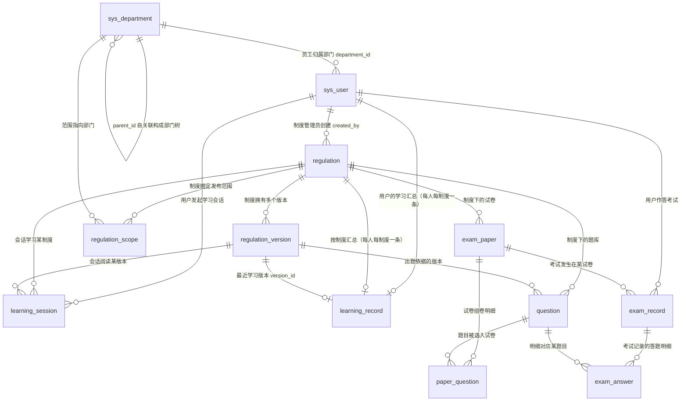

# 03 · 数据库设计

> **一句话定位**：本文档定义 EmodorRuleExam 当前 legacy 基线、A2 培训身份、A3 权限/会话、A4 受控媒体、A5 后台公共配置、B1 课程内容与 B3 版本题库增量表的完整字段、类型、索引、约束与表间关系，并登记 B4 对既有 `import_batch/question/question_version` 的复用，不为导题另造表。
>
> **口径声明**：本文档中 legacy 表名、字段名、枚举值与 [README.md](README.md) 3.2 术语表、3.3 核心实体清单、3.4 统一命名规范保持兼容。A2 已落实培训类别、学员来源与可恢复导入批次，A3 已落实业务权限/会话，A4 已落实受控媒体，A5 通过 `004_system.sql` 新增 `sys_menu`、`sys_dictionary`、`site_setting`；B1 通过 `005_courses.sql` 新增四张课程内容表并为制度增加可空 `category_id`，final 另以独立 `012_course_navigation.sql` 注册课程菜单而不改写已登记 migration checksum；B3 通过 `007_question_bank.sql` 落实四题型、难度、考点与不可变题目版本。上述定义均与 init、entities 和实际 API 同步。旧 `question` 行的未知类别、难度与 current revision 保持 NULL，首次编辑或审核只捕获升级时内容，不伪造历史确认人和时间。A1 的 `schema_migration` 恢复协议见 1.10；本册登记源码事实，不代表已对开发库或生产库执行升级。

> **状态边界（2026-10-21）**：旧制度阅读/固定卷继续兼容原 12 张 legacy 表；A5 已落菜单、显示字典、站点公开配置及其系统 API；B1 已落课程内容但不包含 B2 视频进度；B3 提供题目版本、审核轨迹与候选读取；B4 复用 A2 批次表原子创建 B3 approved 版本，不改变物理表数量。C1 发布/个人题单快照仍待后续实现；已有数据不迁移清空。

---

## 1. 设计规范

本章是当前 legacy 与 A2—A5、B1、B3 增量表的公共设计约定，后文各表字段表格不再重复解释本章内容。后续培训融合新增表沿用相同的 ID、时间、枚举、无外键与事务原则，但字段必须在对应迁移/实体完成后回填。

### 1.1 命名规范

| 规范项 | 约定 |
|---|---|
| 表名 / 字段名 | 一律小写 snake_case（如 `learning_record`、`total_seconds`） |
| 表名 | 12 张 legacy 表不改名或删改；当前 30 张业务表严格使用 README 3.3 节清单中的名称，培训增量表按同步政策追加 |
| 主键 | 统一命名为 `id`，类型 `BIGINT UNSIGNED AUTO_INCREMENT` |
| 外键关联列 | 统一命名为 `<被关联表语义>_id`（如 `user_id`、`regulation_id`、`version_id`、`paper_id`、`question_id`、`exam_record_id`） |
| 时间字段 | 一律 `_at` 后缀（`created_at`、`updated_at`、`started_at`、`deadline_at`、`ended_at`、`submitted_at`、`published_at`、`parsed_at`、`last_login_at`、`valid_at`、`last_learn_at`） |
| 布尔字段 | 一律 `is_` 前缀（`is_all`、`is_valid`、`is_correct`），类型 `TINYINT(1)`，取值 1/0 |
| 计数字段 | 一律 `_count` / `_no` / `_seconds` / `_percent` 后缀表意（`switch_count`、`attempt_no`、`total_seconds`、`max_scroll_percent`） |
| 唯一索引 | `uk_` 前缀（unique key） |
| 普通索引 | `idx_` 前缀（index） |

### 1.2 存储引擎与字符集

**存储引擎：当前基线表与培训增量表统一 InnoDB。**

1. **事务原子性**：交卷是「`exam_record` 终态更新 + `score` 写入 + `exam_answer` 明细批量插入」的多表写操作，必须满足 ACID；学习达标落库同样涉及 `learning_session` 与 `learning_record` 两表联动更新。
2. **行级锁与 MVCC**：心跳聚合落库（写）与统计报表查询（读）并发时互不阻塞，MyISAM 表锁无法满足。
3. **崩溃恢复**：redo log 保证异常宕机后已提交事务不丢失，学习时长与考试成绩属不可丢的业务数据。
4. 统一引擎可避免跨引擎事务的隐性陷阱。

**字符集：`utf8mb4`，排序规则 `utf8mb4_0900_ai_ci`（MySQL 8.0 默认组合）。**

1. `utf8mb4` 是完整的 4 字节 UTF-8 实现，覆盖员工姓名生僻字与备注 emoji；MySQL 历史遗留的 `utf8`（实为 utf8mb3）是残缺字符集，一律禁用。
2. `utf8mb4_0900_ai_ci` 大小写不敏感，符合登录名、制度标题的检索习惯；需要精确区分大小写的场景（如密码哈希比对）在应用层完成，不依赖排序规则。

### 1.3 时间字段：统一 `DATETIME(3)`

全部时间字段统一使用 `DATETIME(3)`（毫秒精度），理由如下：

1. **防作弊仲裁需要毫秒精度**。本系统存在多处"时间边界即业务规则"的场景：
   - 心跳 30 秒/次、服务端单次最大计入 45 秒的容差校验，要求会话起止时刻与心跳到达时刻能区分到亚秒级；
   - 考试限时（`duration_minutes`）的"压秒交卷"判定：交卷时刻与截止时刻的比较若只有秒级精度，同一秒内先后到达的请求无法仲裁；
   - 切屏检测、重复提交检测需要识别"毫秒级连续两次写操作"这类异常模式。
2. **对比 `TIMESTAMP`**：`TIMESTAMP` 存在 2038 上限，且语义随连接时区自动换算，多服务实例时区配置不一致时会产生隐性偏移；`DATETIME` 无时区语义，时区口径完全由应用层统一——本系统是单一时区（Asia/Shanghai）的企业内网系统，约定**应用层统一写入东八区本地时间**，避免任何换算歧义。
3. **对比 `DATETIME(0)`**：秒级精度无法区分同一秒内的多次操作（见第 1 点）；`DATETIME(6)` 微秒精度对本场景过度，徒增存储与比较成本。`(3)` 是精度与成本的平衡点。

统一写入规则：`created_at` / `updated_at` 由数据库默认值与自动更新维护；业务时间（`started_at`、`submitted_at` 等）由服务端时钟统一生成，不信任客户端上报的时间。

### 1.4 主键策略：自增 `BIGINT`

全部表主键为 `BIGINT UNSIGNED AUTO_INCREMENT`，理由：

1. **自增保证聚簇索引顺序追加**：InnoDB 主键即聚簇索引，自增主键永远追加到 B+ 树最右页，无随机写导致的页分裂与空间碎片；UUID（尤其 v4）作为主键会造成随机写、索引膨胀、页分裂，是明确的反模式。
2. **BIGINT 而非 INT 留足余量**：`exam_answer` 为最大表（年增长约 100 万行，见第 6 章），INT 也可支撑，但 BIGINT 为数据迁移、多公司合并、外部批量导入等演进场景留出无争议的余量；关联列（`user_id` 等）统一同型，避免隐式类型转换破坏索引。
3. **不用业务属性做主键**：工号（`employee_no`）可能重编、用户名（`username`）可能变更，业务属性可变字段不可承担主键职责。

### 1.5 软删除策略：`status` 状态位，而非 `deleted_at`

本系统**不引入 `deleted_at` 软删除字段**，实体生命周期统一收敛到已有的 `status` 状态字段（制度的 draft/published/archived、员工的启用/停用等），理由：

1. **业务状态机天然覆盖软删除语义**。本系统的核心实体本就有完整状态生命周期：制度 `archived`（归档）即"退出活动但保留追溯"、员工 `status=0`（停用）即"离职/冻结"，与软删除的业务诉求完全重合；再叠加 `deleted_at` 会形成双状态正交组合（如"已归档且已删除"），语义模糊且无业务场景。
2. **统计口径强依赖 status，双条件易酿成口径事故**。应学人数的分母是"发布范围内**在职**员工"（`sys_user.status = 1`），若每个统计查询还需附带 `deleted_at IS NULL`，任何一处遗漏都会造成统计口径污染——这在报表系统里属于高危错误。
3. **防作弊审计要求明细不可删**。学习会话、考试记录、答题明细是不可变的事实数据（fact data），任何情况下不允许物理或逻辑删除，本设计在表结构上直接不提供删除通道。
4. 物理删除仅保留给明确的低风险场景（清理草稿试卷、已被驳回的废弃题目），由应用层先做引用校验（如题目被 `paper_question` 引用则拒绝删除）后执行。

### 1.6 外键策略：应用层维护，不建数据库外键

**结论：当前及培训增量表均不创建数据库级 FOREIGN KEY 约束，关联完整性由应用层（NestJS 服务层事务）维护。** 理由：

1. **高并发写路径的锁风险**：外键约束在每次写入时须对父行加共享锁校验。心跳聚合落库高频更新 `learning_record`（热点行）、交卷批量写 `exam_answer`，均与 `regulation`、`sys_user` 等父表存在关联，父行锁竞争会显著放大死锁概率。
2. **运维与演进阻碍**：员工 Excel 批量导入、历史数据修复、未来可能的分库分表，在存在物理外键时都极为受限；MySQL 外键也不支持跨库。
3. **替代保障（本设计的具体做法）**：
   - 所有关联列（`department_id`、`regulation_id` 等）**全部建立索引**，查询性能与外键约束场景等价；
   - 写入路径在应用层事务内显式校验父行存在与状态（组卷时校验 `question.status = approved`、发起考试时校验 `learning_record.is_valid = 1`、上传版本时校验 `regulation` 存在）；
   - 可选部署定期一致性稽核任务（孤儿行检测），作为兜底。
4. **规避循环依赖**：`regulation.current_version_id` 指向 `regulation_version`、`regulation_version.regulation_id` 又指回 `regulation`，二者互指在数据库外键模型下是循环依赖，建库顺序与数据修复都很别扭；应用层维护天然规避该问题。

### 1.7 枚举表示策略：`VARCHAR` + 应用层校验

所有枚举字段（`regulation.status`、`question.type`、`exam_record.status`、`sys_user.role` 等）统一使用 `VARCHAR`（长度 16，`role` 为 32）存储枚举字符串，**不使用 MySQL `ENUM` 类型**，理由：

1. `ENUM` 增删枚举值需要 DDL 变更表结构，迭代成本高且有锁表风险；
2. 枚举值在应用层（TypeScript 常量枚举）与文档（README 3.4）中已有唯一定义源，数据库层再复制一份类型定义反而引入不一致风险；
3. 枚举合法性由应用层入参校验保证，非法值在写入前拦截。

全部枚举取值见第 5 章枚举值字典，与 README 3.4 逐字一致。

### 1.8 JSON 字段策略

当前 `database/init.sql` 共 15 个 MySQL 8.0 原生 `JSON` 列：`import_batch` 六个可恢复批次字段；`question` 与 `question_version` 各自的 `options` / `answer`；`exam_answer.selected`、`learning_record.scroll_coverage`、`training_course.regulation_ids`、`site_setting.value_json`；以及迁移元数据 `schema_migration.progress`。

1. 原生 JSON 类型写入时即校验合法性（非法 JSON 直接报错），二进制存储比 TEXT 更紧凑；
2. 用途严格限定为**无结构化检索需求的聚合载荷**：题目判分、阅读覆盖、课程制度信息关联、可恢复导入、站点公开白名单值和迁移进度均由应用层整体校验、反序列化和更新；
3. 因此**不**为 JSON 内部路径建虚拟列 / 函数索引——当前查询模式用不到，属过度设计。题目、作答、阅读与课程的 7 个领域 JSON 结构见第 4 章；其余字段分别见 1.10、3.1.4 与 3.1.8。

### 1.9 培训融合 schema 同步政策

本步骤保留 legacy 业务表及其 DDL/实体不变。培训融合需要的增量事实按以下顺序同步，任一层缺失都只能标记为“计划”，不能写成当前已实现：

```text
版本化 migration（含 A1 registry）
        ↓
database/init.sql 可重建定义
        ↓
server/src/entities/ 实体与索引
        ↓
03 册及受影响设计分册
        ↓
API DTO/controller 与运行验收
```

已批准但由后续任务落地的事实域只在这里做概念登记，不预设字段名或第二套 registry：

| 计划事实域 | 必须保留的业务语义 | owner |
|---|---|---|
| 学员身份 | 培训类别、`institution/external` 来源；来源与权限角色分离；旧用户未知值可为空 | A2/A3 |
| 受控媒体 | 私有媒体资源、实际格式/时长探测、业务引用与头像绑定；未注册 owner type 默认拒绝 | A4 |
| 后台公共配置 | **A5 已落地**菜单注册白名单、固定业务字典只读、站点 Logo/轮播公开白名单与审计查询 | A5 |
| 课程学习 | B1 已落课程、章节、课时版本与视频元数据；B2 再落覆盖区间与课程完成汇总；始终与制度阅读记录分开 | B1/B2 |
| 统一题库 | **B3/B4 已落地** `easy/medium/hard` 难度、`single/multiple/judgment/image` 题型、可选考点组、可选制度/制度版本来源与不可变 revision；合法文件导入创建 `source=import` 的 approved revision，AI 仍必须记录真实来源版本 | B3/B4 |
| 发布与个人快照 | 不可变发布规则/候选版本、个人题单/显示映射、来源/类别/难度/规则快照；旧记录不伪造历史快照 | C1/C2 |
| 作答与阅卷 | 可跨进程恢复的确认草稿、图片附件引用、客观/图片答案、持久批改状态、单题分数/评语、阅卷版本与审计 | C3/C4 |
| 监控与统计 | 服务端确认进度/心跳、按考试/难度/已最终批改个人最高分统计、当前应考集合与历史成功开考交集 | C5/C6 |

A1 的 registry 仍只使用单一 `schema_migration` 元数据表；A2—A5 已分别按同一协议落地 `001_training_identity.sql`、`002_access.sql`、`003_media.sql`、`004_system.sql`，B1 课程主体落在 `005_courses.sql`、课程菜单数据落在独立 `012_course_navigation.sql`，B3 版本题库落在 `007_question_bank.sql`，并同步初始化 DDL/数据、entities、设计与相应 API/controller。后续业务表只有上述各层都具备并验收后才可从“计划”转为当前事实；最终由 C7 做全链一致性审查。

### 1.10 A1 迁移注册表与部分恢复协议（已集成并通过 A1 验收）

A1 只保留一个 `schema_migration` 元数据表，不新增第二张恢复表。当前源码的物理 schema 口径是**12 张 legacy 业务表 + A2 两张培训身份/导入表 + A3 五张权限/会话表 + A4 两张媒体表 + A5 三张后台公共配置表 + B1 四张课程内容表 + B3 两张题库表 + 1 张元数据表**，即 30 张业务表、31 张物理表。`database/init.sql`、`001_training_identity.sql`—`005_courses.sql`、`007_question_bank.sql`、`012_course_navigation.sql`、entities 与已实现 API 的列类型、默认值、索引、约束和课程菜单数据保持一致；012 只新增菜单数据、不增加表。生产执行仍需单独授权和维护窗口。其余业务表只有实际迁移落地后才计入。

**注册表协议要求**：在既有迁移身份、checksum、状态、时间、重试次数和错误信息等元数据语义上，增加可空列 **`progress JSON NULL`**。`progress` 只保存已经验证完成的稳定 step ID 列表，不保存“正在执行”的假进度；文件 checksum 保持不可变，已保存的 step ID 必须仍存在且与当前 step 定义一致。此前 `ed0b379` 的候选 DDL 仅作输入，不代表本协议已完成源码核对。

**迁移文件格式**：每个 SQL step 必须显式标注稳定 ID 和单条完成探针，格式约束如下；尖括号是格式占位，不是待实现字段名：

```sql
-- @step <stable-step-id>
-- @check <single SELECT ... AS complete>
<one SQL statement>;
```

- 每个 step 只能有一条 SQL；禁止存储过程、任意 shell 命令、动态 SQL、切换数据库和静默重放整文件。当前/后续安全 step 仅允许 CREATE TABLE / ALTER TABLE / CREATE INDEX 及明确幂等的 INSERT / UPDATE 回填。
- `@check` 必须是只读单条 `SELECT`，返回恰好一个 `complete` 标志且值为 0/1。schema step 用 `INFORMATION_SCHEMA` 且以 `DATABASE()` 为目标；回填 step 使用经过评审的数据不变量。缺探针、格式错误、多语句或不兼容对象检查必须在任何写入前拒绝。
- 执行顺序固定为“metadata 先检查 → 必要时执行 step → 再验证 `@check` → 持久化 `progress`”。探针已为 1 的 step 只登记/跳过；只有执行后探针仍为 1 才能写入完成 ID，不能把部分执行的 migration 标为 applied。

**`--check` / `--apply` 与恢复边界**：

1. 两种模式都必须显式设置 `DB_DATABASE`，验证目标为安全的非系统库，并用 `SELECT DATABASE()` 确认实际连接库等于请求库；仓库 migration SQL 不得自行 `USE` 或切换数据库。两种模式都执行格式/checksum 检查与业务前置检查：若存在 `exam_record.status = 'in_progress'`，立即阻断；不要把 migration 的 `applying` 状态误当作在考业务记录。
2. `--check` 只读：不 bootstrap registry、不创建/修改表、不写 `schema_migration`，只报告 step/metadata/前置检查结果。`--apply` 在 registry bootstrap 或任何写入前取得同库 MySQL named lock（锁名需 hash 且落在 MySQL 长度限制内）；同一连接持有锁执行全部 step，锁内重新读取前置检查与计划，最后在 `finally` 释放。未取得锁应快速拒绝。
3. apply 的 metadata bootstrap 是 000 step 的受控特例：先做前置检查，再通过已知 000 step 创建 registry，随后按普通 step 记录完成。执行 step 前先查 metadata/probe，执行后再 probe，最后才保存 `progress`；进程在 DDL 成功但 progress 未保存的 crash window 中重试时，必须靠 probe 对账而不是重复执行非幂等 SQL。`applying` / `failed` 记录只有在独占 named lock 和前置检查通过后才可续跑，不能永久阻塞，也不能整文件重放。
4. 正式生产升级要求维护窗口并停止业务服务；named lock 只互斥迁移进程，不声称阻止业务服务并发新开考。升级工具不发明 runtime-wide exam-start lock，业务停服是运维前置条件。
5. 测试重建与迁移契约只允许 `ruleexam_test_*` 隔离库；不得把测试重建或 e2e 指向开发库 `ruleexam`。本期没有旧系统业务数据迁移：原 12 张 legacy 业务表及其旧记录保留，不清空、不伪造发布/个人快照、不把旧记录改写成新培训历史；A2—A5、B1、B3 新表和新链路只对升级后新增事实生效。B3 不批量回填题目版本，只有首次明确编辑/审核才捕获升级时内容。

---

## 2. ER 总览

### 2.1 legacy 基线 ER 图（12 张表）



### 2.2 关系清单

| # | 关系 | 基数 | 维护方与说明 |
|---|---|---|---|
| 1 | sys_department → sys_department（parent_id） | 1 : N | 部门树自关联，根部门 `parent_id IS NULL` |
| 2 | sys_department → sys_user（department_id） | 1 : N | 员工归属部门；应用层维护 |
| 3 | sys_user → regulation（created_by） | 1 : N | 制度管理员创建制度 |
| 4 | regulation → regulation_version（regulation_id） | 1 : N | 一制度多版本；`regulation.current_version_id` 反向指向当前生效版本（应用层维护，规避循环依赖） |
| 5 | regulation → regulation_scope（regulation_id） | 1 : N | 发布范围，按部门圈定或 `is_all` 全员 |
| 6 | sys_department → regulation_scope（department_id） | 1 : N | 范围行指向被圈定部门 |
| 7 | sys_user → learning_session（user_id） | 1 : N | 用户的学习会话序列 |
| 8 | regulation → learning_session（regulation_id） | 1 : N | 会话的学习对象 |
| 9 | regulation_version → learning_session（version_id） | 1 : N | 会话阅读的具体版本（版本切换后新会话指向新版本） |
| 10 | sys_user → learning_record（user_id） | 1 : 1 | 由 `uk_user_regulation` 唯一约束保证：每人每制度一条汇总记录（(user_id, regulation_id) 联合唯一） |
| 11 | regulation → learning_record（regulation_id） | 1 : 1 | 同上，由 `uk_user_regulation` 保证：每制度每人一条汇总记录，制度维度学习汇总按此展开 |
| 12 | regulation → question（regulation_id） | 1 : N | 制度下的题库 |
| 13 | regulation_version → question（version_id） | 1 : N | 出题所依据的版本（版本可追溯） |
| 14 | regulation → exam_paper（regulation_id） | 1 : N | 制度下的试卷 |
| 15 | exam_paper → paper_question（paper_id） | 1 : N | 试卷组卷明细 |
| 16 | question → paper_question（question_id） | 1 : N | 题目被选入试卷（引用校验用） |
| 17 | sys_user → exam_record（user_id） | 1 : N | 用户的考试记录（含补考多次） |
| 18 | exam_paper → exam_record（paper_id） | 1 : N | 试卷下的作答记录 |
| 19 | exam_record → exam_answer（exam_record_id） | 1 : N | 一次作答的逐题明细 |
| 20 | question → exam_answer（question_id） | 1 : N | 明细对应的题目（正确率统计用） |
| 21 | training_category → regulation（category_id） | 1 : N | 可选培训类别；与 legacy `category` 字符串并存，应用层维护 |
| 22 | training_category → training_course（category_id） | 1 : N | 课程必须属于一个培训类别；新建/变更引用时事务锁定并校验启用状态 |
| 23 | training_course → course_chapter（course_id） | 1 : N | 课程章节独立排序 |
| 24 | training_course → course_lesson（course_id） | 1 : N | 课程课时独立排序并校验章节归属 |
| 25 | course_chapter → course_lesson（chapter_id） | 1 : N | 一个课时只属于当前课程下的一个章节 |
| 26 | course_lesson → lesson_version（lesson_id） | 1 : N | 视频内容版本只追加，不原地改写 |
| 27 | course_lesson → lesson_version（current_version_id） | 1 : 0..1 | 指向当前播放版本；历史版本仍保留 |
| 28 | media_asset → training_course（cover_asset_id） | 1 : N | `course_cover` 资源由 `media_reference` 保护 |
| 29 | media_asset → lesson_version（asset_id） | 1 : N | `video` 资源及服务端时长快照；每个版本建立媒体引用 |
| 30 | training_category → question / question_version（category_id） | 1 : N | B3 新题必选启用类别；旧题/旧捕获未知可空 |
| 31 | question → question_version（question_id） | 1 : N | 一题目身份拥有递增不可变 revision；current_version_id 反向指当前版本 |
| 32 | question_concept → question / question_version（concept_id） | 1 : N | 可选考点；应用层保证与类别、题型一致 |
| 33 | media_asset → question_version（media_reference） | N : N | 受控富文本图片绑定版本；删除前引用保护，读取经 owner policy 鉴权 |

> 说明：`regulation.current_version_id`、`regulation_version.regulation_id`、`learning_record.version_id`（最近学习版本）等指向关系均由应用层维护，不在数据库层建外键（见 1.6 节）。

---

## 3. 分域详细表结构

每个域按「域职责 → 逐表（字段表格 + 索引设计 + 设计说明）」组织。字段表格中"默认值"列的 `CURRENT_TIMESTAMP(3)` 表示数据库默认；`—` 表示无默认值（写入必填）。

### 3.1 组织、权限与公共配置域（14 张）

域职责：部门树与员工账号承载组织身份；业务角色/权限与会话承载管理边界；受控媒体、后台菜单、显示字典与站点品牌配置承载 PC 公共能力。学习/考试主体、发布范围与统计维度仍以组织身份表为准。

#### 3.1.1 sys_department（部门）

**字段定义**

| 字段名 | 类型 | 允许空 | 默认值 | 说明 |
|---|---|---|---|---|
| id | BIGINT UNSIGNED | NO | 自增 | 主键 |
| parent_id | BIGINT UNSIGNED | YES | NULL | 上级部门 id，自关联；根部门为 NULL |
| name | VARCHAR(64) | NO | — | 部门名称 |
| sort | INT | NO | 0 | 同级部门展示排序，升序 |
| status | TINYINT | NO | 1 | 部门状态：1=启用，0=停用（取值定义见 5.2 节） |
| created_at | DATETIME(3) | NO | CURRENT_TIMESTAMP(3) | 创建时间 |
| updated_at | DATETIME(3) | NO | CURRENT_TIMESTAMP(3) | 更新时间，随行更新自动刷新（ON UPDATE CURRENT_TIMESTAMP(3)，下同） |

**索引设计**

| 索引名 | 类型 | 字段 | 用途 |
|---|---|---|---|
| PRIMARY | 主键 | id | — |
| idx_parent | 普通 | parent_id | 部门树逐层展开（按 parent_id 取直接子部门） |
| uk_parent_name | 唯一 | (parent_id, name) | 同一父部门下部门名唯一，防重复建部；根部门（parent_id 为 NULL）不受该索引约束，"全局唯一根"由应用层保证 |

**设计说明**

1. **部门树用邻接表（parent_id 自关联）而非嵌套集/闭包表**：组织树深度有限（典型 3~5 层），读取频率低且可整树缓存（Redis），邻接表实现与维护成本最低；发布范围与部门维度统计需要"部门 → 含全部子部门的员工集合"，由应用层内存递归展开（树规模为百级节点，无性能问题）。
2. **status 而非删除**：部门停用后仍被 `sys_user.department_id`、`regulation_scope.department_id` 引用，是历史学习/考试数据的统计维度，必须保留（见 1.5 节软删除策略）。
3. **支撑业务规则**：发布范围按部门圈定（regulation_scope → 部门树展开子部门 → 员工）；部门维度统计（某部门学习完成率 / 通过率）。

#### 3.1.2 sys_user（员工账号）

**字段定义**

| 字段名 | 类型 | 允许空 | 默认值 | 说明 |
|---|---|---|---|---|
| id | BIGINT UNSIGNED | NO | 自增 | 主键 |
| username | VARCHAR(64) | NO | — | 登录用户名，全局唯一 |
| password_hash | VARCHAR(255) | NO | — | 密码哈希（bcrypt，60 字符；预留 255 兼容 argon2 等算法迁移） |
| real_name | VARCHAR(64) | NO | — | 真实姓名（展示与统计口径） |
| employee_no | VARCHAR(32) | YES | NULL | 工号；允许 NULL（超级管理员可无工号），MySQL 唯一索引允许多个 NULL |
| department_id | BIGINT UNSIGNED | YES | NULL | 归属部门（sys_department.id）；超级管理员可不归属业务部门 |
| category_id | BIGINT UNSIGNED | YES | NULL | 培训类别（training_category.id）；旧用户未补齐时保持 NULL |
| source | VARCHAR(16) | YES | NULL | 学员来源：`institution` / `external`；来源不等于权限，旧用户未确认时保持 NULL |
| role | VARCHAR(32) | NO | employee | 角色：super_admin / regulation_admin / employee（README 3.4 角色枚举） |
| phone | VARCHAR(20) | YES | NULL | 手机号 |
| email | VARCHAR(128) | YES | NULL | 邮箱 |
| avatar_id | BIGINT UNSIGNED | YES | NULL | 受控头像媒体资源（media_asset.id）；只经本人资料或 managed-student 事务绑定 |
| status | TINYINT | NO | 1 | 账号状态：1=启用，0=停用（取值定义见 5.2 节） |
| auth_version | INT UNSIGNED | NO | 0 | 认证世代；密码、身份或管理权限变更递增 |
| force_password_change | TINYINT | NO | 0 | 当前口令是否必须修改；与登录统计分离 |
| login_count | INT UNSIGNED | NO | 0 | 真实密码成功登录次数；refresh 不计入 |
| last_login_at | DATETIME(3) | YES | NULL | 最后一次真实密码登录时间 |
| last_login_ip | VARCHAR(64) | YES | NULL | 最后一次真实密码登录来源 IP |
| roles_configured | TINYINT | NO | 0 | 是否显式配置过业务角色（含清空） |
| created_at | DATETIME(3) | NO | CURRENT_TIMESTAMP(3) | 创建时间 |
| updated_at | DATETIME(3) | NO | CURRENT_TIMESTAMP(3) | 更新时间 |

**索引设计**

| 索引名 | 类型 | 字段 | 用途 |
|---|---|---|---|
| PRIMARY | 主键 | id | — |
| uk_username | 唯一 | username | 登录唯一性校验（登录查询走此索引） |
| uk_employee_no | 唯一 | employee_no | 工号唯一（Excel 批量导入去重校验） |
| idx_department_status | 普通 | (department_id, status) | 应学人数统计：按部门取在职（status=1）员工；部门员工列表 |
| idx_training_identity | 普通 | (category_id, source) | 培训学员按类别与来源筛选；不承担权限校验 |

**设计说明**

1. **系统身份与业务角色分离**：`role` 保留三类系统身份边界；业务角色由 `sys_user_role` 多选维护。既有制度管理员在未显式配置前沿用 legacy 矩阵，显式配置（包括清空）后只按业务角色计算。
2. **password_hash 只存哈希不存明文**：登录校验与修改密码均在应用层完成，任何查询不得 SELECT 该列（接口返回用户信息时排除）。
3. **idx_department_status 直接服务统计口径**：应学人数 = 发布范围部门（含子部门，应用层展开）中 `status=1` 的员工数，该联合索引使分母查询免全表扫描。
4. **employee_no 允许 NULL 的唯一索引**：利用 MySQL 唯一索引对 NULL 不去重的特性，兼容超级管理员等无工号账号，同时保证有工号员工的全局唯一。
5. **支撑业务规则**：登录认证（username/password_hash/auth_version/force_password_change/login_count/last_login_at/last_login_ip）、RBAC（role + sys_user_role）、学习与考试主体（learning_*/exam_* 的 user_id）、应学人数分母（department_id + status）；培训考试在开考时读取并冻结 category_id/source，不能用用户后续变更覆盖历史。

#### 3.1.2.1 media_asset / media_reference（受控媒体，A4）

`media_asset` 保存服务端生成的私有存储键与实际探测结果，`media_reference` 保存业务归属引用；两表不建数据库外键，删除前由应用层在事务内锁定并检查引用数。视频只允许 MP4/H.264（有音轨时只能 AAC），图片由受限 ffmpeg 实际解码且只允许 JPEG/PNG/WebP（默认 2500 万像素）。内部媒体服务保留 `answer` 用途供 C3 专用路由包装，通用上传路由不得接收 `answer`。

**media_asset 完整字段定义**

| 字段名 | 类型 | 允许空 | 默认值 | 说明 |
|---|---|---|---|---|
| id | BIGINT UNSIGNED | NO | 自增 | 主键 |
| owner_id | BIGINT UNSIGNED | NO | — | 业务拥有者，由服务端从身份或管理目标确定 |
| uploaded_by | BIGINT UNSIGNED | NO | — | 实际上传操作者 |
| purpose | VARCHAR(32) | NO | — | `avatar / course_cover / video / question / answer / branding`；`answer` 仅供内部受控调用 |
| media_kind | VARCHAR(16) | NO | — | `image / video` |
| original_name | VARCHAR(255) | YES | NULL | 仅作展示元数据，不参与路径拼接 |
| mime_type | VARCHAR(128) | NO | — | 服务端探测确认的媒体类型 |
| storage_key | VARCHAR(512) | NO | — | 服务端生成的私有相对路径 |
| size_bytes | BIGINT UNSIGNED | NO | — | 文件字节数 |
| sha256 | CHAR(64) | NO | — | 文件 SHA-256 |
| status | VARCHAR(16) | NO | processing | 持久状态为 `processing / ready / failed / deleting`；`deleting` 是物理删除失败后的内部重试墓碑，不属于公开状态 |
| duration_ms | BIGINT UNSIGNED | YES | NULL | 视频实际探测时长；图片为 NULL |
| probe_error | VARCHAR(512) | YES | NULL | 脱敏失败摘要，不含真实本地路径 |
| created_at | DATETIME(3) | NO | CURRENT_TIMESTAMP(3) | 创建时间 |
| updated_at | DATETIME(3) | NO | CURRENT_TIMESTAMP(3) | 更新时间；`ON UPDATE CURRENT_TIMESTAMP(3)` |

**media_asset 索引定义**

| 索引名 | 类型 | 字段 |
|---|---|---|
| PRIMARY | 主键 | id |
| uk_media_asset_storage_key | 唯一 | storage_key |
| idx_media_asset_owner_purpose | 普通 | (owner_id, purpose) |
| idx_media_asset_status | 普通 | status |

**media_reference 完整字段定义**

| 字段名 | 类型 | 允许空 | 默认值 | 说明 |
|---|---|---|---|---|
| id | BIGINT UNSIGNED | NO | 自增 | 主键 |
| asset_id | BIGINT UNSIGNED | NO | — | `media_asset.id`；引用完整性由应用层维护 |
| owner_type | VARCHAR(64) | NO | — | 必须注册授权策略的业务归属类型 |
| owner_id | BIGINT UNSIGNED | NO | — | 业务归属实体 ID |
| created_at | DATETIME(3) | NO | CURRENT_TIMESTAMP(3) | 创建时间 |

**media_reference 索引定义**

| 索引名 | 类型 | 字段 |
|---|---|---|
| PRIMARY | 主键 | id |
| uk_media_reference_owner | 唯一 | (asset_id, owner_type, owner_id) |
| idx_media_reference_asset | 普通 | asset_id |
| idx_media_reference_owner | 普通 | (owner_type, owner_id) |

两表均固定使用 `ENGINE=InnoDB DEFAULT CHARSET=utf8mb4 COLLATE=utf8mb4_0900_ai_ci`；表注释分别为“受控媒体资源”和“媒体业务引用”。上述索引均对表中列做全列索引，不使用前缀索引（`INFORMATION_SCHEMA.STATISTICS.SUB_PART IS NULL`）。以上列数、字段形状、时间精度、引擎/排序规则及索引列序由 `003_media.sql` 的只读探针逐项核对；同名、同列序但只索引字段前缀的旧索引也属于漂移，不得误记完成。

删除流程先在资源行锁下确认无引用，再把 `status` 置为内部 `deleting`，然后删除物理文件；物理删除失败保留该行供后续重试，只有删除成功或文件已不存在才删除数据库行。bind 只接受 `ready`，因此新引用不能与 `deleting` 竞态。常规 metadata/content 将 `deleting` 与不存在同样处理，不能向调用方暴露内部墓碑状态；A5 匿名品牌内容还需叠加当前站点白名单和 `site_config` 引用校验。A4 默认视频 512 MiB、图片 10 MiB；大视频由 Multer 直接落私有临时磁盘，不进入全内存 buffer。

#### 3.1.3 training_category（培训类别）

**字段定义**

| 字段名 | 类型 | 允许空 | 默认值 | 说明 |
|---|---|---|---|---|
| id | BIGINT UNSIGNED | NO | 自增 | 主键 |
| name | VARCHAR(128) | NO | — | 类别名称，全局唯一 |
| description | TEXT | YES | NULL | 类别说明 |
| status | TINYINT | NO | 1 | 1=启用，0=停用；历史引用保留 |
| created_by | BIGINT UNSIGNED | NO | — | 创建人（sys_user.id） |
| created_at / updated_at | DATETIME(3) | NO | CURRENT_TIMESTAMP(3) | 创建与更新时间 |

**索引设计**：`PRIMARY(id)`、`uk_training_category_name(name)`、`idx_training_category_status(status)`。

类别停用不删除历史资料；删除前由应用层在锁定类别行的同一事务中检查 `sys_user.category_id`、`training_course.category_id`、`regulation.category_id`、`question.category_id`、`question_concept.category_id` 与 `question_version.category_id` 引用，任一存在即返回 40910，不能硬删除。所有新增类别引用仍复用 `CategoryService.lockActive` 校验启用状态。

#### 3.1.4 import_batch（可恢复导入批次）

| 字段名 | 类型 | 允许空 | 默认值 | 说明 |
|---|---|---|---|---|
| id | BIGINT UNSIGNED | NO | 自增 | 主键 |
| owner_id | BIGINT UNSIGNED | NO | — | 发起管理员（sys_user.id） |
| kind | VARCHAR(32) | NO | — | `students` / `questions`，由业务适配器负责行解析 |
| input_hash | CHAR(64) | NO | — | 脱敏输入指纹，不含明文口令 |
| status | VARCHAR(16) | NO | previewed | `previewed / committing / committed / failed` |
| normalized_rows | JSON | YES | NULL | 规范化行；学员导入只保存 `password_hash`；题库导入保存已清洗 draft 与重复指纹，不保存原文件 |
| valid_rows / errors / duplicates / committed_rows / created_ids | JSON | YES | NULL | 预检结果与首次确认集合；响应不回显口令或哈希 |
| created_at / updated_at | DATETIME(3) | NO | CURRENT_TIMESTAMP(3) | 创建与更新时间 |

**索引设计**：`PRIMARY(id)`、`idx_import_batch_owner_kind(owner_id, kind)`、`idx_import_batch_status(status)`。批次提交按 owner+id 校验，首次确认固定合法行集合；同集合重试返回原结果，换集合返回 409。

#### 3.1.5 sys_role / sys_permission（角色与权限目录）

`sys_role` 保存系统角色及机构自定义业务角色；`sys_permission` 保存服务端注册的 `<resource>:<action>` 白名单。角色代码、权限代码分别唯一，系统角色 `is_system=1` 不可在管理端删除或停用。

| 表 | 字段 | 类型 | 约束 |
|---|---|---|---|
| sys_role | id / code / name / is_system / status / created_at / updated_at | BIGINT / VARCHAR(64) / VARCHAR(128) / TINYINT / TINYINT / DATETIME(3) | `uk_sys_role_code`、`idx_sys_role_status` |
| sys_permission | id / code / name / created_at | BIGINT / VARCHAR(128) / VARCHAR(128) / DATETIME(3) | `uk_sys_permission_code` |

默认系统角色仍由 `role` 字段保持兼容；没有显式 `sys_user_role` 关系的既有制度管理员沿用 legacy 权限矩阵，写入显式业务角色后只按关系表计算权限。权限代码不接受数据库中未注册的任意字符串。

#### 3.1.6 sys_role_permission / sys_user_role（权限关系）

两张关系表均不建数据库外键，由应用层校验父对象；复合唯一键防重复授权。

| 表 | 字段 | 索引 |
|---|---|---|
| sys_role_permission | id / role_id / permission_id / created_at | `uk_sys_role_permission(role_id, permission_id)`、`idx_sys_role_permission_permission` |
| sys_user_role | id / user_id / role_id / created_at | `uk_sys_user_role(user_id, role_id)`、`idx_sys_user_role_role` |

#### 3.1.7 auth_session（可吊销认证会话）

| 字段 | 类型 | 允许空 | 说明 |
|---|---|---|---|
| id | BIGINT UNSIGNED | NO | 主键 |
| sid | VARCHAR(64) | NO | JWT access/refresh 共用的会话标识，`uk_auth_session_sid` 唯一 |
| user_id | BIGINT UNSIGNED | NO | 会话用户；应用层校验账号状态 |
| user_agent / ip_address | VARCHAR(255) / VARCHAR(64) | YES | 登录设备与来源审计 |
| last_seen_at | DATETIME(3) | NO | 最近一次刷新或活跃时间 |
| expires_at | DATETIME(3) | NO | 当前 refresh 会话到期时间；刷新后顺延完整 TTL |
| revoked_at | DATETIME(3) | YES | 强制下线/登出时间；NULL 表示有效 |
| created_at / updated_at | DATETIME(3) | NO | 数据库默认与自动更新时间 |

JWT 若含 `sid`，守卫同时检查 Redis 会话吊销键；历史无 `sid` 令牌继续按旧 jti/用户封禁规则兼容。`auth_session` 只保存会话元数据，不保存 access/refresh 明文。

#### 3.1.8 sys_menu / sys_dictionary / site_setting（后台公共配置，A5）

`sys_menu` 只保存后台已注册页面与权限的展示树，不保存组件代码、脚本或任意 URL。父链循环、按钮作父节点、未注册路由/权限均由应用层拒绝；存在子节点或对应权限仍被角色引用时不得删除。所有菜单新增、修改、删除事务先对实存且不可由业务删除的 `site_setting(setting_key='logo_asset_id')` 行取排他锁，再在同一事务重读目标节点、父链、子项和角色引用；站点配置更新也先锁 Logo、再锁 banners，保持统一锁顺序。该稳定行缺失时菜单结构写入安全失败（50004/HTTP 503），不得自动补行或以空范围 gap lock 代替。

| `sys_menu` 字段 | 类型 / 默认 | 说明 |
|---|---|---|
| id | BIGINT UNSIGNED AUTO_INCREMENT | 主键 |
| parent_id | BIGINT UNSIGNED NULL | 父节点；应用层维护树完整性 |
| name | VARCHAR(128) | 显示名称 |
| type | VARCHAR(16) | `directory / menu / button` |
| route_path | VARCHAR(255) NULL | `menu` 只能使用前端注册路由；`button` 必须为 NULL |
| permission_code | VARCHAR(128) NULL | 只能使用服务端权限白名单；`directory` 必须为 NULL |
| icon | VARCHAR(64) NULL | 白名单格式的图标名 |
| sort / status | INT DEFAULT 0 / TINYINT DEFAULT 1 | 同级排序与启停 |
| created_at / updated_at | DATETIME(3) | 创建与自动更新时间 |

索引：`PRIMARY(id)`、`idx_sys_menu_parent_sort(parent_id, sort)`、`idx_sys_menu_permission(permission_code)`。

`sys_dictionary` 是显示字典，不是业务枚举的可编程定义源。`learner_source`、`difficulty`、`question_type`、`regulation_status`、`paper_status`、`question_status`、`exam_status` 七类固定字典以 `is_system=1` 初始化并在 API 中只读，不得借字典修改来源映射、题型或状态机。

| `sys_dictionary` 字段 | 类型 / 默认 | 说明 |
|---|---|---|
| id | BIGINT UNSIGNED AUTO_INCREMENT | 主键 |
| type / code | VARCHAR(64) | 类型与编码，联合唯一 |
| label | VARCHAR(128) | 显示名称 |
| sort / status / is_system | INT DEFAULT 0 / TINYINT DEFAULT 1 / TINYINT DEFAULT 0 | 排序、启停、固定枚举只读标记 |
| remark | VARCHAR(255) NULL | 备注 |
| created_at / updated_at | DATETIME(3) | 创建与自动更新时间 |

索引：`PRIMARY(id)`、`uk_sys_dictionary_type_code(type, code)`、`idx_sys_dictionary_type_sort(type, sort)`。

`site_setting` 只保存公开展示白名单。`id=1/setting_key=logo_asset_id` 与 `id=2/setting_key=banners` 是稳定初始化映射；固定 ID 供 `media_reference(owner_type='site_config', owner_id=site_setting.id)` 绑定使用，其中 `logo_asset_id` 实存行同时作为本机构菜单结构写入的稳定事务互斥点（只锁不改值，无新增技术表或字段）。Logo 的 `value_json` 是字符串 ID 或 SQL NULL；轮播的 `value_json` 是最多 3 项的 `[{"asset_id":"...","sort":0}]`。只有 `ready + branding + image` 媒体可绑定，更新配置、新引用绑定和旧引用解绑位于同一事务。

| `site_setting` 字段 | 类型 / 默认 | 说明 |
|---|---|---|
| id | BIGINT UNSIGNED AUTO_INCREMENT | 主键；白名单项使用稳定 ID |
| setting_key | VARCHAR(64) | 唯一配置键 |
| value_json | JSON NULL | 白名单值 |
| updated_by | BIGINT UNSIGNED NULL | 最后更新人 `sys_user.id`，由应用层维护 |
| created_at / updated_at | DATETIME(3) | 创建与自动更新时间 |

索引：`PRIMARY(id)`、`uk_site_setting_key(setting_key)`。三表均使用 InnoDB / `utf8mb4_0900_ai_ci`，不建数据库外键；`004_system.sql` 用只读探针核对字段、默认值、索引、固定字典和稳定站点配置 ID。

### 3.2 制度域（3 张）

域职责：制度主档、不可变版本与发布范围——"上传即可读、版本可追溯、范围可圈定"的数据基础，同时为有效学习判定提供参数（required_minutes、scroll_segments）。

#### 3.2.1 regulation（制度主档）

**字段定义**

| 字段名 | 类型 | 允许空 | 默认值 | 说明 |
|---|---|---|---|---|
| id | BIGINT UNSIGNED | NO | 自增 | 主键 |
| title | VARCHAR(128) | NO | — | 制度标题 |
| category | VARCHAR(32) | NO | — | 制度分类（如"安全类""人事类"，业务字典值） |
| category_id | BIGINT UNSIGNED | YES | NULL | 可选培训类别（training_category.id）；不替代 legacy `category`，不构成学习或考试门槛 |
| description | VARCHAR(512) | YES | NULL | 制度描述/摘要 |
| status | VARCHAR(16) | NO | draft | 制度状态：draft / published / archived |
| current_version_id | BIGINT UNSIGNED | YES | NULL | 当前生效版本（regulation_version.id）；draft 阶段可为 NULL，发布时必填 |
| required_minutes | INT | NO | 10 | 规定有效学习时长阈值（分钟）；有效学习判定条件①的分母 |
| scroll_segments | INT | NO | 10 | 滚动分段数：本期固定为 10（配置项前向保留）；若未来放开配置，须按归一化重映射迁移既有位图（见 4.4 节，本期不实现） |
| created_by | BIGINT UNSIGNED | NO | — | 创建人（sys_user.id，制度管理员） |
| published_at | DATETIME(3) | YES | NULL | 发布时间；首次置为 published 时写入 |
| created_at | DATETIME(3) | NO | CURRENT_TIMESTAMP(3) | 创建时间 |
| updated_at | DATETIME(3) | NO | CURRENT_TIMESTAMP(3) | 更新时间 |

**索引设计**

| 索引名 | 类型 | 字段 | 用途 |
|---|---|---|---|
| PRIMARY | 主键 | id | — |
| idx_status_category | 普通 | (status, category) | 管理端按状态/分类筛选制度列表 |
| idx_regulation_category_id | 普通 | category_id | 培训类别引用保护与可选筛选 |
| idx_created_by | 普通 | created_by | 制度管理员查"我创建的制度" |

**索引设计说明**：员工端"我的应学制度清单"按 `regulation_scope` 反查（见 3.2.3），不在本表建范围索引。

**设计说明**

1. **current_version_id 放在制度主档而非版本表上标记**：版本是不可变追加流，"当前生效版本"是制度主档上唯一的指针（README 术语「制度」），切换生效版本只更新指针、不动版本数据，历史学习记录（learning_session.version_id）仍指向学习当时的版本，实现版本可追溯。
2. **required_minutes / scroll_segments 是有效学习判定的参数来源**（README 术语「有效学习」）：判定公式 `learning_record.total_seconds >= required_minutes * 60 AND scroll_coverage 底部段已覆盖` 的阈值在本表按制度配置。
3. **状态机**：draft → published（发布，写 published_at，发布时校验 current_version_id 已解析成功）→ archived（归档，退出学习与考试入口，历史统计保留）。
4. **支撑业务规则**：版本管理、有效学习阈值、发布范围的对象主体、制度维度统计（学习完成率 / 通过率等均以 regulation_id 聚合）。
5. **双分类兼容**：`category` 保持原字符串含义和所有旧列表/阅读响应；`category_id` 是可空培训类别引用。创建或改为新的非空 ID 时事务内 `lockActive`，PUT 省略或保持原 ID 不因类别后来停用而阻断其他元数据编辑，显式 `null` 可清空。

#### 3.2.2 regulation_version（制度版本）

**字段定义**

| 字段名 | 类型 | 允许空 | 默认值 | 说明 |
|---|---|---|---|---|
| id | BIGINT UNSIGNED | NO | 自增 | 主键 |
| regulation_id | BIGINT UNSIGNED | NO | — | 所属制度（regulation.id） |
| version_no | INT | NO | — | 版本号，同一制度内从 1 递增 |
| file_path | VARCHAR(255) | NO | — | 上传文件的存储路径（本地卷 / 对象存储均以 URL 路径表达，天然支持存储演进） |
| file_type | VARCHAR(8) | NO | — | 文件类型：pdf / docx |
| file_hash | CHAR(64) | NO | — | 文件内容 SHA-256（十六进制 64 字符），完整性校验与重复上传检测 |
| content_html | MEDIUMTEXT | YES | NULL | 解析产物：在线阅读用 HTML（pdf-parse / mammoth 产物） |
| text_content | MEDIUMTEXT | YES | NULL | 解析产物：纯文本，AI 出题的输入 |
| parse_status | VARCHAR(16) | NO | pending | 解析状态：pending / parsed / failed |
| parsed_at | DATETIME(3) | YES | NULL | 解析完成时刻（parse_status 置为 parsed / failed 时写入）；NFR-04 解析耗时度量口径：parsed_at − created_at |
| retry_count | INT | NO | 0 | 解析重试计数：retry 接口每次重试 +1；retry_count ≥ 3 触发告警（配合 07 册监控，防失败版本被无限重试） |
| created_by | BIGINT UNSIGNED | NO | — | 上传人（sys_user.id） |
| created_at | DATETIME(3) | NO | CURRENT_TIMESTAMP(3) | 上传时间 |
| updated_at | DATETIME(3) | NO | CURRENT_TIMESTAMP(3) | 更新时间：解析产物本身是 UPDATE 写入（append-only 指业务文件不重复上传），解析 / 重试流转时刷新 |

**索引设计**

| 索引名 | 类型 | 字段 | 用途 |
|---|---|---|---|
| PRIMARY | 主键 | id | — |
| uk_regulation_version_no | 唯一 | (regulation_id, version_no) | 同一制度内版本号唯一，version_no 由应用层按 max+1 分配，唯一索引兜底并发上传 |
| idx_parse_status | 普通 | parse_status | 解析任务扫描 pending 队列、failed 重试 |
| idx_file_hash | 普通 | file_hash | 重复上传检测（同哈希文件提示已存在） |

**设计说明**

1. **业务文件不可变（append-only），解析产物为 UPDATE 补齐，故设 updated_at**：同一制度内业务文件不重复上传（file_hash 去重），一旦创建 file_* 只读；解析是"上传后异步补齐 content_html / text_content 并置 parse_status"的写入，失败后可经 retry 接口重新入队再写。不可变设计是"版本可追溯"的根基——若版本内容可改，learning_record 指向的历史学习将失去审计意义；解析产物存在 UPDATE 路径，updated_at 记录最近一次解析 / 重试流转时刻，使产物二次改写与多次重试在数据上可追溯。
2. **file_hash 双用途**：① 防篡改审计（下载比对）；② 重复上传检测（同制度上传相同文件可直接复用或提示）。
3. **parse_status 状态机**：pending（上传入队）→ parsed（解析成功，可发布/出题）/ failed（解析失败，可经 retry 接口重新入队，retry_count +1）；制度发布前置校验 current_version_id 对应版本为 parsed。
4. **解析任务抢占与兜底扫描（防并发双解析同一版本）**：worker 启动解析前先执行 Redis `SET parse:lock:{version_id} NX EX 600`（10 分钟锁），抢锁失败即放弃本次任务；兜底扫描条件为 `parse_status = 'pending' AND created_at < NOW() - INTERVAL 2 MINUTE`（避免与刚投递的解析事件抢跑）。抢占与扫描条件的完整流水线见 05 册 §3.4.3。
5. **parsed_at / retry_count 服务解析流水线的度量与治理**：parsed_at 记录解析完成时刻，NFR-04（≤ 20MB 文件解析 ≤ 60 秒）的耗时度量口径为 parsed_at − created_at；retry_count 由 retry 接口累加，配合「retry_count ≥ 3 告警」监控（07 册），暴露反复失败的版本。
6. **content_html / text_content 用 MEDIUMTEXT**（上限 16MB）并接受 NULL：解析失败时为 NULL，由 parse_status 区分"尚未解析"与"解析产物"；存储考量详见 6.5 节。
7. **支撑业务规则**：文件上传即可读（解析产物）、版本管理与追溯、AI 出题输入（text_content）、在线阅读（content_html）。

#### 3.2.3 regulation_scope（发布范围）

**字段定义**

| 字段名 | 类型 | 允许空 | 默认值 | 说明 |
|---|---|---|---|---|
| id | BIGINT UNSIGNED | NO | 自增 | 主键 |
| regulation_id | BIGINT UNSIGNED | NO | — | 制度（regulation.id） |
| department_id | BIGINT UNSIGNED | YES | NULL | 被圈定部门（sys_department.id）；is_all=1 时为 NULL |
| is_all | TINYINT(1) | NO | 0 | 是否面向全员：1=全员，0=按部门圈定 |

**索引设计**

| 索引名 | 类型 | 字段 | 用途 |
|---|---|---|---|
| PRIMARY | 主键 | id | — |
| uk_regulation_department | 唯一 | (regulation_id, department_id) | 同一制度不得重复圈定同一部门；同时是"按制度取范围"查询的支撑索引 |
| idx_department | 普通 | department_id | 反查某部门被哪些制度覆盖（员工端"我的应学制度清单"） |

**设计说明**

1. **范围语义二选一**：一条制度的范围行集合中若存在 `is_all=1` 的行则表示全员（此时约定仅此一行、department_id 为 NULL），否则为部门集合（含子部门展开）。"is_all=1 时仅一行"由应用层保证——MySQL 唯一索引对 NULL 不去重，无法在库层约束多个 is_all 行，这是明确的应用层不变式（invariant）。
2. **部门级范围而非用户级**：README 术语「发布范围」定义为按部门圈定或面向全员；部门圈定天然覆盖组织调整（员工换部门自动跟随范围），远优于按人圈定的维护成本。
3. **支撑业务规则（统计口径根基）**：应学人数 = is_all ? 全部在职员工 : 圈定部门（含子部门）中在职员工数；"我的应学制度清单" = 以我的部门（含祖先链）反查 scope；未完成人员清单的分母同样由此展开。

### 3.3 学习域（2 张）

域职责：会话粒度的原始记录（learning_session）+ 人/制度粒度的汇总判定（learning_record），共同支撑「有效学习 = 时长阈值 + 滚动覆盖底部段」的双条件判定与防作弊审计。

#### 3.3.1 learning_session（学习会话）

**字段定义**

| 字段名 | 类型 | 允许空 | 默认值 | 说明 |
|---|---|---|---|---|
| id | BIGINT UNSIGNED | NO | 自增 | 主键 |
| user_id | BIGINT UNSIGNED | NO | — | 学习者（sys_user.id） |
| regulation_id | BIGINT UNSIGNED | NO | — | 学习的制度（regulation.id） |
| version_id | BIGINT UNSIGNED | NO | — | 阅读的制度版本（regulation_version.id） |
| started_at | DATETIME(3) | NO | — | 会话开始时间（进入阅读页） |
| ended_at | DATETIME(3) | YES | NULL | 会话结束时间；NULL 表示进行中或异常未收尾（由兜底任务补齐） |
| duration_seconds | INT | NO | 0 | 本会话有效时长（秒）；已按"单次心跳最大计入 45 秒"容差校验后的累计值 |

**索引设计**

| 索引名 | 类型 | 字段 | 用途 |
|---|---|---|---|
| PRIMARY | 主键 | id | — |
| idx_user_regulation_started | 普通 | (user_id, regulation_id, started_at) | 按人按制度回溯会话序列（时长稽核、防作弊审计：会话起止与汇总时长的对账） |
| idx_regulation_started | 普通 | (regulation_id, started_at) | 制度维度学习活跃度统计（按时段） |
| idx_started_at | 普通 | started_at | 兜底任务扫描异常会话（ended_at IS NULL 且 started_at 早于阈值） |

**设计说明**

1. **会话粒度的意义**：learning_record 只保存累计汇总，"每次读了多久、何时读的"的明细全部在会话表——一旦有人对时长判定有争议，可下钻到会话流水审计（README 术语「学习会话」）。
2. **duration_seconds 是容差校验后的净值**：心跳 30 秒/次上报，服务端对相邻心跳间隔做容差校验（超过 45 秒按 45 秒计入，页面失焦暂停计时），心跳先在 Redis 累计（key 级 HINCRBY），会话结束或定期批量落库时一次性写入本字段——**表结构只需支持"累计值单行写入"，不承载逐心跳高频 UPDATE**（落库策略详见 6.3 节）。
3. **ended_at 三态语义**：非 NULL=正常收尾；NULL 且 started_at 新鲜=进行中；NULL 且 started_at 早于阈值（如 90 秒无心跳）=异常离线，由兜底定时任务按 Redis 最后累计值收口，保证有效时长不丢失。
4. **version_id 逐会话记录**：制度切换生效版本后，新会话指向新版本；旧会话仍指向学习时的版本，版本审计闭环。
5. **支撑业务规则**：有效学习时长的累计来源（会话求和 → learning_record.total_seconds）、心跳防作弊（容差校验产物）、学习明细审计。

#### 3.3.2 learning_record（学习汇总）

**字段定义**

| 字段名 | 类型 | 允许空 | 默认值 | 说明 |
|---|---|---|---|---|
| id | BIGINT UNSIGNED | NO | 自增 | 主键 |
| user_id | BIGINT UNSIGNED | NO | — | 学习者（sys_user.id） |
| regulation_id | BIGINT UNSIGNED | NO | — | 制度（regulation.id） |
| version_id | BIGINT UNSIGNED | NO | — | 最近一次学习时的版本（regulation_version.id） |
| total_seconds | INT | NO | 0 | 累计有效学习时长（秒），跨全部会话求和（容差校验后） |
| max_scroll_percent | TINYINT UNSIGNED | NO | 0 | 最大滚动百分比（0~100），辅助展示"读到最深位置" |
| scroll_coverage | JSON | NO | — | 滚动覆盖位图（10 段，结构见 4.4 节），跨会话按位 OR 合并 |
| is_valid | TINYINT(1) | NO | 0 | 是否达到「有效学习」：1=达标，0=未达标 |
| valid_at | DATETIME(3) | YES | NULL | 首次达标时间；is_valid=1 时非 NULL |
| last_learn_at | DATETIME(3) | YES | NULL | 最近一次学习时间（最近一次会话收尾时间） |
| created_at | DATETIME(3) | NO | CURRENT_TIMESTAMP(3) | 创建时间（首次进入学习时创建） |
| updated_at | DATETIME(3) | NO | CURRENT_TIMESTAMP(3) | 更新时间（每次落库聚合时刷新） |

**索引设计**

| 索引名 | 类型 | 字段 | 用途 |
|---|---|---|---|
| PRIMARY | 主键 | id | — |
| uk_user_regulation | 唯一 | (user_id, regulation_id) | **每人每制度有且仅有一条汇总**（业务不变式落库）；并发首学防重 |
| idx_regulation_valid | 普通 | (regulation_id, is_valid) | 制度维度统计：学习完成率（is_valid=1 计数）、未完成人员清单（反向） |

**设计说明**

1. **唯一键 (user_id, regulation_id) 是学习域的核心不变式**：汇总记录在首次进入学习时创建（INSERT），此后只 UPDATE；达标的判定（`total_seconds >= regulation.required_minutes * 60` 且 `scroll_coverage` 底部段已覆盖）在每次聚合落库后幂等执行——**is_valid 一旦置 1 永不回退**（时长与覆盖率只增不减，判定单调），valid_at 记录首次达标时刻，作为考试资格的起点。
2. **双条件判定的数据落点**：条件①时长落在 total_seconds（阈值在 regulation.required_minutes，应用层比较）；条件②滚动覆盖落在 scroll_coverage 的底部段（末位元素=1，段数来自 regulation.scroll_segments）。两条件缺一不可（README 术语「有效学习」）。
3. **scroll_coverage 用 JSON 位图跨会话 OR 合并**：每次落库把 Redis 中的最新位图与库中位图按位 OR 后写回，天然幂等且只增不减；结构见 4.4 节。
4. **考试资格的判定源**：发起考试时应用层校验 `learning_record.is_valid = 1`（README 术语「考试资格」），本表即资格事实表；本表不冗余存储资格快照到考试域，考试记录创建时校验即可（资格只升不降）。
5. **max_scroll_percent 与 scroll_coverage 并存的理由**：前者是展示辅助（进度条），后者是判定依据（底部段）；二者语义不同，百分比无法还原分段位图，不可互相替代。
6. **支撑业务规则**：有效学习判定、考试资格校验、学习完成率与未完成人员清单统计。

### 3.4 考试域（5 张 legacy 表 + 2 张 B3 增量表）

域职责：题库与审核（question）、试卷与考试策略（exam_paper）、组卷（paper_question）、作答过程（exam_record）、逐题判分（exam_answer），共同支撑「资格校验 → 乱序呈现 → 限时与切屏管控 → 自动评分 → 取最高分」的考试闭环。

#### 3.4.1 question（试题库）

**字段定义**

| 字段名 | 类型 | 允许空 | 默认值 | 说明 |
|---|---|---|---|---|
| id | BIGINT UNSIGNED | NO | 自增 | 主键 |
| regulation_id | BIGINT UNSIGNED | YES | NULL | 可选制度来源（regulation.id）；人工/导入可无来源 |
| version_id | BIGINT UNSIGNED | YES | NULL | 兼容列：可选制度版本来源（regulation_version.id） |
| category_id | BIGINT UNSIGNED | YES | NULL | 培训类别；旧题未知保持 NULL，不自动进入新候选池 |
| difficulty | VARCHAR(16) | YES | NULL | easy / medium / hard；旧题未知保持 NULL |
| concept_id | BIGINT UNSIGNED | YES | NULL | 可选考点组；必须与题目同类别、同题型 |
| current_version_id | BIGINT UNSIGNED | YES | NULL | 当前 revision；旧题首次编辑/审核时才捕获 |
| type | VARCHAR(16) | NO | — | single / multiple / judgment / image |
| stem | TEXT | NO | — | 题干 |
| options | JSON | NO | — | 选项数组（结构见 4.1 节） |
| answer | JSON | NO | — | 正确答案（选项下标数组，结构见 4.2 节） |
| analysis | TEXT | YES | NULL | 答案解析（答题回看展示） |
| rubric | TEXT | YES | NULL | 图片题评分参考（image 必填；其余题型固定 NULL） |
| score | DECIMAL(5,2) | NO | — | 题库默认分值；入卷后实际分值以 paper_question.score 为准 |
| status | VARCHAR(16) | NO | pending | 审核状态：pending / approved / rejected |
| source | VARCHAR(16) | NO | — | ai / manual / import |
| created_by | BIGINT UNSIGNED | NO | — | 创建人：manual 时为录入管理员，ai 时为触发出题的管理员 |
| created_at | DATETIME(3) | NO | CURRENT_TIMESTAMP(3) | 创建时间 |
| updated_at | DATETIME(3) | NO | CURRENT_TIMESTAMP(3) | 更新时间（审核流转时刷新） |

**索引设计**

| 索引名 | 类型 | 字段 | 用途 |
|---|---|---|---|
| PRIMARY | 主键 | id | — |
| idx_regulation_status_type | 普通 | (regulation_id, status, type) | 组卷选题：按制度筛 approved 题目并可按题型筛选；AI 出题去重校验也走此前缀 |
| idx_version | 普通 | version_id | 制度版本更替后定位旧版本题目（重出题/作废依据） |
| idx_question_category_pool | 普通 | (category_id, status, type, difficulty) | 兼容视图筛选；新候选事实以 current question_version 为准 |
| idx_question_concept | 普通 | concept_id | 考点组筛选 |
| idx_question_current_version | 普通 | current_version_id | 题目身份定位当前不可变 revision |

**设计说明**

1. **question 是身份与 legacy 兼容视图，不是不可变内容事实**：创建/修订由 `QuestionVersionService` 同事务写 `question_version` 并同步兼容列。新候选只接受 `question.current_version_id = question_version.id` 且当前版本 approved；后续发布引用应冻结 version id，不能回读本表动态内容替代 C1/C2 快照。
2. **四题型结构**：single 恰一个答案；multiple 至少两个；judgment 固定「正确/错误」两项及 0/1；image 的 options/answer 为空且 rubric 必填。options/answer 下标语义见第 4 章。
3. **score 与 paper_question.score 的分工**：题库 score 是 AI 出题/录入时的建议分值；同一题目可被多张试卷以不同分值引用，实际判分永远以 paper_question.score 为准（题库分值仅作组卷默认值）。
4. **来源与类别分离**：制度/制度版本可空，AI 题必须同时记录真实来源二者；类别与难度由业务请求确定，不由模型输出覆盖。旧题缺少类别/难度时保持 NULL。
5. **版本升级诚实边界**：旧行首次编辑/审核前复制当前内容为 revision 1，并写 `legacy_captured_at`；这只是升级时快照，`approved_by/approved_at` 保持 NULL，不能声称还原历史。

#### 3.4.1.1 question_concept（题目考点组）

| 字段名 | 类型 | 允许空 | 默认值 | 说明 |
|---|---|---|---|---|
| id | BIGINT UNSIGNED | NO | 自增 | 主键 |
| category_id | BIGINT UNSIGNED | NO | — | 培训类别 |
| type | VARCHAR(16) | NO | — | single / multiple / judgment / image |
| name | VARCHAR(128) | NO | — | 考点名称 |
| created_by | BIGINT UNSIGNED | NO | — | 创建管理员 |
| created_at / updated_at | DATETIME(3) | NO | CURRENT_TIMESTAMP(3) | 创建/更新时间 |

唯一索引 `uk_question_concept_scope(category_id,type,name)` 防同类别同题型重名。应用层在同一事务锁定启用类别，并在题目写入时验证 concept 的 category/type 都匹配；不要求一个考点配齐三档难度。

#### 3.4.1.2 question_version（不可变题目内容与审核轨迹）

| 字段名 | 类型 | 允许空 | 默认值 | 说明 |
|---|---|---|---|---|
| id | BIGINT UNSIGNED | NO | 自增 | 版本 ID，后续发布候选应冻结此 ID |
| question_id / revision | BIGINT UNSIGNED / INT UNSIGNED | NO | — | 题目身份与从 1 递增的 revision；联合唯一 |
| category_id / difficulty / type | BIGINT UNSIGNED / VARCHAR(16) / VARCHAR(16) | category/difficulty 旧捕获可空 | NULL / NULL / — | 候选池精确维度 |
| stem / options / answer | TEXT / JSON / JSON | NO | — | 当前 revision 的不可变题面与客观答案 |
| analysis / rubric | TEXT | YES | NULL | 解析；image 评分参考 |
| score_cents | INT UNSIGNED | NO | — | 建议分值整数分（100 分 = 10000）；卷内实际分另存 |
| concept_id | BIGINT UNSIGNED | YES | NULL | 可选同类别同题型考点 |
| regulation_id / regulation_version_id | BIGINT UNSIGNED | YES | NULL | 可选真实来源；AI 二者必填且配对 |
| source_page_group / source_page_start / source_page_end | INT UNSIGNED | YES | NULL | 扫描 PDF AI 题的实际页组下标与 1-based 起止页；仅程序渲染结果写入，旧题未知不补造 |
| source / status | VARCHAR(16) | NO | pending | ai/manual/import；pending/approved/rejected |
| approved_by / approved_at | BIGINT UNSIGNED / DATETIME(3) | YES | NULL | 实际通过人/时间，遗留未知不补造 |
| reviewed_by / reviewed_at / review_reason | BIGINT UNSIGNED / DATETIME(3) / VARCHAR(1000) | YES | NULL | 最近复核留痕与驳回意见 |
| created_by / created_at | BIGINT UNSIGNED / DATETIME(3) | NO | — / CURRENT_TIMESTAMP(3) | revision 创建者与时间 |
| legacy_captured_at | DATETIME(3) | YES | NULL | 非空仅表示首次升级捕获，不能当历史发生时间 |

索引：`uk_question_version_revision(question_id,revision)`；`idx_question_version_candidate(category_id,type,difficulty,status)`；`idx_question_version_regulation(regulation_id)`。版本行创建后只允许审核状态及审核元数据流转；核心内容修订必须新增 revision。受控富文本只保存 ``，实际文件由 `media_reference(owner_type=question_version,owner_id=version_id)` 绑定并经鉴权内容接口读取，不保存公开/私有直链。扫描 PDF 批量命题按实际 `renderGroup(index)` 写页组与页码；单题重生成只读取该页组。多页组旧题缺 provenance 时明确拒绝，不回退第一页或伪造来源；唯一页组可由程序确定为 0。

#### 3.4.2 exam_paper（试卷）

**字段定义**

| 字段名 | 类型 | 允许空 | 默认值 | 说明 |
|---|---|---|---|---|
| id | BIGINT UNSIGNED | NO | 自增 | 主键 |
| regulation_id | BIGINT UNSIGNED | NO | — | 所属制度（regulation.id） |
| title | VARCHAR(128) | NO | — | 试卷标题 |
| total_score | DECIMAL(5,2) | NO | 100.00 | 试卷总分，固定 100 分制 |
| pass_score | DECIMAL(5,2) | NO | 60.00 | 及格线（默认 60 分、可配置；取值 (0, 100]） |
| duration_minutes | INT | NO | 30 | 考试限时（分钟），超时自动交卷 |
| max_attempts | INT | NO | 3 | 最大作答次数（含首次，默认 3；补考次数 = max_attempts − 1） |
| partial_credit_ratio | DECIMAL(4,2) | NO | 0.50 | 多选漏选部分分比例，取值 [0.00, 1.00]，默认 0.50（详见设计说明第 3 条） |
| status | VARCHAR(16) | NO | draft | 试卷状态：draft / published / archived |
| created_by | BIGINT UNSIGNED | NO | — | 创建人（sys_user.id） |
| created_at | DATETIME(3) | NO | CURRENT_TIMESTAMP(3) | 创建时间 |
| updated_at | DATETIME(3) | NO | CURRENT_TIMESTAMP(3) | 更新时间 |

**索引设计**

| 索引名 | 类型 | 字段 | 用途 |
|---|---|---|---|
| PRIMARY | 主键 | id | — |
| idx_regulation_status | 普通 | (regulation_id, status) | 员工端按制度取 published 试卷（考试入口）；制度维度统计取卷 |

**设计说明**

1. **考试策略集中在本表**：及格线（pass_score）、限时（duration_minutes）、补考次数上限（max_attempts）、多选部分分（partial_credit_ratio）全部为试卷级配置——README 术语「试卷」明确这些均可配置；判分、交卷、补考校验逻辑全部读本表，单点维护。
2. **total_score 固定 100 分制**（README 术语「试卷」）：发布前应用层校验 `SUM(paper_question.score) = total_score`，不一致禁止发布。
3. **partial_credit_ratio 设计理由**：README 术语「自动评分」规定"多选题全对得满分、错选得 0 分、漏选按配置得部分分（默认 50%）"——"按配置"的配置主体应是**试卷**而非题目：同一题库的同一道多选题可被多张试卷引用，部分分松紧是考核政策（随制度/试卷宽严调整），不是题目固有属性；且判分公式 `漏选得分 = paper_question.score × partial_credit_ratio` 需要在试卷上下文中求值。取值 [0.00, 1.00]：0.50 为默认；0.00 即"漏选不得分"（从严）；1.00 即"漏选也给满分"（最宽，等价于只罚错选）。该字段已按 A-05 流程回填 README 3.3 清单，属基准内字段。
4. **状态机**：draft（组卷中，可增删题目）→ published（发布，员工可考；发布后禁止改题与改策略，防已考/未考口径不一致）→ archived（归档，停止新考试，历史统计保留）。
5. **支撑业务规则**：及格判定（score ≥ pass_score）、超时自动交卷（duration_minutes）、补考限制与取最高分（max_attempts，配合 exam_record 唯一键）、多选评分策略（partial_credit_ratio）。

#### 3.4.3 paper_question（试卷-题目关联）

**字段定义**

| 字段名 | 类型 | 允许空 | 默认值 | 说明 |
|---|---|---|---|---|
| id | BIGINT UNSIGNED | NO | 自增 | 主键 |
| paper_id | BIGINT UNSIGNED | NO | — | 试卷（exam_paper.id） |
| question_id | BIGINT UNSIGNED | NO | — | 题目（question.id） |
| sort | INT | NO | 0 | 题目在试卷中的原始顺序（乱序呈现的基准） |
| score | DECIMAL(5,2) | NO | — | 本题在本试卷中的分值 |

**索引设计**

| 索引名 | 类型 | 字段 | 用途 |
|---|---|---|---|
| PRIMARY | 主键 | id | — |
| uk_paper_question | 唯一 | (paper_id, question_id) | 同一题目在同一试卷中不得重复出现；同时支撑"按试卷取全部题目"（组卷明细主查询） |
| idx_question | 普通 | question_id | 反查题目被哪些试卷引用（题目下架/驳回前引用校验；题目维度正确率统计） |

**设计说明**

1. **中间表带业务属性（sort / score）而非纯关联**：README 3.3 明确 paper_question 承载组卷顺序与每题分值；分值冗余到关联行是"同一题不同卷不同分"的必然结果，判分以本表 score 为准。
2. **sort 是"原始顺序"，不是"呈现顺序"**：试题乱序（README 术语「试题与选项乱序」）在呈现层对每位考生随机打乱题目与选项，判分始终以题目原始 answer 语义为准——sort 仅作为打乱前的基准序列与出卷排版依据。
3. **组校验在应用层**：组卷时校验 question.status = approved 且 regulation_id 与试卷一致（跨制度题目禁入）；发布时校验 SUM(score) = total_score。
4. **支撑业务规则**：组卷、乱序基准、判分分值来源。

#### 3.4.4 exam_record（考试记录）

**字段定义**

| 字段名 | 类型 | 允许空 | 默认值 | 说明 |
|---|---|---|---|---|
| id | BIGINT UNSIGNED | NO | 自增 | 主键 |
| paper_id | BIGINT UNSIGNED | NO | — | 试卷（exam_paper.id） |
| regulation_id | BIGINT UNSIGNED | NO | — | 制度（regulation.id，试卷所属制度的冗余，服务制度维度统计） |
| user_id | BIGINT UNSIGNED | NO | — | 考生（sys_user.id） |
| attempt_no | INT | NO | 1 | 第几次作答（同一试卷内从 1 递增） |
| status | VARCHAR(16) | NO | in_progress | 考试状态：in_progress / submitted / passed / failed / timeout |
| score | DECIMAL(5,2) | YES | NULL | 得分；in_progress 时为 NULL，交卷判分后写入 |
| started_at | DATETIME(3) | NO | — | 开考时间（资格校验通过、领卷成功时刻） |
| deadline_at | DATETIME(3) | NO | — | 交卷截止时刻快照：开考事务内写入 `started_at + exam_paper.duration_minutes × 60`，此后不变；超时扫描与 Redis `exam:deadline:{record_id}` 均以此为准（防管理员调小限时误判在考记录超时，见设计说明第 3 条） |
| submitted_at | DATETIME(3) | YES | NULL | 交卷时间；in_progress 时为 NULL（含超时自动交卷，见 status=timeout） |
| switch_count | INT | NO | 0 | 切屏次数（考试期间累计，监考风控依据） |
| created_at | DATETIME(3) | NO | CURRENT_TIMESTAMP(3) | 创建时间 |
| updated_at | DATETIME(3) | NO | CURRENT_TIMESTAMP(3) | 更新时间 |

**索引设计**

| 索引名 | 类型 | 字段 | 用途 |
|---|---|---|---|
| PRIMARY | 主键 | id | — |
| uk_paper_user_attempt | 唯一 | (paper_id, user_id, attempt_no) | **补考次数硬约束**：同一试卷同一用户 attempt_no 唯一；发起考试时 attempt_no = 已有记录数 + 1，应用层校验 ≤ max_attempts，唯一索引兜底并发开考。统计用途限于**单试卷口径**（补考次数与试卷内最高分），跨试卷每人最高分走 idx_regulation_status（见 6.4 节） |
| idx_user_paper_status | 普通 | (user_id, paper_id, status) | 员工端"我的考试列表 / 某试卷我的作答历史" |
| idx_regulation_status | 普通 | (regulation_id, status) | 制度维度统计聚合（每人最高分 / 参考人数 / 通过率 / 平均分 / 分数分布），排除 in_progress 记录 |
| idx_paper_status | 普通 | (paper_id, status) | 试卷维度统计与考试中记录管理 |
| idx_status_deadline | 普通 | (status, deadline_at) | 超时自动交卷定时任务：扫描 `status = 'in_progress' AND deadline_at <= NOW(3)` 的记录 |

**设计说明**

1. **regulation_id 冗余存储**：试卷已带 regulation_id，本表再存一份是为制度维度统计（参考人数/通过率/平均分/分数分布）免去 JOIN——统计是本系统高频读路径，一次冗余换全链路统计简化；由应用层在开考时随 paper 快照写入，不维护变更（试卷换制度即新建试卷）。
2. **五态状态机**（README 3.4）：in_progress（开卷，计时开始，Redis 维护剩余时间）→ submitted（主动交卷）/ timeout（超时系统自动交卷）→ 判分后落 passed / failed（以 score ≥ pass_score 定）。submitted 与 timeout 是"交卷方式"，passed 与 failed 是"判分结果"，状态流转为 in_progress → (submitted|timeout) → (passed|failed)。
3. **deadline_at 是开考时刻的截止快照，写入后不变**：开考事务内一次性写入 `started_at + exam_paper.duration_minutes × 60`，此后即使管理员调小试卷限时（限时修改仅对后续作答生效），已在考记录的截止判定也不受影响——超时扫描条件固定为 `status = 'in_progress' AND deadline_at <= NOW(3)`（idx_status_deadline），Redis 键 `exam:deadline:{record_id}` 的值与 TTL 均由本字段派生；若按 `exam_paper.duration_minutes` 当前值实时计算截止时刻，管理员调小限时会把在考记录误判超时并强制自动交卷，破坏服务端期限与最终结果只读边界。
4. **score 五种取值语义**：NULL=未判分；非 NULL=最终得分（含 timeout 记录正常判分）。**取最高分**由应用层统计实现：按 `regulation_id` 维度 `GROUP BY user_id` 后取 `MAX(score)`（跨试卷口径，支撑索引 idx_regulation_status，见 6.4 节统计索引）；单试卷口径（补考次数约束与试卷内最高分）由 uk_paper_user_attempt 保证 attempt 序列完整。
5. **switch_count 是计数器不是日志**：切屏明细（时间点序列）不入库，仅 Redis 会话级累计、交卷时一次性写回本字段——切屏次数只用于风控展示与阈值告警，无需回放明细；避免高频 UPDATE。
6. **timeout 的自动交卷**：定时任务扫描（idx_status_deadline）+ Redis 到期键双触发，交卷幂等（状态机单向往返校验 + 乐观锁 updated_at）。
7. **支撑业务规则**：资格校验后开考、限时超时自动交卷、切屏检测、补考限制、取最高分、制度/试卷两级统计。

#### 3.4.5 exam_answer（答题明细）

**字段定义**

| 字段名 | 类型 | 允许空 | 默认值 | 说明 |
|---|---|---|---|---|
| id | BIGINT UNSIGNED | NO | 自增 | 主键 |
| exam_record_id | BIGINT UNSIGNED | NO | — | 考试记录（exam_record.id） |
| question_id | BIGINT UNSIGNED | NO | — | 题目（question.id） |
| selected | JSON | YES | NULL | 考生所选选项（下标数组，结构见 4.3 节）；NULL/空数组=未作答 |
| is_correct | TINYINT(1) | YES | NULL | 是否完全答对：1=全对，0=非全对（含漏选得部分分的情况），NULL=未作答 |
| gained_score | DECIMAL(5,2) | NO | 0.00 | 本题实得分：全对=题分；多选漏选=题分×partial_credit_ratio；错选或未答=0 |
| created_at | DATETIME(3) | NO | CURRENT_TIMESTAMP(3) | 创建时间（交卷判分时批量写入） |

**索引设计**

| 索引名 | 类型 | 字段 | 用途 |
|---|---|---|---|
| PRIMARY | 主键 | id | — |
| uk_record_question | 唯一 | (exam_record_id, question_id) | 一次作答中每题一答（判分明细的对齐保证） |
| idx_question | 普通 | question_id | 题目维度正确率统计（跨全部考试聚合 is_correct） |

**设计说明**

1. **交卷判分整体批量插入**：答题过程中答案仅存 Redis（防断网丢失，随心跳持久化），交卷时判分引擎逐题计算后**一个事务内**批量 INSERT 本表 + UPDATE exam_record 终态与 score——明细表无 UPDATE 路径，append-only。
2. **is_correct 三态语义**：1=所选与 answer 完全一致；0=不一致（**含多选漏选得部分分的情形**——漏选不是"全对"，故 is_correct=0 而 gained_score > 0）；NULL=未作答。三态区分使"全对率"（正确率统计）与"得分"（评分）口径解耦。
3. **selected 已还原为原始选项顺序**：呈现层乱序由服务端下发乱序映射，考生作答提交后服务端将"乱序位置"还原为题目原始选项下标再落库——判分始终以题目原始答案语义为准（README 术语「试题与选项乱序」），库内 selected 与 question.answer 可直接集合比较。
4. **单条记录不可变**：判分即终判（自动评分规则固定，README 术语「自动评分」），不支持改分重判的行级更新；如需重判（如策略调整）由管理端按考试记录整体重算另行实现，不在常态表结构考虑内。
5. **支撑业务规则**：逐题判分明细（答题回看）、多选评分三档（全对满分/错选 0 分/漏选部分分）、题目正确率统计。

> **legacy/计划边界**：以上是当前旧固定卷 `exam_answer` 的自动评分事实，不能被解释为培训融合禁止人工阅卷。计划中的图片题在最终结算前允许受控逐题评分；其持久阅卷状态、前后分数审计、乐观版本与最终汇总由 C3/C4 通过新增/修改表落地，并在 migration/entity/API 完成后回填本册。最终总分仍不可直接编辑，最终结算后只读。

### 3.5 课程内容域（4 张，B1）

域职责：保存培训课程目录与不可变视频内容版本。这里不保存观看心跳或课程完成度；B2 以 `LessonVersionService.current()` 为版本入口另行增加进度事实，旧制度阅读继续使用 `learning_session / learning_record`。

#### 3.5.1 training_course（课程主档）

| 字段名 | 类型 | 允许空 | 默认值 | 说明 |
|---|---|---|---|---|
| id | BIGINT UNSIGNED | NO | 自增 | 主键 |
| title | VARCHAR(255) | NO | — | 课程标题 |
| category_id | BIGINT UNSIGNED | NO | — | 培训类别；应用层事务校验启用状态 |
| cover_asset_id | BIGINT UNSIGNED | YES | NULL | `course_cover` 媒体资源；通过 `training_course_cover` 引用策略绑定 |
| description | TEXT | YES | NULL | 课程简介 |
| regulation_ids | JSON | YES | NULL | 去重后的制度 ID 字符串数组；仅信息关联，不构成题池或学习门槛 |
| is_recommended | TINYINT UNSIGNED | NO | 0 | 1=推荐，0=普通 |
| sort_order | INT | NO | 0 | 同推荐层级内升序 |
| status | VARCHAR(32) | NO | draft | draft / published / offline |
| created_by | BIGINT UNSIGNED | NO | — | 创建人（sys_user.id） |
| published_at | DATETIME(3) | YES | NULL | 最近一次上架时间 |
| created_at / updated_at | DATETIME(3) | NO | CURRENT_TIMESTAMP(3) | 创建与自动更新时间 |

索引：`PRIMARY(id)`、`idx_training_course_category_status(category_id,status)`、`idx_training_course_recommended_sort(is_recommended,sort_order)`。类别硬删除前同时检查学员、课程、制度、题目/版本与考点引用；停用不改写既有课程或题库事实。

#### 3.5.2 course_chapter（课程章节）

| 字段名 | 类型 | 允许空 | 默认值 | 说明 |
|---|---|---|---|---|
| id | BIGINT UNSIGNED | NO | 自增 | 主键 |
| course_id | BIGINT UNSIGNED | NO | — | 所属课程 |
| title | VARCHAR(255) | NO | — | 章节标题 |
| sort_order | INT | NO | 0 | 章节顺序 |
| created_at / updated_at | DATETIME(3) | NO | CURRENT_TIMESTAMP(3) | 创建与自动更新时间 |

索引：`PRIMARY(id)`、`idx_course_chapter_course_sort(course_id,sort_order)`。已上架课程的章节结构不可修改；先下架后可继续编辑，不删除历史记录。

#### 3.5.3 course_lesson（课程课时）

| 字段名 | 类型 | 允许空 | 默认值 | 说明 |
|---|---|---|---|---|
| id | BIGINT UNSIGNED | NO | 自增 | 主键 |
| course_id / chapter_id | BIGINT UNSIGNED | NO | — | 课程与章节归属；服务层校验二者一致 |
| title | VARCHAR(255) | NO | — | 课时标题 |
| lesson_type | VARCHAR(32) | NO | video | 本期仅 video，未知类型在 DTO/服务层拒绝 |
| is_required | TINYINT UNSIGNED | NO | 1 | 1=必学，0=选学 |
| sort_order | INT | NO | 0 | 课时顺序 |
| current_version_id | BIGINT UNSIGNED | YES | NULL | 当前内容版本；草稿课时允许暂时为空 |
| created_at / updated_at | DATETIME(3) | NO | CURRENT_TIMESTAMP(3) | 创建与自动更新时间 |

索引：`PRIMARY(id)`、`idx_course_lesson_course(course_id)`、`idx_course_lesson_chapter_sort(chapter_id,sort_order)`。上架校验只要求全部必学课时都有 ready 的有效视频当前版本；选学课时可暂缺资源。零必学课时不在 B1 伪造“已完成”事实。

#### 3.5.4 lesson_version（不可变视频版本）

| 字段名 | 类型 | 允许空 | 默认值 | 说明 |
|---|---|---|---|---|
| id | BIGINT UNSIGNED | NO | 自增 | 主键 |
| lesson_id | BIGINT UNSIGNED | NO | — | 所属课时 |
| version_no | INT UNSIGNED | NO | — | 同课时从 1 递增 |
| asset_id | BIGINT UNSIGNED | NO | — | ready 且 purpose/media_kind 均为 video 的媒体资源 |
| duration_ms | BIGINT UNSIGNED | NO | — | 创建版本时保存的服务端探测时长快照 |
| created_by | BIGINT UNSIGNED | NO | — | 创建版本的操作者 |
| created_at | DATETIME(3) | NO | CURRENT_TIMESTAMP(3) | 创建时间 |

索引：`PRIMARY(id)`、`uk_lesson_version_number(lesson_id,version_no)`、`idx_lesson_version_asset(asset_id)`。替换视频只 INSERT 新版本并更新 `course_lesson.current_version_id`；旧行与 `lesson_version_video` 媒体引用永久保留，不提供原地更新或删除接口。

上述四张课程表的索引均按表内完整列建立，不使用前缀索引。`005_courses.sql` 的完成探针同时核对索引总行数、真实名称、唯一性、列顺序、索引类型及 `SUB_PART IS NULL`；同数量但改列、换序、丢失 `uk_lesson_version_number` 唯一性或改为前缀索引均属于 schema 漂移，不得登记完成。

---

## 4. JSON 字段结构定义

`question` / `question_version` 的 options、answer、legacy `exam_answer.selected`、`learning_record.scroll_coverage` 与 `training_course.regulation_ids` 的 JSON 结构约定如下。题目/答案下标一律为**题目原始选项顺序**的下标（乱序还原后）；课程制度关联为字符串 ID 数组。

### 4.1 question.options（选项）

```json
[
  { "key": "A", "text": "公司安全培训每年不少于一次" },
  { "key": "B", "text": "安全培训每两年开展一次" },
  { "key": "C", "text": "安全培训仅在新员工入职时开展" },
  { "key": "D", "text": "安全培训由员工自行安排" }
]
```

| 属性 | 类型 | 说明 |
|---|---|---|
| 数组元素 | object | 每项含 key 与 text |
| key | string | 展示标识（"A"、"B"……），按原始顺序从 A 递增，仅用于前端渲染 |
| text | string | 选项文本 |

- 数组下标是判分语义锚点：`question.answer`、`exam_answer.selected` 中的数字均指此数组的下标（0 起）。
- key 由应用层生成（下标 → 字母），数据库不做约束；判分不使用 key。

### 4.2 question.answer（正确答案）

```json
[1]
```

```json
[0, 2]
```

| 题型 | 结构 | 约束 |
|---|---|---|
| single | 恰 1 个元素的整数数组 | 如 `[1]` 表示选项 B 正确 |
| multiple | ≥ 2 个元素的整数数组，升序 | 如 `[0, 2]` 表示选项 A、C 正确 |
| judgment | 恰 1 个 0/1 元素 | options 固定为下标 0「正确」、1「错误」，这两个语义标签不打乱 |
| image | `[]` | 无客观答案；options 同样为 `[]`，评分依据在 rubric，作答附件/阅卷由 C3/C4 落地 |

- 判分规则（应用层集合比较）：
  - 单选：`selected` 等于 `answer`（恰选且选对）→ 得分，否则 0 分；
  - 多选：`selected == answer`（全对）→ 满分；`selected` 中存在不属于 `answer` 的元素（错选）→ 0 分；`selected` 为 `answer` 的真子集（漏选）→ 题分 × `exam_paper.partial_credit_ratio`。
- 统计口径（题目正确率 / 得分率，配合 6.4 节题目维度统计）：**题目正确率** = `SUM(is_correct = 1) / COUNT(*)`——`is_correct` 为 NULL（未作答）或 0（含漏选得部分分的情形）的记录计入分母、不计入分子；**题目得分率** = `SUM(gained_score) / (COUNT(*) × paper_question.score)`——同一题目在不同试卷分值不同，按卷内分值归一化后用于难度分析。
- 写入前应用层校验下标不越界、multiple 升序去重。

### 4.3 exam_answer.selected（考生所选项）

```json
[0, 2]
```

```json
[]
```

| 情形 | 结构 | 落库语义 |
|---|---|---|
| 已作答 | 非空整数数组 | 已由服务端还原为题目原始选项下标（见 3.4.5 节设计说明第 3 条） |
| 未作答 | `[]` 或 NULL | 不判分，is_correct=NULL，gained_score=0.00 |

### 4.4 learning_record.scroll_coverage（滚动覆盖位图）

```json
{
  "total_segments": 10,
  "covered_count": 7,
  "segments": [1, 1, 1, 1, 1, 1, 1, 0, 0, 0]
}
```

| 属性 | 类型 | 说明 |
|---|---|---|
| total_segments | int | 段总数，等于 `regulation.scroll_segments`（本期固定 10，配置项前向保留） |
| covered_count | int | 已覆盖段数（segments 中 1 的个数），冗余计数便于前端展示覆盖率 |
| segments | int[] | 位图数组：1=已读到位，0=未到位；长度恒等于 total_segments |

- **底部段**：数组最后一个元素（下标 `total_segments - 1`，即 `segments[9]`）。**有效学习判定条件②：`segments[total_segments - 1] === 1`**（README 术语「滚动覆盖率」）。
- **跨会话合并**：每次会话落库时，Redis 中最新位图与库中位图**按位 OR** 后写回——覆盖只增不减，合并幂等。
- **段位置计算**：前端按阅读容器滚动高度把当前视口底缘映射到 0~100% 再除段取整，心跳携带停留 ≥ 10 秒的段集合（07 册 3.1.3 定稿：本周期内连续停留达标的段才上报，途经不算）；服务端合并。max_scroll_percent（0~100）与位图并存，前者是展示进度，后者是判定依据。
- 为什么用 JSON 数组而非 BIGINT 位整数：10 段位图用整型位运算也可表达，但 JSON 结构自带 total_segments / covered_count 元数据、可读可调试，且判分在应用层完成无 SQL 位运算需求。**scroll_segments 本期固定为 10（配置项前向保留）**：若未来放开配置，须按归一化重映射迁移既有位图（旧段下标 / 旧 total_segments 归一化后重映射到新段数、只增不减），本期不实现。

### 4.5 training_course.regulation_ids（可选制度信息关联）

```json
["12", "18"]
```

值为去重后的正十进制字符串 ID 数组，最多 100 项；空数组规范化为 NULL。写入前应用层验证所有制度存在。它只用于课程资料展示，不限制课程可见性，不参与课程完成判定、抽题池计算或新培训考试资格。

---

## 5. 枚举值字典与配置字段取值

### 5.1 枚举总表（与 README 3.4 逐字一致）

**角色枚举（sys_user.role）**

| 枚举值 | 含义 |
|---|---|
| super_admin | 超级管理员 |
| regulation_admin | 制度管理员 |
| employee | 普通员工 |

**状态枚举总表**

| 所属字段 | 枚举值 | 含义 |
|---|---|---|
| regulation.status | draft / published / archived | 制度状态：草稿 / 已发布 / 已归档 |
| regulation_version.file_type | pdf / docx | 上传文件类型 |
| regulation_version.parse_status | pending / parsed / failed | 解析状态：待解析 / 已解析 / 解析失败 |
| question.type / question_version.type | single / multiple / judgment / image | 题型：单选 / 多选 / 判断 / 图片作答 |
| question.status | pending / approved / rejected | 审核状态：待审核 / 已通过 / 已驳回 |
| question.source / question_version.source | ai / manual / import | 试题来源：AI / 人工 / 导入 |
| question.difficulty / question_version.difficulty | easy / medium / hard | 初级 / 中级 / 高级；遗留未知可为 NULL |
| question_version.status | pending / approved / rejected | revision 审核状态 |
| exam_paper.status | draft / published / archived | 试卷状态：草稿 / 已发布 / 已归档 |
| exam_record.status | in_progress / submitted / passed / failed / timeout | 考试状态：进行中 / 已交卷 / 已通过 / 未通过 / 超时自动交卷 |
| training_course.status | draft / published / offline | 课程状态：草稿 / 已上架 / 已下架 |
| course_lesson.lesson_type | video | 本期仅视频课时；未知类型拒绝写入 |

### 5.2 布尔与启停状态补充定义

以下字段为数值状态（非 README 3.4 字符串枚举），在本设计中统一定义口径（README 3.3 已列出字段、3.4 未定义取值，此处补充）：

| 所属字段 | 取值 | 含义 |
|---|---|---|
| sys_department.status | 1 / 0 | 1=启用，0=停用 |
| sys_user.status | 1 / 0 | 1=启用（在职），0=停用（离职/冻结）；**应学人数分母只计 status=1** |
| regulation_scope.is_all | 1 / 0 | 1=全员，0=按部门圈定 |
| learning_record.is_valid | 1 / 0 | 1=有效学习达标，0=未达标；**考试资格判定依据** |
| exam_answer.is_correct | 1 / 0 / NULL | 1=全对，0=非全对（含漏选得部分分），NULL=未作答 |
| training_course.is_recommended | 1 / 0 | 1=推荐；学员列表中优先于普通课程，再按 sort_order 排序 |
| course_lesson.is_required | 1 / 0 | 1=必学；只有必学课时参与 B1 上架资源校验与后续 B2 完成率分母 |

### 5.3 配置字段取值范围

| 所属字段 | 类型 | 取值范围 | 默认值 | 备注 |
|---|---|---|---|---|
| exam_paper.total_score | DECIMAL(5,2) | 恒为 100.00（固定 100 分制） | 100.00 | 发布时校验 SUM(paper_question.score) 相等 |
| exam_paper.pass_score | DECIMAL(5,2) | (0, 100] | 60.00 | 及格线默认 60、可配置（README 术语「试卷」） |
| exam_paper.duration_minutes | INT | ≥ 1 | 30 | 限时分钟，超时自动交卷 |
| exam_paper.max_attempts | INT | ≥ 1 | 3 | 默认 3 次作答机会；补考次数 = max_attempts − 1 |
| exam_paper.partial_credit_ratio | DECIMAL(4,2) | [0.00, 1.00] | 0.50 | 多选漏选部分分比例（理由见 3.4.2 节设计说明第 3 条） |
| regulation.required_minutes | INT | ≥ 1 | 10 | 有效学习时长阈值（分钟）；判定：total_seconds ≥ required_minutes × 60 |
| regulation.scroll_segments | INT | 本期恒为 10 | 10 | 滚动分段数（README 术语「滚动覆盖率」固定 10 段位图；配置项前向保留，见 4.4 节） |
| question.score / paper_question.score | DECIMAL(5,2) | (0, 100] | — | 题库默认分值 / 卷内实际分值 |
| learning_record.total_seconds | INT | ≥ 0 | 0 | 单位秒 |
| learning_record.max_scroll_percent | TINYINT UNSIGNED | [0, 100] | 0 | 百分比整数 |
| exam_record.attempt_no | INT | ≥ 1 | 1 | 受 max_attempts 上限约束 |
| exam_record.switch_count | INT | ≥ 0 | 0 | 切屏次数累计 |
| training_course.sort_order | INT | [0, 2147483647] | 0 | 推荐层级内升序 |
| course_chapter.sort_order / course_lesson.sort_order | INT | [0, 2147483647] | 0 | 各自在课程/章节中的升序 |
| lesson_version.duration_ms | BIGINT UNSIGNED | > 0 | — | 取 ready 视频的服务端探测时长快照 |

---

## 6. 数据量估算与性能设计

### 6.1 规模假设

| 假设项 | 取值 | 依据 |
|---|---|---|
| 在职员工数 | 2,000 人 | 中型企业规模（统计性能另按 1 万员工规模校验，见 07 册 §5.1） |
| 年新增制度 | 60 份（周均 1~2 份） | 年均版本修订系数 1.5（含换版重传） |
| 人均年应学制度 | 15 份 | 发布范围平均覆盖 |
| 每制度学习会话数 | 3 个/人 | 有效学习通常 1~3 次会话完成 |
| 每试卷题量 | 25 题（20 单选 + 5 多选） | 100 分制典型组卷（05 册 4.4.5 默认分值模板） |
| 考试平均作答次数 | 1.3 次/人 | 默认 3 次机会下的实际分布（多数一次通过） |
| 高峰同时在线学习 | 500 人 | 工作日午休/下午时段 |

### 6.2 各表年增长量估算

| 表 | 估算公式 | 年增长量 | 三年累计 | 备注 |
|---|---|---|---|---|
| sys_department | 组织调整 | ~10 行 | <100 | 树规模百级 |
| sys_user | 2,000 × 10% 流动 | ~200 行 | 数千 | 总量稳定 |
| regulation | 年新增 | 60 行 | ~200 | |
| regulation_version | 60 × 1.5 | ~90 行 | ~300 | |
| regulation_scope | 60 × 平均 5 部门 | ~300 行 | ~1,000 | |
| training_course | 年新增约 120 门 | ~120 行 | ~360 | 课程主档低频写 |
| course_chapter | 120 × 平均 8 章 | ~960 行 | ~3,000 | |
| course_lesson | 120 × 平均 40 课时 | ~4,800 行 | ~1.5 万 | B2 进度不写本表 |
| lesson_version | 4,800 × 平均 1.2 个内容版本 | ~5,800 行 | ~1.8 万 | 媒体本体在私有文件存储，表内只存引用与时长 |
| learning_session | 2,000 人 × 15 制度 × 3 会话 | **~90,000 行** | ~27 万 | 高频写入表（见 6.3） |
| learning_record | 2,000 × 15 | ~30,000 行 | ~9 万 | 高频更新表（见 6.3） |
| question | 60 制度 × 80 题（含 AI 生成被驳回的） | ~5,000 行 | ~1.5 万 | |
| exam_paper | 60 | 60 行 | ~200 | |
| paper_question | 60 × 25 | ~1,500 行 | ~4,500 | |
| exam_record | 30,000 应考 × 1.3 次 | ~40,000 行 | ~12 万 | |
| exam_answer | 40,000 × 25 题 | **~1,000,000 行** | ~300 万 | 最大表 |

**结论**：三年内最大表 `exam_answer` 约 300 万行，远低于 MySQL 单表建议阈值（千万级）；全库年新增约 120 万行、存储增量主要来自 `regulation_version` 大字段（~200MB/年，见 6.5）。**单库单表即可满足，无需分库分表**；设计已预留 BIGINT 主键与无外键约束，未来扩展不受限。

### 6.3 高频写入点与聚合落库策略

**写入点 1：学习心跳（最高频）**

- 原始压力：心跳 30 秒/次，高峰 500 人同时学习 → 心跳请求约 500 ÷ 30 ≈ **17 QPS**；若每次心跳直写数据库（UPDATE learning_session + UPDATE learning_record）≈ 34 QPS 写入，且同一用户的 `learning_record` 行被高频独占更新，与统计读相互加锁。
- **策略：Redis 累计 + 会话结束/定期落库（库表只承接低频聚合写）**：
  1. 开卷/开读：创建 `learning_session` 行（started_at 落库），Redis 建 `learn:session:{id}`（Hash：`duration_seconds`、`segments`、`max_scroll_percent`、`last_beat_at`）；
  2. 每次心跳：服务端做**容差校验**（本心跳与上次间隔 ≤ 45 秒按实际计入，超出的按 45 秒封顶计入；页面失焦时前端停发心跳即暂停计时），`HINCRBY duration_seconds <本轮计入秒数>`，同时合并最新滚动段位图；**不写 MySQL**；
  3. 落库时机（三选一，任一触发）：① 正常退出上报 ended_at；② 心跳中断超时（如 90 秒无心跳判离线）；③ 兜底定时任务（每 5 分钟扫描 Redis 中超时未落库会话）；
  4. 落库事务：一次事务内 UPDATE `learning_session`（duration_seconds、ended_at）+ UPDATE `learning_record`（total_seconds 累加、scroll_coverage 按位 OR、max_scroll_percent 取 max、last_learn_at、**is_valid 幂等判定**）。
- 效果：数据库写频率从 ~34 QPS 降至**每会话一次**（≈ 500 人 ÷ 20 分钟会话 ≈ 0.4 QPS + 定期兜底），降两个数量级；Redis 单 key 内存占用字节级，TTL 兜底过期。
- **表结构如何支撑**：`learning_session.duration_seconds` 语义即"该会话容差校验后的累计值"（单行一次写入）；`learning_record` 唯一键保证聚合行唯一；`idx_started_at` 支撑兜底任务扫描未收尾会话。

**写入点 2：交卷判分（事务批量写）**

- 交卷 = UPDATE `exam_record`（终态 + score + submitted_at + switch_count）+ 批量 INSERT `exam_answer`（20 行）单事务完成；答题过程中的逐题暂存走 Redis（`exam:answer:{record_id}`），交卷幂等由状态机单向流转（in_progress → 终态后拒绝再交）+ Redis 防重复提交锁保证。

**写入点 3：AI 出题（批量插入）**

- 单次 AI 生成 20~40 题，批量 INSERT `question`（source=ai、status=pending），低频管理端操作，无特殊处理。

### 6.4 统计查询的索引支撑

统计口径（README 1.1 节）与查询路径、索引的对应关系：

| 统计项 | 口径 | 查询路径 | 支撑索引 |
|---|---|---|---|
| 应学人数 | 发布范围内在职员工 | `regulation_scope`（uk_regulation_department 前缀）→ 应用层展开子部门 → `sys_user WHERE department_id IN (...) AND status = 1`；is_all=1 时直接全员 | uk_regulation_department、sys_user.idx_department_status |
| 学习完成率 | 有效学习人数 ÷ 应学人数 | `learning_record WHERE regulation_id = ? AND is_valid = 1` 计数 | idx_regulation_valid |
| 未完成人员清单 | 应学集合 − 有效学习集合 | 应学用户集 LEFT JOIN `learning_record`（is_valid 为 0 或无记录） | 同上两行 |
| 参考人数 | 已交卷（含超时）去重考生数 | `exam_record WHERE paper_id/regulation_id = ? AND status IN (submitted, passed, failed, timeout)` COUNT(DISTINCT user_id) | idx_paper_status / idx_regulation_status |
| 通过率 | 各员工最高分 ≥ pass_score 的人数 ÷ 参考人数 | 按 `(regulation_id, user_id)` 分组取 MAX(score) 后计数（跨试卷口径，排除 in_progress 记录） | idx_regulation_status（regulation_id 前缀，制度维度聚合）；单试卷口径（试卷内最高分）走 uk_paper_user_attempt |
| 平均分 | 各员工最高分的平均值 | 同上取 MAX(score) 后 AVG | 同上 |
| 分数分布 | 各员工最高分按分数段计数 | 同上按段聚合 | 同上 |
| 题目正确率 | 跨考试按题聚合 | `exam_answer WHERE question_id = ?` 聚合 is_correct / gained_score | exam_answer.idx_question |
| 部门维度统计 | 上述指标按部门切片 | `sys_user.department_id` 分组（部门树预展开为 id 集合） | sys_user.idx_department_status |
| 个人维度统计 | 上述指标按用户切片 | `learning_record WHERE user_id = ?`、`exam_record WHERE user_id = ?` | uk_user_regulation 前缀、idx_user_paper_status |

> 统计结果低频变更（考试结束后才变），可叠加 Redis 缓存 + 交卷事件触发失效；当前量级下直接查库即达标（单制度考试记录 ≤ 4 万行）。

### 6.5 大字段存储考量

`regulation_version.content_html` / `text_content`（MEDIUMTEXT，单值上限 16MB）是全库主要存储增量：

1. **量的估算**：60 制度/年 × 平均 2MB × 1.5 版本 ≈ **200MB/年**，三年 < 1GB，单库 MySQL 完全可承载，无需对象存储。
2. **行的放大会被控制**：InnoDB DYNAMIC 行格式下，大字段超阈值即 off-page 存储（行内仅留 20 字节指针），主键查询与版本列表查询不 SELECT 大字段时无 IO 放大——**制度/版本列表查询一律禁止 `SELECT *`**，仅阅读页按 id 点读 content_html。
3. **版本表天然隔离**：大字段集中在 `regulation_version`（写入一次、按版本低频整读），与高频更新的学习域/考试域物理上分表，热点互不干扰。
4. **在线阅读走缓存**：当前生效版本的 content_html 读取（阅读页）是高频点，Redis 缓存（版本不可变、天然适合缓存，TTL + 换版失效）。
5. **演进路径**：文件本体已存 `file_path`（路径 URL），若未来单文件更大或合规要求分离存储，可将 content_html 同步迁对象存储、库内只留引用——表结构不变，仅应用层读写路径调整。

---

## 7. 初始化数据

系统首次部署时的内置数据口径如下（建库建表后的种子数据；具体初始化脚本属后续实现变更，见 README 第 5 节边界说明，本节仅定义数据口径）。

### 7.1 根部门

| 字段 | 值 | 说明 |
|---|---|---|
| id | 1 | 固定保留 id |
| parent_id | NULL | 根部门，无上级 |
| name | 集团总部 | 根部门名称，可由管理员后续修改 |
| sort | 1 | — |
| status | 1 | 启用 |

> 部门树自根部门向下建设；根部门唯一（parent_id IS NULL 仅此一行，应用层保证，见 3.1.1 节）。

### 7.2 超级管理员账号

| 字段 | 值 | 说明 |
|---|---|---|
| id | 1 | 固定保留 id |
| username | admin | 固定账号名 |
| password_hash | 部署时生成 | 初始化脚本对首次设置的管理员密码做 bcrypt 哈希后写入；**文档不记录任何明文密码**；首次登录强制修改密码（策略见 07-安全与非功能设计） |
| real_name | 超级管理员 | — |
| employee_no | NULL | 无工号（uk_employee_no 允许多个 NULL） |
| department_id | NULL | 超级管理员不归属业务部门（跨部门管理视角） |
| role | super_admin | 超级管理员（README 3.4 角色枚举） |
| phone / email | NULL | — |
| status | 1 | 启用 |

> 超级管理员登录后创建组织部门树、导入员工（Excel 批量）、创建制度管理员账号（role=regulation_admin），完成系统启用闭环；本账号不可删除、不可停用（应用层保护）。

### 7.3 权限目录初始化

`sys_permission` 由服务端注册白名单幂等补齐。AI 出题任务与 AI 服务连接配置分开授权：`ai:read/write` 仅覆盖任务/题库工作流，`ai_config:read/write` 分别覆盖配置脱敏读取和配置写入/连通性测试；既有 `regulation_admin` legacy 矩阵不自动获得 `ai_config:*`，`super_admin` 仍天然拥有全部注册权限。

### 7.4 后台公共配置初始化

- `sys_dictionary` 幂等写入 23 个固定显示项，覆盖学员来源、难度、四题型及制度/试卷/题目/考试状态；全部为 `status=1,is_system=1`。难度与四题型由 B3/B4 共用同一服务端枚举；字典仍只是只读显示镜像，不替代导入校验，也不冒充 C1 发布快照。
- `site_setting` 固定 `id=1/logo_asset_id=NULL` 与 `id=2/banners=[]`；后续只改值，不改键与 ID。
- `sys_menu` 固定种子 ID 包含两个根目录和当前已注册管理页。课程入口固定初始 ID 19、路由 `/admin/courses`、`permission_code=NULL`，由前端注册路由按 `courses:read/write` 任一授权过滤；`012_course_navigation.sql` 只补缺，不覆盖已有合法名称、排序、图标或启停配置，也不重复菜单。Questions 与 AI 配置页同样以单一菜单权限留空，分别由前端按 `questions:read/write` 或 `ai_config:read/write` 任一授权过滤。

---

## 附：与 README 一致性对照

| 对照项 | README 基准 | 本文档落点 |
|---|---|---|
| 当前表名与数量 | 3.3 节清单 | 12 张 legacy 业务表 + A2 两张 + A3 五张 + A4 两张 + A5 三张 + B1 四张 + B3 两张，共 30 张业务表；另有 1 张 `schema_migration` 元数据表 |
| 全部枚举值 | 3.4 节总表 | 第 5.1 节逐字一致 |
| 角色枚举 | 3.4 节 | 第 5.1 节逐字一致 |
| 术语对应实体/字段 | 3.2 节术语表 | 各表设计说明逐条引用 |
| 当前补充字段 | 3.3 节清单（已回填） | `exam_paper.partial_credit_ratio`（3.4.2）、`exam_record.deadline_at`（3.4.4）、`regulation_version.parsed_at` / `retry_count`（3.2.2）均已按当前基线回填 README 3.3；`regulation_version.updated_at` 属 1.1 节通用时间字段 |
| 培训增量同步 | A1—A5、B1 课程主体、B3 版本题库及复用既有表的 B4 导题已落地；B2、C1—C7 继续增量 | A1 `schema_migration` 的部分恢复协议与 `progress JSON NULL` 见 1.10；B4 不增加 DDL，只注册 `questions` 批次适配器并调用 B3 同事务写入接口；后续仍沿用同一政策 |
