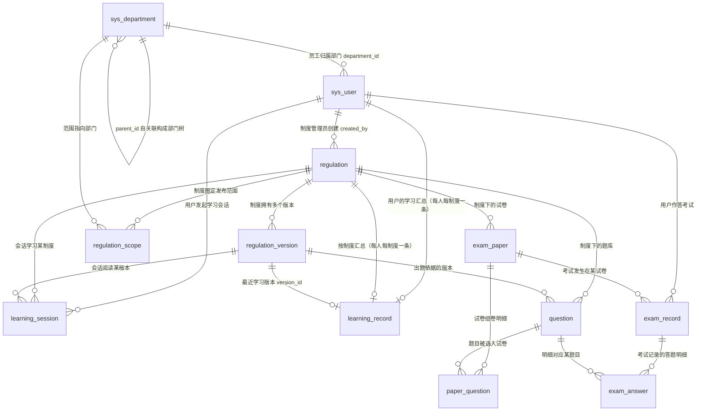

# 03 · 数据库设计

> **一句话定位**：本文档定义 EmodorRuleExam 当前 41 张业务表与 1 张迁移元数据表（共 42 张物理表）的完整字段、类型、索引、约束和关系。现行考试域支持三类客观题、稳定ID与受限Tiptap、本地草稿/主动整卷、纯timeout、自动评分与只读记录；022 增加版本作者原稿、试卷布局和持久提交回执存储。旧制度阅读、旧固定卷和原统计继续复用共享表。表结构必须与 `database/init.sql`、迁移和 entities 同步，不能以摘要或接口说明替代本册的完整定义。
>
> **口径声明**：`000`—`014` 迁移保留为不可变升级历史；`015_demo_slimming.sql` 是后继收缩迁移，删除 `exam_review_event`、题库 rubric、图片答案/人工评分字段和考试监控采集字段，并将题型固定为 `single/multiple/judgment`、`grading_state` 固定为 `not_submitted/finalized`。底层 `regulation/regulation_version` 继续承担旧只读学习和新题库资料来源，外部资料接口不改变其内部存储身份。A1 的 `schema_migration` 恢复协议见 1.10；本册登记源码事实，不代表已对开发库或生产库执行升级。

> **状态边界（2026-10-22）**：旧制度阅读/固定卷继续兼容原 12 张 legacy 表；课程、视频、权限、媒体、版本题库、发布快照和个人题单继续保留。015 的只读前置检查保护历史图片答案和阅卷事件，确认不存在待保留数据后才删除专用表/列；迁移不清空其他历史记录。新应用不再读写图片答案、人工评分、实时监控或切屏数据。018 移动认证增量只为既有账号/会话表增加手机号唯一约束及客户端、认证方式字段，019 学员资料增量只为既有账号增加三个可空展示字段，均不新增业务表；020 新增两张实名表。Task 10/11 Gate G 与 Task 12 Gate H1 已通过自动化和独立代码审查；源码同步不代表开发库或生产库已迁移，也不代表真实腾讯、视频播放或移动真机已通过。

---

## 1. 设计规范

本章是当前 legacy 与 A2—A5、B1—B3、C1 增量表的公共设计约定，后文各表字段表格不再重复解释本章内容。后续培训融合新增表沿用相同的 ID、时间、枚举、无外键与事务原则，但字段必须在对应迁移/实体完成后回填。

### 1.1 命名规范

| 规范项 | 约定 |
|---|---|
| 表名 / 字段名 | 一律小写 snake_case（如 `learning_record`、`total_seconds`） |
| 表名 | 当前 41 张业务表以本册逐表定义和 `database/init.sql` 为准；022 新增 `question_authoring_commit`，README 清单已同步；旧迁移不可改写，现行形状由后继迁移演进 |
| 主键 | 通常命名为 `id`，类型 `BIGINT UNSIGNED AUTO_INCREMENT`；持久核验会话以服务端 UUID `CHAR(36)` 为明确例外，见 3.1.10 |
| 外键关联列 | 统一命名为 `<被关联表语义>_id`（如 `user_id`、`regulation_id`、`version_id`、`paper_id`、`question_id`、`exam_record_id`） |
| 时间字段 | 一律 `_at` 后缀（`created_at`、`updated_at`、`started_at`、`deadline_at`、`ended_at`、`submitted_at`、`published_at`、`parsed_at`、`last_login_at`、`valid_at`、`last_learn_at`） |
| 布尔字段 | 一律 `is_` 前缀（`is_all`、`is_valid`、`is_correct`），类型 `TINYINT(1)`，取值 1/0 |
| 计数字段 | 一律 `_count` / `_no` / `_seconds` / `_percent` 后缀表意（`attempt_no`、`total_seconds`、`max_scroll_percent`） |
| 唯一索引 | `uk_` 前缀（unique key） |
| 普通索引 | `idx_` 前缀（index） |

### 1.2 存储引擎与字符集

**存储引擎：当前基线表与培训增量表统一 InnoDB。**

1. **事务原子性**：新移动主动整卷在record锁后受理，再把完整稳定ID答案、客观题评分和record终态放入同一事务；纯timeout只清旧草稿并写未交卷终态，不评分，必须满足 ACID；学习达标落库同样涉及 `learning_session` 与 `learning_record` 两表联动更新。
2. **行级锁与 MVCC**：心跳聚合落库（写）与统计报表查询（读）并发时互不阻塞，MyISAM 表锁无法满足。
3. **崩溃恢复**：redo log 保证异常宕机后已提交事务不丢失，学习时长与考试成绩属不可丢的业务数据。
4. 统一引擎可避免跨引擎事务的隐性陷阱。

**字符集：`utf8mb4`，排序规则 `utf8mb4_0900_ai_ci`（MySQL 8.0 默认组合）。**

020 的两张实名表同样使用 `utf8mb4_0900_ai_ci`；其 ID、指纹、状态均由服务端规范化写入，不用排序规则判定证件归属，不改写既有迁移 checksum。

022 的回执表仍使用上述表级字符集/排序规则，只有 `request_id CHAR(36)` 与 `content_hash CHAR(64)` 使用 `CHARACTER SET ascii COLLATE ascii_bin`，使幂等身份与摘要按精确字节比较。作者服务须先校验 UUID 并把请求 ID 统一小写，再查询或写入；不依赖大小写不敏感比较合并不同输入。

1. `utf8mb4` 是完整的 4 字节 UTF-8 实现，覆盖员工姓名生僻字与备注 emoji；MySQL 历史遗留的 `utf8`（实为 utf8mb3）是残缺字符集，一律禁用。
2. `utf8mb4_0900_ai_ci` 大小写不敏感，符合登录名、制度标题的检索习惯；需要精确区分大小写的场景（如密码哈希比对）在应用层完成，不依赖排序规则。

### 1.3 时间字段：统一 `DATETIME(3)`

全部时间字段统一使用 `DATETIME(3)`（毫秒精度），理由如下：

1. **防作弊仲裁需要毫秒精度**。本系统存在多处"时间边界即业务规则"的场景：
   - 心跳 30 秒/次、服务端单次最大计入 45 秒的容差校验，要求会话起止时刻与心跳到达时刻能区分到亚秒级；
   - 考试限时（`duration_minutes`）的"压秒交卷"判定：交卷时刻与截止时刻的比较若只有秒级精度，同一秒内先后到达的请求无法仲裁；
   - 锁后accepted_at与原deadline的严格小于比较、重复终态提交仲裁需要毫秒精度；旧草稿版本仅保留兼容。
2. **对比 `TIMESTAMP`**：`TIMESTAMP` 存在 2038 上限，且语义随连接时区自动换算，多服务实例时区配置不一致时会产生隐性偏移；`DATETIME` 无时区语义，时区口径完全由应用层统一——本系统是单一时区（Asia/Shanghai）的企业内网系统，约定**应用层统一写入东八区本地时间**，避免任何换算歧义。
3. **对比 `DATETIME(0)`**：秒级精度无法区分同一秒内的多次操作（见第 1 点）；`DATETIME(6)` 微秒精度对本场景过度，徒增存储与比较成本。`(3)` 是精度与成本的平衡点。

统一写入规则：`created_at` / `updated_at` 由数据库默认值与自动更新维护；业务时间（`started_at`、`submitted_at` 等）由服务端时钟统一生成，不信任客户端上报的时间。

### 1.4 主键策略：自增 `BIGINT`

普通业务表主键为 `BIGINT UNSIGNED AUTO_INCREMENT`；`identity_verification_session.id` 使用服务端 UUID `CHAR(36)`，用于对外会话标识与跨请求幂等，不代表全局迁移 UUID 策略。其余表选自增主键的理由：

1. **自增保证聚簇索引顺序追加**：InnoDB 主键即聚簇索引，自增主键永远追加到 B+ 树最右页，无随机写导致的页分裂与空间碎片；UUID（尤其 v4）作为主键会造成随机写、索引膨胀、页分裂，是明确的反模式。
2. **BIGINT 而非 INT 留足余量**：`exam_answer` 为最大表（年增长约 100 万行，见第 6 章），INT 也可支撑，但 BIGINT 为数据迁移、多公司合并、外部批量导入等演进场景留出无争议的余量；关联列（`user_id` 等）统一同型，避免隐式类型转换破坏索引。
3. **不用业务属性做主键**：工号（`employee_no`）可能重编、用户名（`username`）可能变更，业务属性可变字段不可承担主键职责。

### 1.5 生命周期策略：既有status、题库启停与定向逻辑删除

除下述课时逻辑删除、题库启停及029题目逻辑删除的明确例外，已有完整status的实体不叠加deleted_at，生命周期继续收敛到原状态字段（制度的 draft/published/archived、员工的启用/停用等），理由：

1. **业务状态机天然覆盖软删除语义**。本系统的核心实体本就有完整状态生命周期：制度 `archived`（归档）即"退出活动但保留追溯"、员工 `status=0`（停用）即"离职/冻结"，与软删除的业务诉求完全重合；再叠加 `deleted_at` 会形成双状态正交组合（如"已归档且已删除"），语义模糊且无业务场景。
2. **统计口径强依赖 status，双条件易酿成口径事故**。应学人数的分母是"发布范围内**在职**员工"（`sys_user.status = 1`），若每个统计查询还需附带 `deleted_at IS NULL`，任何一处遗漏都会造成统计口径污染——这在报表系统里属于高危错误。
3. **考试结果要求终态明细不可删**。进行中的确认稿允许按全量替换删除已撤回答案；一旦 finalizer 终结，考试记录与自动逐题评分即成为不可变事实，不提供删除通道。学习终态记录同样保留。
4. 物理删除仅保留给明确的低风险场景（如清理草稿试卷），执行前由应用层校验引用；题库通过 `is_enabled` 停用，不物理删除历史题及其版本。

**课时例外（2026-10-23 明确架构决定，023）**：`course_lesson` 没有独立 `status`，课程的 `offline` 也不能表达“只移除一个课时”。因此仅该表增加 `deleted_at DATETIME(3) NULL`，以 TypeORM `DeleteDateColumn + softDelete` 从有效目录移除课时；不复用课程上下架状态，不提供恢复入口。所有有效课时查询默认过滤 `deleted_at IS NULL`，包含必学计数/发布校验、媒体授权、视频开播/心跳和当前统计；手写 SQL 须显式过滤。版本、媒体引用、学习记录和会话永久保留，历史记录查询不依赖有效课时目录。该自动过滤例外不扩展到其他实体；029题目逻辑删除使用普通列与显式当前查询过滤，见3.4.1。

### 1.6 外键策略：应用层维护，不建数据库外键

**结论：当前及培训增量表均不创建数据库级 FOREIGN KEY 约束，关联完整性由应用层（NestJS 服务层事务）维护。** 理由：

1. **高并发写路径的锁风险**：外键约束在每次写入时须对父行加共享锁校验。心跳聚合落库高频更新 `learning_record`（热点行）、交卷批量写 `exam_answer`，均与 `regulation`、`sys_user` 等父表存在关联，父行锁竞争会显著放大死锁概率。
2. **运维与演进阻碍**：员工 Excel 批量导入、历史数据修复、未来可能的分库分表，在存在物理外键时都极为受限；MySQL 外键也不支持跨库。
3. **替代保障（本设计的具体做法）**：
   - 所有关联列（`department_id`、`regulation_id` 等）**全部建立索引**，查询性能与外键约束场景等价；
   - 写入路径在应用层事务内显式校验父行存在与状态（新组卷时校验question.is_enabled=1与精确current_version_id、发起考试时校验 `learning_record.is_valid = 1`、上传版本时校验 `regulation` 存在）；
   - 可选部署定期一致性稽核任务（孤儿行检测），作为兜底。
4. **规避循环依赖**：`regulation.current_version_id` 指向 `regulation_version`、`regulation_version.regulation_id` 又指回 `regulation`，二者互指在数据库外键模型下是循环依赖，建库顺序与数据修复都很别扭；应用层维护天然规避该问题。

### 1.7 枚举表示策略：`VARCHAR` + 应用层校验

所有枚举字段（`regulation.status`、`question.type`、`exam_record.status`、`sys_user.role` 等）统一使用 `VARCHAR`（长度 16，`role` 为 32）存储枚举字符串，**不使用 MySQL `ENUM` 类型**，理由：

1. `ENUM` 增删枚举值需要 DDL 变更表结构，迭代成本高且有锁表风险；
2. 枚举值在应用层（TypeScript 常量枚举）与文档（README 3.4）中已有唯一定义源，数据库层再复制一份类型定义反而引入不一致风险；
3. 枚举合法性由应用层入参校验保证，非法值在写入前拦截。

全部枚举取值见第 5 章枚举值字典，与 README 3.4 逐字一致。

### 1.8 JSON 字段策略

当前 `database/init.sql` 共33个MySQL 8.0原生`JSON`列：021新增`question.content_json`、`question_version.content_json`与`exam_answer.selected_option_ids`；022新增`question_version.authoring_json`、`exam_paper.designer_layout`和`question_authoring_commit.result_json`。其余包括发布、题库、课程、学习、媒体配置、迁移进度及assignment/record快照。完整题面、标准答案、解析与来源版本只保存在服务端；在考响应按白名单重建安全题面，作者原稿和回执只供管理端使用。

1. 原生 JSON 类型写入时即校验合法性（非法 JSON 直接报错），二进制存储比 TEXT 更紧凑；
2. 用途严格限定为**无结构化检索需求的聚合载荷**：题目判分、阅读覆盖、课程制度信息关联、可恢复导入、站点公开白名单值和迁移进度均由应用层整体校验、反序列化和更新；
3. 因此**不**为 JSON 内部路径建虚拟列 / 函数索引——当前查询模式用不到，属过度设计。题目、作答、阅读与课程的 7 个领域 JSON 结构见第 4 章；其余字段分别见 1.10、3.1.4 与 3.1.8。

### 1.9 培训融合 schema 同步政策

本步骤保留 legacy 业务表及其 DDL/实体不变。培训融合需要的增量事实按以下顺序同步，任一层缺失都只能标记为“计划”，不能写成当前已实现：

```text
版本化 migration（含 A1 registry）
        ↓
database/init.sql 可重建定义
        ↓
server/src/entities/ 实体与索引
        ↓
03 册及受影响设计分册
        ↓
API DTO/controller 与运行验收
```

已批准但由后续任务落地的事实域只在这里做概念登记，不预设字段名或第二套 registry：

| 计划事实域 | 必须保留的业务语义 | owner |
|---|---|---|
| 学员身份 | 培训类别、`institution/external` 来源；来源与权限角色分离；旧用户未知值可为空 | A2/A3 |
| 受控媒体 | 私有媒体资源、实际格式/时长探测、业务引用与头像绑定；未注册 owner type 默认拒绝 | A4 |
| 后台公共配置 | **A5 已落地**菜单注册白名单、固定业务字典只读、站点 Logo/轮播公开白名单与审计查询 | A5 |
| 课程学习 | **B1/B2 已落地**课程、章节、课时版本、视频元数据、覆盖区间、断点与当前应学完成汇总；始终与制度阅读记录分开 | B1/B2 |
| 统一题库 | 三类客观题、启用easy/hard、历史medium只读、is_enabled与不可变revision；人工／文件／参考题AI确认直接启用，新版本无概念／分值／审核事实，旧真实来源与快照保留 | B3/B4、025—027 |
| 发布与个人快照 | **C1/C2 已落地**不可变发布规则/候选版本、个人题单/显示映射、首次来源/类别/难度/规则；旧记录不伪造历史快照 | C1/C2 |
| 作答与评分 | **Task13/14 / Gate H2已实现并自动验证**：移动端本地草稿、稳定ID主动整卷提交；主动受理才评分，到期纯timeout且不生成答案；旧确认草稿列只保留兼容 | Task13/14 |
| 记录与统计 | 管理端只读记录列表/详情/结果；按考试当前 release/冻结规则/难度的 finalized 个人最高分、当前应考与历史成功开考交集、B2 当前必学版本完成率 | C5/C6 |

A1 的 registry 仍只使用单一 `schema_migration` 元数据表。`001`—`014` 记录原融合过程且保持 checksum 不变；`015_demo_slimming.sql` 通过 `@replaces-check` 声明当前终态，收缩枚举、权限、菜单、表和字段。后补低号 migration 仍由 A1 runner 按 ID 检查 pending 并逐 step 应用，不改写任何已登记 checksum。

`021_exam_stable_option_ids.sql`只增5列，不新增表、不回填或改写旧题目/版本、已发布与个人快照、历史答案或成绩。`question/question_version`各新增`content_schema_version TINYINT UNSIGNED NOT NULL DEFAULT 1`和`content_json JSON NULL`，`exam_answer`新增`selected_option_ids JSON NULL`；init、entities和迁移终态一致。真实后端浏览器全链、真实供应商/弱网、微信开发者工具与真机仍未验。

`022_question_designer_storage.sql` 只追加 `question_version.authoring_schema_version TINYINT UNSIGNED NULL`、`authoring_json JSON NULL`、`exam_paper.designer_layout JSON NULL` 与一张持久回执表；不回填原稿/布局，不更新旧题目、medium 难度、release/assignment/record 快照、答案或成绩。作者原稿只保存在版本表，不在 `question` 再存副本。存储增量及布局读写验证不代表作者批量提交事务、完整设计器、发布或移动端业务已验收。

### 1.10 A1 迁移注册表与部分恢复协议（已集成并通过 A1 验收）

A1 只保留一个 `schema_migration` 元数据表，不新增第二张恢复表。当前源码的物理 schema 口径是**12 张 legacy 业务表 + A2 两张培训身份/导入表 + A3 五张权限/会话表 + A4 两张媒体表 + A5 三张后台公共配置表 + B1 四张课程内容表 + B2 两张视频学习表 + B3 两张题库表 + C1 两张发布快照表 + C2 两张个人考试表 + Gate G 两张实名表 + 022 一张作者提交回执表 + 033 一张上传会话表 + 037 一张字典分类表 + 1 张元数据表**，即 41 张业务表、42 张物理表。`database/init.sql`、`000`—`039` migrations 与 entities 的存储定义同步；生产执行仍需单独授权和维护窗口。018 为认证标识/分端会话，019 为学员展示资料，020 为实名事实/持久核验会话，021 为稳定选项 ID，022 为作者原稿/布局/回执，023 为课时逻辑删除列，024 为学员年龄列，025将历史题库分数字段改为可空且不改变旧值；026以可空暂存→仅NULL回填→NOT NULL默认1的可续跑协议添加question.is_enabled，旧approved映射1，其它映射0，不重写历史内容／分数／概念／审核事实或updated_at，新增idx_question_enabled_pool；027只清理questions:review及其角色和菜单关联，不清理其它独立review权限；029追加题目普通逻辑删除标记；030增加试卷考前学习阈值与管理备注，031增加培训试卷管理排序，032增加培训试卷最后更新人，033增加媒体存储定位与持久上传会话，038清理已退役的既有账号提升管理员权限链路；本节的 A1 验收结论不自动扩展到其他阶段。

**注册表协议要求**：在既有迁移身份、checksum、状态、时间、重试次数和错误信息等元数据语义上，增加可空列 **`progress JSON NULL`**。`progress` 只保存已经验证完成的稳定 step ID 列表，不保存“正在执行”的假进度；文件 checksum 保持不可变，已保存的 step ID 必须仍存在且与当前 step 定义一致。此前 `ed0b379` 的候选 DDL 仅作输入，不代表本协议已完成源码核对。

**迁移文件格式**：每个 SQL step 必须显式标注稳定 ID 和单条完成探针，格式约束如下；尖括号是格式占位，不是待实现字段名：

```sql
-- @step <stable-step-id>
-- @check <single SELECT ... AS complete>
<one SQL statement>;
```

- 每个 step 只能有一条 SQL；禁止存储过程、任意 shell 命令、动态 SQL、切换数据库和静默重放整文件。当前/后续安全 step 仅允许 CREATE TABLE / ALTER TABLE / CREATE INDEX、明确幂等的 INSERT、带 WHERE 的 UPDATE，以及 015 瘦身所需的两种受限删除：`DELETE FROM <单表> WHERE ...` 与 `DROP TABLE IF EXISTS <单表>`。DELETE 不得省略 WHERE，DROP 不得多表、不得省略 IF EXISTS；所有标识符仍受单库 ASCII 白名单约束。
- `@check` 必须是只读单条 `SELECT`，返回恰好一个 `complete` 标志且值为 0/1。schema step 用 `INFORMATION_SCHEMA` 且以 `DATABASE()` 为目标；回填 step 使用经过评审的数据不变量。缺探针、格式错误、多语句或不兼容对象检查必须在任何写入前拒绝。
- 015 在任何 registry bootstrap、菜单清理或 DDL 前执行专用只读 preflight：检查图片题/规则快照、`pending_manual`、答案附件与评语/评分版本、rubric、阅卷事件和 answer-purpose 媒体引用。任一退役能力仍承载历史业务数据即整次迁移阻断，要求先人工评审并保存历史数据，不能以“功能取消”为由直接丢弃。
- 018 在任何写入前执行手机号只读 preflight：按去除空白、连字符并将空串视为 NULL 的结果检查；非空结果不符合 `^1[3-9][0-9]{9}$`，或同一规范化手机号对应多个账号，均阻断整次迁移。错误只报告非法条数、重复组数/行数，不回显手机号，不自动合并账号。检查通过后依次执行 `normalize_phone`、`unique_phone`、`session_client`、`session_auth_method` 四个可续跑 step。
- 019 只新增 `occupation/gender/birthday` 可空列，不推断旧资料。020 分 `learner_identity`、`identity_verification_session` 两个可探测 CREATE TABLE step，不回填实名、不把导入或调试登录转换为 verified，不自动执行开发/生产库升级。
- `024_student_age.sql` 的单个 `age` step 仅追加 `sys_user.age TINYINT UNSIGNED NULL`，完成探针检查列类型、可空与默认 null，不回填或改写任何旧资料、生日和实名事实。已有库须执行迁移后再运行引用 age 的服务；新库由 init.sql 直接建立同形字段。业务层限制 0—150 整数，表数仍为 40。
- 022 分 `version_authoring`、`paper_layout`、`authoring_commit` 三个可探测 step；前两项以原子 ALTER 追加可空列，最后创建无短期过期字段的回执表。完成探针核对类型/空值/默认值、索引列序/唯一性及回执列的 ASCII 精确排序规则；同名错结构直接拒绝。通过后继探针承接 `021/version_content` 和 `008/extend_exam_paper_release_config` 的完整既有不变量，不改写既有 SQL/checksum；DDL 已提交而 progress 未保存时重试只登记已验证完成的 step。
- 后继终态通过 `@replaces-check <旧 migration>/<旧 step>` 声明。runner 校验目标存在、只允许单一后继、禁止同 migration、倒序、分叉和环；检查旧 step 时递归采用后继 step 的最终不变量。若后继曾记入 progress 而其探针后来为 0，必须报错，不能重新执行旧 step 复活已删除能力。
- `028_access_password_backfill_probe.sql` 前向替代 `002_access/backfill_force_password_change` 的一次性数据探针。后续新建账号、重置和改密允许合法改变密码标记，不能永久要求其等于“是否曾登录”的 CASE。028 同时核验原列形状、合法 0/1 值及 002 的已完成 step 记录；无首次回填完成证据时仍执行原 002 流程，不提前跳过。028 不新增表或字段，只有明确零行的 SQL，不改账号、旧迁移文件或旧登记校验和。
- `029_question_soft_delete.sql` 只追加`question.deleted_at DATETIME(3) NULL`，旧行保持NULL，不删除或回填业务数据。以`@replaces-check 026_question_lifecycle_slimming/add_question_enabled`线性承接完整有效表形状探针，保留旧列／索引不变量并核对新列类型、精度、可空、默认与额外属性。DDL已提交但progress未保存时只补登记；错结构拒绝，不改000—028或旧checksum。引用新列的服务须先完成029；本地授权升级与PC验收另见本次行内操作验收记录，不代表生产已升级。
- `030_paper_learning_requirement.sql` 为`exam_paper`追加`required_learning_minutes INT UNSIGNED NULL`、`remark VARCHAR(1000) NULL`，为`paper_release`追加同型分钟阈值。分别继承022试卷布局和008发布表的完整结构探针，保留旧约束，不改写既有checksum或任何历史试卷/发布/学习/考试记录。新列旧值保持NULL；旧发布版本不追溯新增学习门槛。部署引用字段的服务前须完成030。
- `031_paper_sort_order.sql` 线性承接030的试卷完整结构探针，为`exam_paper`追加`sort_order INT NOT NULL DEFAULT 0`。旧行只取得数据库默认0，不执行回填UPDATE、不改业务内容或时间戳；同名错结构拒绝。部署引用字段的服务前须完成031。
- `032_paper_operation_metadata.sql` 线性承接031的试卷完整结构探针，为`exam_paper`追加`updated_by BIGINT UNSIGNED NULL`。历史行保持NULL，不以创建人、审计日志或当前登录人反推，不改`created_by/created_at/updated_at`；新写入由服务端认证操作者维护。部署引用字段的服务前须完成032。
- 执行顺序固定为“metadata 先检查 → 必要时执行 step → 再验证 `@check` → 持久化 `progress`”。探针已为 1 的 step 只登记/跳过；只有执行后探针仍为 1 才能写入完成 ID，不能把部分执行的 migration 标为 applied。

- 023 只追加 `course_lesson.deleted_at DATETIME(3) NULL`，不回填、不删除课时或历史版本/媒体引用/学习事实。`lesson_soft_delete` 以 `@replaces-check 005_courses/create_course_lesson` 继承原表全部列/索引不变量并校验新列类型、精度、可空、默认值和额外属性；不改旧迁移或 checksum。DDL 已提交但 progress 未保存时重试只登记完成；同名错结构拒绝。部署含此实体的后端前须完成该迁移，否则有效课时查询会因缺列失败；本机授权执行与业务数据核对结果见 `review/2026-10-23-course-management-dialogs-acceptance.md`。

**`--check` / `--apply` 与恢复边界**：

1. 两种模式都必须显式设置 `DB_DATABASE`，验证目标为安全的非系统库，并用 `SELECT DATABASE()` 确认实际连接库等于请求库；仓库 migration SQL 不得自行 `USE` 或切换数据库。两种模式都执行格式/checksum 检查与业务前置检查：若存在 `exam_record.status = 'in_progress'`，立即阻断；不要把 migration 的 `applying` 状态误当作在考业务记录。
2. `--check` 只读：不 bootstrap registry、不创建/修改表、不写 `schema_migration`，只报告 step/metadata/前置检查结果。`--apply` 在 registry bootstrap 或任何写入前取得同库 MySQL named lock（锁名需 hash 且落在 MySQL 长度限制内）；同一连接持有锁执行全部 step，锁内重新读取前置检查与计划，最后在 `finally` 释放。未取得锁应快速拒绝。
3. apply 的 metadata bootstrap 是 000 step 的受控特例：先做前置检查，再通过已知 000 step 创建 registry，随后按普通 step 记录完成。执行 step 前先查 metadata/probe，执行后再 probe，最后才保存 `progress`；进程在 DDL 成功但 progress 未保存的 crash window 中重试时，必须靠 probe 对账而不是重复执行非幂等 SQL。`applying` / `failed` 记录只有在独占 named lock 和前置检查通过后才可续跑，不能永久阻塞，也不能整文件重放。
4. 正式生产升级要求维护窗口并停止业务服务；named lock 只互斥迁移进程，不声称阻止业务服务并发新开考。升级工具不发明 runtime-wide exam-start lock，业务停服是运维前置条件。
5. 测试重建与迁移契约只允许 `ruleexam_test_*` 隔离库；不得把测试重建或 e2e 指向开发库 `ruleexam`。原 12 张 legacy 业务表及其旧记录保留，不清空、不改写成新培训历史。B2 不回填旧站观看历史，B3 不批量回填题目版本；008 只为旧卷回填 `business_scope=regulation/mode=fixed/requires_learning=1` 的默认语义，不伪造旧发布快照。C1 发布表只记录升级后新发布事实；C2 不得用动态题库伪造旧个人卷。010 只转换 `assignment_id IS NOT NULL` 的快照答案：先确证同 record 的 item 映射并建立 `uk_record_item`，再在停服窗口受控移除旧 `uk_record_question`、恢复 source `question_id` 并重建完整旧唯一键；每步可从 DDL 中断点续跑，旧无 assignment 答案、selected 与 score 均不改写。

---

## 2. ER 总览

### 2.1 legacy 基线 ER 图（12 张表）



### 2.2 关系清单

| # | 关系 | 基数 | 维护方与说明 |
|---|---|---|---|
| 1 | sys_department → sys_department（parent_id） | 1 : N | 部门树自关联，根部门 `parent_id IS NULL` |
| 2 | sys_department → sys_user（department_id） | 1 : N | 员工归属部门；应用层维护 |
| 3 | sys_user → regulation（created_by） | 1 : N | 制度管理员创建制度 |
| 4 | regulation → regulation_version（regulation_id） | 1 : N | 一制度多版本；`regulation.current_version_id` 反向指向当前生效版本（应用层维护，规避循环依赖） |
| 5 | regulation → regulation_scope（regulation_id） | 1 : N | 发布范围，按部门圈定或 `is_all` 全员 |
| 6 | sys_department → regulation_scope（department_id） | 1 : N | 范围行指向被圈定部门 |
| 7 | sys_user → learning_session（user_id） | 1 : N | 用户的学习会话序列 |
| 8 | regulation → learning_session（regulation_id） | 1 : N | 会话的学习对象 |
| 9 | regulation_version → learning_session（version_id） | 1 : N | 会话阅读的具体版本（版本切换后新会话指向新版本） |
| 10 | sys_user → learning_record（user_id） | 1 : 1 | 由 `uk_user_regulation` 唯一约束保证：每人每制度一条汇总记录（(user_id, regulation_id) 联合唯一） |
| 11 | regulation → learning_record（regulation_id） | 1 : 1 | 同上，由 `uk_user_regulation` 保证：每制度每人一条汇总记录，制度维度学习汇总按此展开 |
| 12 | regulation → question（regulation_id） | 1 : N | 制度下的题库 |
| 13 | regulation_version → question（version_id） | 1 : N | 出题所依据的版本（版本可追溯） |
| 14 | regulation → exam_paper（regulation_id） | 1 : N | 制度下的试卷 |
| 15 | exam_paper → paper_question（paper_id） | 1 : N | 试卷组卷明细 |
| 16 | question → paper_question（question_id） | 1 : N | 题目被选入试卷（引用校验用） |
| 17 | sys_user → exam_record（user_id） | 1 : N | 用户的考试记录（含补考多次） |
| 18 | exam_paper → exam_record（paper_id） | 1 : N | 试卷下的作答记录 |
| 19 | exam_record → exam_answer（exam_record_id） | 1 : N | 一次作答的逐题明细 |
| 20 | question → exam_answer（question_id） | 1 : N | 明细对应的题目（正确率统计用） |
| 21 | training_category → regulation（category_id） | 1 : N | 可选培训类别；与 legacy `category` 字符串并存，应用层维护 |
| 22 | training_category → training_course（category_id） | 1 : N | 课程必须属于一个培训类别；新建/变更引用时事务锁定并校验启用状态 |
| 23 | training_course → course_chapter（course_id） | 1 : N | 课程章节独立排序 |
| 24 | training_course → course_lesson（course_id） | 1 : N | 课程课时独立排序并校验章节归属 |
| 25 | course_chapter → course_lesson（chapter_id） | 1 : N | 一个课时只属于当前课程下的一个章节 |
| 26 | course_lesson → lesson_version（lesson_id） | 1 : N | 视频内容版本只追加，不原地改写 |
| 27 | course_lesson → lesson_version（current_version_id） | 1 : 0..1 | 指向当前播放版本；历史版本仍保留 |
| 28 | media_asset → training_course（cover_asset_id） | 1 : N | `course_cover` 资源由 `media_reference` 保护 |
| 29 | media_asset → lesson_version（asset_id） | 1 : N | `video` 资源及服务端时长快照；每个版本建立媒体引用 |
| 30 | training_category → question / question_version（category_id） | 1 : N | B3 新题必选启用类别；旧题/旧捕获未知可空 |
| 31 | question → question_version（question_id） | 1 : N | 一题目身份拥有递增不可变 revision；current_version_id 反向指当前版本 |
| 32 | question_concept → question / question_version（concept_id） | 1 : N | 仅历史引用；不参与新题／新发布，新版本concept_id为NULL |
| 33 | media_asset → question_version（media_reference） | N : N | 受控富文本图片绑定版本；删除前引用保护，读取经 owner policy 鉴权；试卷读取只认精确版本的固定草稿、发布快照或合法随机草稿候选及对应字段 |
| 34 | sys_user → video_learning_record（user_id） | 1 : N | 每人按不可变课时版本保存一条去重覆盖汇总 |
| 35 | lesson_version → video_learning_record（lesson_version_id） | 1 : N | `uk_video_learning_record_user_version` 保证同用户同版本唯一；换版不沿用旧覆盖 |
| 36 | video_learning_record → video_learning_session（record_id） | 1 : N | 会话流水引用版本汇总；心跳每次事务更新会话锚点与汇总 |
| 37 | sys_user → video_learning_session（active_user_id） | 1 : 0..1 | 可空唯一索引只约束活动视频；结束/替换/超时置 NULL，跨阅读类型另由 `sys_user` 行锁串行 |
| 38 | training_category → exam_paper / paper_release（category_id） | 1 : N | 培训卷配置与发布快照的类别；删除类别时与既有引用同事务检查 |
| 39 | exam_paper → paper_release（paper_id） | 1 : N | 每次发布递增 version_no；发布后修改必须复制新草稿 |
| 40 | paper_release → paper_release_question（release_id） | 1 : N | 固定卷冻结题单，随机卷冻结初/高级候选池 |
| 41 | question / question_version → paper_release_question | 1 : N | 保留身份与发布时版本 ID；真正历史内容以 snapshot_json 为准 |
| 42 | exam_record → exam_record_question（record_id） | 1 : N | 每次作答冻结的个人题单与显示映射 |
| 43 | exam_record_question → exam_answer（record_question_id） | 1 : 0..1 | 主动评分按item对齐；新/me草稿不写表，legacy可为NULL |
| 44 | sys_user → learner_identity（user_id） | 1 : 0..1 | `uk_learner_identity_user` 保证账号唯一实名事实，证件指纹另有全局唯一约束 |
| 45 | sys_user → identity_verification_session（user_id） | 1 : N | 用户行锁串行创建，应用层保证每人最多一个非终态核验会话 |
| 46 | identity_verification_session → learner_identity（session_id） | 1 : 0..1 | 绑定成功才有事实；`uk_learner_identity_session` 防止重复绑定 |
| 47 | media_asset → identity_verification_session（三项 asset_id） | 1 : N | 三项分别匹配本人正脸、人像面、国徽面 purpose；session/事实引用阻止临时材料清理 |
| 48 | sys_user → media_reference（identity_verification_user） | 1 : N | 上传即绑定 user owner；签票与读流都检查精确 asset/owner type/owner id 引用及当前授权 |
| 49 | sys_user → question_authoring_commit（owner_id） | 1 : N | 每位操作者的成功提交回执；owner/request 唯一，查询必须限定当前操作者 |

> 说明：`regulation.current_version_id`、`regulation_version.regulation_id`、`learning_record.version_id`（最近学习版本）等指向关系均由应用层维护，不在数据库层建外键（见 1.6 节）。

---

## 3. 分域详细表结构

每个域按「域职责 → 逐表（字段表格 + 索引设计 + 设计说明）」组织。字段表格中"默认值"列的 `CURRENT_TIMESTAMP(3)` 表示数据库默认；`—` 表示无默认值（写入必填）。

### 3.1 组织、权限与公共配置域（16 张）

域职责：部门树与员工账号承载组织身份；业务角色/权限与会话承载管理边界；受控媒体、后台菜单、显示字典与站点品牌配置承载 PC 公共能力。学习/考试主体、发布范围与统计维度仍以组织身份表为准。

#### 3.1.1 sys_department（部门）

**字段定义**

| 字段名 | 类型 | 允许空 | 默认值 | 说明 |
|---|---|---|---|---|
| id | BIGINT UNSIGNED | NO | 自增 | 主键 |
| parent_id | BIGINT UNSIGNED | YES | NULL | 上级部门 id，自关联；根部门为 NULL |
| name | VARCHAR(64) | NO | — | 部门名称 |
| sort | INT | NO | 0 | 同级部门展示排序，升序 |
| status | TINYINT | NO | 1 | 部门状态：1=启用，0=停用（取值定义见 5.2 节） |
| created_at | DATETIME(3) | NO | CURRENT_TIMESTAMP(3) | 创建时间 |
| updated_at | DATETIME(3) | NO | CURRENT_TIMESTAMP(3) | 更新时间，随行更新自动刷新（ON UPDATE CURRENT_TIMESTAMP(3)，下同） |

**索引设计**

| 索引名 | 类型 | 字段 | 用途 |
|---|---|---|---|
| PRIMARY | 主键 | id | — |
| idx_parent | 普通 | parent_id | 部门树逐层展开（按 parent_id 取直接子部门） |
| uk_parent_name | 唯一 | (parent_id, name) | 同一父部门下部门名唯一，防重复建部；根部门（parent_id 为 NULL）不受该索引约束，"全局唯一根"由应用层保证 |

**设计说明**

1. **部门树用邻接表（parent_id 自关联）而非嵌套集/闭包表**：组织树深度有限（典型 3~5 层），读取频率低且可整树缓存（Redis），邻接表实现与维护成本最低；发布范围与部门维度统计需要"部门 → 含全部子部门的员工集合"，由应用层内存递归展开（树规模为百级节点，无性能问题）。
2. **status 而非删除**：部门停用后仍被 `sys_user.department_id`、`regulation_scope.department_id` 引用，是历史学习/考试数据的统计维度，必须保留（见 1.5 节软删除策略）。
3. **支撑业务规则**：发布范围按部门圈定（regulation_scope → 部门树展开子部门 → 员工）；部门维度统计（某部门学习完成率 / 通过率）。

#### 3.1.2 sys_user（员工账号）

**字段定义**

| 字段名 | 类型 | 允许空 | 默认值 | 说明 |
|---|---|---|---|---|
| id | BIGINT UNSIGNED | NO | 自增 | 主键 |
| username | VARCHAR(64) | NO | — | 登录用户名，全局唯一 |
| password_hash | VARCHAR(255) | NO | — | 密码哈希（bcrypt，60 字符；预留 255 兼容 argon2 等算法迁移） |
| real_name | VARCHAR(64) | NO | — | 真实姓名（展示与统计口径） |
| employee_no | VARCHAR(32) | YES | NULL | 工号；允许 NULL（超级管理员可无工号），MySQL 唯一索引允许多个 NULL |
| department_id | BIGINT UNSIGNED | YES | NULL | 归属部门（sys_department.id）；超级管理员可不归属业务部门 |
| category_id | BIGINT UNSIGNED | YES | NULL | PC 培训类别 / H5 培训工种的同一权威引用（training_category.id）；短信新用户或旧用户未补齐时为 NULL |
| source | VARCHAR(16) | YES | NULL | 学员来源：`institution` / `external`；来源不等于权限，旧用户未确认时保持 NULL |
| role | VARCHAR(32) | NO | employee | 角色：super_admin / regulation_admin / employee（README 3.4 角色枚举） |
| phone | VARCHAR(20) | YES | NULL | 认证手机号；非空值为规范化中国大陆 11 位手机号，全局唯一 |
| email | VARCHAR(128) | YES | NULL | 邮箱 |
| avatar_id | BIGINT UNSIGNED | YES | NULL | 受控头像媒体资源（media_asset.id）；只经本人资料或 managed-student 事务绑定 |
| occupation | VARCHAR(64) | YES | NULL | 旧普通资料文本，保留兼容；不再作为移动端培训工种展示或编辑，不映射培训类别 |
| gender | VARCHAR(16) | YES | NULL | 学员本人或受控学员管理入口维护性别：`male / female` |
| birthday | DATE | YES | NULL | 学员本人或受控学员管理入口维护生日；真实日期且不得晚于服务端业务当前日期 |
| age | TINYINT UNSIGNED | YES | NULL | 024 新增；受控学员管理入口维护的 0—150 整数年龄，不反推或覆盖生日 |
| status | TINYINT | NO | 1 | 账号状态：1=启用，0=停用（取值定义见 5.2 节） |
| deleted_at | DATETIME(3) | YES | NULL | 034 新增；管理员逻辑删除时写入，并置 status=0。保留账号及所有历史引用 |
| auth_version | INT UNSIGNED | NO | 0 | 认证世代；密码、身份或管理权限变更递增 |
| force_password_change | TINYINT | NO | 0 | 当前口令是否必须修改；与登录统计分离 |
| login_count | INT UNSIGNED | NO | 0 | 真实密码成功登录次数；refresh 不计入 |
| last_login_at | DATETIME(3) | YES | NULL | 最后一次成功登录时间（密码、短信或显式调试入口）；refresh 不更新 |
| last_login_ip | VARCHAR(64) | YES | NULL | 最后一次成功登录来源 IP；口径同 last_login_at |
| roles_configured | TINYINT | NO | 0 | 是否显式配置过业务角色（含清空） |
| created_at | DATETIME(3) | NO | CURRENT_TIMESTAMP(3) | 创建时间 |
| updated_at | DATETIME(3) | NO | CURRENT_TIMESTAMP(3) | 更新时间 |

**索引设计**

| 索引名 | 类型 | 字段 | 用途 |
|---|---|---|---|
| PRIMARY | 主键 | id | — |
| uk_username | 唯一 | username | 登录唯一性校验（登录查询走此索引） |
| uk_employee_no | 唯一 | employee_no | 工号唯一（Excel 批量导入去重校验） |
| uk_sys_user_phone | 唯一 | phone | 手机号认证账号唯一；允许多个 NULL |
| idx_department_status | 普通 | (department_id, status) | 应学人数统计：按部门取在职（status=1）员工；部门员工列表 |
| idx_training_identity | 普通 | (category_id, source) | 培训学员按类别与来源筛选；不承担权限校验 |

**设计说明**

1. **系统身份与业务角色分离**：`role` 保留三类系统身份边界；业务角色由 `sys_user_role` 多选维护。既有制度管理员在未显式配置前沿用 legacy 矩阵，显式配置（包括清空）后只按业务角色计算。
2. **password_hash 只存哈希不存明文**：管理员密码登录校验与修改密码均在应用层完成，接口返回用户信息时排除该列。学员新建/导入只写不可知随机值的 bcrypt 哈希以兼容非空列，`force_password_change=0`；该哈希不构成学员登录能力，学员使用手机验证码，无设置/重置密码入口。
3. **idx_department_status 直接服务统计口径**：应学人数 = 发布范围部门（含子部门，应用层展开）中 `status=1` 的员工数，该联合索引使分母查询免全表扫描。
4. **employee_no 允许 NULL 的唯一索引**：利用 MySQL 唯一索引对 NULL 不去重的特性，兼容超级管理员等无工号账号，同时保证有工号员工的全局唯一。
5. **支撑业务规则**：登录认证（username/password_hash/auth_version/force_password_change/login_count/last_login_at/last_login_ip）、RBAC（role + sys_user_role）、学习与考试主体（learning_*/exam_* 的 user_id）、应学人数分母（department_id + status）；培训考试在开考时读取并冻结 category_id/source，不能用用户后续变更覆盖历史。
6. **手机号是认证标识**：写入入口统一去除空白和连字符，非空结果必须匹配 `^1[3-9][0-9]{9}$`；可选手机号为空时存 NULL。管理端新建/更新、批量导入与移动短信/调试登录共用规范化规则，数据库唯一索引裁决并发首次登录。`PATCH /me/profile` 不允许修改 phone；受控学员管理入口修改手机号时，递增 `auth_version` 并吊销旧会话，不能只改资料字段而保留旧认证身份。
7. **普通资料与权威身份分开**：`occupation/gender/birthday/age` 只承载普通展示资料，均可为空；`gender/birthday` 同时允许受控学员管理入口维护，`age` 只允许该管理入口维护。occupation 不反推或改写 `category_id`，这些字段也不能充当实名结果。019 迁移只增加三个可空列；024 仅追加 `age` 可空列，不回填旧资料。管理端优先显示明确保存的 age；为空时可按既有 birthday 计算展示年龄，但不能从输入年龄捏造生日。
8. **培训工种首次确认（2026-10-23）**：复用 `category_id`，无需新增 schema 或迁移。仅启用的普通移动学员在专用接口事务内允许从 NULL 赋为启用类别；同值重放幂等，已非空不同值拒绝。PC 有 `students:write` 权限者继续调整；审计保留前后类别，既有 assignment/考试记录与实名事实不变。名称按类别表读取（含停用类），不另存一份工种名称。
9. **管理员删除保留历史（2026-10-27）**：`deleted_at` 是普通可空列，不使用 ORM 的全局软删除过滤，历史考试、学习、审计仍能读取原账号姓名。管理员列表、候选和维护接口显式排除已删除账号；删除事务置停用、递增认证世代并吊销会话，保留 `sys_user_role` 防止账号重新进入学员管理。用户名和手机号唯一占用不释放；不开放恢复入口。管理员姓名选填时存空字符串，不改变本列非空约束；纯学员姓名规则保持。

#### 3.1.2.1 media_asset / media_reference（受控媒体，A4）

`media_asset` 保存服务端生成的私有存储键与实际探测结果，`media_reference` 保存业务归属引用；两表不建数据库外键，删除前由应用层在事务内锁定并检查引用数。视频只允许 MP4/H.264（有音轨时只能 AAC），图片由受限 ffmpeg 实际解码且只允许 JPEG/PNG/WebP（默认 2500 万像素）。内部媒体服务保留 `answer` 用途供 C3 专用路由包装，通用上传路由不得接收 `answer`。

**media_asset 完整字段定义**

| 字段名 | 类型 | 允许空 | 默认值 | 说明 |
|---|---|---|---|---|
| id | BIGINT UNSIGNED | NO | 自增 | 主键 |
| owner_id | BIGINT UNSIGNED | NO | — | 业务拥有者，由服务端从身份或管理目标确定 |
| uploaded_by | BIGINT UNSIGNED | NO | — | 实际上传操作者 |
| purpose | VARCHAR(32) | NO | — | `avatar / course_cover / video / question / answer / branding`；`answer` 仅供内部受控调用 |
| media_kind | VARCHAR(16) | NO | — | `image / video` |
| original_name | VARCHAR(255) | YES | NULL | 仅作展示元数据，不参与路径拼接 |
| mime_type | VARCHAR(128) | NO | — | 服务端探测确认的媒体类型 |
| storage_key | VARCHAR(512) | NO | — | 服务端生成的私有相对路径 |
| size_bytes | BIGINT UNSIGNED | NO | — | 文件字节数 |
| sha256 | CHAR(64) | NO | — | 文件 SHA-256 |
| status | VARCHAR(16) | NO | processing | 持久状态为 `processing / ready / failed / deleting`；`deleting` 是物理删除失败后的内部重试墓碑，不属于公开状态 |
| duration_ms | BIGINT UNSIGNED | YES | NULL | 视频实际探测时长；图片为 NULL |
| probe_error | VARCHAR(512) | YES | NULL | 脱敏失败摘要，不含真实本地路径 |
| created_at | DATETIME(3) | NO | CURRENT_TIMESTAMP(3) | 创建时间 |
| updated_at | DATETIME(3) | NO | CURRENT_TIMESTAMP(3) | 更新时间；`ON UPDATE CURRENT_TIMESTAMP(3)` |

**media_asset 索引定义**

| 索引名 | 类型 | 字段 |
|---|---|---|
| PRIMARY | 主键 | id |
| uk_media_asset_storage_key | 唯一 | storage_key |
| idx_media_asset_owner_purpose | 普通 | (owner_id, purpose) |
| idx_media_asset_status | 普通 | status |

**media_reference 完整字段定义**

| 字段名 | 类型 | 允许空 | 默认值 | 说明 |
|---|---|---|---|---|
| id | BIGINT UNSIGNED | NO | 自增 | 主键 |
| asset_id | BIGINT UNSIGNED | NO | — | `media_asset.id`；引用完整性由应用层维护 |
| owner_type | VARCHAR(64) | NO | — | 必须注册授权策略的业务归属类型 |
| owner_id | BIGINT UNSIGNED | NO | — | 业务归属实体 ID |
| created_at | DATETIME(3) | NO | CURRENT_TIMESTAMP(3) | 创建时间 |

**media_reference 索引定义**

| 索引名 | 类型 | 字段 |
|---|---|---|
| PRIMARY | 主键 | id |
| uk_media_reference_owner | 唯一 | (asset_id, owner_type, owner_id) |
| idx_media_reference_asset | 普通 | asset_id |
| idx_media_reference_owner | 普通 | (owner_type, owner_id) |

两表均固定使用 `ENGINE=InnoDB DEFAULT CHARSET=utf8mb4 COLLATE=utf8mb4_0900_ai_ci`；表注释分别为“受控媒体资源”和“媒体业务引用”。上述索引均对表中列做全列索引，不使用前缀索引（`INFORMATION_SCHEMA.STATISTICS.SUB_PART IS NULL`）。以上列数、字段形状、时间精度、引擎/排序规则及索引列序由 `003_media.sql` 的只读探针逐项核对；同名、同列序但只索引字段前缀的旧索引也属于漂移，不得误记完成。

删除流程先在资源行锁下确认无引用，再把 `status` 置为内部 `deleting`，然后删除物理文件；物理删除失败保留该行供后续重试，只有删除成功或文件已不存在才删除数据库行。bind 只接受 `ready`，因此新引用不能与 `deleting` 竞态。常规 metadata/content 将 `deleting` 与不存在同样处理，不能向调用方暴露内部墓碑状态；A5 匿名品牌内容还需叠加当前站点白名单和 `site_config` 引用校验。A4 默认视频 512 MiB、图片 10 MiB；大视频由 Multer 直接落私有临时磁盘，不进入全内存 buffer。

#### 3.1.3 training_category（培训类别）

**字段定义**

| 字段名 | 类型 | 允许空 | 默认值 | 说明 |
|---|---|---|---|---|
| id | BIGINT UNSIGNED | NO | 自增 | 主键 |
| name | VARCHAR(128) | NO | — | 类别名称，全局唯一 |
| description | TEXT | YES | NULL | 类别说明 |
| status | TINYINT | NO | 1 | 1=启用，0=停用；历史引用保留 |
| created_by | BIGINT UNSIGNED | NO | — | 创建人（sys_user.id） |
| created_at / updated_at | DATETIME(3) | NO | CURRENT_TIMESTAMP(3) | 创建与更新时间 |

**索引设计**：`PRIMARY(id)`、`uk_training_category_name(name)`、`idx_training_category_status(status)`。

类别停用不删除历史资料；删除前由应用层在锁定类别行的同一事务中检查 `sys_user`、`training_course`、`regulation`、`question`、`question_concept`、`question_version`、`exam_paper` 与 `paper_release` 的 `category_id` 引用，任一存在即返回 40910，不能硬删除。所有新增类别引用仍复用 `CategoryService.lockActive` 校验启用状态。C1 发布的锁顺序固定为“类别行 → 试卷行”，与 C2 开考共用试卷锁。撤回/归档写入口已退场；历史状态与快照仍保留。

#### 3.1.4 import_batch（可恢复导入批次）

| 字段名 | 类型 | 允许空 | 默认值 | 说明 |
|---|---|---|---|---|
| id | BIGINT UNSIGNED | NO | 自增 | 主键 |
| owner_id | BIGINT UNSIGNED | NO | — | 发起管理员（sys_user.id） |
| kind | VARCHAR(32) | NO | — | `students` / `questions` / `questions_ai`，分别隔离学员、普通导题与 AI 生成题适配器 |
| input_hash | CHAR(64) | NO | — | 脱敏输入指纹，不含明文口令 |
| status | VARCHAR(16) | NO | previewed | `previewed / committing / committed / failed` |
| normalized_rows | JSON | YES | NULL | 规范化行；新学员导入不保存任何密码或哈希，确认时才生成兼容非空列的不可知随机密码哈希；旧含密码字段的未确认批次要求重新预检；题库导入保存无考点／无分值的已清洗draft与重复指纹，并有question_import_meta专用元数据项保存contract=2及固定warnings；取题须过滤元数据；questions_ai只存生成题，不保存参考正文或原文件；旧未提交显式投影去概念／分值，已提交原回执不重写 |
| valid_rows / errors / duplicates / committed_rows / created_ids | JSON | YES | NULL | 预检结果与首次确认集合；响应不回显口令或哈希 |
| created_at / updated_at | DATETIME(3) | NO | CURRENT_TIMESTAMP(3) | 创建与更新时间 |

**索引设计**：`PRIMARY(id)`、`idx_import_batch_owner_kind(owner_id, kind)`、`idx_import_batch_status(status)`。批次提交按 owner+id 校验，首次确认固定合法行集合；同集合重试返回原结果，换集合返回 409。`questions_ai` 未确认批次自 `created_at` 起 24 小时有效，已确认回执不按此期限失效。

#### 3.1.5 sys_role / sys_permission（角色与权限目录）

`sys_role` 保存系统角色及机构自定义业务角色；`sys_permission` 保存服务端注册的 `<resource>:<action>` 白名单。角色代码、权限代码分别唯一，系统角色 `is_system=1` 不可在管理端删除或停用。

| 表 | 字段 | 类型 | 约束 |
|---|---|---|---|
| sys_role | id / code / name / remark / is_system / status / created_at / updated_at | BIGINT / VARCHAR(64) / VARCHAR(128) / VARCHAR(500) NULL / TINYINT / TINYINT / DATETIME(3) | `uk_sys_role_code`、`uk_sys_role_name`、`idx_sys_role_status` |
| sys_permission | id / code / name / created_at | BIGINT / VARCHAR(128) / VARCHAR(128) / DATETIME(3) | `uk_sys_permission_code` |

默认系统角色仍由 `role` 字段保持兼容；没有显式 `sys_user_role` 关系的既有制度管理员沿用 legacy 权限矩阵，写入显式业务角色后只按关系表计算权限。权限代码不接受数据库中未注册的任意字符串。

035追加选填备注remark和名称唯一索引；同名存量只阻断升级，不自动改名/删除。角色代码可由服务端随机生成，管理表单只需名称和备注。删除角色要求非系统且无任何账号链接（包括已归档管理员），在角色行锁内复查后删除其权限关系及角色。036注册管理员、角色、菜单的独立按钮权限并一次性转换旧聚合授权；038按菜单、角色授权、权限字典的顺序删除已退役的 `administrators:assign_roles`，并以 `@replaces-check` 接管036的权限目录不变量，不改写036。038仅在036完成旧聚合授权复制检查点后接管权限注册检查，避免续跑时跳过授权转换；验收同时要求角色权限关系不存在孤儿记录。未增加sys_role_menu，菜单permission_code映射仍通过sys_role_permission生效。菜单树是授权的展示结构，不是另一套授权事实。

#### 3.1.6 sys_role_permission / sys_user_role（权限关系）

两张关系表均不建数据库外键，由应用层校验父对象；复合唯一键防重复授权。

| 表 | 字段 | 索引 |
|---|---|---|
| sys_role_permission | id / role_id / permission_id / created_at | `uk_sys_role_permission(role_id, permission_id)`、`idx_sys_role_permission_permission` |
| sys_user_role | id / user_id / role_id / created_at | `uk_sys_user_role(user_id, role_id)`、`idx_sys_user_role_role` |

#### 3.1.7 auth_session（可吊销认证会话）

| 字段 | 类型 | 允许空 | 说明 |
|---|---|---|---|
| id | BIGINT UNSIGNED | NO | 主键 |
| sid | VARCHAR(64) | NO | JWT access/refresh 共用的会话标识，`uk_auth_session_sid` 唯一 |
| user_id | BIGINT UNSIGNED | NO | 会话用户；应用层校验账号状态 |
| client | VARCHAR(16) | NO | 客户端：`pc / mobile`；默认 `pc`，兼容既有会话 |
| auth_method | VARCHAR(16) | NO | 认证方式：`password / sms / debug`；默认 `password`；PC 只接受 password，mobile 只接受 sms/debug |
| user_agent / ip_address | VARCHAR(255) / VARCHAR(64) | YES | 登录设备与来源审计 |
| last_seen_at | DATETIME(3) | NO | 最近一次刷新或活跃时间 |
| expires_at | DATETIME(3) | NO | 当前 refresh 会话到期时间；刷新后顺延完整 TTL |
| revoked_at | DATETIME(3) | YES | 强制下线/登出时间；NULL 表示未被吊销，是否有效还需检查 expires_at |
| created_at / updated_at | DATETIME(3) | NO | 数据库默认与自动更新时间 |

JWT 若含 `sid`，守卫同时检查 Redis 会话吊销键与数据库持久撤销/过期状态，并核对会话的 user_id、client、auth_method 与 JWT 一致。mobile access/refresh 必须绑定 sid；仅历史 PC 无 sid 令牌继续按旧 jti/用户封禁规则兼容。`auth_session` 只保存会话元数据，不保存 access/refresh 明文。PC 与 mobile 分别创建会话；退出某一端只吊销对应会话，改密、停用或权限等身份变更仍可使两端旧会话统一失效。

在线会话列表的账号／姓名来自 `user_id` 对 `sys_user` 的只读左连接；`status`、`is_current` 为查询派生字段，不落库。2026-10-27 的列表微调复用现有表和索引，无 DDL、迁移或 entity 定义变更。

#### 3.1.8 sys_menu / sys_dictionary_type / sys_dictionary / site_setting（后台公共配置，A5 与 037）

`sys_menu` 只保存后台已注册页面与权限的展示树，不保存组件代码、脚本或任意 URL。父链循环、按钮作父节点、未注册路由/权限均由应用层拒绝；存在子节点或对应权限仍被角色引用时不得删除。所有菜单新增、修改、删除事务先对实存且不可由业务删除的 `site_setting(setting_key='logo_asset_id')` 行取排他锁，再在同一事务重读目标节点、父链、子项和角色引用；站点配置更新也先锁 Logo、再锁 banners，保持统一锁顺序。该稳定行缺失时菜单结构写入安全失败（50004/HTTP 503），不得自动补行或以空范围 gap lock 代替。

| `sys_menu` 字段 | 类型 / 默认 | 说明 |
|---|---|---|
| id | BIGINT UNSIGNED AUTO_INCREMENT | 主键 |
| parent_id | BIGINT UNSIGNED NULL | 父节点；应用层维护树完整性 |
| name | VARCHAR(128) | 显示名称 |
| type | VARCHAR(16) | `directory / menu / button` |
| route_path | VARCHAR(255) NULL | `menu` 只能使用前端注册路由；`button` 必须为 NULL |
| permission_code | VARCHAR(128) NULL | 只能使用服务端权限白名单；`directory` 必须为 NULL |
| icon | VARCHAR(64) NULL | 白名单格式的图标名 |
| sort / status | INT DEFAULT 0 / TINYINT DEFAULT 1 | 同级排序与启停 |
| created_at / updated_at | DATETIME(3) | 创建与自动更新时间 |

索引：`PRIMARY(id)`、`idx_sys_menu_parent_sort(parent_id, sort)`、`idx_sys_menu_permission(permission_code)`。

`sys_dictionary_type` 独立保存一级字典分类，空分类也保留。037 初始化七个内置分类并按现有 `sys_dictionary.type` 回填自定义分类，不改字典项任何字段。分类名称与描述可编辑，`type` 标识不可变；内置分类不能删除，自定义分类存在字典项时不能删除。所有分类与字典项写入事务先锁定实存的 `question_type` 分类行；该内置行缺失时以 50004/HTTP 503 失败，不自动补建，从而防止分类删除和字典项新增/移类并发产生孤立记录。

| `sys_dictionary_type` 字段 | 类型 / 默认 | 说明 |
|---|---|---|
| type | VARCHAR(64) | 主键；内置标识沿用现值，自定义分类由服务端生成 `custom_` 前缀标识 |
| label | VARCHAR(128) | 分类显示名称，去首尾空白后必填且唯一 |
| description | VARCHAR(255) NULL | 分类描述；空文本存 NULL |
| sort | INT DEFAULT 1000 | 内置七类按既有顺序为 0—6，自定义分类默认 1000 |
| is_system | TINYINT DEFAULT 0 | 内置分类为 1，禁止删除但可编辑显示名称及描述 |
| created_at / updated_at | DATETIME(3) | 创建与自动更新时间 |

索引：`PRIMARY(type)`、`uk_sys_dictionary_type_label(label)`、`idx_sys_dictionary_type_sort(sort,type)`。分类列表按 `sort ASC,type ASC`，字典项数量包含停用项。迁移终态探针验证稳定标识、结构与引用覆盖，不冻结后续可编辑的名称/描述。

`sys_dictionary` 是显示字典，不是业务枚举的可编程定义源。`learner_source`、`difficulty`、`question_type`、`regulation_status`、`paper_status`、`question_status`、`exam_status` 七类固定字典项以 `is_system=1` 初始化并在 API 中只读，不得借字典修改来源映射、题型或状态机。`type` 引用已存在的分类，应用层在上述同一事务中核验；分类显示名称的修改不改字典项字段。

| `sys_dictionary` 字段 | 类型 / 默认 | 说明 |
|---|---|---|
| id | BIGINT UNSIGNED AUTO_INCREMENT | 主键 |
| type / code | VARCHAR(64) | 类型与编码，联合唯一 |
| label | VARCHAR(128) | 显示名称 |
| sort / status / is_system | INT DEFAULT 0 / TINYINT DEFAULT 1 / TINYINT DEFAULT 0 | 排序、启停、固定枚举只读标记 |
| remark | VARCHAR(255) NULL | 备注 |
| created_at / updated_at | DATETIME(3) | 创建与自动更新时间 |

索引：`PRIMARY(id)`、`uk_sys_dictionary_type_code(type, code)`、`idx_sys_dictionary_type_sort(type, sort)`。

`site_setting` 只保存公开展示白名单。`id=1/setting_key=logo_asset_id` 与 `id=2/setting_key=banners` 是稳定初始化映射；固定 ID 供 `media_reference(owner_type='site_config', owner_id=site_setting.id)` 绑定使用，其中 `logo_asset_id` 实存行同时作为本机构菜单结构写入的稳定事务互斥点（只锁不改值，无新增技术表或字段）。Logo 的 `value_json` 是字符串 ID 或 SQL NULL；轮播的 `value_json` 是最多 3 项的 `[{"asset_id":"...","sort":0}]`。只有 `ready + branding + image` 媒体可绑定，更新配置、新引用绑定和旧引用解绑位于同一事务。

新增 `setting_key=about` 保存机构名称 `institution_name`、平台简介 `platform_subtitle`、展示版本 `version`、联系邮箱 `contact_email`、公众号名称 `wechat_account`、联系电话 `contact_phone` 和 `service_terms`。前六项字符串上限分别为128/200/32/254/128/32，前三项非空；联系方式允许空，邮箱须合法、联系电话支持手机、座机及常见分隔符。条款为现有 schema 3 的 Tiptap 富文档或 NULL，整个条款 JSON 不超过100000字节，拒绝图片/媒体节点、HTML和未注册结构。无新表或实体字段，039只幂等补入JSON配置；初始化SQL同步，已有配置不覆盖。默认文本沿用既有H5页面，联系方式为空，不生成虚构业务信息。

`about` 仅是公开展示配置，不是 `site_config` 媒体绑定归属。网站配置同一事务按Logo、轮播、关于我们顺序更新，品牌与关于我们两页签独立保存：仅修改请求显式提供的字段，省略保留；about-only不重绑品牌媒体，非法内容整次拒绝。新增键不改变Logo/轮播固定ID、菜单稳定锁或公开图片白名单。

| `site_setting` 字段 | 类型 / 默认 | 说明 |
|---|---|---|
| id | BIGINT UNSIGNED AUTO_INCREMENT | 主键；白名单项使用稳定 ID |
| setting_key | VARCHAR(64) | 唯一配置键 |
| value_json | JSON NULL | 白名单值 |
| updated_by | BIGINT UNSIGNED NULL | 最后更新人 `sys_user.id`，由应用层维护 |
| created_at / updated_at | DATETIME(3) | 创建与自动更新时间 |

索引：`PRIMARY(id)`、`uk_site_setting_key(setting_key)`。四表均使用 InnoDB / `utf8mb4_0900_ai_ci`，不建数据库外键；`004_system.sql` 用只读探针核对原三表字段、默认值、索引、固定字典和稳定站点配置 ID，`037_dictionary_types.sql` 追加分类表及保留既有字典项的回填。

#### 3.1.9 learner_identity（学员实名事实，020）

这是已绑定实名的权威表；不在 `sys_user` 新增可由客户端修改的实名通过位。字段与 `020_identity_verification.sql`、`LearnerIdentity` 实体一致，Gate G 自动化与独立代码审查已通过，开发/生产库是否执行迁移仍另行确认。

| 字段名 | 类型 | 允许空 | 默认值 | 说明 |
|---|---|---|---|---|
| id | BIGINT UNSIGNED | NO | 自增 | 主键 |
| user_id | BIGINT UNSIGNED | NO | — | 当前 RuleExam 学员，应用层关联 sys_user |
| id_fingerprint | CHAR(64) | NO | — | 规范化证件号的 HMAC-SHA256 十六进制指纹；独立指纹密钥 |
| identity_encrypted | TEXT | NO | — | 姓名、证件号的 AES-256-GCM 认证密文；含版本、随机 nonce、tag，不存明文 |
| session_id | CHAR(36) | NO | — | 唯一完成绑定的持久核验会话 |
| provider_request_id | VARCHAR(128) | NO | — | 受控供应商请求标识，不保存请求签名或原始响应 |
| verified_at | DATETIME(3) | NO | CURRENT_TIMESTAMP(3) | 实名事实成立时间 |

| 索引名 | 类型 | 字段 | 用途 |
|---|---|---|---|
| PRIMARY | 主键 | id | 事实行定位 |
| uk_learner_identity_user | 唯一 | user_id | 同账号只绑定一个实名事实 |
| uk_learner_identity_fingerprint | 唯一 | id_fingerprint | 同证件不能绑定其他账号，裁决跨实例并发 |
| uk_learner_identity_session | 唯一 | session_id | 同会话重复查询/恢复不新增事实 |

绑定事务锁定 `sys_user` 与当前 session，重查是否已有事实、当前可绑定会话及证件指纹冲突。成功在同一事务写入本表、保留三图业务引用、更新 `sys_user.real_name` 与 session 的 `verified/bound_at/bound_event_id`；不改变手机号、学员 ID、来源、类别和历史记录。普通 PC/mobile 资料入口不得改已实名姓名。相同证件已绑定他人返回 `IDENTITY_ALREADY_BOUND`，不静默合并账号。本人视图只返回解密姓名、脱敏证件号和时间。

#### 3.1.10 identity_verification_session（持久核验会话，020）

| 字段名 | 类型 | 允许空 | 默认值 | 说明 |
|---|---|---|---|---|
| id | CHAR(36) | NO | — | 服务端生成的 UUID；会话主键 |
| user_id | BIGINT UNSIGNED | NO | — | 发起学员，客户端不得自选 |
| face_asset_id | BIGINT UNSIGNED | NO | — | 本人 `identity_face` 私有资产 |
| id_card_portrait_asset_id | BIGINT UNSIGNED | NO | — | 本人 `identity_id_portrait` 私有资产 |
| id_card_emblem_asset_id | BIGINT UNSIGNED | NO | — | 本人 `identity_id_emblem` 私有资产 |
| material_fingerprint | CHAR(64) | NO | — | 三项资产 ID 按固定顺序计算 SHA-256，用于同材料复用；不是证件查重指纹 |
| status | VARCHAR(24) | NO | — | created/provider_pending/provider_unknown/provider_verified/verified/rejected/expired |
| provider | VARCHAR(32) | NO | — | 供应商身份，正式链路为 tencent；不接受客户端写入 |
| provider_request_id | VARCHAR(128) | YES | NULL | 供应商请求标识 |
| provider_result_encrypted | TEXT | YES | NULL | 绑定所需的受控 Provider 结果认证密文；成功结果先持久化再绑定 |
| provider_lease_until | DATETIME(3) | YES | NULL | 外部调用 claim 的有效期；行锁内取得并提交后才可调用供应商 |
| reason_code | VARCHAR(64) | YES | NULL | 受控材料拒绝/会话过期原因，不保存原始错误或敏感材料 |
| expires_at | DATETIME(3) | NO | — | 默认创建后 600 秒；只终结尚无持久成功结果的会话 |
| bound_at | DATETIME(3) | YES | NULL | 本地绑定事务成功时间 |
| bound_event_id | CHAR(36) | YES | NULL | 绑定成功的唯一脱敏审计事实 ID，与绑定同事务提交 |
| created_at | DATETIME(3) | NO | CURRENT_TIMESTAMP(3) | 创建时间 |
| updated_at | DATETIME(3) | NO | CURRENT_TIMESTAMP(3) | 行更新自动刷新 |

| 索引名 | 类型 | 字段 | 用途 |
|---|---|---|---|
| PRIMARY | 主键 | id | 会话定位及行锁 |
| idx_identity_session_user_created | 普通 | (user_id, created_at) | 本人最新会话及恢复查询 |
| idx_identity_session_material | 普通 | (user_id, material_fingerprint) | 同用户同三图会话复用 |
| uk_identity_session_bound_event | 唯一 | bound_event_id | 可空；每个绑定成功事件只落一次事实 |

无数据库外键，也没有“每人活动会话”的唯一索引；该约束由 `sys_user` 行锁与事务内重查维护。相同材料且未过期时复用原会话（包括 rejected）；新材料遇到旧非终态不得并行新建。`provider_pending` 是当前实现的已提交执行 claim 状态，跨实例只能一个调用者；lease 到期无持久结果转 `provider_unknown`，查询不自动再次调用腾讯，待会话到期后由用户明确重提。

Provider 成功结果先落 `provider_result_encrypted` 和 `provider_verified`，再做本地绑定。`provider_verified` 即使超过普通 TTL 也不能转 expired；GET 本人视图/会话应优先恢复绑定，不再调供应商。外部返回与结果落库之间的崩溃只能保留 unknown，不能承诺外部 exactly-once。绑定事务重查本 session 的当前资格，迟到旧结果不能覆盖既有实名；`bound_event_id/bound_at` 是数据库审计事实，事务后文件日志 best-effort，不声称文件和数据库原子。

三图引用由 `media_reference(owner_type='identity_verification_user', owner_id=user_id)` 与 session 三项资产关联共同保护。取消/替换/离页只释放尚无 session/实名事实引用的本人临时材料；仅临时引用且超过 24 小时未提交的资产可解除引用再按媒体删除状态机清理，活动会话与绑定证据不清理。

#### 3.1.11 COS 媒体定位与上传会话（033）

`media_asset` 保留原 ID、SHA-256、拥有者和业务引用，增量列如下。存量行默认 local，配置驱动只决定新写入，不重新解释历史行。

| 字段 | 类型/默认 | 用途 |
|---|---|---|
| storage_provider | VARCHAR(16) NOT NULL DEFAULT 'local' | local / cos |
| cos_bucket / cos_region | VARCHAR(255) / VARCHAR(64)，NULL | COS 桶与地域 |
| cos_version_id | VARCHAR(255) NULL | 读取/删除的精确对象版本 |
| etag / crc64 | VARCHAR(255) / VARCHAR(64)，NULL | 供应商元数据，不替代实际 SHA-256 |

`media_upload_session` 为上传恢复与后台处理事实源，无外键；上传会话 UUID 不替代媒体 BIGINT ID。字段、默认和索引与 `033_cos_media_storage.sql`、`MediaUploadSession` 同步：

| 字段 | 类型/默认 | 用途 |
|---|---|---|
| id | CHAR(36) ASCII BINARY，主键 | 服务端 UUID |
| owner_id / uploaded_by | BIGINT UNSIGNED | 业务拥有者/上传操作者 |
| client_request_id / request_digest | CHAR(36) / CHAR(64) ASCII BINARY | 幂等请求与请求正文摘要 |
| purpose / original_name / mime_type | VARCHAR(32) / VARCHAR(255) NULL / VARCHAR(128) | 用途和声明信息 |
| size_bytes / fingerprint_sha256 | BIGINT UNSIGNED / CHAR(64) ASCII BINARY | 声明大小与内容指纹；后端仍实际核验 |
| mode / part_size / parallel_limit | VARCHAR(16) / INT UNSIGNED / TINYINT UNSIGNED DEFAULT 3 | simple或multipart、分块大小与并发 |
| staging_locator / upload_id | JSON NULL / VARCHAR(255) NULL | 临时准确定位和供应商上传 ID |
| state | VARCHAR(16) DEFAULT 'uploading' | uploading/finalizing/completed/failed/aborted/expired |
| expires_at / last_credential_expires_at | DATETIME(3) / DATETIME(3) NULL | 会话与最后临时授权到期 |
| claim_id / lease_until | CHAR(36) ASCII BINARY NULL / DATETIME(3) NULL | 当前处理者及租约 |
| finalize_attempts | TINYINT UNSIGNED DEFAULT 0 | 处理重试次数 |
| candidate_objects | JSON NULL | 每个 claim 的独立候选对象及核验结果 |
| asset_id / receipt | BIGINT UNSIGNED NULL / JSON NULL | 已发布资产与幂等完成回执 |
| receipt_expires_at | DATETIME(3) NULL | 默认30天回执保留期 |
| reason_code / error_message | VARCHAR(64) NULL / VARCHAR(512) NULL | 受控失败分类，不存原始供应商错误 |
| finalized_at / cleaned_at | DATETIME(3) NULL | 处理完成及清理进度 |
| created_at / updated_at | DATETIME(3)，CURRENT_TIMESTAMP(3) | 创建/更新时间 |

唯一键 `uk_media_upload_request(uploaded_by,client_request_id)`；索引 `idx_media_upload_queue(state,lease_until)`、`idx_media_upload_expiry(state,expires_at)`、`idx_media_upload_credentials(state,last_credential_expires_at)`、`idx_media_upload_receipt(state,receipt_expires_at)`。完成回执到期后可清大字段，仍保留主体、请求键和摘要组成的最小墓碑，旧请求不能重新造资源。

033 的媒体定位步骤使用 `@replaces-check` 继承 003 的完整终态探针，并增加6列验证；第二步创建上传会话并验证列、索引、字符集与无外键。本节描述的媒体增量截至033；当前迁移序列为000—039。原 COS 候选 030 从未部署；整合主线已应用的029—032后重编号为033，已应用的主线迁移内容与 checksum 保持不变。033落地时为40张业务表加1张迁移元数据表；037增加字典分类后，当前共41张业务表、42张物理表；038仅清理退役权限元数据，039幂等补充网站关于我们配置，均不改变表数。真实业务库执行另记，不用临时库通过代替。

### 3.2 制度域（3 张）

域职责：制度主档、不可变版本与发布范围——"上传即可读、版本可追溯、范围可圈定"的数据基础，同时为有效学习判定提供参数（required_minutes、scroll_segments）。

#### 3.2.1 regulation（制度主档）

**字段定义**

| 字段名 | 类型 | 允许空 | 默认值 | 说明 |
|---|---|---|---|---|
| id | BIGINT UNSIGNED | NO | 自增 | 主键 |
| title | VARCHAR(128) | NO | — | 制度标题 |
| category | VARCHAR(32) | NO | — | 制度分类（如"安全类""人事类"，业务字典值） |
| category_id | BIGINT UNSIGNED | YES | NULL | 可选培训类别（training_category.id）；不替代 legacy `category`，不构成学习或考试门槛 |
| description | VARCHAR(512) | YES | NULL | 制度描述/摘要 |
| status | VARCHAR(16) | NO | draft | 制度状态：draft / published / archived |
| current_version_id | BIGINT UNSIGNED | YES | NULL | 当前生效版本（regulation_version.id）；draft 阶段可为 NULL，发布时必填 |
| required_minutes | INT | NO | 10 | 规定有效学习时长阈值（分钟）；有效学习判定条件①的分母 |
| scroll_segments | INT | NO | 10 | 滚动分段数：本期固定为 10（配置项前向保留）；若未来放开配置，须按归一化重映射迁移既有位图（见 4.4 节，本期不实现） |
| created_by | BIGINT UNSIGNED | NO | — | 创建人（sys_user.id，制度管理员） |
| published_at | DATETIME(3) | YES | NULL | 发布时间；首次置为 published 时写入 |
| created_at | DATETIME(3) | NO | CURRENT_TIMESTAMP(3) | 创建时间 |
| updated_at | DATETIME(3) | NO | CURRENT_TIMESTAMP(3) | 更新时间 |

**索引设计**

| 索引名 | 类型 | 字段 | 用途 |
|---|---|---|---|
| PRIMARY | 主键 | id | — |
| idx_status_category | 普通 | (status, category) | 管理端按状态/分类筛选制度列表 |
| idx_regulation_category_id | 普通 | category_id | 培训类别引用保护与可选筛选 |
| idx_created_by | 普通 | created_by | 制度管理员查"我创建的制度" |

**索引设计说明**：员工端"我的应学制度清单"按 `regulation_scope` 反查（见 3.2.3），不在本表建范围索引。

**设计说明**

1. **current_version_id 放在制度主档而非版本表上标记**：版本是不可变追加流，"当前生效版本"是制度主档上唯一的指针（README 术语「制度」），切换生效版本只更新指针、不动版本数据，历史学习记录（learning_session.version_id）仍指向学习当时的版本，实现版本可追溯。
2. **required_minutes / scroll_segments 是有效学习判定的参数来源**（README 术语「有效学习」）：判定公式 `learning_record.total_seconds >= required_minutes * 60 AND scroll_coverage 底部段已覆盖` 的阈值在本表按制度配置。
3. **状态机**：draft → published（发布，写 published_at，发布时校验 current_version_id 已解析成功）→ archived（归档，退出学习与考试入口，历史统计保留）。
4. **支撑业务规则**：版本管理、有效学习阈值、发布范围的对象主体、制度维度统计（学习完成率 / 通过率等均以 regulation_id 聚合）。
5. **双分类兼容**：`category` 保持原字符串含义和所有旧列表/阅读响应；`category_id` 是可空培训类别引用。创建或改为新的非空 ID 时事务内 `lockActive`，PUT 省略或保持原 ID 不因类别后来停用而阻断其他元数据编辑，显式 `null` 可清空。

#### 3.2.2 regulation_version（制度版本）

**字段定义**

| 字段名 | 类型 | 允许空 | 默认值 | 说明 |
|---|---|---|---|---|
| id | BIGINT UNSIGNED | NO | 自增 | 主键 |
| regulation_id | BIGINT UNSIGNED | NO | — | 所属制度（regulation.id） |
| version_no | INT | NO | — | 版本号，同一制度内从 1 递增 |
| file_path | VARCHAR(255) | NO | — | 上传文件的存储路径（本地卷 / 对象存储均以 URL 路径表达，天然支持存储演进） |
| file_type | VARCHAR(8) | NO | — | 文件类型：pdf / docx |
| file_hash | CHAR(64) | NO | — | 文件内容 SHA-256（十六进制 64 字符），完整性校验与重复上传检测 |
| content_html | MEDIUMTEXT | YES | NULL | 解析产物：在线阅读用 HTML（pdf-parse / mammoth 产物） |
| text_content | MEDIUMTEXT | YES | NULL | 解析产物：纯文本，AI 出题的输入 |
| parse_status | VARCHAR(16) | NO | pending | 解析状态：pending / parsed / failed |
| parsed_at | DATETIME(3) | YES | NULL | 解析完成时刻（parse_status 置为 parsed / failed 时写入）；NFR-04 解析耗时度量口径：parsed_at − created_at |
| retry_count | INT | NO | 0 | 解析重试计数：retry 接口每次重试 +1；retry_count ≥ 3 触发告警（配合 07 册监控，防失败版本被无限重试） |
| created_by | BIGINT UNSIGNED | NO | — | 上传人（sys_user.id） |
| created_at | DATETIME(3) | NO | CURRENT_TIMESTAMP(3) | 上传时间 |
| updated_at | DATETIME(3) | NO | CURRENT_TIMESTAMP(3) | 更新时间：解析产物本身是 UPDATE 写入（append-only 指业务文件不重复上传），解析 / 重试流转时刷新 |

**索引设计**

| 索引名 | 类型 | 字段 | 用途 |
|---|---|---|---|
| PRIMARY | 主键 | id | — |
| uk_regulation_version_no | 唯一 | (regulation_id, version_no) | 同一制度内版本号唯一，version_no 由应用层按 max+1 分配，唯一索引兜底并发上传 |
| idx_parse_status | 普通 | parse_status | 解析任务扫描 pending 队列、failed 重试 |
| idx_file_hash | 普通 | file_hash | 重复上传检测（同哈希文件提示已存在） |

**设计说明**

1. **业务文件不可变（append-only），解析产物为 UPDATE 补齐，故设 updated_at**：同一制度内业务文件不重复上传（file_hash 去重），一旦创建 file_* 只读；解析是"上传后异步补齐 content_html / text_content 并置 parse_status"的写入，失败后可经 retry 接口重新入队再写。不可变设计是"版本可追溯"的根基——若版本内容可改，learning_record 指向的历史学习将失去审计意义；解析产物存在 UPDATE 路径，updated_at 记录最近一次解析 / 重试流转时刻，使产物二次改写与多次重试在数据上可追溯。
2. **file_hash 双用途**：① 防篡改审计（下载比对）；② 重复上传检测（同制度上传相同文件可直接复用或提示）。
3. **parse_status 状态机**：pending（上传入队）→ parsed（解析成功）/ failed（解析失败，可经 retry 接口重新入队，retry_count +1）。资料没有发布或current版本切换入口；旧制度发布状态与当前版本只读兼容，parsed不代表允许直接出题。
4. **解析任务抢占与兜底扫描（防并发双解析同一版本）**：worker 启动解析前先执行 Redis `SET parse:lock:{version_id} NX EX 600`（10 分钟锁），抢锁失败即放弃本次任务；兜底扫描条件为 `parse_status = 'pending' AND created_at < NOW() - INTERVAL 2 MINUTE`（避免与刚投递的解析事件抢跑）。抢占与扫描条件的完整流水线见 05 册 §3.4.3。
5. **parsed_at / retry_count 服务解析流水线的度量与治理**：parsed_at 记录解析完成时刻，NFR-04（≤ 20MB 文件解析 ≤ 60 秒）的耗时度量口径为 parsed_at − created_at；retry_count 由 retry 接口累加，配合「retry_count ≥ 3 告警」监控（07 册），暴露反复失败的版本。
6. **content_html / text_content 用 MEDIUMTEXT**（上限 16MB）并接受 NULL：解析失败时为 NULL，由 parse_status 区分"尚未解析"与"解析产物"；存储考量详见 6.5 节。
7. **支撑业务规则**：文件上传即可读（解析产物）、版本管理与追溯、AI 出题输入（text_content）、在线阅读（content_html）。

#### 3.2.3 regulation_scope（发布范围）

**字段定义**

| 字段名 | 类型 | 允许空 | 默认值 | 说明 |
|---|---|---|---|---|
| id | BIGINT UNSIGNED | NO | 自增 | 主键 |
| regulation_id | BIGINT UNSIGNED | NO | — | 制度（regulation.id） |
| department_id | BIGINT UNSIGNED | YES | NULL | 被圈定部门（sys_department.id）；is_all=1 时为 NULL |
| is_all | TINYINT(1) | NO | 0 | 是否面向全员：1=全员，0=按部门圈定 |

**索引设计**

| 索引名 | 类型 | 字段 | 用途 |
|---|---|---|---|
| PRIMARY | 主键 | id | — |
| uk_regulation_department | 唯一 | (regulation_id, department_id) | 同一制度不得重复圈定同一部门；同时是"按制度取范围"查询的支撑索引 |
| idx_department | 普通 | department_id | 反查某部门被哪些制度覆盖（员工端"我的应学制度清单"） |

**设计说明**

1. **范围语义二选一**：一条制度的范围行集合中若存在 `is_all=1` 的行则表示全员（此时约定仅此一行、department_id 为 NULL），否则为部门集合（含子部门展开）。"is_all=1 时仅一行"由应用层保证——MySQL 唯一索引对 NULL 不去重，无法在库层约束多个 is_all 行，这是明确的应用层不变式（invariant）。
2. **部门级范围而非用户级**：README 术语「发布范围」定义为按部门圈定或面向全员；部门圈定天然覆盖组织调整（员工换部门自动跟随范围），远优于按人圈定的维护成本。
3. **支撑业务规则（统计口径根基）**：应学人数 = is_all ? 全部在职员工 : 圈定部门（含子部门）中在职员工数；"我的应学制度清单" = 以我的部门（含祖先链）反查 scope；未完成人员清单的分母同样由此展开。

### 3.3 学习域（2 张）

域职责：会话粒度的原始记录（learning_session）+ 人/制度粒度的汇总判定（learning_record），共同支撑「有效学习 = 时长阈值 + 滚动覆盖底部段」的双条件判定与防作弊审计。

#### 3.3.1 learning_session（学习会话）

**字段定义**

| 字段名 | 类型 | 允许空 | 默认值 | 说明 |
|---|---|---|---|---|
| id | BIGINT UNSIGNED | NO | 自增 | 主键 |
| user_id | BIGINT UNSIGNED | NO | — | 学习者（sys_user.id） |
| regulation_id | BIGINT UNSIGNED | NO | — | 学习的制度（regulation.id） |
| version_id | BIGINT UNSIGNED | NO | — | 阅读的制度版本（regulation_version.id） |
| started_at | DATETIME(3) | NO | — | 会话开始时间（进入阅读页） |
| ended_at | DATETIME(3) | YES | NULL | 会话结束时间；NULL 表示进行中或异常未收尾（由兜底任务补齐） |
| duration_seconds | INT | NO | 0 | 本会话有效时长（秒）；已按"单次心跳最大计入 45 秒"容差校验后的累计值 |

**索引设计**

| 索引名 | 类型 | 字段 | 用途 |
|---|---|---|---|
| PRIMARY | 主键 | id | — |
| idx_user_regulation_started | 普通 | (user_id, regulation_id, started_at) | 按人按制度回溯会话序列（时长稽核、防作弊审计：会话起止与汇总时长的对账） |
| idx_regulation_started | 普通 | (regulation_id, started_at) | 制度维度学习活跃度统计（按时段） |
| idx_started_at | 普通 | started_at | 兜底任务扫描异常会话（ended_at IS NULL 且 started_at 早于阈值） |

**设计说明**

1. **会话粒度的意义**：learning_record 只保存累计汇总，"每次读了多久、何时读的"的明细全部在会话表——一旦有人对时长判定有争议，可下钻到会话流水审计（README 术语「学习会话」）。
2. **duration_seconds 是容差校验后的净值**：心跳 30 秒/次上报，服务端对相邻心跳间隔做容差校验（超过 45 秒按 45 秒计入，页面失焦暂停计时），心跳先在 Redis 累计（key 级 HINCRBY），会话结束或定期批量落库时一次性写入本字段——**表结构只需支持"累计值单行写入"，不承载逐心跳高频 UPDATE**（落库策略详见 6.3 节）。
3. **ended_at 三态语义**：非 NULL=正常收尾；NULL 且 started_at 新鲜=进行中；NULL 且 started_at 早于阈值（如 90 秒无心跳）=异常离线，由兜底定时任务按 Redis 最后累计值收口，保证有效时长不丢失。
4. **version_id 逐会话记录**：制度切换生效版本后，新会话指向新版本；旧会话仍指向学习时的版本，版本审计闭环。
5. **支撑业务规则**：有效学习时长的累计来源（会话求和 → learning_record.total_seconds）、心跳防作弊（容差校验产物）、学习明细审计。

#### 3.3.2 learning_record（学习汇总）

**字段定义**

| 字段名 | 类型 | 允许空 | 默认值 | 说明 |
|---|---|---|---|---|
| id | BIGINT UNSIGNED | NO | 自增 | 主键 |
| user_id | BIGINT UNSIGNED | NO | — | 学习者（sys_user.id） |
| regulation_id | BIGINT UNSIGNED | NO | — | 制度（regulation.id） |
| version_id | BIGINT UNSIGNED | NO | — | 最近一次学习时的版本（regulation_version.id） |
| total_seconds | INT | NO | 0 | 累计有效学习时长（秒），跨全部会话求和（容差校验后） |
| max_scroll_percent | TINYINT UNSIGNED | NO | 0 | 最大滚动百分比（0~100），辅助展示"读到最深位置" |
| scroll_coverage | JSON | NO | — | 滚动覆盖位图（10 段，结构见 4.4 节），跨会话按位 OR 合并 |
| is_valid | TINYINT(1) | NO | 0 | 是否达到「有效学习」：1=达标，0=未达标 |
| valid_at | DATETIME(3) | YES | NULL | 首次达标时间；is_valid=1 时非 NULL |
| last_learn_at | DATETIME(3) | YES | NULL | 最近一次学习时间（最近一次会话收尾时间） |
| created_at | DATETIME(3) | NO | CURRENT_TIMESTAMP(3) | 创建时间（首次进入学习时创建） |
| updated_at | DATETIME(3) | NO | CURRENT_TIMESTAMP(3) | 更新时间（每次落库聚合时刷新） |

**索引设计**

| 索引名 | 类型 | 字段 | 用途 |
|---|---|---|---|
| PRIMARY | 主键 | id | — |
| uk_user_regulation | 唯一 | (user_id, regulation_id) | **每人每制度有且仅有一条汇总**（业务不变式落库）；并发首学防重 |
| idx_regulation_valid | 普通 | (regulation_id, is_valid) | 制度维度统计：学习完成率（is_valid=1 计数）、未完成人员清单（反向） |

**设计说明**

1. **唯一键 (user_id, regulation_id) 是学习域的核心不变式**：汇总记录在首次进入学习时创建（INSERT），此后只 UPDATE；达标的判定（`total_seconds >= regulation.required_minutes * 60` 且 `scroll_coverage` 底部段已覆盖）在每次聚合落库后幂等执行——**is_valid 一旦置 1 永不回退**（时长与覆盖率只增不减，判定单调），valid_at 记录首次达标时刻，作为考试资格的起点。
2. **双条件判定的数据落点**：条件①时长落在 total_seconds（阈值在 regulation.required_minutes，应用层比较）；条件②滚动覆盖落在 scroll_coverage 的底部段（末位元素=1，段数来自 regulation.scroll_segments）。两条件缺一不可（README 术语「有效学习」）。
3. **scroll_coverage 用 JSON 位图跨会话 OR 合并**：每次落库把 Redis 中的最新位图与库中位图按位 OR 后写回，天然幂等且只增不减；结构见 4.4 节。
4. **考试资格的判定源**：发起考试时应用层校验 `learning_record.is_valid = 1`（README 术语「考试资格」），本表即资格事实表；本表不冗余存储资格快照到考试域，考试记录创建时校验即可（资格只升不降）。
5. **max_scroll_percent 与 scroll_coverage 并存的理由**：前者是展示辅助（进度条），后者是判定依据（底部段）；二者语义不同，百分比无法还原分段位图，不可互相替代。
6. **支撑业务规则**：有效学习判定、考试资格校验、学习完成率与未完成人员清单统计。

### 3.4 考试域（5 张 legacy 表 + 2 张 B3 题库表 + 2 张 C1 发布表 + 2 张 C2 个人考试表 + 1 张作者回执表）

域职责：题库身份与启停（question）、试卷与考试策略（exam_paper）、组卷（paper_question）、作答过程（exam_record）和逐题自动判分（exam_answer），共同支撑「资格校验 → 乱序呈现 → 服务端限时 → 客观题自动评分 → 最终结果」的考试闭环。

#### 3.4.1 question（试题库）

**字段定义**

| 字段名 | 类型 | 允许空 | 默认值 | 说明 |
|---|---|---|---|---|
| id | BIGINT UNSIGNED | NO | 自增 | 主键 |
| regulation_id | BIGINT UNSIGNED | YES | NULL | 可选制度来源（regulation.id）；人工/导入可无来源 |
| version_id | BIGINT UNSIGNED | YES | NULL | 兼容列：可选制度版本来源（regulation_version.id） |
| category_id | BIGINT UNSIGNED | YES | NULL | 培训类别；旧题未知保持 NULL，不自动进入新候选池 |
| difficulty | VARCHAR(16) | YES | NULL | easy / medium / hard；旧题未知保持 NULL |
| concept_id | BIGINT UNSIGNED | YES | NULL | 历史兼容引用；新题及新revision投影写NULL，不参与新组卷 |
| current_version_id | BIGINT UNSIGNED | YES | NULL | 当前revision；旧题首次修订或新发布时诚实捕获 |
| is_enabled | TINYINT(1) | NO | 1 | 026新增权威启用状态；旧approved回填1，旧pending/rejected回填0；启停不增内容版本 |
| deleted_at | DATETIME(3) | YES | NULL | 029新增普通逻辑删除标记；删除时同时停用，仅当前题库／新候选显式排除，历史保留 |
| type | VARCHAR(16) | NO | — | single / multiple / judgment |
| stem | TEXT | NO | — | 题干 |
| options | JSON | NO | — | 选项数组（结构见 4.1 节） |
| answer | JSON | NO | — | legacy正确答案下标兼容投影；v2权威answer_option_ids在content_json |
| analysis | TEXT | YES | NULL | 答案解析（答题回看展示） |
| content_schema_version | TINYINT UNSIGNED | NO | 1 | 1为legacy，2为原受限内容，3为独立白名单富文本；沿用021列 |
| content_json | JSON | YES | NULL | schema 2/3权威题面、选项、解析与answer_option_ids；见4.0 |
| score | DECIMAL(5,2) | YES | NULL | 历史兼容列；新题和修订写 NULL，题库不再拥有分值；旧值不重算 |
| status | VARCHAR(16) | NO | pending | 历史兼容状态；新题／新版本写approved，不再驱动审核工作流 |
| source | VARCHAR(16) | NO | — | ai / manual / import |
| created_by | BIGINT UNSIGNED | NO | — | 创建人：manual 时为录入管理员，ai 时为触发出题的管理员 |
| created_at | DATETIME(3) | NO | CURRENT_TIMESTAMP(3) | 创建时间 |
| updated_at | DATETIME(3) | NO | CURRENT_TIMESTAMP(3) | 更新时间（实际修订或启停时刷新，历史迁移不伪造变更时间） |

**索引设计**

| 索引名 | 类型 | 字段 | 用途 |
|---|---|---|---|
| PRIMARY | 主键 | id | — |
| idx_regulation_status_type | 普通 | (regulation_id, status, type) | 旧制度／状态检索兼容索引；新候选以is_enabled和精确当前版本为准 |
| idx_version | 普通 | version_id | 制度版本更替后定位旧版本题目（重出题/作废依据） |
| idx_question_category_pool | 普通 | (category_id, status, type, difficulty) | 兼容视图筛选；新候选事实以 current question_version 为准 |
| idx_question_concept | 普通 | concept_id | 历史考点引用兼容 |
| idx_question_current_version | 普通 | current_version_id | 题目身份定位当前不可变revision |
| idx_question_enabled_pool | 普通 | (is_enabled, category_id, type, difficulty, current_version_id) | 026新增；当前启用候选池与精确版本过滤 |

**设计说明**

1. **question 是身份与 legacy 兼容视图，不是不可变内容事实**：创建/修订由 `QuestionVersionService` 同事务写 `question_version` 并同步兼容列。新候选只接受 `question.current_version_id = question_version.id` 且question.is_enabled=1，类别／题型／启用难度及来源、媒体合法；后续发布引用应冻结 version id，不能回读本表动态内容替代 C1/C2 快照。
2. **三类客观题结构**：single恰一个正确ID，multiple至少两个，judgment固定正确/错误两项且一个正确ID。新版本以`content_json.answer_option_ids`为权威；旧options/answer仅兼容投影，数字语义见第4章legacy部分。
3. **分值归属试卷**：题库仅保存题目内容、答案和属性，不提供建议分值或默认分值。同一题目可被多张试卷以不同分值引用，实际分值由 `paper_question.score` 或随机卷规则确定，并写入发布/个人题单快照。025 将 `question.score`、`question_version.score_cents` 改为可空历史兼容列；不回填、清零或删除旧值，新题及修订写 NULL，题库接口不再投影这两列。
4. **来源与类别分离**：制度／制度版本可空；旧资料AI保留真实配对来源，当前参考题AI允许无永久来源；类别与难度由业务请求确定，不由模型输出覆盖。旧题缺少类别/难度时保持 NULL。
5. **版本升级诚实边界**：旧行首次修订或新发布前复制当前内容为revision1并写legacy_captured_at，只代表升级捕获；旧真实审核事实按原值保留，未知不补造。修订同时携带expected_version_id与expected_enabled，在identity锁内比较，任一不符40940、零新版本、不恢复启用；停用态明确保存后新revision才启用。启停只更新is_enabled，恢复锁内验证结构、类别、启用难度、来源与媒体。

**题库生命周期（026／029）**：question.status退为历史兼容列，is_enabled是权威启停状态；029按用户确认追加普通可空deleted_at，独立表达不可通过开关恢复的逻辑删除，不新增生命周期版本令牌。新版本status=approved不是一次审核，审核元数据NULL；旧状态与内容不重写。删除仅设置deleted_at并停用，保留身份、所有版本、媒体引用、试卷关联、发布与考试事实，不增revision；重复删除返回原时间。当前题库／新候选显式过滤deleted_at IS NULL，修订、启用恢复和新发布在身份锁内拒绝已删。实体不用DeleteDateColumn，历史读取不得隐式过滤；草稿保留旧引用但不能发布，已发布快照、个人题单、成绩和旧无release卷读取原事实。

#### 3.4.1.1 question_concept（历史题目考点组，仅兼容保留）

| 字段名 | 类型 | 允许空 | 默认值 | 说明 |
|---|---|---|---|---|
| id | BIGINT UNSIGNED | NO | 自增 | 主键 |
| category_id | BIGINT UNSIGNED | NO | — | 培训类别 |
| type | VARCHAR(16) | NO | — | single / multiple / judgment |
| name | VARCHAR(128) | NO | — | 考点名称 |
| created_by | BIGINT UNSIGNED | NO | — | 创建管理员 |
| created_at / updated_at | DATETIME(3) | NO | CURRENT_TIMESTAMP(3) | 创建/更新时间 |

唯一索引uk_question_concept_scope(category_id,type,name)与全部既有引用保留。表无当前CRUD入口，新题／修订写concept_id=NULL，不参与新候选、新容量与新发布。读取既有随机release时仅按其冻结concept保留历史分组，无concept回退question_id；不据此恢复考点维护。

#### 3.4.1.2 question_version（不可变内容版本与历史审核事实）

| 字段名 | 类型 | 允许空 | 默认值 | 说明 |
|---|---|---|---|---|
| id | BIGINT UNSIGNED | NO | 自增 | 版本 ID，后续发布候选应冻结此 ID |
| question_id / revision | BIGINT UNSIGNED / INT UNSIGNED | NO | — | 题目身份与从 1 递增的 revision；联合唯一 |
| category_id / difficulty / type | BIGINT UNSIGNED / VARCHAR(16) / VARCHAR(16) | category/difficulty 旧捕获可空 | NULL / NULL / — | 候选池精确维度 |
| stem / options / answer | TEXT / JSON / JSON | NO | — | 当前 revision 的不可变题面与客观答案 |
| analysis | TEXT | YES | NULL | 答案解析 |
| content_schema_version | TINYINT UNSIGNED | NO | 1 | 021新增；1 legacy，2原受限内容，3白名单富文本 |
| content_json | JSON | YES | NULL | 不可变schema 2/3内容，含stem/options/analysis与answer_option_ids |
| authoring_schema_version | TINYINT UNSIGNED | YES | NULL | 022新增；有作者原稿时由作者服务写 1，旧版本不回填 |
| authoring_json | JSON | YES | NULL | 022新增；该精确版本的单题 `AuthoringBundle`，仅管理端使用，结构见 4.0.1 |
| score_cents | INT UNSIGNED | YES | NULL | 历史兼容列；新版本写 NULL；卷内实际分仅由试卷关联/规则与冻结快照承载 |
| concept_id | BIGINT UNSIGNED | YES | NULL | 历史兼容；新版本写NULL，旧版本保持原值 |
| regulation_id / regulation_version_id | BIGINT UNSIGNED | YES | NULL | 可选真实历史来源；旧资料AI配对保留，当前参考题AI两者均NULL |
| source_page_group / source_page_start / source_page_end | INT UNSIGNED | YES | NULL | 扫描 PDF AI 题的实际页组下标与 1-based 起止页；仅程序渲染结果写入，旧题未知不补造 |
| source / status | VARCHAR(16) | NO | pending | ai/manual/import；旧状态保留，新版本写approved |
| approved_by / approved_at | BIGINT UNSIGNED / DATETIME(3) | YES | NULL | 仅保留旧真实通过人／时间；当前新版本写NULL，不伪造审核 |
| reviewed_by / reviewed_at / review_reason | BIGINT UNSIGNED / DATETIME(3) / VARCHAR(1000) | YES | NULL | 历史复核留痕与意见；当前新版本写NULL |
| created_by / created_at | BIGINT UNSIGNED / DATETIME(3) | NO | — / CURRENT_TIMESTAMP(3) | revision 创建者与时间 |
| legacy_captured_at | DATETIME(3) | YES | NULL | 非空仅表示首次升级捕获，不能当历史发生时间 |

索引：`uk_question_version_revision(question_id,revision)`；`idx_question_version_candidate(category_id,type,difficulty,status)`；`idx_question_version_regulation(regulation_id)`。版本行创建后内容与旧审核事实只读；当前不再提供审核状态流转，核心内容修订须新增revision，启停只改question.is_enabled。v2受控图片只存Tiptap `image.attrs.asset_id`，legacy HTML兼容投影保留`data-media-id`；实际文件由`media_reference(owner_type=question_version,owner_id=version_id)`绑定并鉴权，不存直链。`questions:read`保留题库读取；`papers:read`只桥接真实fixed draft、release快照，或按完整规则重算的random当前合法候选精确版本。题干/选项可读，解析还需`papers:export`或`questions:export`；后者没有`papers:read`时不单独放开题库。发布历史取snapshot，不回读当前题库；随机预览不写伪引用。历史扫描PDF来源页组按原事实保留；旧资料直接生成与历史题直接重生成写路由退场，不能补造provenance。

#### 3.4.1.3 question_authoring_commit（作者提交持久回执，022）

| 字段名 | 类型 | 允许空 | 默认值 | 说明 |
|---|---|---|---|---|
| id | BIGINT UNSIGNED | NO | 自增 | 主键 |
| owner_id | BIGINT UNSIGNED | NO | — | 实际提交操作者，服务端身份提供 |
| request_id | CHAR(36) ASCII / ascii_bin | NO | — | 已校验且小写规范化的 UUID；重试继续使用原 ID |
| content_hash | CHAR(64) ASCII / ascii_bin | NO | — | 规范化提交内容的 SHA-256 十六进制摘要 |
| result_json | JSON | YES | NULL | 事务内先以 NULL 占位，提交前必须更新为本次完整 `AuthoringReceipt`；不能用之后的当前版本重建 |
| created_at | DATETIME(3) | NO | CURRENT_TIMESTAMP(3) | 成功回执创建时间；无自动更新时间/过期列 |

索引：`PRIMARY(id)`、`uk_question_authoring_commit_owner_request(owner_id,request_id)`（唯一；owner 前缀同时支撑按操作者查询）。不建外键，不设短期自动清理或 TTL，以免旧请求重试再次建题。作者写服务先在事务内插入 `result_json=NULL` 的占位，凭唯一键串行化同 owner/request 的并发请求，再写题目版本、单题原稿与完整回执后提交；NULL 只能存在于未提交事务，失败整体回滚，不能持久提交空回执。同 owner/request 同内容返回原回执，不同内容拒绝；跨 owner 不能查询回执。服务事务与隔离HTTP链路证据见本次集成验收记录，建表本身不代替服务或浏览器验收。

#### 3.4.2 exam_paper（试卷）

**字段定义**

| 字段名 | 类型 | 允许空 | 默认值 | 说明 |
|---|---|---|---|---|
| id | BIGINT UNSIGNED | NO | 自增 | 主键 |
| regulation_id | BIGINT UNSIGNED | YES | NULL | legacy 制度专项卷所属制度；培训卷为 NULL |
| business_scope | VARCHAR(16) | NO | regulation | `regulation / training`；用于隔离旧接口与新发布链路 |
| mode | VARCHAR(16) | NO | fixed | `fixed / random` |
| category_id | BIGINT UNSIGNED | YES | NULL | 培训卷类别；legacy 卷为 NULL |
| requires_learning | TINYINT UNSIGNED | NO | 1 | legacy 保持 1；新培训卷创建时默认显式写 0 |
| required_learning_minutes | INT UNSIGNED | YES | NULL | 030新增；培训考前累计有效视频分钟，开启时业务范围1—2147483647；关闭或历史未配置为NULL |
| regulation_ids | JSON | YES | NULL | 可选制度来源筛选 ID 字符串数组；空数组表示不过滤 |
| course_ids | JSON | YES | NULL | 考前学习课程ID数组，不参与抽题过滤；新配置关闭学习要求时写空数组 |
| rule_config | JSON | YES | NULL | 草稿题型、题量与整数分规则 |
| designer_layout | JSON | YES | NULL | 022新增；管理端 `DesignerLayoutV1`，结构见 4.0.1；不存整卷题目/答案副本 |
| title | VARCHAR(128) | NO | — | 试卷标题 |
| remark | VARCHAR(1000) | YES | NULL | 030新增；管理员备注，去除首尾空白后空值归一NULL，复制保留 |
| sort_order | INT | NO | 0 | 031新增；培训试卷管理排序，小值在前，同值按id降序；legacy接口不使用该字段 |
| total_score | DECIMAL(5,2) | NO | 100.00 | 试卷目标总分；培训卷默认 100，范围 0.01～999.99，最多两位小数 |
| pass_score | DECIMAL(5,2) | NO | 60.00 | 及格线（默认 60 分、可配置；大于0且不超过试卷目标总分） |
| duration_minutes | INT | NO | 30 | 考试限时（分钟），到期纯timeout不评分 |
| max_attempts | INT | NO | 3 | 最大作答次数（含首次，默认 3；补考次数 = max_attempts − 1） |
| partial_credit_ratio | DECIMAL(4,2) | NO | 0.50 | 多选漏选部分分比例，取值 [0.00, 1.00]，默认 0.50（详见设计说明第 3 条） |
| status | VARCHAR(16) | NO | draft | 试卷新流程：draft / published；withdrawn / archived 仅历史兼容，legacy 不使用 withdrawn |
| created_by | BIGINT UNSIGNED | NO | — | 创建人（sys_user.id） |
| updated_by | BIGINT UNSIGNED | YES | NULL | 032新增；最后修改培训试卷配置、题单或首次发布的服务端操作者；历史未知保持NULL |
| created_at | DATETIME(3) | NO | CURRENT_TIMESTAMP(3) | 创建时间 |
| updated_at | DATETIME(3) | NO | CURRENT_TIMESTAMP(3) | 更新时间 |

**索引设计**

| 索引名 | 类型 | 字段 | 用途 |
|---|---|---|---|
| PRIMARY | 主键 | id | — |
| idx_regulation_status | 普通 | (regulation_id, status) | 员工端按制度取 published 试卷（考试入口）；制度维度统计取卷 |
| idx_paper_training_pool | 普通 | (category_id, business_scope, mode, status) | 培训卷分页、类别引用保护与状态筛选 |

**设计说明**

1. **考试策略集中在本表**：及格线（pass_score）、限时（duration_minutes）、补考次数上限（max_attempts）、多选部分分（partial_credit_ratio）全部为试卷级配置——README 术语「试卷」明确这些均可配置；判分、交卷、补考校验逻辑全部读本表，单点维护。
2. **total_score 为目标总分**（培训卷默认 100，0.01～999.99，最多两位小数）：草稿允许 0 分题和未配齐；发布前应用层校验各题正分且 `SUM(paper_question.score) = total_score`，不一致禁止发布，及格线不得超过目标总分。
3. **partial_credit_ratio 设计理由**：README 术语「自动评分」规定"多选题全对得满分、错选得 0 分、漏选按配置得部分分（默认 50%）"——"按配置"的配置主体应是**试卷**而非题目：同一题库的同一道多选题可被多张试卷引用，部分分松紧是考核政策（随制度/试卷宽严调整），不是题目固有属性；且判分公式 `漏选得分 = paper_question.score × partial_credit_ratio` 需要在试卷上下文中求值。取值 [0.00, 1.00]：0.50 为默认；0.00 即"漏选不得分"（从严）；1.00 即"漏选也给满分"（最宽，等价于只罚错选）。该字段已按 A-05 流程回填 README 3.3 清单，属基准内字段。
4. **双链路状态语义**：真正升级前已 published 且无 release 的 legacy 制度卷保持原策略生效边界，也不补造历史；升级后从 draft 新发布的制度卷与 training 卷都冻结 `paper_release*`，配置及题池不可改，变更须复制新草稿。现行新流程仅 draft → published，撤回/归档写入口退场；历史 withdrawn/archived 仍阻止 C2 后续新开考，不删除或改写历史快照。
5. **支撑业务规则**：及格判定（score ≥ pass_score）、到期纯timeout（duration_minutes）、补考限制与取最高分（max_attempts，配合 exam_record 唯一键）、多选评分策略（partial_credit_ratio）。
6. **布局与考试配置分开**：`designer_layout` 只控制 PC 设计器纸张。`createTraining/updateTraining` 未提供布局时不生成或清空数据库值；显式提供必须为完整白名单对象，`null` 不作为重置指令。旧 NULL 读取时投影为当前标题、A4、纵向、四边各 15 mm，读取不回填。随机卷的抽题规则和旧制度接口沿用原有链路。

7. **复制布局独立持久化**：`copyTraining`在复制草稿时深拷贝源`designer_layout`，保留纸张、方向、边距和模板名；旧NULL仍保持NULL。副本随后修改布局不改变源试卷；题目/答案继续由精确题单而非布局决定。

8. **考前学习要求（030）**：创建/更新合并后的配置开启时，必须有同类别已上架课程及正整数分钟数；关闭时新写入课程为空数组、分钟为NULL。发布再次验证并冻结开关、course_ids、required_learning_minutes。首次及补考创建前，以对应release要求汇总本人在关联课程未删除视频课时当前版本的`credited_ms`，每版本仅一次；重复有效观看仍沿用服务端累计，`coverage_ms`不作为分钟数。旧发布版本阈值NULL继续原语义，已有进行中考试恢复不新增学习拦截。备注是管理配置，不复制成学员公告。

9. **培训试卷排序（031）**：`sort_order` 仅用于 `/admin/papers` 管理列表，取0—2147483647整数；创建缺省为0，修改未传保持原值，复制继承源值。列表固定按`sort_order ASC, id DESC`，不写入发布快照、不改变开考、评分、统计或legacy `/ai/papers`排序与响应。

10. **操作信息（032）**：新建和复制分别以当前服务端认证操作者写`created_by/updated_by`；配置保存、固定题单全量替换及首次发布只改`updated_by`并显式推进`updated_at`，即使同一操作者重复保存相同内容也留下本次操作时间。`created_by/created_at`永不因后续操作改写；重复发布仍幂等，不重复推进。用户行已不存在或历史`updated_by=NULL`时，接口姓名返回NULL而不是猜测。

#### 3.4.3 paper_question（试卷-题目关联）

**字段定义**

| 字段名 | 类型 | 允许空 | 默认值 | 说明 |
|---|---|---|---|---|
| id | BIGINT UNSIGNED | NO | 自增 | 主键 |
| paper_id | BIGINT UNSIGNED | NO | — | 试卷（exam_paper.id） |
| question_id | BIGINT UNSIGNED | NO | — | 题目（question.id） |
| question_version_id | BIGINT UNSIGNED | YES | NULL | 培训固定卷选定的启用题精确当前版本；升级后制度卷发布/复制写真实捕获版本，真正旧数据可为 NULL |
| concept_id | BIGINT UNSIGNED | YES | NULL | 历史考点兼容列；新关联／新发布写NULL，当前去重仅按question_id |
| sort | INT | NO | 0 | 题目在试卷中的原始顺序（乱序呈现的基准） |
| score | DECIMAL(5,2) | NO | — | 本题在本试卷中的分值 |

**索引设计**

| 索引名 | 类型 | 字段 | 用途 |
|---|---|---|---|
| PRIMARY | 主键 | id | — |
| uk_paper_question | 唯一 | (paper_id, question_id) | 同一题目在同一试卷中不得重复出现；同时支撑"按试卷取全部题目"（组卷明细主查询） |
| idx_question | 普通 | question_id | 反查题目被哪些试卷引用（题目停用与历史引用追溯；题目维度正确率统计） |
| idx_paper_question_version | 普通 | question_version_id | 固定卷反查准备冻结的版本 |
| idx_paper_question_concept | 普通 | concept_id | 旧考点关联兼容索引 |

**设计说明**

1. **中间表带业务属性（sort / score）而非纯关联**：README 3.3 明确 paper_question 承载组卷顺序与每题分值；分值冗余到关联行是"同一题不同卷不同分"的必然结果，判分以本表 score 为准。
2. **sort 是"原始顺序"，不是"呈现顺序"**：试题乱序（README 术语「试题与选项乱序」）在呈现层对每位考生随机打乱题目与选项，判分始终以题目原始 answer 语义为准——sort 仅作为打乱前的基准序列与出卷排版依据。
3. **组校验在应用层**：制度卷新组卷仍要求同制度及single/multiple；培训固定卷要求同类别、可选来源集合、三题型、启用难度和发布时卷内整数分合计等于 round(total_score×100)。新固定／随机候选和发布统一按question_id去重，不按旧concept分组。发布锁身份并复核is_enabled=1、current_version_id仍等于所选版本，失效整批回滚；旧版本与既有release不重写。既有随机release预览和开考显式使用historical-concept模式，以冻结concept分组、无concept时按question_id，保留历史抽样语义。
4. **支撑业务规则**：组卷、乱序基准、判分分值来源。

#### 3.4.3.1 paper_release（不可变发布版本，C1）

| 字段名 | 类型 | 允许空 | 默认值 | 说明 |
|---|---|---|---|---|
| id | BIGINT UNSIGNED | NO | 自增 | 发布版本 ID |
| paper_id / version_no | BIGINT UNSIGNED / INT UNSIGNED | NO | — | 所属试卷与从 1 递增的版次 |
| business_scope / mode | VARCHAR(16) | NO | — | `training` fixed/random，或升级后新发布的 `regulation` fixed |
| category_id | BIGINT UNSIGNED | YES | NULL | 发布时培训类别；制度卷保持 NULL |
| requires_learning | TINYINT UNSIGNED | NO | 0 | 发布时学习门槛快照；培训默认关闭，制度卷保持旧门槛 |
| required_learning_minutes | INT UNSIGNED | YES | NULL | 030新增；发布时冻结的考前累计分钟，NULL历史版本不新增培训学习限制 |
| rule_snapshot | JSON | NO | — | `RuleSnapshot`：动态整数分币总分 totalCents（默认10000）、及格线、时长、次数、漏选比例与题型规则 |
| regulation_ids / course_ids | JSON | YES | NULL | 发布时历史资料筛选与考前学习课程关联；课程集合冻结，按当前有效视频版本累计学习 |
| created_by / released_at | BIGINT UNSIGNED / DATETIME(3) | NO | — / CURRENT_TIMESTAMP(3) | 发布人与发布时间 |

索引：`PRIMARY(id)`、`uk_paper_release_version(paper_id,version_no)`、`idx_paper_release_category(category_id)`。training 发布事务按“类别行 → 试卷行”加锁；无类别的制度卷直接锁试卷，再按题目 ID 稳定顺序锁 identity、冻结规则与题目行后才置为 published。已 published 且已有 release 的重试返回最新版；升级前 published 无 release 不补造历史。表无修改/删除业务入口。

#### 3.4.3.2 paper_release_question（发布题池内容快照，C1）

| 字段名 | 类型 | 允许空 | 默认值 | 说明 |
|---|---|---|---|---|
| id | BIGINT UNSIGNED | NO | 自增 | 主键 |
| release_id / question_id / question_version_id | BIGINT UNSIGNED | NO | — | 发布版本、题目身份与通过启用校验的精确当前版本 |
| concept_id | BIGINT UNSIGNED | YES | NULL | 旧release冻结考点保留；新release写NULL，当前发布按question_id去重 |
| type / difficulty | VARCHAR(16) | NO | — | 题型与初/中/高难度；旧制度题未知难度真实写 `unknown` |
| score_cents | INT UNSIGNED | NO | — | 考试实际整数分，来自卷内关联或随机卷规则 |
| position | INT UNSIGNED | NO | 0 | 固定卷顺序；随机池中为稳定写入序 |
| snapshot_json | JSON | NO | — | 发布时通过启用校验的精确版本、题面、答案、解析、来源和卷内实际分值；旧审核事实按原值保留 |

索引：`PRIMARY(id)`、`uk_release_question_version(release_id,question_version_id)`、`idx_release_question_pool(release_id,difficulty,type)`。固定卷只写所选题单；随机卷同时写初级与高级候选池，新发布前按question_id统计各题型容量，两池都足额才允许发布，新release不写concept；既有release读取明确使用historical-concept分组，预览与开考一致。制度旧题快照允许 `categoryId=null/difficulty=unknown`，保存真实捕获 version ID、实际卷面分及未知为 null 的审核事实，不伪造历史。`snapshot_json` 含标准答案及受控媒体字段事实，普通预览必须在 controller 显式剔除答案与解析；题图授权按该快照而非当前题目投影判断，`papers:read` 桥接下的答案字段图片另需 `papers:export` 或 `questions:export`。

#### 3.4.3.1 exam_assignment（同一学员同一考试归属）

`exam_assignment` 每个 `(paper_id,user_id)` 只有一行，冻结本场首次 `release_id/source/category_id/difficulty/rule_snapshot/snapshot_origin`。补考只新增 `exam_record`，不按用户当前资料重算这些事实。`uk_exam_assignment_paper_user` 配合开考事务中的 `sys_user → exam_assignment → 本人该卷全部 exam_record → 仅新开时 exam_paper` 行锁顺序，使 Redis 不可用时仍只产生一个 assignment。

| 字段 | 类型 / 空值 | 说明 |
|---|---|---|
| id | BIGINT UNSIGNED / NO | 自增主键 |
| paper_id / user_id | BIGINT UNSIGNED / NO | 试卷与学员；联合唯一 |
| release_id | BIGINT UNSIGNED / YES | 新发布快照；`legacy_start` 为 NULL |
| source / category_id | VARCHAR(16) / BIGINT UNSIGNED，YES | 首次培训归属；制度固定卷为 NULL |
| difficulty | VARCHAR(16) / NO | easy / medium / hard / mixed / unknown |
| rule_snapshot | JSON / NO | 冻结目标总分 totalCents、及格线、限时、次数、多选部分分和题型规则 |
| snapshot_origin | VARCHAR(32) / NO | release / legacy_start |
| created_at / updated_at | DATETIME(3) / NO | 创建与更新时间 |

索引另含 `idx_exam_assignment_user(user_id)` 与 `idx_exam_assignment_release(release_id)`。来源不授予任何后台权限；账号停用仍阻止恢复和新开。

#### 3.4.4 exam_record（考试记录）

**字段定义**

| 字段名 | 类型 | 允许空 | 默认值 | 说明 |
|---|---|---|---|---|
| id | BIGINT UNSIGNED | NO | 自增 | 主键 |
| paper_id | BIGINT UNSIGNED | NO | — | 试卷（exam_paper.id） |
| regulation_id | BIGINT UNSIGNED | YES | NULL | 制度冗余快照；培训考试为 NULL |
| user_id | BIGINT UNSIGNED | NO | — | 考生（sys_user.id） |
| assignment_id / active_assignment_id | BIGINT UNSIGNED | YES | NULL | C2 归属；后者只在进行中等于 assignment_id，终态原子置空 |
| release_id | BIGINT UNSIGNED | YES | NULL | 发布快照；legacy_start 为 NULL |
| source / category_id / difficulty | VARCHAR(16) / BIGINT UNSIGNED / VARCHAR(16) | YES | NULL | 本次冻结归属；旧事实未知不补造 |
| rule_snapshot | JSON | YES | NULL | 本次评分规则；旧终态记录为 NULL |
| snapshot_origin | VARCHAR(32) | NO | legacy_unavailable | release / legacy_start / legacy_unavailable |
| attempt_no | INT | NO | 1 | 第几次作答（同一试卷内从 1 递增） |
| status | VARCHAR(16) | NO | in_progress | in_progress / submitted / passed / failed / timeout；新主动提交写passed/failed，到期写纯timeout；submitted仅历史兼容 |
| score | DECIMAL(5,2) | YES | NULL | 进行中NULL；主动提交为评分结果；新纯timeout固定0（不表示已评分） |
| started_at | DATETIME(3) | NO | — | 开考时间（资格校验通过、领卷成功时刻） |
| deadline_at | DATETIME(3) | NO | — | 交卷截止时刻快照：开考事务内写入 `started_at + exam_paper.duration_minutes × 60`，此后不变；超时扫描与 Redis `exam:deadline:{record_id}` 均以此为准（防管理员调小限时误判在考记录超时，见设计说明第 3 条） |
| submitted_at | DATETIME(3) | YES | NULL | 主动交卷锁后唯一accepted_at；新纯timeout保持NULL |
| draft_revision | INT UNSIGNED | NO | 0 | 旧服务端草稿兼容列；新/me链路不写，到期清0 |
| draft_payload_hash | CHAR(64) | YES | NULL | 旧确认稿兼容列；新/me不写，到期清NULL |
| draft_saved_at | DATETIME(3) | YES | NULL | 旧确认稿兼容列；新/me不写，到期清NULL |
| submission_method | VARCHAR(16) | YES | NULL | 新主动提交manual；新纯timeout为NULL；历史timeout/未知NULL只读兼容 |
| grading_state | VARCHAR(32) | NO | not_submitted | not_submitted / finalized |
| graded_at | DATETIME(3) | YES | NULL | 最终结算时间；历史未知为 NULL |
| created_at | DATETIME(3) | NO | CURRENT_TIMESTAMP(3) | 创建时间 |
| updated_at | DATETIME(3) | NO | CURRENT_TIMESTAMP(3) | 更新时间 |

**索引设计**

| 索引名 | 类型 | 字段 | 用途 |
|---|---|---|---|
| PRIMARY | 主键 | id | — |
| uk_paper_user_attempt | 唯一 | (paper_id, user_id, attempt_no) | **补考次数硬约束**：同一试卷同一用户 attempt_no 唯一；发起考试时 attempt_no = 已有记录数 + 1，应用层校验 ≤ max_attempts，唯一索引兜底并发开考。统计用途限于**单试卷口径**（补考次数与试卷内最高分），跨试卷每人最高分走 idx_regulation_status（见 6.4 节） |
| uk_assignment_attempt | 唯一 | (assignment_id, attempt_no) | C2 assignment 内次数唯一；旧 NULL 行保持兼容 |
| uk_active_assignment | 唯一 | (active_assignment_id) | NULL 可重复；非 NULL 保证一个 assignment 至多一条活动答卷 |
| idx_user_paper_status | 普通 | (user_id, paper_id, status) | 员工端"我的考试列表 / 某试卷我的作答历史" |
| idx_regulation_status | 普通 | (regulation_id, status) | 制度评分事实聚合（最高分/参考人数/通过率/平均分/分布），排除in_progress与新纯timeout |
| idx_paper_status | 普通 | (paper_id, status) | 试卷维度统计与考试中记录管理 |
| idx_status_deadline | 普通 | (status, deadline_at) | 纯timeout收口任务：扫描 `status = 'in_progress' AND deadline_at <= NOW(3)` |
| idx_exam_record_release | 普通 | (release_id) | 按不可变发布版本筛选考试记录与培训统计 |

**设计说明**

1. **regulation_id 冗余存储**：试卷已带 regulation_id，本表再存一份是为制度维度统计（参考人数/通过率/平均分/分数分布）免去 JOIN——统计是本系统高频读路径，一次冗余换全链路统计简化；由应用层在开考时随 paper 快照写入，不维护变更（试卷换制度即新建试卷）。
2. **结果状态与交卷方式分离**：新主动提交是`passed/failed + manual + finalized`；新纯timeout是`timeout + NULL + not_submitted`，`submitted_at/graded_at=NULL`。历史已评分timeout（finalized且score/submitted_at已知）保留历史分数/方式、冻结结果及题图只读权限，读结果可按历史判定passed/failed；历史submitted返回待确认模型，不伪造新终态。legacy由schema/冻结事实判定，不能仅用`!submission_method`推断。
3. **deadline_at 是开考时刻的截止快照，写入后不变**：开考事务内一次性写入 `started_at + exam_paper.duration_minutes × 60`，此后即使管理员调小试卷限时（限时修改仅对后续作答生效），已在考记录的截止判定也不受影响——超时扫描条件固定为 `status = 'in_progress' AND deadline_at <= NOW(3)`（idx_status_deadline），Redis 键 `exam:deadline:{record_id}` 的值与 TTL 均由本字段派生；若按 `exam_paper.duration_minutes` 当前值实时计算截止时刻，管理员调小限时会把在考记录误判到期并提前收口，破坏服务端期限与最终结果只读边界。
4. **分数与统计分开**：新纯timeout的0分只是终态展示，不是评分结果，不进入finalized成绩/排名分母；进行中NULL，主动评分写实际分数。最高分只在合法最终评分集合中按用户聚合，历次记录不合并。
5. **锁后仲裁**：主动submit锁record后取唯一accepted_at，严格`< deadline_at`才校验完整body并评分；相等/更晚、状态读取、sweeper及legacy Redis过期都统一纯timeout。收口释放active关联、清draft元数据，并删除同一升级前active记录的非终态草稿答案；不创建答案、不评分，不改历史终态。
6. **支撑业务规则**：资格校验、实名、服务端限时、主动整卷提交、纯timeout、补考限制与只读最终成绩。
7. **记录查询不采集监考数据**：`ExamRecordsService` 只读既有记录、学员、试卷和题单事实，提供管理端列表与详情；不读取或派生连接状态、设备摘要、切屏次数，也不提供监控轮询。

#### 3.4.4.1 exam_record_question（本次个人题单）

每行是一次作答中的一道冻结题。`snapshot_json` 保存题型、题干、原始选项、标准答案、解析、实际分值、难度及来源版本；考点仅既有历史快照保留；`position` 保存题目显示顺序，`display_to_original` 保存显示选项下标到原始下标的完整映射。读取和评分均不再回查动态题库或重新派生 HMAC 映射。

| 字段 | 类型 / 空值 | 说明 |
|---|---|---|
| id / record_id | BIGINT UNSIGNED / NO | item_id 与所属考试记录 |
| question_id | BIGINT UNSIGNED / NO | 来源题目身份，只作追踪，不作新答题主键 |
| question_version_id | BIGINT UNSIGNED / YES | 冻结版本；遗留未知可空 |
| type / difficulty | VARCHAR(16) / NO | 三类客观题与题目自身难度（可 unknown） |
| score_cents / position | INT UNSIGNED / NO | 实际整数分与显示位置 |
| display_to_original / snapshot_json | JSON / NO | 持久显示映射与完整服务端快照 |

`uk_exam_record_question_position(record_id,position)`保证位置唯一。v2快照直接冻结受限Tiptap与稳定option ID，乱序不改变ID；legacy保留原快照/映射，仅边界适配。题图用`media_reference(owner_type=exam_record_question,owner_id=item_id)`精确引用；在考本人须mobile/实名/未截止且仅可读prompt，主动passed/failed及历史已评分timeout可读冻结题干/选项/解析图；仅新纯timeout不开放题图。签票与内容读取都复核当前阶段及引用；PC `exam_records:read` Bearer管理预览独立，不能签learner票据。

#### 3.4.5 exam_answer（答题明细）

**字段定义**

| 字段名 | 类型 | 允许空 | 默认值 | 说明 |
|---|---|---|---|---|
| id | BIGINT UNSIGNED | NO | 自增 | 主键 |
| exam_record_id | BIGINT UNSIGNED | NO | — | 考试记录（exam_record.id） |
| question_id | BIGINT UNSIGNED | NO | — | 来源题目（question.id）；010 把 C2 临时 item 域还原为 source 域 |
| record_question_id | BIGINT UNSIGNED | YES | NULL | 个人题单项（exam_record_question.id）；旧无 assignment 答案保持 NULL |
| selected | JSON | YES | NULL | legacy原始下标兼容投影；新v2权威为selected_option_ids，历史不回写 |
| selected_option_ids | JSON | YES | NULL | 021新增；v2提交的稳定option ID数组，空数组表示未答；新评分权威输入 |
| is_correct | TINYINT(1) | YES | NULL | 1=全对，0=非全对；NULL=未作答或尚未交卷 |
| gained_score | DECIMAL(5,2) | YES | NULL | 客观题自动得分；未交卷为 NULL |
| created_at / updated_at | DATETIME(3) | NO | CURRENT_TIMESTAMP(3) | 创建与最后更新时间 |

**索引设计**

| 索引名 | 类型 | 字段 | 用途 |
|---|---|---|---|
| PRIMARY | 主键 | id | — |
| uk_record_question | 唯一 | (exam_record_id, question_id) | 同一答卷来源题目唯一；保留旧接口与统计对齐 |
| uk_record_item | 唯一 | (exam_record_id, record_question_id) | 同一答卷个人题单项唯一；NULL 允许旧答案并存 |
| idx_question | 普通 | question_id | 题目维度正确率统计（跨全部考试聚合 is_correct） |

**设计说明**

1. **主动提交才写最终答案**：新`/me`无draft/heartbeat；学员二次确认后提交完整稳定ID集合，锁后期限与严格校验通过才在评分事务写每题答案。作答中答案只在客户端本地草稿；旧兼容服务/草稿列保留，不作为新training评分事实源。
2. **is_correct 三态语义**：1=所选与 answer 完全一致；0=不一致（**含多选漏选得部分分的情形**——漏选不是"全对"，故 is_correct=0 而 gained_score > 0）；NULL=未作答。三态区分使"全对率"（正确率统计）与"得分"（评分）口径解耦。
3. **v2稳定ID/legacy原始域隔离**：新提交与结果始终使用`selected_option_ids`，不转展示下标。兼容`selected`仍是原始域；legacy数字答案只用当时冻结options原始下标映射key，不能按当前题库或显示序列转换。010/021都不重写历史selected/score。
4. **评分与timeout分流**：主动受理同事务写完整题单答案、逐题得分与manual/finalized结果；重复终态只读首次结果。纯timeout不评分、不创建答案；升级前active草稿答案仅清理，不改历史终态。

### 3.5 课程内容域（4 张，B1）

域职责：保存培训课程目录与不可变视频内容版本。观看心跳与完成度由 3.6 节 B2 独立表保存；`LessonVersionService.current()` 只提供版本读取，B2 仍须在自身事务内重查学员、课程、课时与当前版本范围。旧制度阅读继续使用 `learning_session / learning_record`。

#### 3.5.1 training_course（课程主档）

| 字段名 | 类型 | 允许空 | 默认值 | 说明 |
|---|---|---|---|---|
| id | BIGINT UNSIGNED | NO | 自增 | 主键 |
| title | VARCHAR(255) | NO | — | 课程标题 |
| category_id | BIGINT UNSIGNED | NO | — | 培训类别；应用层事务校验启用状态 |
| cover_asset_id | BIGINT UNSIGNED | YES | NULL | `course_cover` 媒体资源；通过 `training_course_cover` 引用策略绑定 |
| description | TEXT | YES | NULL | 课程简介 |
| regulation_ids | JSON | YES | NULL | 去重后的制度 ID 字符串数组；仅信息关联，不构成题池或学习门槛 |
| is_recommended | TINYINT UNSIGNED | NO | 0 | 1=推荐，0=普通 |
| sort_order | INT | NO | 0 | 同推荐层级内升序 |
| status | VARCHAR(32) | NO | draft | draft / published / offline |
| created_by | BIGINT UNSIGNED | NO | — | 创建人（sys_user.id） |
| published_at | DATETIME(3) | YES | NULL | 最近一次上架时间 |
| created_at / updated_at | DATETIME(3) | NO | CURRENT_TIMESTAMP(3) | 创建与自动更新时间 |

索引：`PRIMARY(id)`、`idx_training_course_category_status(category_id,status)`、`idx_training_course_recommended_sort(is_recommended,sort_order)`。类别硬删除前同时检查学员、课程、制度、题目/版本与考点引用；停用不改写既有课程或题库事实。

#### 3.5.2 course_chapter（课程章节）

| 字段名 | 类型 | 允许空 | 默认值 | 说明 |
|---|---|---|---|---|
| id | BIGINT UNSIGNED | NO | 自增 | 主键 |
| course_id | BIGINT UNSIGNED | NO | — | 所属课程 |
| title | VARCHAR(255) | NO | — | 章节标题 |
| sort_order | INT | NO | 0 | 章节顺序 |
| created_at / updated_at | DATETIME(3) | NO | CURRENT_TIMESTAMP(3) | 创建与自动更新时间 |

索引：`PRIMARY(id)`、`idx_course_chapter_course_sort(course_id,sort_order)`。已上架课程的章节结构不可修改；先下架后可继续编辑，不删除历史记录。

#### 3.5.3 course_lesson（课程课时）

| 字段名 | 类型 | 允许空 | 默认值 | 说明 |
|---|---|---|---|---|
| id | BIGINT UNSIGNED | NO | 自增 | 主键 |
| course_id / chapter_id | BIGINT UNSIGNED | NO | — | 课程与章节归属；服务层校验二者一致 |
| title | VARCHAR(255) | NO | — | 课时标题 |
| lesson_type | VARCHAR(32) | NO | video | 本期仅 video，未知类型在 DTO/服务层拒绝 |
| is_required | TINYINT UNSIGNED | NO | 1 | 1=必学，0=选学 |
| sort_order | INT | NO | 0 | 课时顺序 |
| current_version_id | BIGINT UNSIGNED | YES | NULL | 当前内容版本；草稿课时允许暂时为空 |
| created_at / updated_at | DATETIME(3) | NO | CURRENT_TIMESTAMP(3) | 创建与自动更新时间 |
| deleted_at | DATETIME(3) | YES | NULL | 023 新增；逻辑删除时间，NULL 为有效目录课时；不提供恢复入口 |

索引：`PRIMARY(id)`、`idx_course_lesson_course(course_id)`、`idx_course_lesson_chapter_sort(chapter_id,sort_order)`。上架校验只要求全部有效必学课时都有 ready 的有效视频当前版本；选学课时可暂缺资源。零必学课时不在 B1 伪造“已完成”事实。实体使用 TypeORM `DeleteDateColumn`，删除使用 `softDelete`；目录、必学计数、发布校验、媒体访问、视频开播/心跳及当前统计默认只读取 `deleted_at IS NULL`，手写 SQL 必须显式带该条件。删除永久保留课时行的 `current_version_id`、所有 `lesson_version`、`media_reference` 和视频学习记录/会话；历史记录查询不连接有效课时目录，不被当前软删除过滤。

#### 3.5.4 lesson_version（不可变视频版本）

| 字段名 | 类型 | 允许空 | 默认值 | 说明 |
|---|---|---|---|---|
| id | BIGINT UNSIGNED | NO | 自增 | 主键 |
| lesson_id | BIGINT UNSIGNED | NO | — | 所属课时 |
| version_no | INT UNSIGNED | NO | — | 同课时从 1 递增 |
| asset_id | BIGINT UNSIGNED | NO | — | ready 且 purpose/media_kind 均为 video 的媒体资源 |
| duration_ms | BIGINT UNSIGNED | NO | — | 创建版本时保存的服务端探测时长快照 |
| created_by | BIGINT UNSIGNED | NO | — | 创建版本的操作者 |
| created_at | DATETIME(3) | NO | CURRENT_TIMESTAMP(3) | 创建时间 |

索引：`PRIMARY(id)`、`uk_lesson_version_number(lesson_id,version_no)`、`idx_lesson_version_asset(asset_id)`。替换视频只 INSERT 新版本并更新 `course_lesson.current_version_id`；旧行与 `lesson_version_video` 媒体引用永久保留，不提供原地更新或删除接口。

上述四张课程表的索引均按表内完整列建立，不使用前缀索引。`005_courses.sql` 的完成探针同时核对索引总行数、真实名称、唯一性、列顺序、索引类型及 `SUB_PART IS NULL`；同数量但改列、换序、丢失 `uk_lesson_version_number` 唯一性或改为前缀索引均属于 schema 漂移，不得登记完成。

### 3.6 视频学习域（2 张，B2）

#### 3.6.1 video_learning_record（视频版本学习汇总）

| 字段名 | 类型 | 允许空 | 默认值 | 说明 |
|---|---|---|---|---|
| id | BIGINT UNSIGNED | NO | 自增 | 主键 |
| user_id / lesson_version_id | BIGINT UNSIGNED | NO | — | 学员与不可变课时版本；联合唯一 |
| duration_ms | BIGINT UNSIGNED | NO | — | 该版本服务端探测时长快照 |
| credited_ms | BIGINT UNSIGNED | NO | 0 | 服务端确认的有效播放毫秒；重复观看可累计 |
| coverage_intervals | JSON | NO | — | 已确认播放区间数组，合并重叠/相邻区间后保存 |
| coverage_ms | BIGINT UNSIGNED | NO | 0 | 去重覆盖毫秒，不能用 credited_ms 替代 |
| confirmed_position_ms | BIGINT UNSIGNED | NO | 0 | 最远已确认断点；跳播不推进 |
| is_completed | TINYINT UNSIGNED | NO | 0 | coverage_ms / duration_ms ≥ 95% 后置 1，只增不减 |
| completed_at / last_learn_at | DATETIME(3) | YES | NULL | 首次完成、最近有效心跳时间 |
| created_at / updated_at | DATETIME(3) | NO | CURRENT_TIMESTAMP(3) | 创建与自动更新时间 |

索引：`PRIMARY(id)`、`uk_video_learning_record_user_version(user_id,lesson_version_id)`、`idx_video_learning_record_user_completed(user_id,is_completed)`、`idx_video_learning_record_version(lesson_version_id)`。视频替换产生新的 `lesson_version_id`，当前课程分母只取课时当前版本；旧汇总保留，不迁移覆盖率。

#### 3.6.2 video_learning_session（可恢复视频会话）

| 字段名 | 类型 | 允许空 | 默认值 | 说明 |
|---|---|---|---|---|
| id | BIGINT UNSIGNED | NO | 自增 | 会话 ID |
| record_id / user_id / lesson_version_id | BIGINT UNSIGNED | NO | — | 汇总、学员与实际观看版本 |
| active_user_id | BIGINT UNSIGNED | YES | NULL | 活动时等于 user_id；结束即置 NULL；可空唯一索引兜底 |
| started_at / last_heartbeat_at | DATETIME(3) | NO | — | 服务端开始与最后接受的新序号心跳时刻 |
| ended_at | DATETIME(3) | YES | NULL | NULL=活动；关闭、替换、失效或回收后写服务端时间 |
| last_seq | INT UNSIGNED | NO | 0 | 最后接受的递增客户端序号；重放/乱序不更新 |
| anchor_position_ms | BIGINT UNSIGNED | NO | 0 | 下次区间校验起点；跳播可重置锚点但不增加覆盖 |
| anchor_state | VARCHAR(32) | NO | playing | playing / paused / buffering / background / ended |
| credited_ms | BIGINT UNSIGNED | NO | 0 | 本会话确认时长，用于审计；课程完成仍看 record.coverage_ms |

索引：`PRIMARY(id)`、`uk_video_learning_session_active_user(active_user_id)`、`idx_video_learning_session_user_started(user_id,started_at)`、`idx_video_learning_session_last_heartbeat(last_heartbeat_at)`、`idx_video_learning_session_record(record_id)`。所有 start 以短事务锁 `sys_user` 行并重查活动 reading；若需收口，先释放该事务连接，再在事务外等待原 reading mutex/flush，最多竞争重试 3 次，最终无活动 reading 的短事务才关闭旧 video 并创建新会话。这样不会在持用户事务连接时再向同一连接池借连接。心跳只按 session→record 顺序加锁，不反向获取用户锁。重启从本表锚点恢复，不依赖进程内累计或客户端累计值；超时回收只释放活动所有权，不补记未上报区间。

---

## 4. JSON 字段结构定义

新培训的权威题目内容为schema 2/3 `content_json`，答案为稳定option ID。下方`question.options/answer`和`exam_answer.selected`是legacy/兼容投影；其中数字只指原始选项下标，不是新移动端提交协议。课程制度关联仍为字符串ID数组。

### 4.0 schema 2 content_json 与 selected_option_ids（021）

```json
{
  "stem": {"type":"doc","content":[{"type":"paragraph","content":[{"type":"text","text":"示例题干"}]}]},
  "options": [{"id":"A","content":{"type":"doc","content":[{"type":"paragraph","content":[{"type":"text","text":"甲"}]}]}}],
  "answer_option_ids": ["A"],
  "analysis": null
}
```

示例只节选一项。option ID在同一版本非空且唯一，编辑重排保持ID；`selected_option_ids`为该题ID数组，未答`[]`。PC编辑中的checked仅表示标准答案选择，保存转换为answer_option_ids，不是学员选择。legacy HTML/数字输入经统一question-content适配创建新v2版本；读取旧快照以原始`options[index].key`适配，旧key缺失/重复/非法整题报数据契约错误，禁止补随机ID。

Tiptap白名单只有doc/paragraph/text/hardBreak/image，图片attrs仅十进制字符串asset_id；无marks/src/HTML/链接/样式/未知字段。单文档最多2000节点、100000文本字符、深度4；非法整题拒绝。在考投影递归重建，剔除答案、解析、checked/correct与管理元数据。

### 4.0.1 作者原稿、试卷布局与提交回执（022）

内容 schema 3 复用既有 `content_json` 列，独立于 schema 2 的冻结含义。其文档支持段落、h1—h4、引用、有序/无序列表、代码块、水平线、受控表格与图片；只允许有限 marks、五种字体、9—36pt 字号、受控色值/对齐/缩进/行高。每字段最多2,000节点/100,000文本字符/16层；作者文档最多100题、20,000节点、32层且序列化不超过2MiB。稳定 ID 保持原值；作者链接和控件只静态投影可见文本，学员内容不含URL、脚本、事件或管理元数据。具体白名单由 `question-content-v3.ts` 与合同报告固定。

`question_version.authoring_json` 是单题 `AuthoringBundle`：`document` 保存 schema_version=1 的作者正文和本题业务属性；`option_ids` 保存本地选项身份到稳定 ID 的映射；`identities`保存题目／精确版本及expected_enabled布尔状态锁；`layouts` 保存本题受控布局。不得把整卷其他题的答案复制到某题原稿；原稿不会进入学员题面。旧版本两列保持 NULL，首次实际修订时由作者服务在新版本同步原稿与考试内容，不能更新旧版本或在题目主表双写。

025／026后新单题原稿不保存score_cents或concept_id，题库 assemble 也不返回题库建议分。试卷编辑期间可在请求/回执中携带本卷分值；内容判等排除这一属性，只调整卷内分值不新增题目版本。旧原稿中的分值不做迁移重写。

`exam_paper.designer_layout` 仅接受下列完整对象；所有层级都拒绝未知键：

```json
{
  "schema_version": 1,
  "settings": {
    "templateName": "试卷标题",
    "pageSize": "A4",
    "pageOrientation": 1,
    "pageSizeReduce": { "top": 15, "bottom": 15, "left": 15, "right": 15 }
  }
}
```

`templateName` 为 1–128 字符且不可全为空白；`pageSize` 只取 A4/A5；`pageOrientation` 为数字 1（纵向）或 2（横向）；四边边距为 0–99 的整数，单位 mm。只允许 schema_version=1，不接受任意 CSS、事件、URL 或其他设置字段。布局不决定学员端宽度、题目权限或评分。

`question_authoring_commit.result_json` 保存 `request_id`、本次规范化 `bundle` 和 `items[{client_id,question_id,saved_version_id,revision}]`。这里的版本是本次事务保存的结果，即使之后又有修订也不替换；回执仅供当前管理操作者查询，不能作为学员内容来源。

### 4.1 question.options（选项）

```json
[
  { "key": "A", "text": "公司安全培训每年不少于一次" },
  { "key": "B", "text": "安全培训每两年开展一次" },
  { "key": "C", "text": "安全培训仅在新员工入职时开展" },
  { "key": "D", "text": "安全培训由员工自行安排" }
]
```

| 属性 | 类型 | 说明 |
|---|---|---|
| 数组元素 | object | 每项含 key 与 text |
| key | string | 展示标识（"A"、"B"……），按原始顺序从 A 递增，仅用于前端渲染 |
| text | string | 选项文本 |

- legacy/兼容列的数组下标是其判分语义锚点：`question.answer`、`exam_answer.selected` 中的数字均指此数组的下标（0 起）。
- legacy key原为展示标识；旧快照转v2时以冻结原始key为稳定ID，缺失/重复/非法拒绝。新v2判分使用ID，不能由当前展示字母重生成ID。

### 4.2 question.answer（正确答案）

```json
[1]
```

```json
[0, 2]
```

| 题型 | 结构 | 约束 |
|---|---|---|
| single | 恰 1 个元素的整数数组 | 如 `[1]` 表示选项 B 正确 |
| multiple | ≥ 2 个元素的整数数组，升序 | 如 `[0, 2]` 表示选项 A、C 正确 |
| judgment | 恰 1 个 0/1 元素 | options 固定为下标 0「正确」、1「错误」，这两个语义标签不打乱 |

- 判分规则（应用层集合比较）：
  - 单选：`selected` 等于 `answer`（恰选且选对）→ 得分，否则 0 分；
  - 多选：`selected == answer`（全对）→ 满分；`selected` 中存在不属于 `answer` 的元素（错选）→ 0 分；`selected` 为 `answer` 的真子集（漏选）→ 题分 × `exam_paper.partial_credit_ratio`。
- 统计口径（题目正确率 / 得分率，配合 6.4 节题目维度统计）：**题目正确率** = `SUM(is_correct = 1) / COUNT(*)`——`is_correct` 为 NULL（未作答）或 0（含漏选得部分分的情形）的记录计入分母、不计入分子；**题目得分率** = `SUM(gained_score) / (COUNT(*) × paper_question.score)`——同一题目在不同试卷分值不同，按卷内分值归一化后用于难度分析。
- 写入前应用层校验下标不越界、multiple 升序去重。

### 4.3 exam_answer.selected（考生所选项）

```json
[0, 2]
```

```json
[]
```

| 情形 | 结构 | 落库语义 |
|---|---|---|
| 已作答 | 非空整数数组 | 已由服务端还原为题目原始选项下标（见 3.4.5 节设计说明第 3 条） |
| 未作答 | `[]` 或 NULL | 不判分，is_correct=NULL，gained_score=0.00 |

本节仅是legacy/兼容投影；新v2使用`selected_option_ids`。主动交卷中的空答案得0分且`is_correct=NULL`；新纯timeout根本不创建本表答案行。

### 4.4 learning_record.scroll_coverage（滚动覆盖位图）

```json
{
  "total_segments": 10,
  "covered_count": 7,
  "segments": [1, 1, 1, 1, 1, 1, 1, 0, 0, 0]
}
```

| 属性 | 类型 | 说明 |
|---|---|---|
| total_segments | int | 段总数，等于 `regulation.scroll_segments`（本期固定 10，配置项前向保留） |
| covered_count | int | 已覆盖段数（segments 中 1 的个数），冗余计数便于前端展示覆盖率 |
| segments | int[] | 位图数组：1=已读到位，0=未到位；长度恒等于 total_segments |

- **底部段**：数组最后一个元素（下标 `total_segments - 1`，即 `segments[9]`）。**有效学习判定条件②：`segments[total_segments - 1] === 1`**（README 术语「滚动覆盖率」）。
- **跨会话合并**：每次会话落库时，Redis 中最新位图与库中位图**按位 OR** 后写回——覆盖只增不减，合并幂等。
- **段位置计算**：前端按阅读容器滚动高度把当前视口底缘映射到 0~100% 再除段取整，心跳携带停留 ≥ 10 秒的段集合（07 册 3.1.3 定稿：本周期内连续停留达标的段才上报，途经不算）；服务端合并。max_scroll_percent（0~100）与位图并存，前者是展示进度，后者是判定依据。
- 为什么用 JSON 数组而非 BIGINT 位整数：10 段位图用整型位运算也可表达，但 JSON 结构自带 total_segments / covered_count 元数据、可读可调试，且判分在应用层完成无 SQL 位运算需求。**scroll_segments 本期固定为 10（配置项前向保留）**：若未来放开配置，须按归一化重映射迁移既有位图（旧段下标 / 旧 total_segments 归一化后重映射到新段数、只增不减），本期不实现。

### 4.5 training_course.regulation_ids（可选制度信息关联）

```json
["12", "18"]
```

值为去重后的正十进制字符串 ID 数组，最多 100 项；空数组规范化为 NULL。写入前应用层验证所有制度存在。它只用于课程资料展示，不限制课程可见性，不参与课程完成判定、抽题池计算或新培训考试资格。

### 4.6 video_learning_record.coverage_intervals（已确认播放覆盖）

```json
[[0, 30000], [45000, 95000]]
```

每项为 `[start_ms,end_ms]`，满足 `0 ≤ start_ms < end_ms ≤ duration_ms`。服务端按起点排序，并将重叠或首尾相接的区间合并后整体写回；`coverage_ms` 等于全部合并区间长度之和。重复观看可以增加 `credited_ms`，但相同区间再次合并不增加 `coverage_ms`。跳播判定使用完整的非负服务端实际间隔：位置前进超过 `server_elapsed_ms + 2000` 时，本拍只更新下一次校验锚点，不写入覆盖区间，也不推进 `confirmed_position_ms`；判定合法后，可确认区间仍按 45 秒封顶。

---

## 5. 枚举值字典与配置字段取值

### 5.1 枚举总表（与 README 3.4 逐字一致）

**角色枚举（sys_user.role）**

| 枚举值 | 含义 |
|---|---|
| super_admin | 超级管理员 |
| regulation_admin | 制度管理员 |
| employee | 普通员工 |

**状态枚举总表**

| 所属字段 | 枚举值 | 含义 |
|---|---|---|
| regulation.status | draft / published / archived | 制度状态：草稿 / 已发布 / 已归档 |
| regulation_version.file_type | pdf / docx | 上传文件类型 |
| regulation_version.parse_status | pending / parsed / failed | 解析状态：待解析 / 已解析 / 解析失败 |
| question.type / question_version.type | single / multiple / judgment | 题型：单选 / 多选 / 判断 |
| question.is_enabled | 1 / 0 | 题库权威启停状态；历史approved映射1，其它映射0 |
| question.source / question_version.source | ai / manual / import | 试题来源：AI / 人工 / 导入 |
| question.difficulty / question_version.difficulty | easy / medium / hard | 当前简单easy / 困难hard启用；历史中级medium可读但停用，未知可为NULL，不自动重分类 |
| question.status / question_version.status | pending / approved / rejected | 历史兼容状态，新版本approved；不再提供审核流转 |
| exam_paper.status | draft / published；withdrawn / archived 仅历史兼容 | 试卷新流程：草稿 → 已发布；legacy 不使用 withdrawn，不改写历史状态 |
| exam_record.status | in_progress / submitted / passed / failed / timeout | 进行中 / 历史已交卷待确认 / 已通过 / 未通过 / 超时未交卷（旧已评分timeout兼容） |
| exam_record.submission_method | manual / timeout / NULL | 新主动交卷manual；timeout为历史已评分方式；NULL包含新纯timeout未交卷与旧历史方式未知，不能单独判legacy |
| exam_record.grading_state | not_submitted / finalized | 未交卷 / 已自动最终结算 |
| training_course.status | draft / published / offline | 课程状态：草稿 / 已上架 / 已下架 |
| course_lesson.lesson_type | video | 本期仅视频课时；未知类型拒绝写入 |
| video_learning_session.anchor_state | playing / paused / buffering / background / ended | 客户端播放状态；只有连续 playing（或 playing→ended）可确认区间 |
| identity_verification_session.status | created / provider_pending / provider_unknown / provider_verified / verified / rejected / expired | 持久核验执行、未知、待绑定及终态；API 将未绑定执行态映射 pending，expired 映射 rejected + SESSION_EXPIRED |

### 5.2 布尔与启停状态补充定义

以下字段为数值状态（非 README 3.4 字符串枚举），在本设计中统一定义口径（README 3.3 已列出字段、3.4 未定义取值，此处补充）：

| 所属字段 | 取值 | 含义 |
|---|---|---|
| sys_department.status | 1 / 0 | 1=启用，0=停用 |
| sys_user.status | 1 / 0 | 1=启用（在职），0=停用（离职/冻结）；**应学人数分母只计 status=1** |
| regulation_scope.is_all | 1 / 0 | 1=全员，0=按部门圈定 |
| learning_record.is_valid | 1 / 0 | 1=有效学习达标，0=未达标；**考试资格判定依据** |
| exam_answer.is_correct | 1 / 0 / NULL | 1=全对，0=非全对（含漏选得部分分），NULL=确认稿尚未判分或未作答 |
| training_course.is_recommended | 1 / 0 | 1=推荐；学员列表中优先于普通课程，再按 sort_order 排序 |
| course_lesson.is_required | 1 / 0 | 1=必学；只有必学课时参与 B1 上架资源校验与 B2 当前完成率分母 |
| video_learning_record.is_completed | 1 / 0 | 1=当前不可变视频版本去重覆盖达到 95%；重复观看累计时长不能替代覆盖 |

### 5.3 配置字段取值范围

| 所属字段 | 类型 | 取值范围 | 默认值 | 备注 |
|---|---|---|---|---|
| exam_paper.total_score | DECIMAL(5,2) | 培训卷可配置 0.01～999.99，最多两位小数 | 100.00 | 发布时校验各题正分且 SUM(paper_question.score) 相等 |
| exam_paper.pass_score | DECIMAL(5,2) | (0, total_score] | 60.00 | 及格线默认 60、可配置（README 术语「试卷」） |
| exam_paper.duration_minutes | INT | ≥ 1 | 30 | 限时分钟，到期纯timeout |
| exam_paper.max_attempts | INT | ≥ 1 | 3 | 默认 3 次作答机会；补考次数 = max_attempts − 1 |
| exam_paper.partial_credit_ratio | DECIMAL(4,2) | [0.00, 1.00] | 0.50 | 多选漏选部分分比例（理由见 3.4.2 节设计说明第 3 条） |
| exam_paper.sort_order | INT | [0, 2147483647] | 0 | 培训试卷管理列表升序，同值id降序 |
| regulation.required_minutes | INT | ≥ 1 | 10 | 有效学习时长阈值（分钟）；判定：total_seconds ≥ required_minutes × 60 |
| regulation.scroll_segments | INT | 本期恒为 10 | 10 | 滚动分段数（README 术语「滚动覆盖率」固定 10 段位图；配置项前向保留，见 4.4 节） |
| paper_question.score | DECIMAL(5,2) | 草稿 [0,999.99]，发布 (0,total_score] | — | 卷内实际分值；题库历史 score 不参与取值或默认赋分 |
| learning_record.total_seconds | INT | ≥ 0 | 0 | 单位秒 |
| learning_record.max_scroll_percent | TINYINT UNSIGNED | [0, 100] | 0 | 百分比整数 |
| exam_record.attempt_no | INT | ≥ 1 | 1 | 受 max_attempts 上限约束 |
| training_course.sort_order | INT | [0, 2147483647] | 0 | 推荐层级内升序 |
| course_chapter.sort_order / course_lesson.sort_order | INT | [0, 2147483647] | 0 | 各自在课程/章节中的升序 |
| lesson_version.duration_ms | BIGINT UNSIGNED | > 0 | — | 取 ready 视频的服务端探测时长快照 |
| video_learning_session.last_seq | INT UNSIGNED | [0, 4294967295] | 0 | 只接受严格递增序号；重复/乱序返回现有进度 |
| video_learning_record.coverage_ms | BIGINT UNSIGNED | [0, duration_ms] | 0 | 去重区间总长；达到 duration_ms × 95% 完成 |

---

## 6. 数据量估算与性能设计

### 6.1 规模假设

| 假设项 | 取值 | 依据 |
|---|---|---|
| 在职员工数 | 2,000 人 | 中型企业规模（统计性能另按 1 万员工规模校验，见 07 册 §5.1） |
| 年新增制度 | 60 份（周均 1~2 份） | 年均版本修订系数 1.5（含换版重传） |
| 人均年应学制度 | 15 份 | 发布范围平均覆盖 |
| 每制度学习会话数 | 3 个/人 | 有效学习通常 1~3 次会话完成 |
| 每试卷题量 | 25 题（20 单选 + 5 多选） | 100 分制容量估算示例，不是当前 AI 生成默认值或题库分值模板 |
| 考试平均作答次数 | 1.3 次/人 | 默认 3 次机会下的实际分布（多数一次通过） |
| 高峰同时在线学习 | 500 人 | 工作日午休/下午时段 |

### 6.2 各表年增长量估算

| 表 | 估算公式 | 年增长量 | 三年累计 | 备注 |
|---|---|---|---|---|
| sys_department | 组织调整 | ~10 行 | <100 | 树规模百级 |
| sys_user | 2,000 × 10% 流动 | ~200 行 | 数千 | 总量稳定 |
| regulation | 年新增 | 60 行 | ~200 | |
| regulation_version | 60 × 1.5 | ~90 行 | ~300 | |
| regulation_scope | 60 × 平均 5 部门 | ~300 行 | ~1,000 | |
| training_course | 年新增约 120 门 | ~120 行 | ~360 | 课程主档低频写 |
| course_chapter | 120 × 平均 8 章 | ~960 行 | ~3,000 | |
| course_lesson | 120 × 平均 40 课时 | ~4,800 行 | ~1.5 万 | B2 进度不写本表 |
| lesson_version | 4,800 × 平均 1.2 个内容版本 | ~5,800 行 | ~1.8 万 | 媒体本体在私有文件存储，表内只存引用与时长 |
| learning_session | 2,000 人 × 15 制度 × 3 会话 | **~90,000 行** | ~27 万 | 高频写入表（见 6.3） |
| learning_record | 2,000 × 15 | ~30,000 行 | ~9 万 | 高频更新表（见 6.3） |
| question | 60 制度 × 80 题（含 AI 生成被驳回的） | ~5,000 行 | ~1.5 万 | |
| exam_paper | 60 | 60 行 | ~200 | |
| paper_question | 60 × 25 | ~1,500 行 | ~4,500 | |
| exam_record | 30,000 应考 × 1.3 次 | ~40,000 行 | ~12 万 | |
| exam_answer | 40,000 × 25 题 | **~1,000,000 行** | ~300 万 | 最大表 |

**结论**：三年内最大表 `exam_answer` 约 300 万行，远低于 MySQL 单表建议阈值（千万级）；全库年新增约 120 万行、存储增量主要来自 `regulation_version` 大字段（~200MB/年，见 6.5）。**单库单表即可满足，无需分库分表**；设计已预留 BIGINT 主键与无外键约束，未来扩展不受限。

### 6.3 高频写入点与聚合落库策略

**写入点 1：学习心跳（最高频）**

- 原始压力：心跳 30 秒/次，高峰 500 人同时学习 → 心跳请求约 500 ÷ 30 ≈ **17 QPS**；若每次心跳直写数据库（UPDATE learning_session + UPDATE learning_record）≈ 34 QPS 写入，且同一用户的 `learning_record` 行被高频独占更新，与统计读相互加锁。
- **策略：Redis 累计 + 会话结束/定期落库（库表只承接低频聚合写）**：
  1. 开卷/开读：创建 `learning_session` 行（started_at 落库），Redis 建 `learn:session:{id}`（Hash：`duration_seconds`、`segments`、`max_scroll_percent`、`last_beat_at`）；
  2. 每次心跳：服务端做**容差校验**（本心跳与上次间隔 ≤ 45 秒按实际计入，超出的按 45 秒封顶计入；页面失焦时前端停发心跳即暂停计时），`HINCRBY duration_seconds <本轮计入秒数>`，同时合并最新滚动段位图；**不写 MySQL**；
  3. 落库时机（三选一，任一触发）：① 正常退出上报 ended_at；② 心跳中断超时（如 90 秒无心跳判离线）；③ 兜底定时任务（每 5 分钟扫描 Redis 中超时未落库会话）；
  4. 落库事务：一次事务内 UPDATE `learning_session`（duration_seconds、ended_at）+ UPDATE `learning_record`（total_seconds 累加、scroll_coverage 按位 OR、max_scroll_percent 取 max、last_learn_at、**is_valid 幂等判定**）。
- 效果：数据库写频率从 ~34 QPS 降至**每会话一次**（≈ 500 人 ÷ 20 分钟会话 ≈ 0.4 QPS + 定期兜底），降两个数量级；Redis 单 key 内存占用字节级，TTL 兜底过期。
- **表结构如何支撑**：`learning_session.duration_seconds` 语义即"该会话容差校验后的累计值"（单行一次写入）；`learning_record` 唯一键保证聚合行唯一；`idx_started_at` 支撑兜底任务扫描未收尾会话。

**写入点2：主动整卷评分与纯timeout（事务仲裁）**

- 新/me作答只存客户端草稿；主动submit在record锁后受理并严格校验整卷稳定ID，同事务写完整答案/评分及manual/finalized终态。到期同锁写纯timeout、清active及旧draft元数据，不评分、不创建答案。并发请求只认首次终态，事务提交后才触发一次缓存失效/审计。

**写入点 3：AI 出题（批量插入）**

- 当前参考题AI先保存questions_ai预览批次，确认前零题库写；选行确认事务批量创建启用题与版本。参考文件最多50行，每行最多easy/hard两题。

### 6.4 统计查询的索引支撑

统计口径（README 1.1 节）与查询路径、索引的对应关系：

| 统计项 | 口径 | 查询路径 | 支撑索引 |
|---|---|---|---|
| 应学人数 | 发布范围内在职员工 | `regulation_scope`（uk_regulation_department 前缀）→ 应用层展开子部门 → `sys_user WHERE department_id IN (...) AND status = 1`；is_all=1 时直接全员 | uk_regulation_department、sys_user.idx_department_status |
| 学习完成率 | 有效学习人数 ÷ 应学人数 | `learning_record WHERE regulation_id = ? AND is_valid = 1` 计数 | idx_regulation_valid |
| 未完成人员清单 | 应学集合 − 有效学习集合 | 应学用户集 LEFT JOIN `learning_record`（is_valid 为 0 或无记录） | 同上两行 |
| 参考人数 | 有合法评分事实的去重考生；新纯timeout排除 | paper/regulation记录中passed/failed或旧已评分timeout（finalized、score与submitted_at已知） | idx_paper_status / idx_regulation_status |
| 通过率 | 各员工最高分 ≥ pass_score 的人数 ÷ 参考人数 | 按 `(regulation_id, user_id)` 分组取 MAX(score) 后计数（跨试卷口径，仅合法评分集合，排除in_progress/新纯timeout） | idx_regulation_status（regulation_id 前缀，制度维度聚合）；单试卷口径（试卷内最高分）走 uk_paper_user_attempt |
| 平均分 | 各员工最高分的平均值 | 同上取 MAX(score) 后 AVG | 同上 |
| 分数分布 | 各员工最高分按分数段计数 | 同上按段聚合 | 同上 |
| 题目正确率 | 跨考试按题聚合 | `exam_answer WHERE question_id = ?` 聚合 is_correct / gained_score | exam_answer.idx_question |
| 部门维度统计 | 上述指标按部门切片 | `sys_user.department_id` 分组（部门树预展开为 id 集合） | sys_user.idx_department_status |
| 个人维度统计 | 上述指标按用户切片 | `learning_record WHERE user_id = ?`、`exam_record WHERE user_id = ?` | uk_user_regulation 前缀、idx_user_paper_status |
| 培训当前参与率 | 当前启用且同类别/来源有效的学员（管理权限不改变学习身份），与该 paper 历史成功开考用户取交集；当前范围外历史人数另列 | `sys_user` 当前范围 + `exam_record WHERE paper_id = ?` 冻结事实 | sys_user.idx_training_identity、idx_user_paper_status、idx_paper_status |
| 培训成绩与排名 | 仅当前最新 `release_id`、完全相同 `rule_snapshot`、同 difficulty 的 `finalized` 记录，每人取最高分；同分选较早已知 graded_at，未知时间按 record_id 稳定兜底 | `paper_release` 最新版 + `exam_record.paper_id/release_id/grading_state/difficulty` | idx_paper_status、idx_exam_record_release、uk_paper_user_attempt |
| 培训课程完成率 | 当前同类别 institution 学员 × published 课程必学课时的 `current_version_id`；必须全部 `is_completed=1`，零必学课时分母结果为 NULL | training_course → course_lesson.current_version_id → video_learning_record | idx_training_course_category_status、idx_course_lesson_course、uk_video_learning_record_user_version |

> legacy 制度/部门缓存保持 Redis + 提交/阅卷后失效；C6 培训统计当前不缓存，人员范围和课程当前版本变化会由下一次查询立即反映，避免另造一套失效框架。当前量级下直接查库即达标（单试卷记录 ≤ 4 万行）。

#### 6.4.1 运营看板只读查询（2026-10-27）

本次无数据库结构变更，继续复用 `sys_user/sys_user_role`、`question`、`exam_paper/paper_release`、`exam_record`、`training_course/course_lesson/lesson_version/video_learning_record`；不新增统计表或快照。学员排除业务角色关联；题目显式过滤普通 `deleted_at` 列；培训卷限定 business_scope。参与查询先以UTC `started_at` 半开范围过滤，再按上海日期去重；学时以唯一当前有效版本的 `credited_ms` 做LEFT JOIN聚合，无记录人员仍在分母，保持整数阈值精度。

实测1万新增账号、10万考试记录的实际SELECT已执行EXPLAIN；学时使用 `idx_video_learning_record_version`，趋势/最近成绩在本样本扫描约10万行仍达到统计P95目标，因此没有仅凭推测追加索引。`init.sql`、entities、迁移编号和既有checksum保持一致；若未来实际规模使P95持续超标，再基于查询计划追加最小迁移。环境、样本和数值见[验收记录](../../review/2026-10-27-admin-operations-dashboard-acceptance.md)，不将本机数据当生产容量。

### 6.5 大字段存储考量

`regulation_version.content_html` / `text_content`（MEDIUMTEXT，单值上限 16MB）是全库主要存储增量：

1. **量的估算**：60 制度/年 × 平均 2MB × 1.5 版本 ≈ **200MB/年**，三年 < 1GB，单库 MySQL 完全可承载，无需对象存储。
2. **行的放大会被控制**：InnoDB DYNAMIC 行格式下，大字段超阈值即 off-page 存储（行内仅留 20 字节指针），主键查询与版本列表查询不 SELECT 大字段时无 IO 放大——**制度/版本列表查询一律禁止 `SELECT *`**，仅阅读页按 id 点读 content_html。
3. **版本表天然隔离**：大字段集中在 `regulation_version`（写入一次、按版本低频整读），与高频更新的学习域/考试域物理上分表，热点互不干扰。
4. **在线阅读走缓存**：当前生效版本的 content_html 读取（阅读页）是高频点，Redis 缓存（版本不可变、天然适合缓存，TTL + 换版失效）。
5. **演进路径**：文件本体已存 `file_path`（路径 URL），若未来单文件更大或合规要求分离存储，可将 content_html 同步迁对象存储、库内只留引用——表结构不变，仅应用层读写路径调整。

---

## 7. 初始化数据

系统首次部署时的内置数据口径如下（建库建表后的种子数据；具体初始化脚本属后续实现变更，见 README 第 5 节边界说明，本节仅定义数据口径）。

### 7.1 根部门

| 字段 | 值 | 说明 |
|---|---|---|
| id | 1 | 固定保留 id |
| parent_id | NULL | 根部门，无上级 |
| name | 集团总部 | 根部门名称，可由管理员后续修改 |
| sort | 1 | — |
| status | 1 | 启用 |

> 部门树自根部门向下建设；根部门唯一（parent_id IS NULL 仅此一行，应用层保证，见 3.1.1 节）。

### 7.2 超级管理员账号

| 字段 | 值 | 说明 |
|---|---|---|
| id | 1 | 固定保留 id |
| username | admin | 固定账号名 |
| password_hash | 部署时生成 | 初始化脚本对首次设置的管理员密码做 bcrypt 哈希后写入；**文档不记录任何明文密码**；首次登录强制修改密码（策略见 07-安全与非功能设计） |
| real_name | 超级管理员 | — |
| employee_no | NULL | 无工号（uk_employee_no 允许多个 NULL） |
| department_id | NULL | 超级管理员不归属业务部门（跨部门管理视角） |
| role | super_admin | 超级管理员（README 3.4 角色枚举） |
| phone / email | NULL | — |
| status | 1 | 启用 |

> 超级管理员登录后通过 `POST /admin/administrators` 创建管理员并显式提交非空 `role_ids`；培训学员新建/导入时写 `department_id=NULL`，更新既有学员时不接受部门字段并保留历史值。本账号不可删除、不可停用（应用层保护）。

### 7.3 权限目录初始化

`sys_permission` 由服务端注册白名单幂等补齐。AI 出题任务与 AI 服务连接配置分开授权：`ai:read/write` 仅覆盖任务/题库工作流，`ai_config:read/write` 分别覆盖配置脱敏读取和配置写入/连通性测试；考试记录只保留 `exam_records:read`。015删除部门／制度管理及考试监控、人工阅卷权限；027继续删除questions:review及其角色关联和菜单按钮，questions:write承担人工／导入／AI确认／修订、启停与逻辑删除。既有 `regulation_admin` legacy 身份不自动获得细权限，`super_admin` 仍天然拥有全部已注册权限。

### 7.4 后台公共配置初始化

- `sys_dictionary` 幂等写入 22 个固定显示项，覆盖学员来源、难度、三类客观题及制度/试卷/题目/考试状态；全部为 `status=1,is_system=1`。字典只是只读显示镜像，不替代导入校验，也不冒充发布快照。
- `site_setting` 固定 `id=1/logo_asset_id` 与 `id=2/banners`，后续只改值，不改键与 ID。新库执行 `init.sql` 时，在两项配置均不存在的前提下，同一事务写入四条 `cos + ready + branding + image` 媒体记录、Logo/三张轮播配置及四条 `site_config` 引用；媒体 ID 由新库分配，拥有者/上传者为随后 `seed.mjs` 创建的超级管理员 1。轮播沿用当前配置顺序：实践、数字化、课堂（sort=10/20/30）。重复初始化保留既有配置，包括主动清空，不给升级库强制回填。
- 品牌种子只保存现有 COS 桶、地域、对象路径、版本与完整性元数据，不保存密钥或签名 URL，不重新上传图片。部署需配置该桶的读权限和覆盖 `ruleexam/dev/media/` 的 `COS_KEY_PREFIX`（现有示例 `ruleexam/dev/`）；`MEDIA_STORAGE_PROVIDER=cos`，通过 `MEDIA_DELIVERY_MODE=cos-signed` 在公开品牌入口按当前配置重新签发短链。未配置 COS 的纯本地环境无法读取这些云端默认图，可在后台替换为本地上传图片。
- 四个默认云端原件跨环境共享，`shared-branding.ts` 按 provider/bucket/region/key 精确保护；配置移除后允许回收本环境媒体行，但不删除共享 COS 原件，也不会因此放宽公开访问白名单。所有共享环境必须运行带该保护的服务版本；旧版本仍可能按自身引用计数删除原件。仅变更初始化数据和删除策略，无表结构变化，不改历史迁移。
- `about` 初始化沿用当前H5机构名称、简介、版本和条款正文，联系方式留空；039为已有库幂等补入，保留自定义内容与清空状态。无新表/实体字段，不改变现有品牌引用。
- `sys_menu` 现行五个根菜单为业务首页、学习管理、考试管理、统计分析、系统设置。学习管理下保留培训类别、学员管理、课程管理；考试管理下依次保留试题管理、试卷管理、试题导入、考试记录；系统设置下保留 AI 配置、管理员、角色和治理页面。015 删除制度/员工/部门、人工阅卷和实时监控菜单，并隐藏旧 `/admin/statistics` 菜单；其后端兼容服务不因此删除。016 将原“培训管理”目录更名为“学习管理”，不改权限、路由和业务数据；017 按 route_path 复用四个考试入口 ID，动态定位考试目录，保留无关自定义菜单；新库初始化直接使用最终名称与顺序；027移除questions:review按钮，不扩展清理其它自定义菜单。

---

## 附：与 README 一致性对照

| 对照项 | README 基准 | 本文档落点 |
|---|---|---|
| 当前表名与数量 | 3.3 节清单（022 增量由集成任务同步） | 12 张 legacy 业务表 + A2 两张 + A3 五张 + A4 两张 + A5 三张 + B1 四张 + B2 两张 + B3 两张 + C1 两张 + C2 两张 + Gate G 两张实名表 + 022 一张作者回执表 + 033 一张上传会话表 + 037 一张字典分类表，共 41 张业务表；另有 1 张 `schema_migration`，共 42 张物理表 |
| 全部枚举值 | 3.4 节总表 | 第 5.1 节逐字一致 |
| 角色枚举 | 3.4 节 | 第 5.1 节逐字一致 |
| 术语对应实体/字段 | 3.2 节术语表 | 各表设计说明逐条引用 |
| 当前补充字段 | 3.3 节清单（已回填） | `exam_paper.partial_credit_ratio`（3.4.2）、`exam_record.deadline_at`（3.4.4）、`regulation_version.parsed_at` / `retry_count`（3.2.2）均已按当前基线回填 README 3.3；`regulation_version.updated_at` 属 1.1 节通用时间字段 |
| 培训增量同步 | 015—033现行形状 | init/entities/迁移与本册同步三类客观题、schema2稳定ID、主动整卷、纯timeout、作者原稿/布局/回执存储、课时逻辑删除、学员年龄、无分值题库、is_enabled候选索引、题目审核权限退场、普通deleted_at题目逻辑删除、试卷考前学习阈值/备注/排序/最后更新人及COS定位/上传会话；旧数字列/草稿列与历史固定协议只兼容保留 |
