# 05 · 模块设计 —— 制度学习及考试系统（EmodorRuleExam）

> **一句话定位**：本文档给出 EmodorRuleExam 六大业务模块的职责边界、内部组成（子服务 / 组件）、核心类与服务职责、关键设计决策详解、模块间依赖关系与对应数据表，是后端模块划分与前端页面组织的实现级设计基准。
>
> **口径声明**：本文档中全部模块名、路由前缀、表名、字段名、枚举值、角色值、术语与 [README.md](README.md) 第 3 章「设计约定速览」**逐字一致**；功能依据引自 [01-需求分析.md](01-需求分析.md)（FR-XX-NN / NFR-NN / C-NN / A-NN），表结构依据引自 [03-数据库设计.md](03-数据库设计.md)，架构基座遵循 [02-系统架构.md](02-系统架构.md)（AD-01 ~ AD-07）。本册只做设计、不含任何系统代码实现；接口契约明细见 [04-API设计.md](04-API设计.md)，端到端时序见 [06-关键流程.md](06-关键流程.md)。

> **状态边界（2026-10-21）**：六大模块继续复用 legacy 边界；A2—A5、B1/B3 增量已在同一 NestJS 单体内落地。C1 现在由 `PaperService + PaperReleaseService + SamplingService + PaperAdminController` 提供固定/随机培训卷配置、双难度容量校验、不可变发布题池、预览及撤回/归档；升级后新发布的制度固定卷复用同一不可变 release，并由旧 `/ai/papers` 兼容 flags/copy。C2 个人题单/开考仍未实现，因此 legacy `ExamService.start` 对 training 卷保持明确拒绝；所有服务端计时、答案/解析隔离、令牌/Redis/SSRF/密钥边界继续有效。

---

## 1. 模块总览

### 1.1 六大模块职责划分

六大模块名称与路由前缀固定如下（与 README 3.4 逐字一致），职责划分一览：

| # | 模块（固定名称） | 路由前缀 | 核心职责（一句话） | 对应需求组 |
|---|---|---|---|---|
| 1 | 组织权限模块 | `/auth`、`/users`、`/departments` | JWT 认证、三角色 RBAC 守卫、部门树与员工账号管理、员工 Excel 批量导入——全系统的身份与组织基座 | FR-ORG-01 ~ 06 |
| 2 | 制度文件管理模块 | `/regulations` | 制度主档与学习要求配置、文件上传校验与本地卷存储、异步解析流水线、append-only 版本管理、发布范围圈定与状态流转、在线阅读内容服务 | FR-REG-01 ~ 08 |
| 3 | AI 出题模块 | `/ai` | AI 服务配置与 OpenAI 兼容协议网关、异步出题任务（长文本分块）、提示词与结构化输出校验、题目审核工作台、100 分制组卷 | FR-AIQ-01 ~ 07 |
| 4 | 学习行为管控模块 | `/learning` | 学习会话管理、30 秒心跳与时长容差校验（单次最大计入 45 秒）、失焦暂停、10 段滚动覆盖位图、有效学习双条件判定 | FR-LRN-01 ~ 06 |
| 5 | 考试评分模块 | `/exams` | 考试资格校验、试题与选项乱序下发、限时与超时自动交卷、切屏检测、幂等交卷与自动评分（partial_credit_ratio 漏选部分分）、补考取最高分 | FR-EXM-01 ~ 07 |
| 6 | 统计报表模块 | `/statistics` | 制度 / 部门 / 个人三维统计指标（精确口径）、未完成人员清单、Excel 导出 | FR-STT-01 ~ 05 |

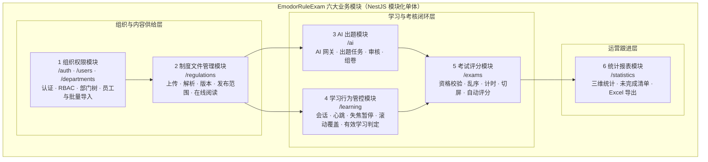

### 1.2 模块依赖关系

系统为 NestJS 模块化单体（AD-02），全部模块间交互发生在**进程内**：跨模块调用一律经 NestJS 依赖注入引用对方暴露的 Service，或经 Repository 对共享数据表做**只读**查询；不存在任何跨服务网络调用。依赖方向与交互内容如下（A → B 表示 A 依赖 B）：

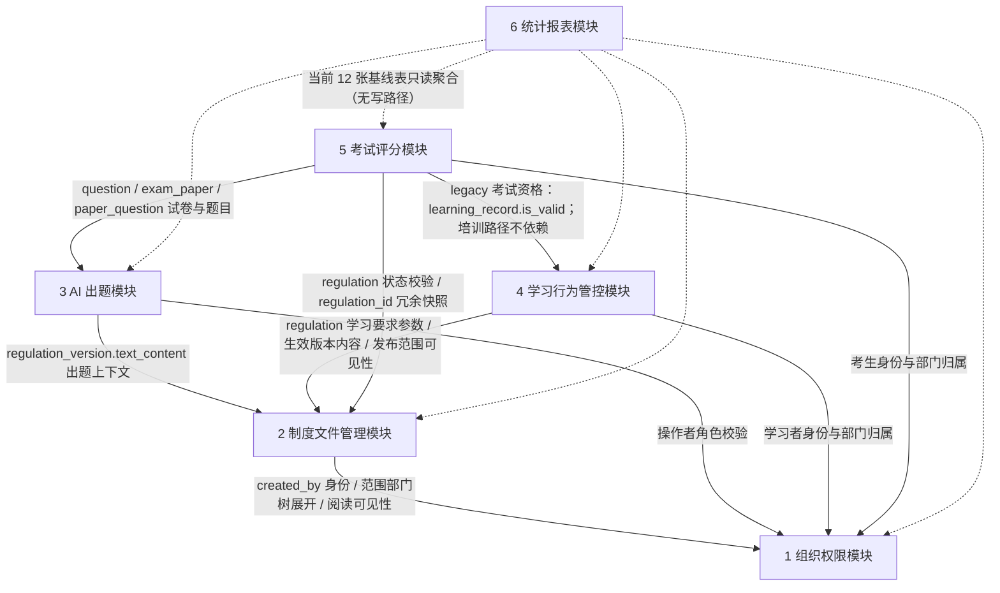

**依赖关系清单**：

| 依赖方 | 被依赖方 | 交互内容 | 交互方式 |
|---|---|---|---|
| 2 制度文件管理模块 | 1 组织权限模块 | 创建人身份（`regulation.created_by`）；发布范围部门树展开（`regulation_scope` → `sys_department` 含子部门）；员工阅读可见性判定（`sys_user.department_id`） | 进程内 Service 调用（部门树服务）；`sys_department` / `sys_user` 只读查询 |
| 3 AI 出题模块 | 2 制度文件管理模块 | 出题上下文（`regulation_version.text_content`，按 `regulation.current_version_id` 取生效版本）；版本追溯（`question.version_id`） | `regulation` / `regulation_version` 只读查询 + 生效版本查询服务 |
| 3 AI 出题模块 | 1 组织权限模块 | 发起出题 / 审核 / 组卷的操作者角色校验（regulation_admin / super_admin） | 认证守卫（JWT + RBAC） |
| 4 学习行为管控模块 | 2 制度文件管理模块 | 有效学习判定参数（`regulation.required_minutes`、`regulation.scroll_segments`）；阅读内容（生效版本 `content_html` 或 PDF 文件流）；制度状态与范围可见性（`regulation.status`、`regulation_scope`） | 进程内 Service 调用 + 只读查询 |
| 4 学习行为管控模块 | 1 组织权限模块 | 学习者身份（`learning_session.user_id`）与部门归属（统计用） | 认证守卫 + 只读查询 |
| 5 考试评分模块 | 4 学习行为管控模块 | **legacy 制度固定卷**资格校验（`learning_record.is_valid`，按 user_id + regulation_id）；新培训考试默认不调用该学习门槛 | 旧路径进程内 Service 调用；培训路径按发布/身份/规则快照校验 |
| 5 考试评分模块 | 3 AI 出题模块 | legacy 试卷与题目（`exam_paper` / `paper_question` / `question` 的 `answer`、`options`、`analysis`）；培训目标读取发布/个人题单快照 | legacy 只读查询；培训路径不得回读动态题库覆盖快照 |
| 5 考试评分模块 | 2 制度文件管理模块 | 制度状态校验（`regulation.status = published`）；`exam_record.regulation_id` 冗余快照来源 | 只读查询 |
| 5 考试评分模块 | 1 组织权限模块 | 考生身份、在职状态（`sys_user.status`）、部门归属 | 认证守卫 + 只读查询 |
| 6 统计报表模块 | 1 ~ 5 全部模块 | 当前业务表及培训增量事实的只读聚合（应学集合、学习指标、考试指标、部门 / 个人维度） | Repository 只读查询；不调用会改变数据的任何服务方法 |

**依赖关系设计原则**：

1. **单向依赖、无环**：依赖方向总体为 1 → 2 → {3, 4} → 5 → 6（被依赖方在上游），不存在循环依赖；`regulation.current_version_id` 与 `regulation_version.regulation_id` 的互指在应用层维护（03 册 1.6 节），不构成模块级环。
2. **跨模块只读优先**：模块间共享数据一律以「上游模块写入、下游模块只读」为常态；唯二的反向写入是考试评分模块写 `exam_record.regulation_id` 冗余快照（开考事务内一次写入、不再变更）。
3. **权限守卫全局统一**：全部模块接口先经全局认证守卫与角色守卫（见 2.4.2 节），模块内不再各建权限体系；数据范围控制（employee 仅本人）由各模块在查询入口统一收口。
4. **统计模块零写路径**：统计报表模块对当前业务事实表只读，不持有任何写事务，保证报表永远不污染业务数据；培训新增统计事实沿用同一边界。

### 1.3 模块内部设计通用约定

以下约定对六大模块统一适用，各模块章节不再重复：

| 约定项 | 内容 |
|---|---|
| 模块组织 | 每模块对应一个 NestJS Module：Controller（接口层，只做参数校验与转发）→ Service（领域服务，承载业务规则）→ Repository（TypeORM 数据访问，映射 03 册当前基线与后续同步实体）；文件解析、AI 网关、定时任务为横切能力（02 册 2.2 节），分别挂靠其业务归属模块（解析 → 制度文件管理模块，AI 网关 → AI 出题模块，定时任务 → 学习行为管控 / 考试评分模块） |
| 统一响应 | 全局响应拦截器输出 `{ code, message, data }`，`code = 0` 表示成功；全局异常过滤器映射 40xxx（客户端错误）/ 50xxx（服务端错误）错误码（README 3.4，明细见 04 分册） |
| 事务边界 | 多表写操作一律在 Service 层显式事务内完成（03 册 1.6 节：关联完整性由应用层维护）；本章标注「事务」的设计点均为单事务原子操作 |
| 时钟口径 | 全部业务时间由服务端时钟生成、统一东八区、`DATETIME(3)` 毫秒精度（03 册 1.3 节）；任何客户端上报的时间戳不参与业务判定（C-01 的通用化） |
| 枚举校验 | 全部枚举字段（`regulation.status`、`question.type` 等）以应用层 TypeScript 常量枚举为唯一定义源，写入前经 DTO 校验拦截非法值（03 册 1.7 节） |
| 数据范围 | employee 的查询边界一律为「仅本人」；super_admin 拥有 regulation_admin 的全部能力（01 册 3 章权限矩阵） |
| Redis 边界 | Redis 只存可再生临时态（考试计时、学习会话累计、防重复提交、任务与作答暂存），MySQL 是唯一权威数据源（AD-04）；各模块的 Redis Key 约定在对应小节给出 |

### 1.4 培训融合模块增量（已实现与计划边界）

仍复用六大 legacy 模块与公共认证，不另造身份系统；以下职责由 A1—C6 分阶段加入，具体模块文件、表和接口由相应任务在源码落地后回填：

| 增量职责 | 归属/owner | 必须保持的边界 |
|---|---|---|
| 类别、学员来源、批量导入 | 组织权限扩展 / A2 | `institution/external` 来源与权限角色分离；旧用户未知值可为空；学员不能改来源/类别/角色 |
| 课程、章节、课时版本、视频 | 学习行为扩展 / B1 已落内容主体，B2 待进度 | 与制度阅读独立；B1 只保存目录/不可变视频版本，B2 才负责 30 秒心跳、45 秒封顶、2 秒位置容差、95% 覆盖；零必学课时不自动完成 |
| 四题型、难度、考点组、题目版本与导题 | AI 出题扩展 / B3 已实现版本链；B4 后续导入 | AI 保存真实来源版本；人工可无制度来源；不强制每考点三档齐全；修订新增 pending revision，不覆盖旧 revision |
| 固定/随机发布与个人题单 | AI/考试协同 / C1 已落发布、C2 待个人卷 | 本机构初级、外来高级；同考点同卷最多一道；发布/个人快照不可变；新培训考试默认无学习门槛 |
| 草稿、图片答案、阅卷 | 考试评分扩展 / C3-C4 | 确认草稿持久化；单题最多 9 张；逐题评分 0..满分且审计/乐观版本校验；最终总分服务端汇总后只读 |
| 监控、场次统计与排名 | 考试/统计扩展 / C5-C6 | 5 秒轮询、90 秒待确认；按场次/难度统计已最终批改个人最高分与当前应考集合交集；旧报表口径保留 |

B1 课程内容、B3 版本题库及 C1 `paper_release/paper_release_question` 均已同步 migration、`init.sql`、entities、设计与 controller/API。视频进度、题库导入、C2 个人题单、草稿/阅卷和统计仍由后续任务落地；C1 不以发布候选池冒充个人卷。

---

## 2. 组织权限模块（`/auth`、`/users`、`/departments`）

### 2.1 模块职责与边界

**职责**：承担全系统的身份认证（JWT 签发 / 校验 / 刷新）、三角色 RBAC 接口守卫、部门树（`sys_department`）维护、员工账号（`sys_user`）全生命周期管理（新增 / 编辑 / 禁用 / 重置密码）与 Excel 批量导入、本人信息与密码维护（FR-ORG-01 ~ 06）。它是其余五个模块的身份与组织数据基座：发布范围圈定、应学人数统计、个人维度统计都以其部门树与员工数据为口径来源。

**边界（不做什么）**：

| 不属于本模块的内容 | 归属 |
|---|---|
| AI 服务连接配置（`base_url` / `api_key` / `model`，具备 `ai_config:write` 的管理角色维护） | 3 AI 出题模块（`/ai`，FR-AIQ-01） |
| 制度的学习要求、发布范围等业务配置 | 2 制度文件管理模块 |
| 员工「在学习 / 考试中的行为数据」的查询与展示 | 4 学习行为管控模块、5 考试评分模块、6 统计报表模块 |
| 组织数据被学习 / 考试 / 统计模块引用后的口径解释 | 各引用模块（本模块只保证组织数据本身的正确性） |

### 2.2 内部组成（子服务 / 组件）

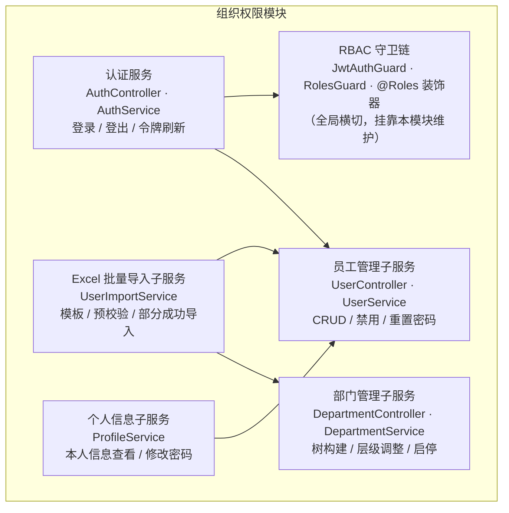

### 2.3 核心类 / 服务职责表

| 组件 | 类型 | 职责 | 关键依赖 |
|---|---|---|---|
| AuthController | 接口层 | `/auth` 登录、登出、刷新令牌入口 | AuthService |
| AuthService | 服务 | 凭据校验（bcrypt 比对）、双令牌签发与刷新、`last_login_at` 更新、登录失败错误混淆 | `sys_user` 仓储 |
| JwtAuthGuard | 守卫（全局） | 全部业务接口的 JWT 校验：解析 Bearer 令牌、验签、注入请求上下文（user_id / role） | JwtStrategy |
| RolesGuard | 守卫 | 读取 `@Roles('super_admin', ...)` 装饰器元数据，校验 `sys_user.role` 是否在允许列表 | 守卫元数据 |
| DepartmentController | 接口层 | `/departments` 部门树查询（`GET /tree` 登录即可读）、新增 / 编辑 / 删除 / 移动（写操作仅 `super_admin`） | DepartmentService |
| DepartmentService | 服务 | 部门树内存构建与缓存、层级调整（事务 + 循环引用检测）、删除前置引用校验、同级重名与唯一根约束 | `sys_department` 仓储 |
| AccessController / AccessService | 接口层 / 服务 | 管理员列表与业务角色分配；首次分配提供受 `administrators:write` 保护的分页账号候选和启用非系统角色选项，事务内重查最高身份并刷新令牌权限 | `sys_user` / `sys_role` / `sys_user_role` 仓储、Redis |
| UserController | 接口层 | `/users` 员工分页查询（按部门 / 角色 / 状态）、新增、编辑、禁用、重置密码 | UserService |
| UserService | 服务 | 员工 CRUD 与唯一性校验（username / employee_no）、角色枚举校验、bcrypt 哈希、禁用生效策略 | `sys_user` 仓储 |
| UserImportService | 服务 | 导入模板定义与下载、Excel 解析、两阶段校验、部分成功写入、失败行回报 | `sys_user` / `sys_department` 仓储 |
| ProfileService | 服务 | 本人信息查询（排除 `password_hash`）、修改密码（原密码校验） | `sys_user` 仓储 |

### 2.4 关键设计详解

#### 2.4.1 认证服务（JWT 签发 / 校验 / 刷新策略、bcrypt 密码哈希）

**密码哈希**：`sys_user.password_hash` 一律存 bcrypt 哈希（cost 因子 12，输出 60 字符；列宽 VARCHAR(255) 为 argon2 等算法迁移预留，03 册 3.1.2 节）。任何查询不得 SELECT 该列，接口返回用户信息时排除（03 册设计说明 2）。登录校验与修改密码均在应用层完成 bcrypt 比对，不依赖数据库排序规则。

**登录流程**：

| 步骤 | 规则 |
|---|---|
| 1 凭据校验 | 按 `username` 走 `uk_username` 查 `sys_user`；bcrypt 比对密码 |
| 2 状态校验 | `sys_user.status = 0`（停用）的账号拒绝登录（FR-ORG-01 验收④） |
| 3 错误混淆 | 「用户不存在」与「密码错误」返回同一错误码与同一提示（FR-ORG-01 验收②：不泄露具体区别） |
| 4 令牌签发 | 校验通过签发双令牌（见下），并更新 `last_login_at` |

**JWT 双令牌与刷新策略**：

| 令牌 | 有效期（默认） | 载荷 | 用途 |
|---|---|---|---|
| access token | 2 小时（环境变量 `JWT_EXPIRES_IN`） | sub（`sys_user.id`）、username、role（`sys_user.role`）、type=access、jti、iat、exp | 每次业务请求的 Bearer 凭据 |
| refresh token | 7 天（应用配置，可调） | sub、type=refresh、jti、iat、exp | 访问 `/auth` 刷新端点换取新 access token |

- **刷新策略**：access 过期前客户端以 refresh token 调用刷新端点；服务端校验 refresh 签名与有效期后签发新 access，并轮换签发新 refresh（旧 refresh 到期自然失效）。学习 / 考试会话经常跨越小时级（`required_minutes` 典型 10 ~ 30 分钟、考试限时更长），双令牌避免「学一半被迫重登打断进度采集」。
- **取舍说明（服务端吊销统一为 Redis 黑名单，与 07 册 2.1.4 定稿一致）**：① AD-05 定稿 JWT 无状态认证，不依赖服务端会话存储——黑名单不改变「默认放行、按需吊销」的无状态主体；② 当前基线不把吊销态写进业务表——吊销态不落 MySQL，由 Redis 承载（条目数只与登出 / 封禁事件数成正比，量级极小且带 TTL 自然过期）；③ JWT 载荷增加 `jti`（随机令牌 id），为单令牌级吊销提供定位粒度。吊销规则：**登出**写 Redis 黑名单 `auth:blacklist:{jti}`（TTL = access 剩余有效期，到期自动清理，黑名单不无限增长）；**改密 / 停用账号**写用户级封禁键 `auth:block:{user_id}`（TTL = refresh 剩余有效期）——键值 = 封禁时刻时间戳 `block_ts`，守卫判定 `token.iat < block_ts` 才拒绝（改密 / 重置后**新签发**令牌天然放行，旧令牌含 refresh 轮换路径即时失效，不会出现「改密后至封禁键过期前无法登录」的误伤）。Redis 故障时降级为**敏感操作实时回库校验**——发起考试、交卷、管理端全部写操作在执行前回查 `sys_user.status = 1`，停用账号的存量令牌在敏感路径上即时失效（07 册 2.1.4 降级取舍：可用性优先，鉴权主体依赖 JWT 自校验，不因 Redis 故障全员不可用）。
- **登出**：服务端写 `auth:blacklist:{jti}`（TTL = access 剩余有效期）并记录审计日志，前端丢弃双令牌；界面侧同时清除本地作答暂存。
- **会话时间一致性**：`SessionService.create` 生成一个服务端 JS `now`，显式写入新 `auth_session` 的 `created_at`、`updated_at`、`last_seen_at`；不依赖数据库 `CURRENT_TIMESTAMP` 的时区默认值，管理端列表因此展示同一时间基准。

#### 2.4.2 RBAC 守卫（角色枚举、接口守卫链）

角色枚举固定三个（`sys_user.role`，README 3.4）：`super_admin`（超级管理员）、`regulation_admin`（制度管理员）、`employee`（普通员工）。super_admin 天然拥有 regulation_admin 的全部能力（01 册 3 章权限矩阵）。

**接口守卫链**（全部业务接口统一经过，顺序固定）：

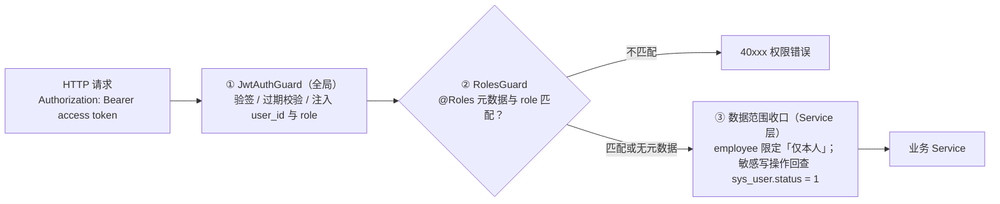

**角色守卫要点**：

| 规则 | 说明 |
|---|---|
| 声明式角色要求 | 接口以 `@Roles('super_admin')`、`@Roles('super_admin', 'regulation_admin')` 声明允许角色；未声明角色的接口默认「任一已认证用户」 |
| 典型拦截 | employee 调用创建制度 / 组卷 / 统计接口、regulation_admin 调用员工管理与 AI 服务配置接口 → 统一 40xxx 权限错误码（FR-ORG-05 验收①②） |
| 部门树兼容例外 | `GET /departments/tree` 是登录后查找接口，普通员工与委派管理员可读；其余部门管理接口继续按 `super_admin` 与写权限收口，不得用该例外放开写操作 |
| 数据范围 | 接口角色之外，数据边界在 Service 查询入口收口：employee 的学习 / 考试 / 统计查询强制追加 `user_id = 本人`；「限发布范围内的本人」由业务模块叠加范围校验（见 3.4.6 / 6.4.1 节） |
| 管理员可被纳入学习 | 学习与考试面向「发布范围内的用户」开放、不按角色排除（01 册 3 章说明）：super_admin / regulation_admin 账号被纳入范围时同样应学应考 |

#### 2.4.3 部门管理子服务（树构建、层级调整的事务与循环引用检测）

**树构建**：

- `sys_department` 为邻接表（`parent_id` 自关联，根部门 `parent_id IS NULL`；03 册 3.1.1 节）。部门树规模为百级节点，树构建采用**一次全量查询 + 内存递归组装**（按 `sort` 升序排列同级），不做逐层 SQL 递归。
- 部门树整树缓存于进程内（组织调整为低频操作），写操作（新增 / 编辑 / 移动 / 启停）后失效重建；「部门 → 含全部子部门的 id 集合」的展开结果随缓存一并提供，供发布范围圈定（3.4.5 节）与统计模块（7.4.2 节）复用。
- 唯一性约束：同一父部门下部门名唯一由 `uk_parent_name` 兜底；「全局唯一根」（`parent_id IS NULL` 仅一行）由应用层保证（03 册 3.1.1 节索引说明）。

**层级调整（移动部门）——事务与循环引用检测**：

把部门 A 移动到部门 B 之下时，若 B 是 A 的子孙，会形成环、树遍历将死循环。设计如下：

| 步骤 | 操作 | 说明 |
|---|---|---|
| 1 | 开启事务，对被移动部门行与其新父链各行加锁（SELECT ... FOR UPDATE） | 防并发移动同一批节点 |
| 2 | 循环引用检测：从新 `parent_id` 出发沿 `parent_id` 链逐级向上遍历至根（`parent_id IS NULL`）；若途中遇到被移动部门自身的 id → 拒绝并提示「不能将部门移动到其自身或其子孙部门之下」 | 时间复杂度 O(树深)，典型 3 ~ 5 层，开销可忽略 |
| 3 | 通过检测后 UPDATE 被移动部门的 `parent_id`，提交事务 | 子树整体随迁（邻接表天然语义） |

**删除与停用的分工**（03 册 1.5 节状态位策略）：

- **物理删除**仅允许无任何引用的部门：无子部门（无 `parent_id` 指向它的行）、无员工归属（`sys_user.department_id` 无引用）、无发布范围引用（`regulation_scope.department_id` 无引用）；任一命中则拒绝。
- **仍被引用的部门走停用**（`sys_department.status = 0`）：停用部门保留在树中（标注停用态），历史学习 / 考试数据仍以其为统计维度；删除仍有员工归属的部门被拒绝并提示先转移员工（FR-ORG-02 验收②）。
- 部门重命名后，发布范围与统计中的部门信息按 `department_id` 实时关联、自动同步展示（FR-ORG-02 验收③）。

#### 2.4.4 员工管理子服务与 Excel 批量导入

**员工 CRUD**：

| 操作 | 关键规则 |
|---|---|
| 新增 | `username` 全局唯一（`uk_username`）、`employee_no` 有值时全局唯一（`uk_employee_no`，NULL 不去重以兼容无工号账号）；`role` 枚举合法性校验；`department_id` 存在性校验；初始密码 bcrypt 哈希入库 |
| 编辑 | 不经此入口改密码；改 `role` / `department_id` 即时生效（换部门后该员工在制度发布范围中的归属随之变化，见 3.4.5 节影响表） |
| 禁用 | `sys_user.status = 0`：即刻无法登录（登录校验拦截）、敏感路径令牌即时失效（2.4.1 节回库校验）、不再计入应学人数（统计分母只计 `status = 1`，C-09） |
| 重置密码 | 新密码 bcrypt 哈希覆写 `password_hash`，旧密码立即失效（FR-ORG-03 验收③） |

**Excel 批量导入（FR-ORG-04 / UC-09）**：

① **模板定义**（单 Sheet，中文表头，首行为表头行）：

| 列 | 对应字段 | 必填 | 校验规则 |
|---|---|---|---|
| A 用户名 | `sys_user.username` | 是 | 全局唯一（库内 + 文件内）；长度 ≤ 64 |
| B 姓名 | `sys_user.real_name` | 是 | 长度 ≤ 64，非空白 |
| C 工号 | `sys_user.employee_no` | 是 | 全局唯一（库内 + 文件内）；长度 ≤ 32 |
| D 部门 | `sys_user.department_id`（按路径解析） | 是 | 填部门名称路径（如「集团总部/生产中心/一车间」），按 `/` 拆解逐级匹配 `sys_department`；路径不存在或中途断链 → 「部门不存在」；目标部门须 `status = 1` |
| E 角色 | `sys_user.role` | 是 | 枚举合法值：super_admin / regulation_admin / employee |
| F 初始密码 | `sys_user.password_hash`（bcrypt 哈希后写入） | 是 | 明文长度 ≥ 6；只用于哈希，不落任何日志 |

② **导入流程（两阶段）**：

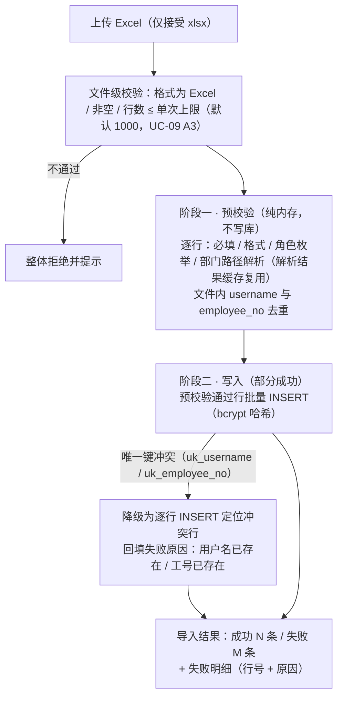

③ **事务与部分成功策略——方案取舍**：

| 方案 | 描述 | 优点 | 缺点 | 结论 |
|---|---|---|---|---|
| 整文件单事务（all-or-nothing） | 任一行失败则全量回滚 | 强一致、实现简单 | 一行脏数据导致千人导入整体失败，管理员须修一行重传全量；**与 FR-ORG-04 验收②「非法行整行失败且不影响其他行」直接冲突** | 否 |
| 逐行独立事务 | 每行一个事务 | 天然部分成功 | 千行级导入的行级事务开销与往返次数偏高 | 备选 |
| **预校验 + 批量写 + 冲突降级（定稿）** | 阶段一在内存中拦截全部可预知错误（格式 / 枚举 / 文件内重复 / 部门路径）；阶段二批量 INSERT 高效写入，仅剩「库内唯一键冲突」这一类运行期错误由唯一索引兜底、逐行降级定位 | 兼顾效率与部分成功语义；可预知错误零数据库开销；库内冲突仍有精确行级原因 | 批量 INSERT 失败需一次降级重放（千行内毫秒 ~ 秒级，可接受） | **采用** |

- **失败行回报**：结果体包含成功计数、失败计数与明细列表（行号 + 失败原因），页面以表格展示（FR-ORG-04 验收③）。
- **导入后闭环**：成功导入的员工可登录，并按其 `department_id` 自动纳入被圈定制度的应学范围（UC-09 后置条件；范围匹配逻辑见 3.4.5 节）。
- **留痕**：批量导入属管理端敏感操作，写审计日志（操作人、时间、成功 / 失败计数，NFR-10）。

### 2.5 与其他模块的依赖关系

| 方向 | 对端模块 | 交互内容 | 交互方式 |
|---|---|---|---|
| 被依赖（上游） | 2 制度文件管理模块 | 部门树与「部门 → 子树 id 集合」展开服务（发布范围圈定 / 应学集合）；创建人身份 | DepartmentService 进程内调用 |
| 被依赖（上游） | 4 学习行为管控模块、5 考试评分模块 | 认证守卫注入的 user_id / role；员工在职状态回查 | 守卫 + 只读查询 |
| 被依赖（上游） | 6 统计报表模块 | `sys_user`（应学分母、部门 / 个人维度）、`sys_department`（部门树展开） | 只读查询 |
| 依赖（下游） | 无 | 组织权限模块是依赖图的根，不依赖任何业务模块 | — |

### 2.6 对应数据表

| 表 | 本模块读写角色 | 说明 |
|---|---|---|
| `sys_department` | 全量读写（树构建 / 新增 / 编辑 / 移动 / 停用） | 物理删除仅限零引用部门（2.4.3 节） |
| `sys_user` | 全量读写（含批量导入写入） | `password_hash` 只写不读不出参；`last_login_at` 登录时更新 |
| 其余 10 张表 | 不读写 | 组织数据被引用场景全部由引用方模块负责 |

---

## 3. 制度文件管理模块（`/regulations`）

### 3.1 模块职责与边界

**职责**：承载「制度上传即可读、版本可追溯、范围可圈定」的全部数据与流程（FR-REG-01 ~ 08）：制度主档（`regulation`）创建与维护、学习要求配置（`required_minutes` / `scroll_segments`）、制度文件上传校验（pdf / docx、大小上限、`file_hash` 重复检测）与本地卷存储、异步解析流水线（`regulation_version.parse_status`：pending → parsed / failed）、append-only 版本管理与 `current_version_id` 生效切换、发布范围配置（`regulation_scope` / `is_all`）、制度状态流转（draft → published → archived）、以及面向员工端的在线阅读内容服务（docx → `content_html` 渲染、pdf → pdfjs-dist 前端渲染的受控下发）。

**边界（不做什么）**：

| 不属于本模块的内容 | 归属 |
|---|---|
| 解析产物的出题消费（`text_content` 喂给 AI） | 3 AI 出题模块（本模块只负责产出与提供只读访问） |
| 学习会话、心跳、滚动覆盖、有效学习判定 | 4 学习行为管控模块 |
| 考试资格、试卷状态中「员工可考」的组织协调 | 5 考试评分模块 |
| 基于制度数据的指标聚合 | 6 统计报表模块 |
| 组织维度数据维护（部门 / 员工） | 1 组织权限模块 |

### 3.2 内部组成（子服务 / 组件）

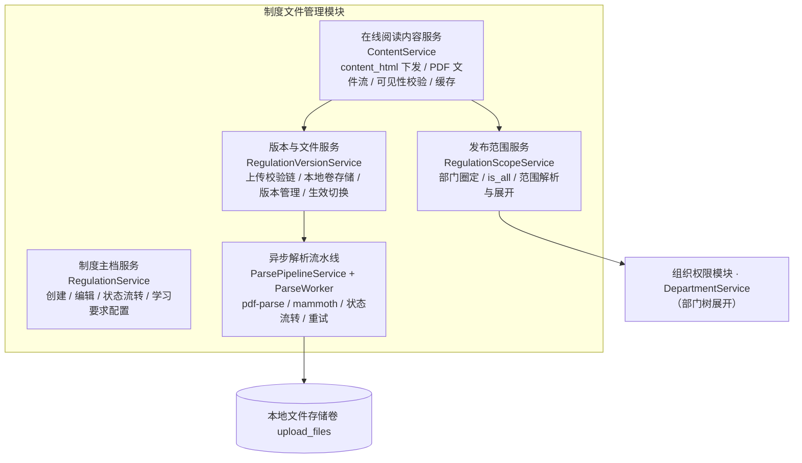

### 3.3 核心类 / 服务职责表

| 组件 | 类型 | 职责 | 关键依赖 |
|---|---|---|---|
| RegulationController | 接口层 | `/regulations` 制度 CRUD、状态流转、学习要求与发布范围配置入口 | RegulationService 等 |
| RegulationService | 服务 | 制度主档维护（标题 / 分类 / 描述）、`required_minutes` / `scroll_segments` 配置校验、status 状态机流转（draft → published → archived，发布前置校验）、`published_at` 写入 | `regulation` 仓储 |
| RegulationVersionService | 服务 | 上传校验链（格式 / 大小 / 哈希 / 重复检测）、`version_no` 分配、文件落盘与目录组织、`current_version_id` 切换 | `regulation_version` 仓储、文件系统 |
| ParsePipelineService | 服务（横切） | 解析任务调度：事件触发 + 兜底扫描、并发控制、worker 分派、`parse_status` 流转与重试 | `regulation_version` 仓储、ParseWorker |
| ParseWorker | 执行器 | 进程隔离执行解析：pdf-parse 提取文本 / mammoth 转 HTML，产物体检（空产物判失败） | pdf-parse、mammoth、文件系统 |
| RegulationScopeService | 服务 | 发布范围配置（部门圈定 / `is_all` 互斥表达）、「制度 → 应学部门 id 集合」与「用户 → 可见制度」两个方向的解析 | `regulation_scope` 仓储、DepartmentService |
| ContentService | 服务 | 在线阅读内容受控下发：docx 的 `content_html`（带缓存）、pdf 的文件流；阅读可见性校验链 | `regulation` / `regulation_version` 仓储、RegulationScopeService、Redis |

### 3.4 关键设计详解

#### 3.4.1 上传校验（格式 pdf / docx、大小上限、file_hash 重复检测）

上传校验按固定顺序执行，任一步失败立即终止并返回对应 40xxx 错误：

| # | 校验项 | 规则 | 失败处理 |
|---|---|---|---|
| 1 | 角色与制度 | 操作者为 regulation_admin / super_admin；目标制度存在 | 权限 / 参数错误 |
| 2 | 大小 | 单文件 ≤ 50MB：应用层流式读取累计字节数判定；nginx 请求体上限同步配置为同值 | 拒绝并提示超出大小上限 |
| 3 | 格式 | 扩展名 ∈ {pdf, docx}（写入 `regulation_version.file_type`）+ **文件魔数双重校验**：pdf 以 `%PDF-` 头；docx 为 zip 结构（`PK` 头）。仅改扩展名的伪装文件被拦截 | 拒绝并提示支持的格式（FR-REG-02 验收①） |
| 4 | 完整性 | 流式计算 SHA-256 得 `file_hash`（CHAR(64)，十六进制） | — |
| 5 | 重复检测 | 以 `file_hash` 在同制度下查询（`idx_file_hash`）：命中 → 返回提示「与版本 v{N} 文件内容相同」，**提示但不阻断**（FR-REG-02 验收③），继续走版本创建 | — |
| 6 | 落库（事务） | 分配 `version_no` = 该制度 max(version_no) + 1（`uk_regulation_version_no` 兜底并发上传，冲突时重读重分配）；INSERT `regulation_version`（`parse_status = pending`、`file_path` / `file_type` / `file_hash` / `created_by`）；文件从临时区移入正式目录；事务提交后触发解析任务 | 失败回滚并清理临时文件，不产生半成品 |

> 说明：大小上限 50MB 为上传硬性拒绝线；NFR-04 的「常规制度文件（≤ 20MB）解析完成 ≤ 60 秒」是解析时效的性能基准口径（20MB 以上文件解析时长按比例放宽，仍受异步任务模型保护、不阻塞其他操作）。

#### 3.4.2 文件存储组织（本地卷目录规则）

本地文件存储卷（AD-06，Docker 卷 `upload_files`，容器内挂载 `UPLOAD_DIR`）的目录规则：

| 项 | 规则 | 说明 |
|---|---|---|
| 正式目录 | `{UPLOAD_DIR}/regulations/{regulation_id}/{version_no}_{file_hash 前 8 位}.{file_type}` | 按制度分目录（备份 / 清理粒度）；`version_no` 保证同制度唯一；hash 前缀防同名碰撞；扩展名即 `file_type` |
| 临时区 | `{UPLOAD_DIR}/tmp/` | 上传先写临时区，校验全部通过并在事务提交后移入正式目录；事务失败即清理 |
| 路径入参 | `regulation_version.file_path` 存放**相对路径** | 与 03 册 3.2.2 节「以 URL 路径表达、天然支持存储演进」一致；未来迁对象存储仅改应用层读写路径 |
| 安全性 | 目录与文件名全部由系统生成（制度 id / 版本号 / hash 派生），不含任何用户输入 | 天然防路径穿越；文件访问一律经应用层鉴权受控下发（3.4.6 节），不暴露直接静态映射 |

#### 3.4.3 异步解析流水线（上传后 pending → 队列消费 → parsed / failed）

解析为异步任务（AD-03）：上传接口在事务提交后立即返回，解析在后台执行，`parse_status` 状态流转如下：

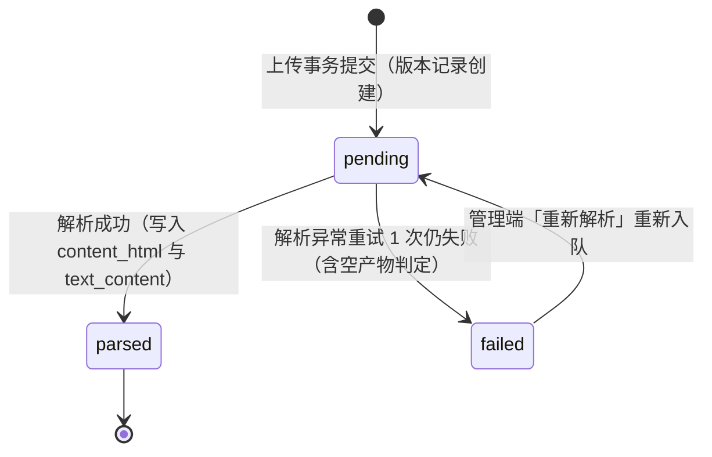

**流水线设计**：

| 环节 | 设计 |
|---|---|
| 任务触发 | 双通道：① 上传事务提交后进程内事件**立即触发**（实时性）；② 兜底定时扫描（每 1 分钟扫 `parse_status = 'pending' AND created_at < NOW() − 2 分钟` 的记录重新投递，防事件丢失、避免与刚投递的事件任务抢跑；`idx_parse_status` 支撑） |
| 任务抢占 | worker 取任务时执行 `SET parse:lock:{version_id} NX EX 600` 抢占——抢锁失败即跳过该版本（另一 worker 正在解析）；锁随解析终态释放，600 秒 TTL 自然过期兜底 | 双通道触发下同一版本不并发双解析（重复投递被锁幂等拦截，防 `parse_status` 被 `failed` 覆盖已成功的 `parsed`） |
| 执行隔离 | 解析在 worker 线程 / 子进程执行，与请求处理的事件循环隔离（pdf 文本提取为 CPU 密集操作，02 册 3.3 节风险 R1）；并发上限默认 2 个，超出的排队 |
| pdf 分流 | `file_type = pdf` → **pdf-parse** 提取全文文本 → 写 `text_content`；`content_html` 置 NULL（PDF 阅读走 pdfjs-dist 前端渲染原始文件，见 3.4.6 节，与 02 册 4.2 节协同口径一致） |
| docx 分流 | `file_type = docx` → **mammoth** 一次转换双产物：`convertToHtml` → `content_html`（在线阅读）、`extractRawText` → `text_content`（AI 出题输入） |
| 产物体检 | `text_content` 去空白后低于 50 字符时：启用多模态且为 PDF → 保持 parsed，供 PdfVisionService 逐页出题；否则 failed。DOCX 低文本仍提示核对，不把不可用产物伪装成功 |
| 失败重试 | 瞬时异常（文件读取 I/O 等）自动重试 1 次，每次重试 `retry_count + 1`；仍失败 → `parse_status = failed`；管理端版本详情提供「重新解析」入口（failed → pending 重新入队，同样计入 `retry_count`）。产物字段只在首次成功时写入、并同步记录 `parsed_at`（解析完成时刻，NFR-04 耗时度量），重试不产生脏数据 |
| 状态可见 | 管理端版本列表 / 详情轮询 `parse_status`（pending / parsed / failed 实时呈现，FR-REG-03 验收③）；版本不可变约束不受影响——`parse_status` 是版本记录上唯一允许流转的状态字段（pending → parsed / failed，及 failed → pending 的重新入队） |

#### 3.4.4 版本管理（append-only、current_version_id 切换规则、员工读到当前生效版本）

**append-only 不可变约束**：`regulation_version` 一经创建，`file_path` / `file_type` / `file_hash` 与解析产物（`content_html` / `text_content`）只读，表上无 `updated_at`（03 册 3.2.2 节设计说明 1）。同一制度可多次上传形成多版本，历史版本内容永久可回看（FR-REG-04 验收②③）。

**current_version_id 切换规则**：

| 规则 | 内容 |
|---|---|
| 候选校验 | 目标版本必须属于本制度且 `parse_status = parsed`（未解析 / 解析失败版本不能生效） |
| 允许状态 | `regulation.status` ∈ {draft, published} 时均可切换；archived 后不再切换（归档即止，C-08） |
| 切换操作 | 仅单字段 UPDATE `regulation.current_version_id`，不改动任何版本行数据 |
| 生效时机 | 即时：员工阅读内容接口按切换后的指针取版本（3.4.6 节）；Redis 中旧版本 `content_html` 缓存随换版失效 |
| 会话影响 | 切换后**新**学习会话的 `version_id` 指向新版本；进行中会话不受影响读到结束；`learning_record.version_id` 记录最近一次学习版本 |
| 进度影响 | **不追溯、不清零**：学习进度与考试资格绑定 `regulation` 而非具体版本（C-07）；如需要求重新学习，由管理员调整学习要求（如提高 `required_minutes`）或另行发布新制度 |

**员工读到的是当前生效版本**：员工端阅读接口只暴露 `current_version_id` 指向的版本内容；历史版本仅管理端版本管理页可见（FR-REG-04 验收①：切换生效版本后员工阅读页展示新版本内容）。

#### 3.4.5 发布机制（status 流转、发布范围变更对已学记录的影响）

**制度状态机**（单向，`published_at` 首次发布时写入）：

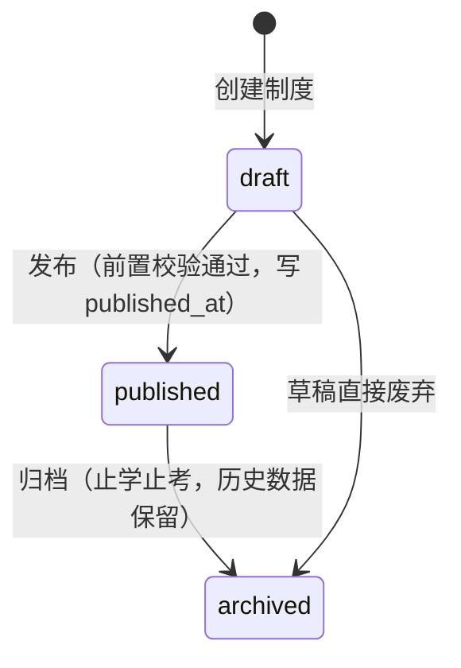

**发布前置校验**（C-04，任一不满足即拦截并提示，FR-REG-07 验收①）：① `current_version_id` 非空且其版本 `parse_status = parsed`；② 已配置发布范围——`regulation_scope` 存在 `is_all = 1` 行（约定仅此一行且 `department_id` 为 NULL，应用层保证该不变式，03 册 3.2.3 节），或至少一条部门圈定行。

**发布范围语义与解析**：

- `is_all = 1` → 面向全员（全部在职员工）；否则为部门集合，**圈定部门含其全部子部门**（经组织权限模块的「部门 → 子树 id 集合」展开服务）。
- 员工可见性反查：以员工 `department_id` 的祖先链（含自身）匹配圈定部门集合，命中即范围内（新员工入职进入已圈定部门后自动纳入应学范围，FR-REG-06 验收③）。
- 「按部门」与「全员」两种方式互斥表达（FR-REG-06 验收①）；范围调整后应学人数与统计口径随之更新（C-09）。

**发布范围 / 组织变更对已学记录的影响**（FR-REG-06 验收②、C-07 / C-08 / C-09 的组合口径）：

| 变更场景 | 可见性与入口 | `learning_record` 影响 | 统计口径影响 |
|---|---|---|---|
| 范围扩大 | 新纳入员工可见、可学 | 新员工首次学习时创建记录 | 应学人数增加；完成率分母同步增大 |
| 范围缩小 | 范围外员工不再可见、不可再进入阅读 / 考试 | 已有记录（含 `is_valid = 1`）**保留不删、不回退** | 应学人数减少；学习完成率分子按「应学集合 ∩ `is_valid = 1`」计算（见 7.4.1 节），不会出现完成率 > 100% 的口径事故 |
| 员工换部门 | 可见性按新部门即时重新判定 | 记录绑定 `user_id` 不变（进度跟人不跟部门） | 应学口径按当前部门计算（部门级范围天然覆盖组织调整） |
| 部门重命名 / 停用 | 名称变化不影响可见性判定（按 `department_id`） | 无影响 | 部门维度统计实时关联新名称；停用部门保留为历史统计维度 |
| 制度归档 | 员工端不可见、不可再学习与考试（C-08） | 历史学习数据保留并计入统计 | 历史数据继续计入统计，新增停止 |

#### 3.4.6 在线阅读内容服务（docx → HTML、pdf → pdfjs-dist、权限与可见性）

**双渲染路径**（阅读数据来源由生效版本的 `file_type` 决定，与 02 册 3.9 节定稿一致）：

| 生效版本 file_type | 阅读数据来源 | 前端渲染方式 |
|---|---|---|
| docx | `regulation_version.content_html`（mammoth 产物，经接口下发） | 富文本直接渲染（结构化 HTML） |
| pdf | 原始 PDF 文件流（`file_path` 指向的本体，经应用层受控下发） | **pdfjs-dist** canvas 渲染（自有容器内滚动可观测，是滚动覆盖采集的硬前提） |

两条路径在阅读页共用同一滚动追踪与心跳上报逻辑（FR-REG-08）。

**阅读内容接口的权限与可见性校验链**（顺序执行）：

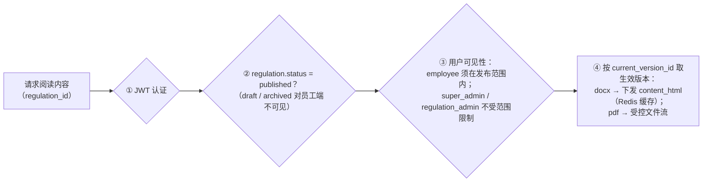

- **缓存**：docx 的 `content_html` 为版本不可变数据，天然适合缓存——Redis 缓存「制度 id → 生效版本 content_html」，TTL + 换版失效（03 册 6.5 节第 4 条）；版本列表类查询一律禁止 `SELECT *`，阅读内容按版本 id 点读大字段。
- **pdf 文件流**：经上述校验链后由应用层流式下发，不提供可猜测的静态 URL（文件本体不落 nginx 静态映射；传输安全细节见 07 分册）。
- **阅读页职责**：承载滚动位置采集与 30 秒心跳上报（行为采集的设计见第 5 章）。

### 3.5 与其他模块的依赖关系

| 方向 | 对端模块 | 交互内容 | 交互方式 |
|---|---|---|---|
| 依赖（下游） | 1 组织权限模块 | 部门树 /「部门 → 子树 id 集合」展开（发布范围圈定与应学集合）；创建人身份（`created_by`） | DepartmentService 进程内调用；只读查询 |
| 被依赖（上游） | 3 AI 出题模块 | 生效版本 `text_content`（出题上下文）、`current_version_id`、`question.version_id` 绑定 | 只读查询 |
| 被依赖（上游） | 4 学习行为管控模块 | `regulation`（`required_minutes` / `scroll_segments` / `status`）、生效版本阅读内容、发布范围可见性 | ContentService / RegulationScopeService 进程内调用；只读查询 |
| 被依赖（上游） | 5 考试评分模块 | `regulation.status` 校验（published 方可开考）；`exam_record.regulation_id` 冗余快照来源 | 只读查询 |
| 被依赖（上游） | 6 统计报表模块 | 制度主档、版本、范围三表的统计口径数据 | 只读查询 |

### 3.6 对应数据表

| 表 | 本模块读写角色 | 说明 |
|---|---|---|
| `regulation` | 全量读写 | 状态流转、`current_version_id` 指针维护、学习要求配置 |
| `regulation_version` | 写（创建 / 解析产物回填 / `parse_status` 流转）、读（版本列表 / 阅读内容 / 出题上下文） | append-only；产物仅在解析成功时单次写入 |
| `regulation_scope` | 全量读写（范围配置） | `is_all = 1` 时仅一行且 `department_id` 为 NULL（应用层不变式） |
| 本地文件存储卷 | 读写文件本体 | 目录规则见 3.4.2 节 |

---

## 4. AI 出题模块（`/ai`）

### 4.1 模块职责与边界

**职责**：实现「出题低成本、质量可控」（FR-AIQ-01 ~ 07）：保留 AI 配置/网关、文本与 PDF 视觉输入、异步进度与 B3 四题型版本题库。C1 在同一模块的管理面新增培训固定/随机卷、不重复考点抽样与发布快照；legacy `/ai/papers` 继续兼容。个人题单与开考仍归 C2 考试执行面。

**边界（不做什么）**：

| 不属于本模块的内容 | 归属 |
|---|---|
| 制度文本的解析产出（`text_content` 的生成） | 2 制度文件管理模块 |
| 考试的资格校验、乱序、计时、评分（消费试卷与题目） | 5 考试评分模块 |
| 题目正确率等题库维度统计 | 6 统计报表模块 |

### 4.2 内部组成（子服务 / 组件）

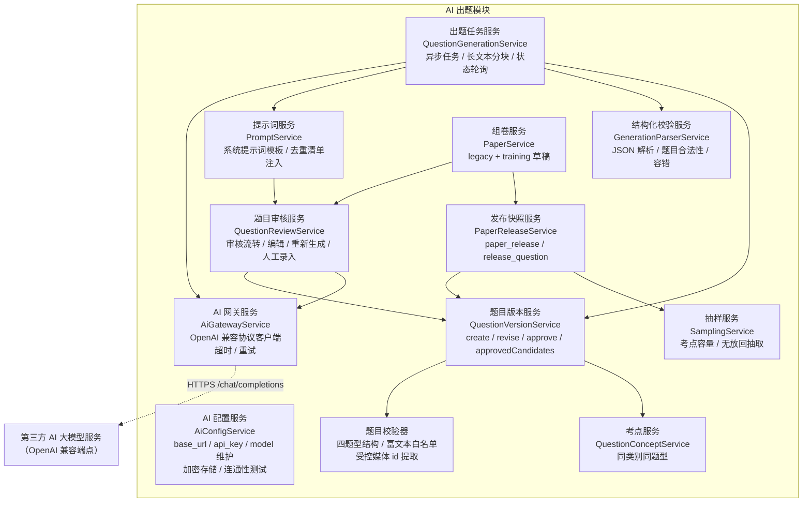

### 4.3 核心类 / 服务职责表

| 组件 | 类型 | 职责 | 关键依赖 |
|---|---|---|---|
| AiConfigController / AiConfigService | 接口层 / 服务 | AI 连接参数维护与读取（`GET / PUT /ai/config`；`ai_config:read/write` 分离，环境变量默认 + 界面配置覆写；PUT 返回脱敏结果）、连通性测试（`POST /ai/config/test`）、`api_key` 加密存取与脱敏展示 | 加密配置存储 |
| AiGatewayService | 服务（横切） | OpenAI 兼容协议 HTTP 客户端：按配置动态构建请求、120 秒超时、分类重试、非流式调用 | AiConfigService |
| QuestionGenerationService | 服务 | 出题任务生命周期、文本分块/PDF page image 编排、category/difficulty 固定、合法结果交给统一版本服务批量落库 | AiGatewayService、PdfVisionService、QuestionVersionService |
| PromptService | 服务 | 系统提示词模板渲染（角色设定 / 题型规则 / JSON Schema 约束 / 去重清单）、用户提示词组装 | `question` 仓储（存量题干采样） |
| GenerationParserService | 服务 | 响应体提取（剥离代码围栏）、JSON 解析、逐题合法性校验、批级容错判定、stem 归一化去重 | — |
| QuestionValidator | 纯校验 | 四题型结构、scoreCents、来源配对、sanitize-html 白名单、拒绝外链图片并提取 data-media-id | training contracts、sanitize-html |
| QuestionConceptService | 服务 | 创建/查询考点；事务锁定启用类别；题目引用时验证 category/type 同域 | CategoryService、question_concept |
| QuestionVersionService | 领域服务 | `create/revise/approve/approvedCandidates`；一个事务写身份+revision，旧题首次动作诚实捕获，绑定媒体引用，只返回当前 approved 精确候选 | question/question_version、CategoryService、MediaService |
| QuestionReviewService | 服务 | 题库多维查询、当前版本审核/驳回、修订、扫描 PDF 单题重生成、人工录入首版本确认；审计日志记录动作 | QuestionVersionService、AiGatewayService、PdfVisionService |
| PaperService | 服务 | 保留 legacy 试卷；新增 training 草稿配置、固定版本题单、同类别关系校验、复制与状态流转 | `exam_paper` / `paper_question`、CategoryService |
| PaperReleaseService | 领域服务 | `publish/get/preview`；冻结 RuleSnapshot 与当前 approved QuestionVersionSnapshot，发布后只读 | `paper_release*`、QuestionVersionService、SamplingService |
| SamplingService | 纯服务 | 按题型/难度将同 concept 变体视为一组；验容后组间无放回、组内抽一版本，用 crypto 随机源 | training contracts |
| PaperAdminController | 接口层 | `/admin/papers` 严格 DTO、细权限、普通/答案预览隔离和 snake_case 响应 | PaperService、PaperReleaseService、AccessService |

### 4.4 关键设计详解

#### 4.4.1 AI 网关服务（OpenAI 兼容协议封装）

**协议封装**：以 OpenAI 兼容协议的 `/chat/completions` 端点为唯一接入形态（`POST {base_url}/chat/completions`，`Authorization: Bearer {api_key}`，请求体含 `model`、`messages`、`temperature`），一个客户端适配智谱 GLM、DeepSeek、通义千问等全部兼容服务商（02 册 3.6 节）；换服务商 = 改 `base_url` / `api_key` / `model` 三项配置，无需改代码（NFR-15）。

**配置管理**：

| 项 | 设计 |
|---|---|
| 配置来源 | 环境变量（`AI_BASE_URL` / `AI_API_KEY` / `AI_MODEL`）为初始默认值；具备 `ai_config:write` 的管理端界面配置覆写并全局生效（FR-AIQ-01） |
| 持久化 | 遵循当前基线与增量同步政策：界面配置持久化为**应用数据目录下的加密配置文件**（唯一权威副本，随应用数据卷参与备份）；`api_key` 以 AES-256-GCM 加密存储（加密密钥来自环境变量 `APP_ENCRYPTION_KEY`）；Redis 仅作解密后配置的**读缓存** `ai:config:cache`（TTL 10 分钟，可再生、不作为权威源）——不存在「Redis 持久键 `ai:config` 为权威源」的路径（07 册 4.2.2 同口径）；界面只回显脱敏掩码、不回显明文（FR-AIQ-01 验收② / NFR-10） |
| 未配置拦截 | 三项配置任一缺失时，发起出题被拦截并提示先完成配置（FR-AIQ-01 验收③） |
| 连通性测试 | 以最小 messages（如「请回复 OK」）走真实调用链路验证配置，返回成功 / 失败与失败原因（FR-AIQ-01 验收①） |

管理端入口同时接受 `ai_config:read` 或 `ai_config:write`。仅有 `ai_config:write` 的角色进入空白编辑表单，不请求受保护的 `GET /ai/config`，保存后以 `PUT /ai/config` 返回的脱敏结果更新界面；写权限不隐式授予读权限。

**超时与重试**：

| 项 | 规则 |
|---|---|
| 超时 | 单次调用 120 秒硬超时（NFR-05）；超时明确报错、任务可重试 |
| 可重试错误 | 网络错误 / 5xx / 429（限流）→ 重试 ≤ 2 次，指数退避（如 2 秒、8 秒） |
| 不可重试错误 | 4xx（鉴权失败 / 参数错误）→ 立即报错提示检查配置，不消耗重试 |

**流式与否的取舍**：**不启用流式（`stream = false`）**。理由：① 出题是后台异步任务（AD-03），调用方是任务执行器而非用户浏览器，无「打字机」体验诉求；② 生成结果必须**整体**通过 JSON 校验后才落库（FR-AIQ-02 验收③：不产生脏数据），流式增量没有可消费的中间产物；③ 非流式使超时控制与重试边界（一次调用 = 一个重试单元）简单可靠。

#### 4.4.2 出题任务服务（异步任务、长文本分块、任务状态轮询）

**异步任务模型**（AD-03）：发起出题接口完成参数校验后立即返回 `task_id`，生成在后台执行；前端以任务状态轮询接口跟踪进度（AI 不可用仅影响新增出题，不影响已入库题目的审核与组卷，A-02）。

**任务状态（Redis 承载，key：`ai:task:{task_id}`，TTL 24 小时）**：任务元数据是「失败可重试、结果落 `question` 表」的可再生临时态（AD-04），不建任务表（A-05）。状态流转：`queued`（已受理）→ `running`（分块调用中）→ `completed`（响应直接返回 `question_ids[]` 与题目明细）/ `failed`（返回失败原因，可重新发起）。任务完成后**不引入批次字段**（A-05：`question` 表无 task_id / 批次号，题库查询接口亦无批次筛选参数）：当次批次视图以 `completed` 响应返回的 `question_ids[]` 为准；跨批次追溯按 `regulation_id + status = pending + created_at` 倒序检索题库（`idx_regulation_status_type` 支撑）。

**发起前置校验**：① category_id 指向启用类别且 difficulty 为 easy/medium/hard；② 制度有 parsed 生效版本，优先使用 `text_content`，文本不足但为 PDF 时使用 `PdfVisionService` 按页渲染 image_url；③ 分值合计 = 100；④ AI 配置完整。校验顺序先确认业务来源与类别，再读取 AI 配置，失败不创建任务。类别、难度与实际 regulation_version_id 由服务端固定，模型输出无权覆盖；同时把目标难度写入实际文本/视觉 gateway messages：easy 为直接明确的一条规则，medium 为单一情境直接应用，hard 为多条规则综合应用，三档均须有据且无歧义。

**长文本分块策略**（制度文本超长时分段喂给大模型）：

| 环节 | 规则 | 说明 |
|---|---|---|
| 分块触发 | `text_content` 超过单块阈值（默认 4000 字符，可配置）时启用分块；不超过则单块直出 | 阈值权衡：过小 → 上下文割裂出题质量下降；过大 → 单次调用 token 上限与超时风险 |
| 边界切分 | 优先按解析产物保留的段落 / 标题边界切块；无结构可用时按字符数硬切 | 保语义完整性 |
| 块间重叠 | 相邻块保留 200 字符重叠 | 段落跨界考点不因切分丢失 |
| 题量分配 | 按各块字符数占比分配 single / multiple 目标题数，合计等于请求总数 | 长章节多出题，覆盖均衡 |
| 上下文注入 | 每块头部注入制度标题与「第 i / N 部分」序号 | 提示模型这是长文的一部分，避免跨块误判 |
| 并发控制 | 块间并行调用，并发度 ≤ 3 | 控制总时长（NFR-05：单次出题请求 120 秒内返回）与上游限流压力 |
| 失败粒度 | 块级失败块级重试（≤ 2 次），不拖累其他块 | 成功块正常落库，失败块计入任务结果明细 |

**不产生脏数据**：任何生成结果都先经 4.4.4 节校验，合法题目才进入落库事务；任务失败（全部块失败）时 `question` 表零写入（FR-AIQ-02 验收③、UC-03 A1）。

#### 4.4.3 提示词策略（系统提示词模板设计）

**系统提示词模板**（角色设定 + 输出格式约束 + 题型规则 + 质量要求 + 去重约束；模板为设计产物，`{xxx}` 为运行期注入槽位）：

```text
你是企业制度考核命题专家。请根据提供的制度文本，编写用于考核员工对企业制度理解程度的考试题目。

输出要求：
1. 仅输出一个 JSON 数组作为全部输出内容，不要输出任何解释、前后缀或 markdown 代码块标记。
2. 数组每个元素的 JSON 结构为：
   {"type": "single 或 multiple", "stem": "题干", "options": [{"key": "A", "text": "选项文本"}, {"key": "B", "text": "选项文本"}, {"key": "C", "text": "选项文本"}, {"key": "D", "text": "选项文本"}], "answer": [正确选项的下标数组], "analysis": "答案解析"}
3. 题型规则：type = single 的题目，answer 必须恰好包含 1 个元素；type = multiple 的题目，answer 必须包含 2 ~ 3 个元素，且为升序、不重复的下标。
4. 每道题 options 恰好 4 个选项；answer 中的每个下标必须在 0 ~ 3 范围内。
5. 目标难度由请求注入：easy 只考直接明确的一条规则；medium 在单一工作情境中直接应用制度规则；hard 综合应用多条规则。不得自行改写或降级。
6. 题目必须严格依据给定的制度文本命制，不得编造文本中不存在的内容；每题答案必须唯一正确（single）或组合唯一正确（multiple）。
7. 干扰项应具有合理迷惑性但明确错误；解析须说明正确答案的依据（引用制度原文要点）。
8. 不得与【已有题目清单】中任何题干重复或高度相似。

【已有题目清单】
{existing_stems}
```

**用户提示词**：生成参数（single 数量与分值、multiple 数量与分值、出题依据版本说明）+ 分块文本（「制度《{title}》正文（第 {i} / {n} 部分）」+ 块内容）。

**答案唯一性 / 多选答案数约束的落地**：提示词约束（第 3 ~ 5 条）只是第一道；第二道在服务端逐题校验（4.4.4 节步骤 3），两道合围保证落库题目必然满足「single 恰 1 答案、multiple ≥ 2 答案升序去重、下标不越界」（与 03 册 4.2 节 `question.answer` 结构约束一致）。

**避免出题重复的去重策略（三层）**：

| 层 | 机制 | 说明 |
|---|---|---|
| 提示词层 | 注入【已有题目清单】：该制度下现存全部题目的 stem 列表（超过 50 条时采样最近 50 条） | 生成前把存量题目告诉模型，要求不重复（模板第 7 条） |
| 校验层 | stem 归一化精确去重：新题之间、新题与库内题，去除空白与标点后精确匹配 → 命中即剔除并计数 | 确定性拦截「字面重复」 |
| 审核层 | 人工审核把关：语义高度相似但非字面重复的题目由管理员驳回或编辑（C-03 人工把关是最终防线） | 技术手段不追求语义相似度全自动判定，交人工收口 |

**设计取舍说明（score 不纳入 AI 结构化输出）**：提示词模板的 JSON 结构仅约束 `type / stem / options / answer / analysis`——`score` 不由 AI 输出，由发起出题时的分值模板（`score_single` / `score_multiple`，4.4.2 节）在落库事务中统一写入 `question.score`。理由：① 分值是试卷级业务配置，同一题可被多张试卷以不同分值引用（03 册 3.4.1 节设计说明 3）；② 避免 AI 输出分值与模板合计 ≠ 100 的冲突（4.4.5 节总分校验）；③ 「分值」语义由模板参数 + `paper_question.score` 共同承载。

#### 4.4.4 结构化输出解析与校验（容错处理）

生成结果（每块一份 JSON 数组）按以下流水处理：

| # | 步骤 | 规则 | 容错处理 |
|---|---|---|---|
| 1 | 响应体提取 | 剥离 markdown 代码围栏（```json ... ```）、截取首个 `[` 至末个 `]` 之间的内容 | 围栏缺失可容错（部分厂商输出习惯不同） |
| 2 | JSON 解析 | `JSON.parse` 整体解析为题目数组 | 解析失败 → 该块重试（≤ 2 次）；仍失败 → **该块结果整体丢弃**（对应 UC-03 A2「返回格式异常 → 丢弃并提示重新生成」的块级形态） |
| 3 | 逐题合法性校验 | type ∈ {single, multiple}；stem / analysis 非空；options 恰 4 项；answer 元素为 0 ~ 3 的整数；single 恰 1 元素；multiple 为 2—3 元素且升序去重 | 非法题剔除并计数 |
| 4 | 批级判定 | 块内合法题占比 ≥ 80% 且数量 ≥ 目标题数 × 60% → 保留合法题；否则该块重试 1 次，仍不达标 → 保留合法题 | 剔除明细（原因 + 数量）计入任务结果，管理员可见 |
| 5 | 去重 | stem 归一化后与本批其他题、库内存量题精确匹配 → 剔除 | 去重计数计入任务结果 |
| 6 | 落库（事务） | `QuestionVersionService.createMany` 为每题创建 question 身份 + revision 1，写入请求 category/difficulty、实际 regulation/version、source=ai、status=pending；视觉题另写程序实际渲染的 page group 与起止页，并同步兼容视图 | 单事务整批写入；任一关系/媒体绑定失败整体回滚；全部块失败零写入 |

**整批失败语义**：全部块解析失败 → 任务置 `failed`、不产生任何 `question` 记录（FR-AIQ-02 验收③）；部分块成功 → 成功块落库，任务结果报告成功 / 失败块明细，管理员可对失败块重新发起。

#### 4.4.5 100 分分值分配规则

试卷固定 100 分制（`exam_paper.total_score` 恒为 100.00）。分值分配在**发起出题**时即参数化约定，并在**组卷发布**时二次校验：

| 层 | 规则 |
|---|---|
| 发起出题（默认模板） | **20 道 single × 3 分 + 5 道 multiple × 8 分 = 60 + 40 = 100 分**；模板参数（`count_single` / `score_single` / `count_multiple` / `score_multiple`）由发起请求传入、可调整（4.4.2 节），应用层校验 `count_single × score_single + count_multiple × score_multiple = 100.00`，不满足拒绝发起（提示具体差额）；数量上限 single 1–40、multiple 0–20 |
| 题库建议分值 | 生成题目落库时按模板写入 `question.score`（single 题 3 分、multiple 题 8 分）——题库 score 是建议值，同一题可被多张试卷以不同分值引用（03 册 3.4.1 节设计说明 3） |
| 组卷实际分值 | `paper_question.score` 默认带出 `question.score`，管理员组卷时可逐卷调整；发布时校验 `SUM(paper_question.score) = 100`，不足或超出均拦截（C-04，见 4.4.7 节） |
| 备选模板示例 | 25 single × 2 分 + 10 multiple × 5 分 = 50 + 50 = 100；10 single × 4 分 + 12 multiple × 5 分 = 40 + 60 = 100（均满足合计 = 100 的校验） |

#### 4.4.6 题目审核工作台（pending / approved / rejected 流转、编辑、重新生成）

**审核状态机**（事实在 `question_version.status`，`question.status` 仅同步当前版本兼容值）：

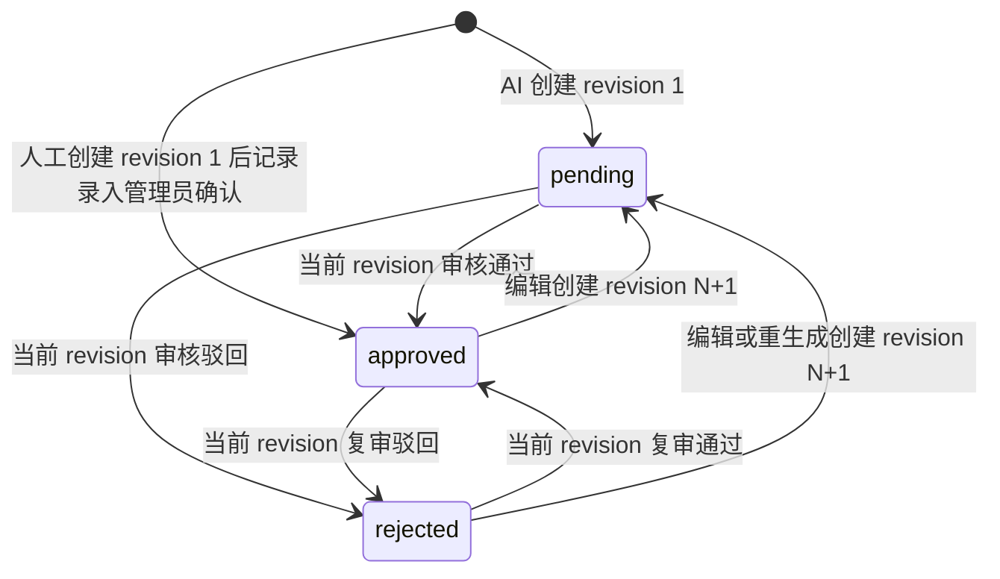

**工作台能力**：

| 能力 | 设计 |
|---|---|
| 题库检索 | 按 category/difficulty/concept/type/status/regulation/keyword 分页；考点管理与版本历史返回 Page.items（默认 20、范围 1—100）；旧题 category/difficulty 为 null 时不被悄悄归入新池或补为 easy |
| 审核流转 | 请求显式携带用户所见 expected_version_id（legacy 明确 null），事务锁内只审核 identity 指向的当前 revision；通过写实际 approved_by/approved_at 与 reviewed 元数据，驳回写复核人/时间/意见；非当前版本冲突 40940 |
| 题目编辑 | 请求显式携带 expected_version_id，锁内匹配后才由 `revise` 新建 pending revision；single 恰一答案、multiple 2—3 个答案、judgment 固定正误、image 无客观答案且 rubric 必填。旧 revision 永不覆盖 |
| 单题重新生成 | 仅有真实来源的 AI single/multiple；发起与提交都校验 expected_version_id，沿用原 category/difficulty/concept/regulation version和完整 JSON 合同。文本不足的 PDF 只渲染 revision 记录的实际页组；唯一页组可确定为0，多页组来源未知则明确失败。成功新增 pending revision，失败不动当前内容 |
| 人工录入 | 制度来源可选；创建四题型 revision 1 后以实际录入管理员确认 approved。write-only 用户使用 questions:write 类别/考点窄接口，考点选项必须类别启用且只返回 id/name，不依赖 questions:read |
| 富文本媒体 | sanitize-html 白名单；外链 img/script/event/javascript 拒绝。新插入媒体须为当前操作者 ready question 资源，每个 revision 写 media_reference；遗留响应和未保存预览也先走同一安全显示白名单，再经鉴权内容 API 获取 Blob URL并释放；`questions:read` 保留题库读取，`papers:read` 只桥接真实 fixed draft/release 精确版本的题干/选项图片，解析/rubric 另需 `papers:export`；显示清洗不回写历史 |
| 旧题升级 | current_version_id 为空时，首次编辑/审核先捕获当时内容为 revision 1；legacy_captured_at 只说明升级捕获，未知审核人/时间保持 null |
| 候选读取 | `approvedCandidates` 精确匹配 category/type/difficulty，可选 regulationIds，且仅返回 identity 当前 approved revision 的只读快照；C1 已消费 versionId 冻结发布池 |

**编辑前置校验与阶段边界**：升级前已发布且没有 release 的 legacy 固定卷仍可能动态读取题库，因此被任一 in_progress legacy 考试引用时，核心修订继续返回 40908；analysis-only 可生成 revision。升级后新发布的制度卷会冻结真实 current approved revision，但 legacy 选题、发布与开考仍只接受 single/multiple，开考前守卫不删除。C1 培训发布链允许四题型并冻结 revision 内容；图片作答/阅卷及个人题单仍不由 C1 实现。

#### 4.4.7 legacy 制度固定卷服务（paper_question、总分校验 = 100）

**试卷创建与策略配置**（`exam_paper`，策略集中单点维护，03 册 3.4.2 节设计说明 1）：

| 字段 | 默认值 | 取值范围 |
|---|---|---|
| `total_score` | 100.00 | 恒为 100.00（固定 100 分制） |
| `pass_score` | 60.00 | (0, 100]，及格线可配置 |
| `duration_minutes` | 30 | ≥ 1，超时自动交卷 |
| `max_attempts` | 3 | ≥ 1，补考次数 = max_attempts − 1 |
| `partial_credit_ratio` | 0.50 | [0.00, 1.00]，多选漏选部分分比例（03 册新增字段） |
| `status` | draft | draft / published / archived |

**选题入卷校验**：① `question.status = approved`（仅审核通过题目可入卷）；② `question.regulation_id` 与试卷一致（跨制度题目禁入，03 册 paper_question 设计说明 3）；③ 同一题目同一试卷不重复（`uk_paper_question` 兜底）。入卷写 `paper_question`（`question_id`、`sort` 组卷原始顺序、`score` 默认带出题库建议分值）。

**试卷状态机与发布校验**：

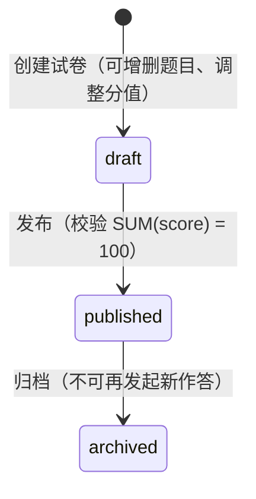

- **发布校验**：`SUM(paper_question.score) = exam_paper.total_score = 100`，不足或超出均拦截并提示差额（C-04、FR-AIQ-07 验收①）。
- **升级前无 release 的兼容生效边界**（仅适用于真正旧的 published 数据）：

| 字段 | 发布后可否调整 | 生效边界 |
|---|---|---|
| `paper_question`（题目组成与分值） | 否 | 锁定，防同一试卷对不同考生呈现不同题目 / 分值 |
| `pass_score` | 是 | 判分时实时读取 → 对后续交卷的及格判定即时生效（FR-EXM-06 验收②；已判分的历史记录不重判，C-05） |
| `partial_credit_ratio` | 是 | 判分时实时读取 → 同上 |
| `duration_minutes` | 是 | 发起考试时读取 → 对后续作答（新 `exam_record`）生效；已开考的计时不变（6.4.3 节） |
| `max_attempts` | 是 | 发起考试的资格校验时读取 → 对后续发起生效（6.4.1 节） |

升级后从 draft 新发布的制度卷不再使用上表的动态策略：发布事务把真实当前 approved revision、每题实际分值及全部策略写入 `paper_release*`，list/detail 以 `release_id/rules_locked` 明示冻结状态。发布后题单和策略均不可改，须 `POST /ai/papers/{id}/copy` 复制冻结事实为新 draft；复制卷若所选版本已不再是 current approved，重新发布明确返回 40970 要求重选。已有 published 且无 release 的升级前数据不补造历史，继续沿用上表。

#### 4.4.8 C1 培训固定/随机卷发布服务

```text
draft 配置（类别 + 可选制度 + 课程说明）
  ├─ fixed: 当前 approved revision 题单 + 整数分
  └─ random: 题型题量/分值 + easy/hard 两候选池
        ↓ 发布事务（类别锁 → 试卷写锁）
paper_release.rule_snapshot + paper_release_question.snapshot_json
        ↓
published 只读；变更需 copy 新 draft；withdraw/archive 保留快照
```

- 随机池硬筛选只有类别、可选制度集合、题型、难度、当前 approved；课程关联不参与交并。初级与高级必须同时足额。
- 容量与抽样键是 `concept_id ?? question_id`：同考点多变体只算一组，组间无放回，组内使用 crypto 随机选一版本。考试实际 `scoreCents` 覆盖题库建议分，规则合计固定 10000。
- 固定卷不强制来源难度，中级合法；同类别内可跨制度。training 与升级后新发布的 regulation 固定卷都在发布事务内按 `concept_id ?? question_id` 重检不重复考点；无 concept 旧题按真实 question_id 独立。失败整体回滚，不留下 release、published 状态、捕获版本或题单版本关联。
- 随机卷规则最多四项且题型唯一；固定卷按“题型 + 实际分值”派生规则，不受四项限制，同题型五档分值仍冻结每题实际 `scoreCents`。
- 发布行深拷贝题干、选项、答案、解析/评分参考、来源与审核元数据。后续编辑、撤审或题库变化不影响该 release。
- 同一 `PaperReleaseService` 也承接升级后新发布的制度固定卷：无类别/难度的旧题保持 `categoryId=null/difficulty=unknown`，真实捕获 `question_version.id`，未知审核事实保持 null；制度卷仍只允许 single/multiple，并执行与 training fixed 相同的考点组唯一规则。其 copy 接口保留数字 ID、学习门槛、冻结题目版本及实际分值，且不修改源 release。
- 预览不会冒充个人卷：固定卷返回完整题单；随机卷返回规则、两池容量与一次样例。普通预览剔除答案/解析/rubric，答案版额外检查题库或试卷导出权限。
- 前端使用公共未保存 hook；保存基线取“本次提交快照”，操作序号阻止较旧响应覆盖更新草稿。

### 4.5 与其他模块的依赖关系

| 方向 | 对端模块 | 交互内容 | 交互方式 |
|---|---|---|---|
| 依赖（下游） | 2 制度文件管理模块 | 生效版本 `text_content`（出题上下文）、`current_version_id`、制度标题等元数据 | 只读查询 |
| 依赖（下游） | 1 组织权限模块 | 出题 / 审核 / 组卷操作者角色校验（regulation_admin / super_admin）；`created_by` | 认证守卫 |
| 依赖（下游） | 外部 AI 服务 | OpenAI 兼容协议 `/chat/completions` 调用 | HTTPS（经 AI 网关） |
| 被依赖（上游） | 5 考试评分模块 | legacy 读 `exam_paper/paper_question/question`；C2 培训开考将读 C1 `paper_release*` 而不回读动态题库 | 只读查询 |
| 被依赖（上游） | 6 统计报表模块 | 题库与试卷数据（题目正确率、试卷维度统计） | 只读查询 |

### 4.6 对应数据表

| 表 | 本模块读写角色 | 说明 |
|---|---|---|
| `question` | 身份与 legacy 兼容视图读写 | current_version_id 指向当前 revision；旧 category/difficulty 可空 |
| `question_version` | 版本创建与当前版本审核 | 核心内容新增 revision；当前 approved 精确候选；真实审核人与时间 |
| `question_concept` | 读写 | 同类别同题型考点组，不要求三档齐全 |
| `media_reference` | 事务内新增引用 | question_version 富文本图片防误删与鉴权读取 |
| `exam_paper` | 全量读写（legacy + training） | business_scope 隔离两套接口；有 release 的发布卷配置不可变 |
| `paper_question` | 全量读写（组卷明细） | training fixed 与升级后制度卷发布/复制均保存实际 question_version_id/concept_id |
| `paper_release` / `paper_release_question` | C1 发布时追加，之后只读 | 培训卷及升级后制度固定卷的规则、条件关联、实际版本/分值与内容快照 |
| `regulation` / `regulation_version` | 只读 | 出题上下文与版本追溯 |

---

## 5. 学习行为管控模块（`/learning`）

### 5.1 模块职责与边界

**职责**：实现「学习真实性可保障」的四道防线与有效学习判定（FR-LRN-01 ~ 06）：学习会话管理（`learning_session` 的 start / end 与异常收口）、心跳处理（30 秒/次收包 → 服务端时间差计算 → 单次最大计入 45 秒容差 → Redis 累计 → 会话结束 / 定期落库）、失焦暂停计时（visibilitychange / blur 事件驱动的暂停与恢复）、滚动进度服务（10 段位图 `scroll_coverage` 跨会话按位 OR 合并、`max_scroll_percent` 更新、底部段判定）、有效学习判定服务（时长 + 底部段覆盖双条件 → `is_valid = 1` 与 `valid_at` → 考试资格）、以及学习进度查询（本人进度、管理员全员视图、会话明细审计）。

**边界（不做什么）**：

| 不属于本模块的内容 | 归属 |
|---|---|
| 阅读内容的下发与可见性（本模块只管「读的过程」） | 2 制度文件管理模块 |
| 考试资格的最终裁决（发起考试时的校验动作） | 5 考试评分模块（本模块只产出并维护 `is_valid` 事实） |
| 学习完成率等指标聚合 | 6 统计报表模块 |
| 阅读页渲染（pdfjs-dist / content_html） | 前端 + 2 制度文件管理模块（内容服务） |

### 5.2 内部组成（子服务 / 组件）

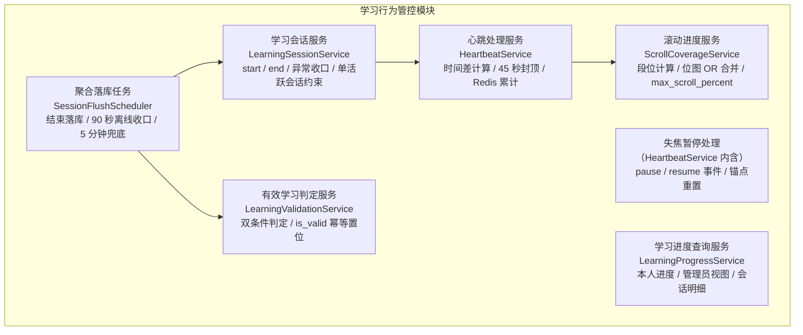

**Redis Key 约定**（会话维度的累计态，AD-04：可再生临时态、MySQL 为权威源）：

| Key | 类型 | 内容 | 生命周期 |
|---|---|---|---|
| `learn:session:{session_id}` | Hash | `duration_seconds`（累计计入秒数）、`segments`（JSON 位图数组）、`max_scroll_percent`、`last_beat_at`（最后心跳服务端时刻）、`state`（active / paused）、`paused_at` | 会话开始创建；落库后删除；TTL 6 小时兜底过期 |

### 5.3 核心类 / 服务职责表

| 组件 | 类型 | 职责 | 关键依赖 |
|---|---|---|---|
| LearningController | 接口层 | `/learning` 会话开始 / 结束、心跳、pause / resume、进度查询入口 | 各服务 |
| LearningSessionService | 服务 | 会话 start（可见性前置校验、`learning_session` 创建、Redis 初始化）、end（正常收口结算）、单活跃会话约束（双开标签页阻断） | `learning_session` 仓储、RegulationScopeService |
| HeartbeatService | 服务 | 心跳收包处理：时间差容差计算（≤ 45 秒计入）、Redis HINCRBY 累计、pause / resume 状态机、失焦防伪造 | Redis、ScrollCoverageService |
| ScrollCoverageService | 服务 | 滚动段位合并（Redis 位图 OR）、`max_scroll_percent` 单调更新、底部段判定、跨会话位图合并 | Redis |
| LearningValidationService | 服务 | 有效学习双条件判定（`total_seconds ≥ required_minutes × 60` 且底部段覆盖）、`is_valid` / `valid_at` 幂等置位 | `regulation` / `learning_record` 仓储 |
| SessionFlushScheduler | 定时任务 | 三触发落库编排：正常退出、90 秒离线收口、每 5 分钟兜底扫描；聚合事务执行 | 各仓储、Redis |
| LearningProgressService | 服务 | 学习进度查询：本人 / 全员、会话明细审计（按人按制度回溯会话序列） | `learning_session` / `learning_record` 仓储 |

### 5.4 关键设计详解

#### 5.4.1 学习会话管理（start / end、Redis 会话状态）

**会话 start**（进入阅读页）：

| 步骤 | 规则 |
|---|---|
| 1 前置校验 | 制度 `status = published` 且用户在发布范围内（复用 3.4.6 节校验链） |
| 2 单活跃会话约束 | 若该用户该制度存在活跃会话（Redis `state = active` 且 90 秒内有心跳）→ 先按当前 Redis 累计值收口旧会话再创建新会话。**目的：阻断「双标签页并行刷时长」**——两个标签页各自 30 秒心跳会使时长以双倍速累计，单活跃会话约束使任一时刻至多一个会话在计费 |
| 3 创建 | INSERT `learning_session`（`user_id`、`regulation_id`、`version_id = current_version_id`、`started_at`、`ended_at = NULL`、`duration_seconds = 0`） |
| 4 Redis 初始化 | 建 `learn:session:{id}`：`duration_seconds = 0`、`segments` = 全 0 位图（长度 = `regulation.scroll_segments`）、`max_scroll_percent = 0`、`last_beat_at = started_at`、`state = active` |

**会话 end**（正常离开）：前端在路由离开 / `pagehide` 时上报结束 → 服务端执行 5.4.6 节聚合落库事务（写 `ended_at` 与 `duration_seconds`）。

**异常离线收口**（直接关闭浏览器，UC-04 A2）：90 秒无心跳判定离线，由定时任务按 Redis 最后累计值收口——`ended_at` 取最后心跳时刻加 45 秒封顶（该段间隔已按封顶计入累计，保证有效时长不丢失且不虚增）。

**`learning_record` 创建**：首次学习时 INSERT（`uk_user_regulation` 唯一键防并发首学，冲突时转为 UPDATE 路径）。

#### 5.4.2 心跳处理服务（30 秒收包 → 时间差计算 → 45 秒容差 → Redis 累计）

**心跳协议**：阅读页每 30 秒上报一次（active 状态下），携带当前最大滚动百分比（0 ~ 100）与本周期内停留 ≥ 10 秒的段集合 `dwell_segments`（07 册 3.1.1/3.1.3 定稿口径）；服务端只使用「心跳到达的服务端时刻」与上报的滚动位置，**不信任任何客户端时间戳**（C-01）。

**单次心跳处理流程**：

| 步骤 | 规则 |
|---|---|
| 1 归属校验 | 会话存在且 `user_id` 与当前令牌一致；`state = paused` 下的心跳忽略计费、仅更新滚动位置（见 5.4.3） |
| 2 时间差计算 | `diff = 服务端当前时刻 − last_beat_at`（毫秒精度，`DATETIME(3)` 口径） |
| 3 容差封顶 | `credited = min(diff, 45 秒)`——**单次心跳最大计入 45 秒，超出部分不计入有效时长**（README 术语「心跳上报」） |
| 4 累计 | Redis `HINCRBY duration_seconds credited`；**不写 MySQL**（心跳高频路径零数据库写入，03 册 6.3 节） |
| 5 | 滚动合并 | 服务端对上报 `dwell_segments` 集合中的每个段位在 `segments` 位图置 1（停留 ≥ 10 秒语义，只增不减）、`max_scroll_percent` 取 max 单调更新（交 ScrollCoverageService） |
| 6 锚点更新 | 若 state = active：last_beat_at = 服务端当前时刻；若 state = paused：不更新 last_beat_at、不变更 state（仅步骤 5 的滚动合并生效，见 5.4.3） |

**防作弊有效性**（服务端防线，NFR-08）：

| 作弊手段 | 服务端防线与结果 |
|---|---|
| 高频上报（如每秒一次） | 每次计入的 `diff ≈ 1 秒`，累计值与真实流逝时间一致，`total_seconds` 不虚增（FR-LRN-02 验收②） |
| 篡改客户端时间 | 时长完全由服务端时钟差计算，客户端时间不参与任何判定 |
| 改心跳间隔为 60 秒 | 每次封顶计入 45 秒，比真实流失少 15 秒——作弊者自我损耗，无利可图 |
| 双标签页并行 | 单活跃会话约束（5.4.1 节步骤 2）阻断 |
| 脚本伪造心跳 + 位置序列 | 时长不可虚增（见上）；滚动位置属客户端上报，是本方案的技术信任边界——补偿手段为会话明细审计（`learning_session` 流水可下钻对账，03 册 3.3.1 节）与四道防线的组合抬高作弊成本（纵深细节见 07 分册） |

#### 5.4.3 失焦暂停方案（定稿：pause / resume 事件 + 心跳断流封顶兜底）

**方案定义**：前端监听 `visibilitychange`（`document.visibilityState === 'hidden'`，移动端「切后台」等价）与 `window blur` 双事件，失焦时上报 **pause** 事件；恢复聚焦时上报 **resume** 事件并重启 30 秒心跳定时器。服务端以「锚点」模型处理：

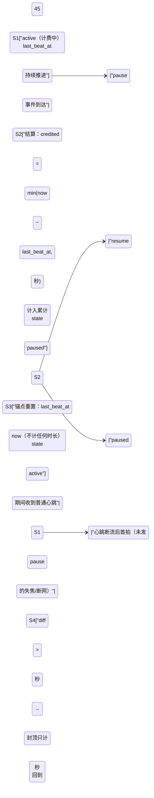

**pause 报文的携带与 flush（07 册 3.1.1 同口径）**：pause 报文可携带 `dwell_segments` 与 `scroll_percent`——前端在 `visibilitychange → hidden` 与 `pagehide` 时以 `navigator.sendBeacon` 调用 pause 端点，flush 本地缓冲中未上报的已确认段位（防页面关闭导致已停留 ≥ 10 秒的段位永久丢失，与「覆盖只增不减」原则一致）；服务端按 5.4.2 节步骤 5 的滚动合并规则处理。

**规则要点**：

1. **失焦期间零累计**：`paused` 状态下不推进计费锚点，普通心跳到达也不计费（只更新滚动位置）——失焦期间不产生有效时长累计（FR-LRN-03 验收①）。
2. **恢复不补记**：`resume` 只做锚点重置（`last_beat_at = now`），不产生任何时长——恢复聚焦后计时继续且不补记失焦期间时长（验收②）。
3. **长时间失焦不一次性计入大额时长**：用户不发 pause 直接失焦（或断网）时心跳断流，恢复后首个心跳 `diff > 45 秒`，按封顶只计 45 秒（验收③、UC-04 A1：网络中断恢复后从当前时刻继续累计，丢失区间不计时长）。

**防伪造设计说明**（为什么 pause / resume 不可被利用）：

| 伪造场景 | 服务端结果 |
|---|---|
| 不发 pause 直接失焦 | 恢复后首拍 `diff > 45 秒` → 只计 45 秒（兜底封顶） |
| 伪造高频 resume | resume 只重置锚点、不产生时长，无任何收益 |
| pause 后不发心跳 | 无时长累计（自然暂停，与真实失焦等价） |
| pause / resume 高频交替 | 每对 pause-resume 至多结算一个 ≤ 45 秒的窗口，服务端时钟差不因报文频率虚增；异常高频报文按接口限流丢弃 |

**结论**：时长收入的唯一来源是「服务端时钟在 active 状态下的推进、且每次结算封顶 45 秒」；pause / resume 只是锚点重置指令，任何客户端报文组合都无法让服务端计算出的时间差虚增。方案取舍：相比「失焦时停止心跳、纯靠断流封顶」的方案，显式 pause / resume 使**短时失焦**（如 10 秒，断流封顶会因 `diff ≤ 45 秒` 而全额计入）也能被精确扣除，且前端可向用户实时展示「已暂停」状态，体验与准确性兼得。

#### 5.4.4 滚动进度服务（10 段位图、跨会话按位 OR 合并、max_scroll_percent、底部段判定）

**段位计算（前端）**：阅读容器（pdfjs-dist canvas 或 content_html 富文本容器，两条渲染路径共用同一逻辑）按 `视口底缘位置 = scrollTop + clientHeight` 映射为百分比 `p = 视口底缘 / scrollHeight × 100`，段位 = `min(floor(p × total_segments / 100), total_segments − 1)`；心跳携带「本周期内停留 ≥ 10 秒的段集合 `dwell_segments`」（连续静止停留达标的段才上报，途经不算，07 册 3.1.3）与最大百分比。

**位图结构与合并**（`scroll_coverage`，结构与 03 册 4.4 节逐字一致）：

| 属性 | 说明 |
|---|---|
| `total_segments` | 段总数 = `regulation.scroll_segments`（当前版本固定 10） |
| `covered_count` | 已覆盖段数（segments 中 1 的个数，落库合并时重算） |
| `segments` | 长度恒为 10 的 0/1 数组，`segments[9]`（下标 `total_segments − 1`）为底部段 |

- **Redis 内合并**：每次心跳服务端对上报 `dwell_segments` 集合中的每个段位在 `segments` 中置 1（停留 ≥ 10 秒语义，逐段置位）——**只增不减，回滚不取消已置位段落**（FR-LRN-04 验收②）；`max_scroll_percent` 单调不减（验收③）。
- **跨会话合并**：聚合落库时（5.4.6 节），Redis 最新位图与 `learning_record.scroll_coverage` 库内位图**按位 OR** 后写回、`covered_count` 重算——合并幂等、覆盖只增不减（03 册 3.3.2 节设计说明 3）。
- **底部段判定**：`segments[total_segments − 1] === 1`——有效学习判定条件②（README 术语「滚动覆盖率」）。
- **段数一致性**：`scroll_segments` 本期固定为 10（配置项前向保留）；未来放开配置须按归一化重映射迁移位图（本期不实现）。

#### 5.4.5 有效学习判定服务（双条件判定、判定时机）

**双条件判定**（缺一不可，C-02）：

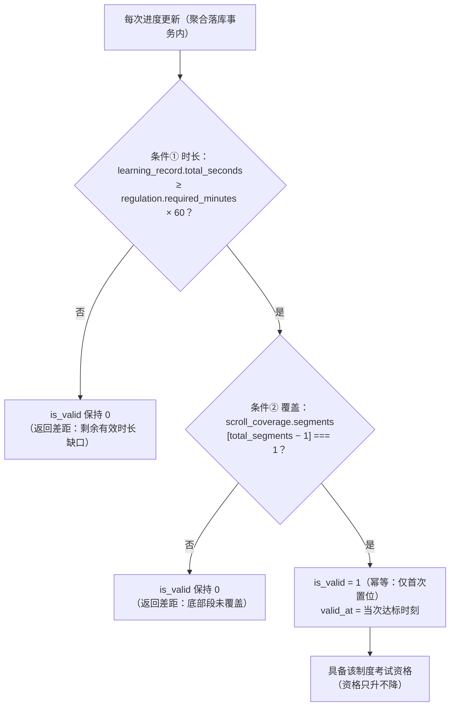

| 规则 | 说明 |
|---|---|
| 判定时机 | **每次进度更新后检查**——即每次聚合落库（会话正常结束 / 离线收口 / 定期兜底）事务内判定；达标当次落库即置位，员工学习页随即提示「已达有效学习标准」（UC-04 主流程 7） |
| 幂等与单向 | `is_valid` 一旦置 1 **永不回退**（时长与覆盖率只增不减，判定单调）；`valid_at` 记录首次达标时刻，只写一次（FR-LRN-05 验收③） |
| 阈值调整不回退 | 调整 `required_minutes` 后：已达标员工保持达标；未达标员工按新阈值继续判定（FR-REG-05 验收③、UC-02 A2） |
| 单条件不判定 | 仅时长达标或仅底部段覆盖，均不置 `is_valid`（FR-LRN-05 验收①②） |
| 资格联动 | `is_valid = 1` 即该制度考试资格事实；考试评分模块发起考试时校验（6.4.1 节），不冗余存储资格快照（03 册 3.3.2 节设计说明 4） |

**心跳响应中的达标提示口径**：心跳响应中的 `progress_hint` 仅为 **Redis 侧实时估算**（累计值跨过阈值的界面提示「预计已达标，正在结算」）；`is_valid` / `valid_at` **只能由聚合落库事务产生**（5.4.6 节，04 册 3.6 节同口径）——Redis 累计刚跨过阈值的瞬间，`learning_record.is_valid` 仍为 0（最长需等 5 分钟兜底任务落库），前端不得以 `progress_hint` 解锁考试入口，资格以开考校验（6.4.1 节）为准。

#### 5.4.6 聚合落库事务（会话结束 / 定期 5 分钟、learning_session + learning_record）

**落库时机**（三选一，任一触发，03 册 6.3 节）：

| # | 触发 | 说明 |
|---|---|---|
| ① | 正常退出上报 end | 用户主动离开阅读页 |
| ② | 心跳中断超时（90 秒无心跳判离线） | 直接关闭页面 / 断网场景 |
| ③ | 兜底定时任务（每 5 分钟） | 扫描 Redis 中超时未落库的会话；辅以 `learning_session.idx_started_at` 扫库（`ended_at IS NULL` 且 `started_at` 早于阈值）兜底 Redis 丢失场景 |

**聚合落库事务**（单事务原子完成，03 册 6.3 节写入点 1）：

| 步骤 | 表 | 操作 |
|---|---|---|
| 1 | `learning_session` | UPDATE `duration_seconds` = Redis 累计值、`ended_at` = 收口时刻（90 秒离线收口取最后心跳 + 45 秒封顶时刻） |
| 2 | `learning_record` | UPDATE：`total_seconds +=` 本会话累计时长；`scroll_coverage` = 库内位图 OR Redis 位图（`covered_count` 重算）；`max_scroll_percent` = max(库内, Redis)；`version_id` = 本会话版本；`last_learn_at` = 收口时刻 |
| 3 | `learning_record` | 同事务内执行有效学习判定（5.4.5 节）：双条件满足且 `is_valid = 0` → 置 `is_valid = 1`、写 `valid_at` |
| 4 | Redis | 事务提交后删除 `learn:session:{id}` |

**幂等与一致性**：以 `ended_at IS NULL` 作为「未收口」判据——已收口会话重复触发落库时直接跳过；Redis 为累计态、MySQL 为权威态（AD-04），Redis 不可用时兜底任务可从库侧扫描恢复（NFR-11 / NFR-12：网络中断、误关闭页面不丢失已累计进度）。

**写频收敛效果**：心跳高频路径零数据库写入；库表只承接「每会话一次」的聚合写（高峰 500 人在线 ≈ 0.4 QPS + 定期兜底），较逐心跳直写下降两个数量级（03 册 6.3 节结论）。

#### 5.4.7 B1 课程内容与视频版本服务

B1 以 `CourseService`、`LessonVersionService` 和 `/admin/courses`、`/me/courses` controllers 承载课程内容，不复用或改写 legacy `LearningSessionService`：

| 组件 | 职责 | 关键边界 |
|---|---|---|
| CourseService | 课程 CRUD、上架/下架、学员可见分页、`visibleCourses`、`assignedCourseIds` | 新类别引用用 `CategoryService.lockActive`；机构学员只见同类别 published，external 返回空；`regulation_ids` 仅信息关联 |
| LessonVersionService | 章节/课时写入、视频版本追加、`current(lessonId)` | 本期只接受 video；published 锁定结构但允许追加内容版本；旧版本/媒体引用不覆盖 |
| MediaOwnerPolicy | `training_course_cover` 与 `lesson_version_video` 两类 owner authorizer | bind 前资源必须 ready 且用途匹配；学员读取媒体再次走课程可见性；未注册 owner type 默认拒绝 |
| CourseAdminController | `courses:read/write/publish` 的管理接口和 courses:write 类别 options | 不隐式授予 `training_categories:read`；上传本身另需 `media:write` |
| MyCoursesController | 本人课程分页与目录 | 数据范围由服务端按 status/source/category 收口，不接受客户端传 user/category |
| LearnerHomeController | 本人首页组合 | 并行复用 `SystemService.publicConfig()` 与 `CourseService.visibleCourses()`；返回 `{site_config,courses}`，不另造推荐、完成度或学习门槛 |

上架事务锁定课程行；draft/offline 上架还会锁定并重查启用类别，随后校验所有必学课时的当前版本与 ready 视频、用途、媒体种类和正时长。失败统一返回 40930，课程状态不改变。替换视频锁定课程/课时后追加 `lesson_version`，以 `(lesson_id,version_no)` 唯一键兜底并发，再绑定媒体、切换 `current_version_id`。下架仅改状态，重新上架重跑同一 readiness 校验。

课程管理页面由 `Courses.vue` 与 `CourseDetail.vue` 提供，并已注册 `/admin/courses`、`/admin/courses/:id` 及 `permission_code=NULL` 的默认菜单。列表入口按 `courses:read/write` 任一授权显示，详情要求 read；write-only 新建成功后不跳入无权详情。详情页把“服务端课程/目录状态刷新”与“课程资料表单初始化”分开：保存章节、课时、视频版本或上/下架后更新服务端状态，但不得覆盖同页尚未保存的标题、类别、简介、封面、制度关联、推荐或排序；legacy 制度选项的数字 ID 在页面边界显式转成字符串。创建表单、课程资料、章节、课时和视频换版各自注册 `useUnsavedChanges(dirty,{onDiscard})`，只在对应持久化成功后清洁；放弃一个区段只恢复该区段的持久基线，不撤销已保存或其他未保存区段。`/me/home` 只组合真实 `SystemService.publicConfig()` 与 `visibleCourses()`，B1 未创建替代配置服务。

### 5.5 与其他模块的依赖关系

| 方向 | 对端模块 | 交互内容 | 交互方式 |
|---|---|---|---|
| 依赖（下游） | 2 制度文件管理模块 | 判定参数（`regulation.required_minutes` / `scroll_segments`）、生效版本（`current_version_id` → 会话 `version_id`）、阅读可见性校验（status + 发布范围） | ContentService / RegulationScopeService 进程内调用；只读查询 |
| 依赖（下游） | 1 组织权限模块 | 学习者身份（令牌 user_id）；部门归属（统计复用） | 认证守卫 |
| B1 课程内容依赖 | 组织权限 / 媒体 / 制度模块 | 学员 source/category/status；类别锁；封面/视频 bind 与读取策略；可选制度存在性 | 进程内 Service + 同事务 EntityManager；制度只读验证 |
| 被依赖（上游） | 5 考试评分模块 | **legacy 制度固定卷**考试资格校验（`learning_record.is_valid`，按 user_id + regulation_id）；培训路径默认不依赖学习完成 | 旧路径由 LearningProgressService 进程内调用；培训路径按发布/身份/规则快照校验 |
| 被依赖（上游） | 6 统计报表模块 | `learning_record`（完成率 / 未完成清单）、`learning_session`（活跃度 / 审计） | 只读查询 |

### 5.6 对应数据表

| 表 | 本模块读写角色 | 说明 |
|---|---|---|
| `learning_session` | 全量读写（创建 / 收口 UPDATE） | 会话流水 append + 单次收口更新；审计下钻入口 |
| `learning_record` | 读写（首次 INSERT / 聚合 UPDATE / 判定置位） | `uk_user_regulation` 保证每人每制度一条 |
| `training_course` / `course_chapter` / `course_lesson` / `lesson_version` | B1 课程内容读写 | 课程结构与不可变视频版本；不保存观看进度 |
| `media_asset` / `media_reference` | B1 受控绑定/授权读取 | 封面和每个视频版本均建立独立业务引用 |
| `regulation` / `regulation_version` / `regulation_scope` | 只读 | 判定参数、版本指针、范围可见性 |

---

## 6. 考试评分模块（`/exams`）

### 6.1 模块职责与边界

**职责**：当前 legacy 路径实现资格校验、乱序下发、计时/切屏、幂等交卷与客观题评分。C1 已在上游产生培训发布快照，但本模块的 C2 个人题单/开考尚未接入；`ExamService.start` 遇到 training 卷直接 40402，不通过删除 legacy 守卫伪造通路。后续草稿、图片答案/阅卷、监控与统计仍按 C2—C6 落地。

**边界（不做什么）**：

| 不属于本模块的内容 | 归属 |
|---|---|
| `is_valid` 事实的产出与维护 | 4 学习行为管控模块（本模块只消费） |
| 试卷与题目的管理（组卷 / 发布 / 策略配置） | 3 AI 出题模块（本模块只读消费） |
| 考试指标聚合与导出 | 6 统计报表模块 |
| 最终成绩的直接修改 | **任何人**——最终总分不可直接编辑。计划中的图片题仅在最终结算前受控逐题评分，分值 0..满分，记录审计/乐观版本并由服务端汇总；最终结算后只读（C-05） |

### 6.2 内部组成（子服务 / 组件）

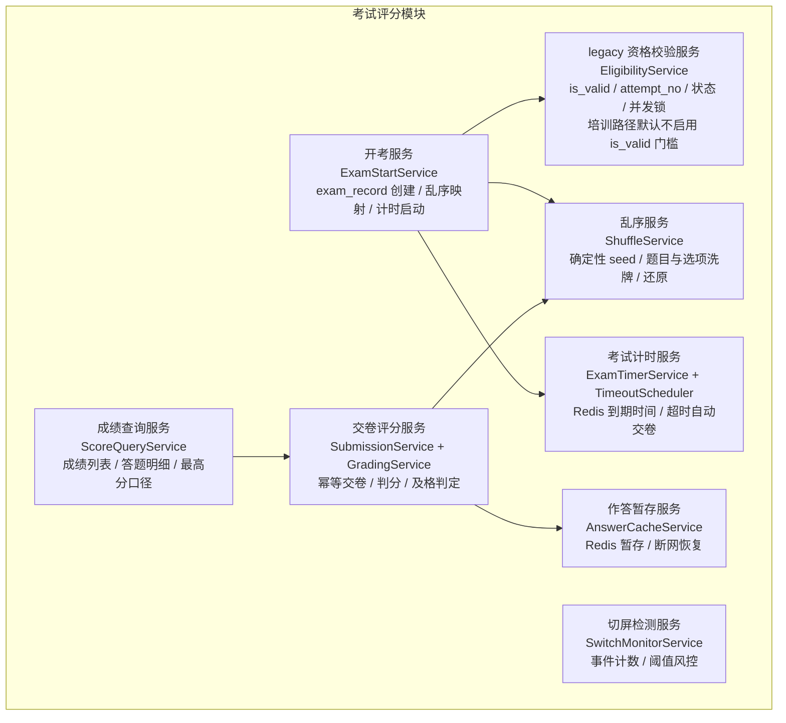

**Redis Key 约定**（AD-04：全部为可再生临时态）：

| Key | 类型 | 内容 | 生命周期 |
|---|---|---|---|
| `exam:deadline:{record_id}` | String | 交卷截止时间戳 | TTL = `duration_minutes × 60`；交卷后删除 |
| `exam:answer:{record_id}` | Hash | field = `question_id`，value = selected（JSON 数组，呈现位置） | 作答暂存；TTL = `duration_minutes × 60` + 24 小时（兜底过期防漏删）；交卷落库后主动删除 |
| `exam:switch:{record_id}` | String | 切屏计数 | 开考创建；TTL = `duration_minutes × 60` + 24 小时（兜底过期防漏删）；交卷写回后主动删除 |
| `exam:lock:start:{user_id}:{paper_id}` | String | 开考防并发锁（SETNX） | TTL 10 秒 |
| `exam:lock:submit:{record_id}` | String | 交卷防重锁（SETNX） | TTL 30 秒（判分 P99 × 3，见 6.4.5 节） |

### 6.3 核心类 / 服务职责表

| 组件 | 类型 | 职责 | 关键依赖 |
|---|---|---|---|
| ExamController | 接口层 | `/exams` 发起考试、取卷、作答暂存、切屏上报、交卷、成绩查询入口 | 各服务 |
| EligibilityService | 服务 | 资格校验链（制度 / 试卷状态、`is_valid`、补考次数、并发 in_progress）；未达标返回差距信息 | `learning_record` / `exam_paper` / `exam_record` 仓储 |
| ExamStartService | 服务 | 开考事务：`exam_record` 创建（`attempt_no` 分配、`regulation_id` 冗余快照）、Redis 计时与暂存初始化 | 各仓储、ShuffleService |
| ShuffleService | 服务 | 确定性 seed 派生、题目与选项 Fisher-Yates 洗牌、乱序映射下发与判分还原 | — |
| ExamTimerService | 服务 | 剩余时间查询（deadline − now 下发）；`duration_minutes` 生效边界控制 | Redis |
| TimeoutScheduler | 定时任务 | 每 30 秒扫描 `status = 'in_progress' AND deadline_at ≤ NOW(3)` 的记录自动交卷（6.4.3 节，`idx_status_started`） | SubmissionService |
| AnswerCacheService | 服务 | 作答 Redis 暂存与恢复（断网 / 误关页面后继续作答，UC-06 A2） | Redis |
| SwitchMonitorService | 服务 | 切屏事件计数（前端 500ms 事件合并后上报 + 服务端 1 秒窗口二次去抖）、交卷写回 `switch_count`、两级阈值风控（>3 前端警告 / ≥5 风控标记 + 审计） | Redis |
| SubmissionService | 服务 | 交卷入口编排：幂等三层防护、自动交卷（timeout）与主动交卷（submitted）统一路径 | GradingService |
| GradingService | 服务 | 逐题判分（单选 / 多选三档 / 未答）、总分汇总、及格判定（实时读 `pass_score`）、`exam_answer` 批量写入 | `exam_paper` / `paper_question` / `question` 仓储 |
| ScoreQueryService | 服务 | 成绩列表（历次 + 最高分）、答题明细（逐题对错与解析）、数据范围收口（仅本人 / 管理员全员） | `exam_record` / `exam_answer` 仓储 |

### 6.4 关键设计详解

#### 6.4.1 资格校验服务（is_valid 检查 + 补考次数校验）

以下校验链是**legacy 制度固定卷**口径，发起时必须检查 `learning_record.is_valid`。新培训考试复用发布、类别/来源权限、次数、身份状态、并发和服务端 deadline 校验，但默认不把课程或制度学习完成作为开考门槛；后续实现应由独立业务范围/规则快照表达，不能用一个布尔字段同时表示两种语义。

发起 legacy 固定卷时按固定顺序执行校验链，任一失败立即拒绝（FR-EXM-01 验收①、FR-LRN-06）：

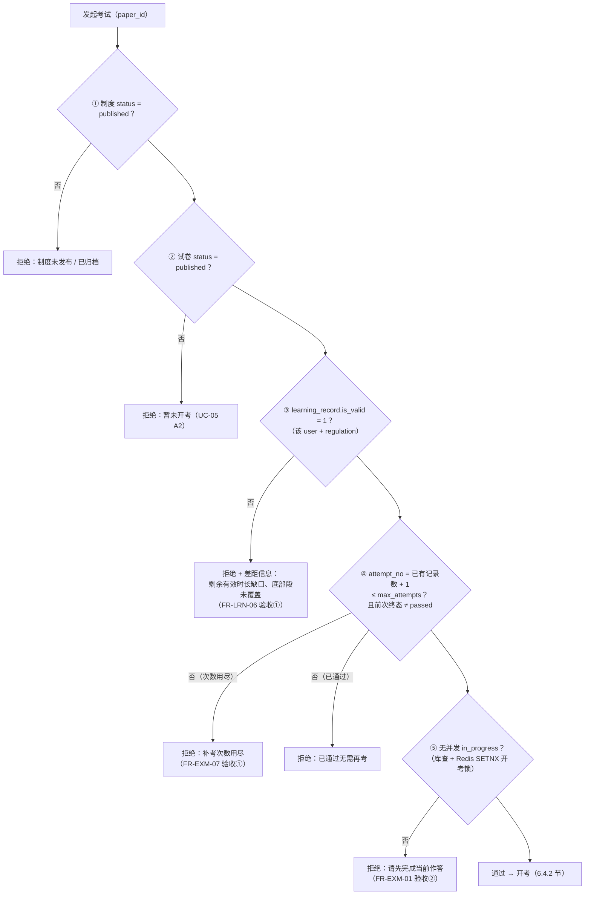

**规则要点**：

| 规则 | 说明 |
|---|---|
| `attempt_no` 分配 | 该用户该试卷已有记录数 + 1，从 1 起连续递增（FR-EXM-01 验收③）；`uk_paper_user_attempt` 唯一索引兜底并发开考（03 册 3.4.4 节索引说明） |
| 补考语义 | 前次终态为 failed / timeout 方可再次发起（UC-07 前置条件）；已 passed 的不再发起（补考是「未通过后的再作答机制」，防刷分） |
| 次数上限 | `attempt_no ≤ max_attempts`（含首次；补考次数 = max_attempts − 1，默认 3 次作答机会） |
| 每次补考重新乱序 | 新 `exam_record` 用新 record_id 派生新 seed，题目与选项顺序重新洗牌（FR-EXM-07 验收②） |

#### 6.4.2 组卷下发服务（试题与选项乱序：每考生随机 seed、判分按原始 answer 语义）

**确定性 seed 方案**：`seed = HMAC-SHA256(EXAM_SHUFFLE_SECRET, exam_record.id)`——以考试记录 id 派生、服务端密钥参与，**同一考生任意时刻重算结果一致**（断网重进呈现顺序不变，UC-06 A2）、**不同考生各不相同**（FR-EXM-02 验收①）。`EXAM_SHUFFLE_SECRET` 为独立环境变量（07 册 6.4 节），不参与 `JWT_SECRET` 的 90 天轮换——防止轮换瞬间在考记录还原映射错位导致判分错误（仅在确认泄露且无在考记录时更换）。映射无需持久化（可随时重算），Redis 零占用。

**乱序与判分流程**：

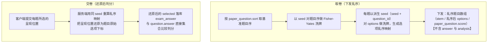

**设计要点**：

| 要点 | 说明 |
|---|---|
| 判分语义 | 判分始终以题目原始 `answer` 语义为准（README 术语「试题与选项乱序」）；库内 `exam_answer.selected` 已还原为原始下标，与 `question.answer` 可直接集合比较（03 册 4.3 节说明） |
| 乱序有效性 | 乱序不影响判分正确性：不同顺序作答同一选项组合得分一致（FR-EXM-02 验收②）——还原映射是确定性双射 |
| 防偷答案 | 下发载荷不含 `answer` / `analysis`；解析只在交卷后的成绩回看中下发 |
| `sort` 的角色 | `paper_question.sort` 是打乱前的基准序列与出卷排版依据（03 册 3.4.3 节设计说明 2），不参与呈现 |
| 题目编辑的边界 | 判分读交卷时刻的 `question.answer`（编辑后判分以当前答案为准，FR-AIQ-04 验收③；被 `in_progress` 试卷引用的题目另有编辑前置校验，4.4.6 节）；`paper_question` 发布后锁定保证题集与分值不变（4.4.7 节） |

#### 6.4.3 考试计时服务（Redis 到期时间、超时自动交卷、timeout 状态）

**开考计时**：开考事务内创建 `exam_record`（`status = in_progress`、`started_at`、`attempt_no`、`regulation_id` 冗余快照）并一次性写入截止时刻快照 `exam_record.deadline_at = started_at + duration_minutes × 60`（此后不再变更——防管理员调小限时误判已开考记录超时，与 4.4.7 节「已开考记录 deadline 不变」的生效边界一致）；Redis `exam:deadline:{record_id}` 的值与 TTL 均由 `deadline_at` 派生（TTL = `deadline_at − 开考时刻`）。

**倒计时呈现**：前端进入 / 恢复考试页时向服务端查询剩余时间（`deadline − 服务端当前时刻` 下发），本地倒计时并每 30 秒向服务端校准一次——不信任客户端本地时钟累计。

**超时自动交卷（双触发）**：

| 触发器 | 机制 | 角色 |
|---|---|---|
| 定时任务扫描（主） | 每 30 秒扫描 `exam_record`：`status = 'in_progress' AND deadline_at ≤ NOW(3)`（以开考事务写入的 `deadline_at` 快照判定，不受 `duration_minutes` 事后调整影响；`idx_status_started` 支撑）；命中记录按 Redis 暂存作答自动交卷 | 可靠性主通道（Redis 故障时兜底，AD-04） |
| Redis 到期键（辅） | 启用 keyspace notification 监听 `exam:deadline:*` 过期事件，加速触发交卷 | 降低扫描粒度带来的至多 30 秒延迟 |

**超时处理**：自动交卷走与主动交卷完全相同的评分路径（6.4.5 节）；`status = timeout`、按当前已答内容评分、未答题目不得分（FR-EXM-03 验收②③）；`timeout` 记录正常写入 `score` 并参与及格判定与最高分口径（03 册 3.4.4 节 score 语义）。

**`duration_minutes` 调整生效边界**：发起考试时读取——新开考按新限时计时；已开考记录的 deadline 不变（4.4.7 节生效边界表）。

#### 6.4.4 切屏检测（前端事件上报 → switch_count 累计、超阈值风控策略）

**检测与计数**：

| 环节 | 设计 |
|---|---|
| 前端 | `visibilitychange`（hidden）与 `window blur` 触发切屏上报（record_id）；恢复聚焦不上报（一次离开记 1 次，FR-EXM-04 验收①）；**500ms 事件合并**——窗口内的连续事件合并为一次上报 |
| 服务端 | Redis `INCR exam:switch:{record_id}`；两级去抖统一口径：**前端 500ms 事件合并后上报 + 服务端 1 秒窗口二次去抖**——1 秒窗口内的重复上报合并计 1 次（防事件风暴与伪造 flooding） |
| 写回 | 交卷时一次性 GET 并写入 `exam_record.switch_count`（Redis 会话级累计、交卷单次写回，高频 UPDATE 不入库存量计数器语义，03 册 3.4.4 节设计说明 4） |

**超阈值风控策略（定稿：两级处置 + 计数留痕，不自动作废）**：

| 策略 | 内容 | 理由 |
|---|---|---|
| 计数留痕 | `switch_count` 在成绩详情中对管理员与本人可见（FR-EXM-04 验收②） | 需求底线：检测、累计、可见 |
| 两级处置 | ① `switch_count > 3`：前端**全屏警告弹窗**（实时警示考生切屏行为）；② `switch_count ≥ 5`：服务端写入**风控标记 + 审计日志**，该成绩在管理端成绩详情高亮「切屏异常」标注，提示管理员核查（07 册 3.2.2 同口径，阈值可配置） | 一级（>3）实时警示考生，二级（≥5）交由运营者复核，切屏次数是辅助证据 |
| 不自动作废 | 超阈值不强制交卷、不判成绩无效 | ① C-05 最终总分不可直接修改——自动作废等于变相改分，无需求授权；② 切屏存在误触场景（系统通知弹窗、输入法面板触发 blur）；③ 需求定位是「用于监考与风控」的检测与留痕，而非自动判罚 |

#### 6.4.5 交卷评分服务（幂等防重复交卷、评分规则、及格判定、取最高分）

**交卷入口统一**：主动交卷（`status = submitted`）与超时自动交卷（`status = timeout`）共用同一评分路径，仅终态标签不同。

**幂等防重复交卷（三层防护，UC-06 A3）**：

| 层 | 机制 |
|---|---|
| 状态机单向 | 终态 UPDATE 带条件：`UPDATE ... WHERE id = ? AND status = 'in_progress'`——affected rows = 0 说明已被交卷 / 超时处理，拒绝重复提交 |
| Redis 防重锁 | `SET NX EX exam:lock:submit:{record_id}` 拦截并发重复交卷请求（同刻双击交卷只放行首个）；TTL = 30 秒（判分 P99 3 秒 × 3，NFR-02——锁寿命远大于事务耗时上限，防「锁先于事务过期」放行并发） |
| 乐观锁 | UPDATE 携带 `updated_at` 原值条件比对（03 册 3.4.4 节设计说明 5） |

**锁 TTL 与失败 / 成功的释放顺序**：① 锁 TTL 30 秒 = 判分 P99 耗时（3 秒，NFR-02）× 3；② 判分事务**回滚**时，在同一异常处理中 `DEL exam:lock:submit:{record_id}` 且**不删除** `exam:answer:{record_id}`（作答暂存保留），返回 50xxx 允许考生**立即重试**；③ **成功**路径清理顺序固定：**提交事务 → DEL 答案暂存（`exam:answer`）→ DEL 防重锁**——避免「已删暂存但事务回滚」导致答案不可恢复（deadline 与切屏计数随后一并清理）。

**评分规则**（逐题判分，判分读交卷时刻的 `question.answer` 与 `exam_paper.pass_score` / `partial_credit_ratio`）：

| 情形 | 判定条件 | `gained_score` | `is_correct` |
|---|---|---|---|
| 单选（single）答对 | `selected` 等于 `answer`（恰选且选对） | `paper_question.score` | 1 |
| 单选（single）答错 | `selected` 不等于 `answer` | 0 | 0 |
| 多选（multiple）全对 | `selected == answer` | `paper_question.score`（满分） | 1 |
| 多选（multiple）错选 | `selected` 中存在不属于 `answer` 的元素 | 0 | 0 |
| 多选（multiple）漏选 | `selected` 为 `answer` 的真子集且非空 | `round(paper_question.score × partial_credit_ratio, 2)`（默认 0.50，即半分） | 0（漏选非全对，但得分 > 0） |
| 未作答 | `selected` 为 `[]` 或 NULL | 0 | NULL |

- 多选三档规则与 README 术语「自动评分」逐字一致（全对满分 / 错选 0 分 / 漏选按配置得部分分，默认 50%）。
- `is_correct` 三态语义与 03 册 3.4.5 节一致：1=全对、0=非全对（含漏选得部分分）、NULL=未作答。

**评分落库事务**（单事务，03 册 6.3 节写入点 2）：

| 步骤 | 操作 |
|---|---|
| 1 | 取作答：主动交卷以报文为准、与 Redis 暂存合并（超时自动交卷直接取 Redis 暂存）；乱序还原（6.4.2 节） |
| 2 | 逐题判分（上表规则），计算 `total = Σ gained_score`（两位小数） |
| 3 | 及格判定：`total ≥ pass_score`（实时读 `exam_paper.pass_score`）→ `status = passed`，否则 `status = failed`；恰好等于及格线判 passed（FR-EXM-06 验收①） |
| 4 | UPDATE `exam_record`（status / score / submitted_at / switch_count 回写）+ 批量 INSERT `exam_answer`（`selected` 还原值 / `is_correct` / `gained_score`，append-only 无 UPDATE 路径） |
| 5 | 事务提交后按序清理 Redis：DEL 作答暂存（`exam:answer:{record_id}`）→ DEL 防重锁（`exam:lock:submit:{record_id}`）→ DEL deadline 与切屏计数（释放顺序见上） |

**取最高分策略**（C-06）：`exam_record` 保留每次作答记录，不做物理合并；「最高分」是**展示与统计口径**——个人成绩页与统计报表一律按 `GROUP BY user_id` 取 `MAX(score)`（7.4.1 节），历次记录并列展示并标注最高分（FR-EXM-07 验收③）。

**断网 / 误关闭恢复**（UC-06 A2）：`in_progress` 记录在限时内重新进入可继续作答——作答实时暂存 Redis（每次选择即写 `exam:answer:{record_id}`），前端另有本地暂存兜底；恢复后呈现顺序不变（确定性 seed）、剩余时间以服务端 deadline 为准。

#### 6.4.6 计划中的图片阅卷与最终结果边界（C3/C4）

以下是培训融合的目标状态，具体服务/表/DTO 待 C3/C4 实际落地后补入：

```text
已交卷
  ├─ 仅客观题或无已保存图片答案 → 服务端自动汇总 → finalized
  └─ 有图片答案 → pending_manual（score/passed/correct_rate 均为 null）
       → 授权阅卷人逐题评分 0..该题满分
       → 审计记录前后分数、操作者、时间与评语
       → 乐观版本冲突返回 409，不能覆盖他人最新评分
       → 最后一题完成时同事务汇总最终总分/及格/排名 → finalized
```

客观题分数不可被人工覆盖；人工评分只作用于图片题的单题分数，且不得直接写最终总分。最终结算前可更正但必须留痕，最终结算后结果只读；待批改记录不计最终成绩、通过率、错题或排名，也不允许补考。结果、历史、解析与报表必须读取同一题单/评分版本。此边界修正 C-05 的旧表述，不把受控阅卷误写为任意改分。

#### 6.4.7 成绩与答题明细查询

| 能力 | 设计 |
|---|---|
| 数据范围 | employee 仅本人（`idx_user_paper_status` 前缀过滤 user_id）；super_admin / regulation_admin 可查全员 |
| 成绩列表 | 按试卷 / 制度维度展示历次作答：`attempt_no`、`status`（in_progress / submitted / passed / failed / timeout）、`score`、`started_at` / `submitted_at`、`switch_count`；同屏标注最高分（取最高分口径） |
| 答题明细 | 按 `exam_record` → `exam_answer` 逐题展示：题干、选项、`selected`、正确答案、`is_correct`、`gained_score`、`analysis` 解析（交卷后即时可看，UC-06 主流程 7；`uk_record_question` 保证每题一答） |
| 交卷即时反馈 | 交卷响应直接返回总分与逐题对错（判分在事务内完成，3 秒内返回，NFR-02） |
| 切屏可见性 | `switch_count` 随成绩详情展示（管理员与本人，FR-EXM-04 验收②）；超阈值标注见 6.4.4 节 |

### 6.5 与其他模块的依赖关系

| 方向 | 对端模块 | 交互内容 | 交互方式 |
|---|---|---|---|
| 依赖（下游） | 4 学习行为管控模块 | **legacy 制度固定卷**考试资格校验（`learning_record.is_valid`）；未达标差距信息（剩余时长缺口 / 底部段未覆盖）。新培训考试默认不依赖该学习门槛 | 旧路径由 LearningProgressService 进程内调用；培训路径按发布/身份/规则快照校验 |
| 依赖（下游） | 3 AI 出题模块 | `exam_paper`（策略：pass_score / duration_minutes / max_attempts / partial_credit_ratio / status）、`paper_question`（题目与分值）、`question`（options / answer / analysis） | 只读查询 |
| 依赖（下游） | 2 制度文件管理模块 | `regulation.status` 开考校验；`exam_record.regulation_id` 冗余快照来源 | 只读查询 |
| 依赖（下游） | 1 组织权限模块 | 考生身份、在职状态（开考 / 交卷敏感路径回查 `sys_user.status`） | 认证守卫 + 只读查询 |
| 被依赖（上游） | 6 统计报表模块 | `exam_record`（参考人数 / 通过率 / 平均分 / 分数分布）、`exam_answer`（题目正确率） | 只读查询 |

### 6.6 对应数据表

| 表 | 本模块读写角色 | 说明 |
|---|---|---|
| `exam_record` | 全量读写（创建 / 终态 UPDATE / switch_count 回写） | 五态状态机；`regulation_id` 冗余快照开考时写入 |
| `exam_answer` | 写（交卷事务内批量 INSERT）、读（明细回看） | append-only，无 UPDATE 路径 |
| `exam_paper` / `paper_question` / `question` | 只读 | 策略与判分基准（判分读当前 `question.answer`） |
| `learning_record` | 只读 | 资格校验（`is_valid`） |
| `regulation` | 只读 | 开考状态校验 |

---

## 7. 统计报表模块（`/statistics`）

### 7.1 模块职责与边界

**职责**：实现「落实情况可运营」（FR-STT-01 ~ 05）：以**精确口径**计算并展示各维度指标（应学人数、学习完成率、参考人数、通过率、平均分、分数分布）；提供制度维度、部门维度、个人维度三个方向的统计查询；输出未完成人员清单（应学但 `is_valid = 0`，附学习进度；含已完成学习但考试未通过者并标注原因）；各维度报表与清单的 Excel 导出。

**边界（不做什么）**：

| 不属于本模块的内容 | 归属 |
|---|---|
| 学习与考试数据的产生 / 变更 | 4 学习行为管控模块、5 考试评分模块（本模块对当前及培训事实表**零写路径**） |
| 学习进度与成绩的明细交互查询（员工端「我的进度 / 我的成绩」） | 4 / 5 模块的查询服务（本模块做的是跨表聚合视角） |
| 指标阈值的运营决策（如督办规则） | 管理员基于报表的人工跟进（系统只提供数据与清单） |

### 7.2 内部组成（子服务 / 组件）

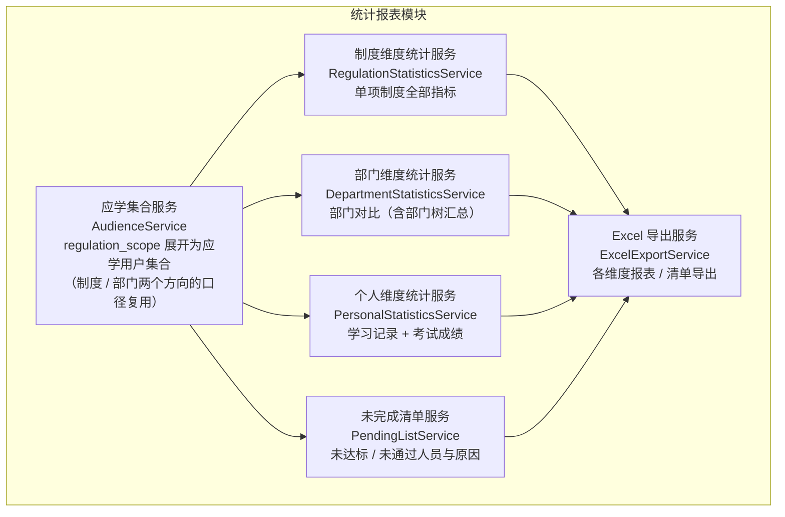

### 7.3 核心类 / 服务职责表

| 组件 | 类型 | 职责 | 关键依赖 |
|---|---|---|---|
| StatisticsController | 接口层 | `/statistics` 各维度查询与导出入口（regulation_admin / super_admin；个人维度含 employee 仅本人） | 各服务 |
| AudienceService | 服务 | 应学集合计算：`regulation_scope` → `is_all` 全员或部门树展开 → 在职员工集合（含部门归属），供全部指标复用；「部门 → 制度集合」反查（跨制度汇总） | `regulation_scope` / `sys_department` / `sys_user` 仓储 |
| RegulationStatisticsService | 服务 | 单项制度维度指标：应学人数、学习完成率、参考人数、通过率、平均分、分数分布 | 各仓储 |
| DepartmentStatisticsService | 服务 | 部门维度对比：应学集合按 `sys_user.department_id` 切片 + 部门树父级汇总（子部门指标聚合） | 各仓储 |
| PersonalStatisticsService | 服务 | 个人维度：指定员工（或本人）的学习记录汇总 + 考试成绩（历次 / 最高分 / `switch_count`） | `learning_record` / `exam_record` 仓储 |
| PendingListService | 服务 | 未完成人员清单：应学未达标人员（含进度与差距原因）+ 已达标但考试未通过人员 | 各仓储 |
| ExcelExportService | 服务 | 各导出物的 xlsx 生成（中文表头、流式分页取数）、文件流响应、导出审计留痕 | 各统计服务 |

### 7.4 关键设计详解

#### 7.4.1 各指标精确口径定义

全部指标以「应学集合」为口径锚点（C-09：应学人数以发布范围内在职员工数为准，范围调整后口径随之更新）。

**应学集合（AudienceService 的统一产出）**：

1. 若该制度的 `regulation_scope` 存在 `is_all = 1` 行 → 应学集合 = 全部在职员工（`sys_user` 中 `status = 1` 的全体，去重）；
2. 否则 → 取全部圈定部门（`department_id` 集合），经应用层部门树展开为**含全部子部门的部门 id 集合** → 应学集合 = `sys_user` 中 `department_id` 属于该集合且 `status = 1` 的员工（去重）；
3. 集合中的员工即「应学人员」，其人数即「应学人数」（C-09：发布范围调整后集合随之更新，新入部门员工自动纳入）。

**指标口径总表**：

| 指标 | 精确口径 | 数据来源与查询路径（03 册 6.4 节索引支撑） |
|---|---|---|
| 应学人数 | 应学集合的人数（发布范围内 `sys_user.status = 1` 的去重员工数） | `regulation_scope`（`uk_regulation_department` 前缀）→ 应用层展开子部门 → `sys_user WHERE department_id IN (…) AND status = 1`（`idx_department_status`）；`is_all = 1` 时直接全员 |
| 学习完成率 | **应学集合中** `learning_record.is_valid = 1` 的人数 ÷ 应学人数（分子分母同源于应学集合；范围缩小后不会出现 > 100%） | `learning_record WHERE regulation_id = ? AND is_valid = 1`（`idx_regulation_valid`）与应学集合求交 |
| 参考人数 | 该制度下至少一条 `exam_record` 且 `status ∈ {submitted, passed, failed, timeout}`（非 in_progress）的去重考生数——事实数据口径，历史作答保留计入（与 C-08「归档后历史数据保留并计入统计」精神一致） | `exam_record WHERE regulation_id = ? AND status IN (…) COUNT(DISTINCT user_id)`（`idx_regulation_status`） |
| 通过率 | 各考生最高分 ≥ **该最高分记录对应试卷** `pass_score` 的人数 ÷ 参考人数。每人最高分 = 按 `(regulation_id, user_id)` 分组取 `MAX(score)`（跨试卷取最高，C-06；**`status = 'in_progress'` 一律排除**）；SQL 级定义：`SELECT user_id, MAX(score) FROM exam_record WHERE regulation_id = ? AND status <> 'in_progress' GROUP BY user_id`，再以窗口函数（按 user_id 取 score 最高一条）关联其 `paper_id → exam_paper.pass_score` 判定及格。**多试卷时及格线取最高分所在试卷的 `pass_score` 为有意设计**（「以最好成绩认定」的补考激励语义） | `exam_record` GROUP BY user_id 取 MAX（`idx_regulation_status(regulation_id, status)` 前缀 + 回表；`uk_paper_user_attempt` 仅用于单试卷补考次数与试卷内最高分） |
| 平均分 | 各考生最高分的算术平均（AVG over「每人 MAX(score)」，保留两位小数） | 同上 |
| 分数分布 | 各考生最高分按**左闭右开**分段计数：**[0,60)、[60,70)、[70,80)、[80,90)、[90,100]**——`FLOOR(score / 10)` 分桶、`score ≥ 90` 归入最高桶（小数分值如 89.50 归 [80,90)，五段计数之和恒等于参考人数） | 同上，按段 CASE WHEN 聚合 |
| 未完成人员清单 | ① 应学集合中 `learning_record.is_valid = 0` 或无 `learning_record` 记录者（学习未达标），附学习进度与差距原因；② 已 `is_valid = 1` 但历次最高分 < `pass_score`（或未参考）者，标注「考试未通过 / 未参考」（FR-STT-04「未达标或未通过」完整口径） | 应学集合 LEFT JOIN `learning_record`（is_valid 为 0 或无记录）；`learning_record` ∩ `exam_record` 聚合 |

**口径细则**：

| 细则 | 说明 |
|---|---|
| 分母限定 | 学习完成率的分子限定应学集合内（7.4.1 节口径表）；考试类指标（参考 / 通过 / 平均 / 分布）按 `exam_record` 事实数据聚合 |
| 最高分唯一性 | 同一考生多次作答（含补考、timeout 记录）只以最高分计入通过率 / 平均分 / 分布（C-06 取最高分口径） |
| 空态 | 无学习 / 考试数据时各指标展示 0 或空态、不报错（UC-08 A1） |
| 口径透明 | 每项指标在页面明示口径定义（FR-STT-01 验收④）；百分比保留 1 ~ 2 位小数 |
| 个人维度边界 | 管理员可查任意员工（数据与该员工明细一致，FR-STT-03 验收①）；employee 仅能查本人（验收②，数据范围收口） |

#### 7.4.2 三个维度查询实现

**① 制度维度**（FR-STT-01）：

| 指标 | 查询实现 |
|---|---|
| 应学人数 / 完成率 | AudienceService 展开应学用户 id 集合 → 与 `learning_record`（regulation_id、is_valid）JOIN 计数 |
| 参考人数 / 通过率 / 平均分 / 分数分布 | `exam_record WHERE regulation_id = ? AND status <> 'in_progress'`（`idx_regulation_status`）→ 窗口函数按 user_id 取最高分一条 → 通过判定（最高分 ≥ 该记录所在试卷 `pass_score`）→ 计数 / AVG / 左闭右开分段 CASE 聚合 |
| 未完成清单 | 应学集合 LEFT JOIN `learning_record` → is_valid = 0 或无记录人员；逐人计算剩余时长缺口（`required_minutes × 60 − total_seconds`）与底部段覆盖状态 |

**② 部门维度**（FR-STT-02，定位落后部门）：

- 应学集合携带 `sys_user.department_id` → 全部指标按部门切片（同一制度下按部门拆分的结果与制度维度总数核对一致，FR-STT-02 验收①）。
- **部门树汇总**：父部门的指标 = 其子树全部员工的聚合（应用层树展开为 id 集合后统一计算），子部门明细可下钻。
- **跨制度汇总**：支持「部门 × 全部已发布制度」矩阵视图——按部门反查其被圈定的制度集合（`regulation_scope.idx_department`），逐制度聚合后按部门汇总（验收②）。
- JOIN 聚合路径：应学集合（含 department_id）→ LEFT JOIN `learning_record`（学习指标）→ LEFT JOIN `exam_record` 聚合（考试指标）。

**③ 个人维度**（FR-STT-03）：

| 视图 | 内容 |
|---|---|
| 学习记录 | 按 `learning_record WHERE user_id = ?`（`uk_user_regulation` 前缀）：制度、`total_seconds`（累计有效时长）、`max_scroll_percent`、`scroll_coverage.covered_count / total_segments`、`is_valid`、`valid_at`、`last_learn_at` |
| 考试成绩 | 按 `exam_record WHERE user_id = ?`（`idx_user_paper_status`）：按试卷分组的历次作答（`attempt_no`、status、score、`switch_count`）+ 每试卷最高分标注 |
| 会话明细 | 需要审计时下钻 `learning_session`（`idx_user_regulation_started` 回溯会话序列，与汇总时长对账） |

**性能与缓存**：当前量级（单制度考试记录 ≤ 4 万行 / 年，03 册 6.2 节）直接查库 + 03 册 6.4 节索引即可满足统计 P95 ≤ 3 秒（NFR-03）；管理端制度 / 部门维度的统计结果另设 Redis 缓存以降低聚合开销（两级缓存键与失效策略见 7.4.4 节）。

#### 7.4.3 Excel 导出服务（导出内容与模板）

**导出物与模板**（FR-STT-05；导出文件内容与页面数据一致，验收①）：

| 导出物 | Sheet 结构与列定义 |
|---|---|
| 制度维度统计表 | 列：制度标题、分类、状态、应学人数、有效学习人数、学习完成率、参考人数、通过人数、通过率、平均分、[0,60) 人数、[60,70) 人数、[70,80) 人数、[80,90) 人数、[90,100] 人数 |
| 部门维度对比表 | 列：部门（含层级路径）、应学人数、有效学习人数、学习完成率、参考人数、通过率、平均分（按选定制度或跨制度汇总两种模式） |
| 未完成人员清单 | 列：部门、姓名、工号、未完成类型（学习未达标 / 考试未通过 / 未参考）、累计有效时长（`total_seconds`）、目标时长（`required_minutes × 60` 秒）、剩余时长缺口、已覆盖段数（covered_count / total_segments）、底部段是否覆盖、`is_valid`、历次考试最高分、具体未完成原因 |
| 个人维度明细表 | 列：姓名、工号、部门、制度标题、累计有效时长、覆盖段数、`is_valid`、试卷标题、作答次数、最高分、最终状态（passed / failed / timeout 等）、`switch_count` |

**生成机制**：

| 项 | 设计 |
|---|---|
| 生成方式 | 服务端生成 xlsx 文件流（Node.js Excel 生成组件），以附件响应下发（Content-Disposition） |
| 取数策略 | 流式分页查询（按主键游标分批），避免万行数据全量驻留内存；单 Sheet 超大时按固定行数分 Sheet |
| 表头与格式 | 中文表头完整、列宽自适应、状态 / 枚举列输出中文含义（FR-STT-05 验收②） |
| 性能 | 万行级导出 ≤ 30 秒（NFR-03 / FR-STT-05 验收③） |
| 空清单 | 全员已完成 → 提示「无未完成人员」、不生成文件（UC-10 A1）；导出失败提示重试（A2） |
| 留痕 | 导出操作写审计日志（操作人、时间、导出物与数据范围，NFR-10） |

#### 7.4.4 统计缓存设计（两级缓存键与失效策略）

管理端制度 / 部门维度的统计结果经 Redis 缓存（TTL 5 分钟）；**缓存键携带维度与主体标识**，杜绝跨维度 / 跨用户复用同一键导致的越权泄露（07 册 5.3 节同口径）：

| 缓存键 | 维度 | 缓存范围 |
|---|---|---|
| `stat:reg:{regulation_id}` | 制度维度（管理端） | 该制度全部指标（应学 / 完成率 / 参考 / 通过 / 平均 / 分数分布） |
| `stat:dept:{regulation_id}:{department_id}` | 部门维度（管理端） | 该制度下该部门（含子树）切片指标 |
| 个人维度（`/statistics` 个人查询） | — | **一律不缓存**——数据主体唯一、命中率低、越权风险高（employee 仅本人边界，2.4.2 节数据范围收口） |

- **主动失效**：交卷 / 达标事件按 `regulation_id` 前缀**批量失效**——以 `SCAN`（而非 `KEYS`，避免阻塞）按 `stat:reg:{regulation_id}` 与 `stat:dept:{regulation_id}:*` 前缀匹配删除对应键；辅以 TTL 5 分钟自然过期兜底。
- **写路径边界不变**：统计模块自身仍为零写路径（1.2 节原则 4）——缓存读写均在查询路径内完成，失效事件由考试评分 / 学习行为管控模块的交卷 / 达标事务**提交后**以进程内事件发出（模块化单体，无需消息中间件）。

#### 7.4.5 培训场次统计与排名（计划，C6）

培训报表与 legacy 制度报表分开口径：

| 指标 | 培训目标口径 |
|---|---|
| 场次与难度 | 以考试场次、发布版本/评分规则和冻结难度分组；固定混档/遗留未知单独标识，不由当前学员资料倒推 |
| 个人最高分 | 同场、同难度、同评分规则内，仅统计已 `finalized` 的个人最高分；同分并列，展示记录取较早完成批改者；待批改不当零分 |
| 参考率 | 当前应考集合内成功开考去重人数 ÷ 当前应考人数；分子与分母同集合；历史成功开考总人数另列，已调离人员不混入当前分子 |
| 分数/通过/排名 | 未指定难度不产生跨难度默认榜；分布和平均分按难度拆分；通过按冻结及格线与最终结论，不能用当前试卷配置重判历史 |
| 未完成原因 | 未完成学习、未开考、待批改、未通过分别列示；外来学员不进入课程应学分母，课程零必学课时完成率显示空值 |

本节是 C6 的目标契约，不修改当前 7.4.1 legacy 跨试卷取最高分口径；新增字段与查询接口待培训统计 migration/entity/controller 存在后回填。

### 7.5 与其他模块的依赖关系

| 方向 | 对端模块 | 交互内容 | 交互方式 |
|---|---|---|---|
| 依赖（下游） | 1 组织权限模块 | `sys_user`（应学分母、部门 / 个人维度、`status` 口径）、`sys_department`（部门树展开与汇总） | 只读查询 + DepartmentService 调用 |
| 依赖（下游） | 2 制度文件管理模块 | `regulation`（标题 / 分类 / 状态 / `required_minutes`）、`regulation_scope`（应学口径） | 只读查询 + AudienceService 复用 |
| 依赖（下游） | 3 AI 出题模块 | `exam_paper`（`pass_score` 及格判定）、`paper_question` / `question`（题目正确率等扩展统计） | 只读查询 |
| 依赖（下游） | 4 学习行为管控模块 | `learning_record`（完成率 / 未完成清单）、`learning_session`（会话明细审计） | 只读查询 |
| 依赖（下游） | 5 考试评分模块 | `exam_record`（参考 / 通过 / 平均分 / 分布）、`exam_answer`（题目正确率） | 只读查询 |
| 被依赖（上游） | 无 | 统计模块是依赖图顶端，无任何模块依赖它 | — |

### 7.6 对应数据表

| 表 | 本模块读写角色 | 说明 |
|---|---|---|
| 当前 12 张基线表及培训统计事实 | **只读**（零写路径） | 统计模块不修改任何业务数据；培训统计读取场次/难度/最终批改快照，不把待批改当零分 |
| 主要读取 | `regulation_scope` + `sys_department` + `sys_user`（legacy 应学集合）、`learning_record`（制度学习指标）、`exam_record` + `exam_paper`（legacy 考试指标）及后续 C6 的培训快照/题单统计事实 | 查询路径与 03 册当前索引及增量迁移一致；新增表字段由 C6 落地后补入 |

---

## 附：与 README 一致性对照

| 对照项 | README 基准 | 本文档落点 |
|---|---|---|
| 六大模块名与路由映射 | 3.4 节（组织权限 / 制度文件管理 / AI 出题 / 学习行为管控 / 考试评分 / 统计报表 ↔ `/auth` `/users` `/departments` `/regulations` `/ai` `/learning` `/exams` `/statistics`） | 第 1 ~ 7 章逐字一致，模块名与路由前缀无增删改 |
| 当前表名 | 3.3 节清单 | 12 张 legacy 保持不变；A2—A5、B1 四张、B3 两张与 C1 两张发布快照表已同步进入，当前共 32 张业务表，另有 1 张 migration 元数据表 |
| 全部枚举值 | 3.4 节总表（含 `exam_record.status` 五态、`question.status` 三态、角色三值等） | 全文逐字一致 |
| 核心术语 | 3.2 节术语表（有效学习、学习会话、心跳上报、滚动覆盖率、考试资格、试题、试卷、考试记录、答题明细、自动评分、试题与选项乱序、切屏检测、补考） | 各模块关键设计详解逐条对应（有效学习 → 5.4.5；心跳上报与容差 → 5.4.2；滚动覆盖率 → 5.4.4；自动评分 → 6.4.5；试题与选项乱序 → 6.4.2；补考 → 6.4.1 等） |
| 角色枚举 | super_admin / regulation_admin / employee | 2.4.2 节守卫设计与全文权限口径一致 |
| `exam_paper.partial_credit_ratio` | —（03 册新增字段，默认 0.50） | 4.4.7 节试卷策略表、6.4.5 节评分规则逐字采用 |
| 技术栈定稿 | 3.1 节 | 模块设计全部落在定稿栈上（NestJS 模块化单体、Redis 临时态、pdf-parse / mammoth、pdfjs-dist、OpenAI 兼容协议、JWT + RBAC） |

> 本册为设计文档，不含任何系统代码实现（README 第 5 章边界说明）；模块内的服务 / 组件命名为设计概念（NestJS Module 组织方式的落地建议），具体接口契约见 04 分册、端到端时序见 06 分册、安全与非功能细化见 07 分册。
