# 05 · 模块设计 —— 制度学习及考试系统（EmodorRuleExam）

> **一句话定位**：本文档给出 EmodorRuleExam 六大业务模块的职责边界、内部组成（子服务 / 组件）、核心类与服务职责、关键设计决策详解、模块间依赖关系与对应数据表，是后端模块划分与前端页面组织的实现级设计基准。
>
> **口径声明**：本文档中全部模块名、路由前缀、表名、字段名、枚举值、角色值、术语与 [README.md](README.md) 第 3 章「设计约定速览」**逐字一致**；功能依据引自 [01-需求分析.md](01-需求分析.md)（FR-XX-NN / NFR-NN / C-NN / A-NN），表结构依据引自 [03-数据库设计.md](03-数据库设计.md)，架构基座遵循 [02-系统架构.md](02-系统架构.md)（AD-01 ~ AD-07）。本册只做设计、不含任何系统代码实现；接口契约明细见 [04-API设计.md](04-API设计.md)，端到端时序见 [06-关键流程.md](06-关键流程.md)。

> **状态边界（2026-10-22）**：现行模块只支持培训类别/无部门学员、课程视频、题库资料、single/multiple/judgment、发布快照、客户端本地草稿、主动整卷提交、纯timeout、自动评分、考试记录和培训统计。图片答案、人工阅卷、实时监控、切屏采集及制度/员工/部门管理控制器已删除。底层制度/组织表和旧学习、固定卷、统计服务继续作只读兼容，不得据此恢复隐藏入口。

---

## 1. 模块总览

### 1.0 试卷作者链路增量（2026-10-23）

`QuestionAuthoringController/Service` 提供精确版本装配、批量commit和owner限定回执。codec同时校验作者文档与受控schema3；`QuestionVersionService`负责锁版本、关系/媒体校验及既有表单原稿同步。题目版本、单题原稿、媒体引用和回执在同事务内完成，回执NULL占位只存在于未提交事务。`question-difficulty.ts`为唯一启用目录，控制人工／AI确认／导入、恢复启用、题池和新发布；历史读取不套新写策略，不将medium或unknown改成easy。

PC `PaperDesigner` 保留共享 `QuestionDocumentEditor`、Tiptap、属性/解析、题库/试卷库与模板设置，保存由宿主按“批量题目回执 → 配置/布局 → 有序题单”分步确认；只完成第一步不显示整卷已保存。`Questions.vue`仍使用现有表单，复用无损字段适配，不暴露独立QuestionDesigner或新路由。mobile `ReadonlyRichContent/ReadonlyRichNode`以uni节点显示schema3，考试store保留能力升级错误下的当前attempt/答案/期限/本地草稿；不引入作者内核。

### 1.1 六大模块职责划分

六大模块名称与路由前缀固定如下（与 README 3.4 逐字一致），职责划分一览：

| # | 模块（固定名称） | 路由前缀 | 核心职责（一句话） | 对应需求组 |
|---|---|---|---|---|
| 1 | 身份权限与公共后台模块 | `/auth`、`/admin`、`/me` | JWT、可配置 RBAC、培训类别、无部门学员、管理员与系统设置 | FR-ORG-01 ~ 06 |
| 2 | 题库资料与旧制度兼容模块 | `/admin/question-materials`、`/regulations` 只读 | 资料创建/上传/解析/版本；旧制度内容与文件只读；底层复用 regulation/version | FR-MAT-01 ~ 04 |
| 3 | AI 出题模块 | `/ai` | AI 服务配置与 OpenAI 兼容协议网关、参考题AI预览任务、结构化输出校验、题库启停与版本修订、可配置总分组卷；旧资料生成任务仅读 | FR-AIQ-01 ~ 07 |
| 4 | 学习行为管控模块 | `/learning`、`/me/video-sessions` | 制度阅读会话与双条件判定；视频 30 秒心跳、45 秒封顶、2 秒位置容差、95% 去重覆盖及课程进度 | FR-LRN-01 ~ 06、B2 |
| 5 | 考试评分与记录模块 | `/exams`、`/me/exams`、`/me/exam-records`、`/admin/exam-records` | 旧固定卷兼容执行；个人题单、本地草稿、主动整卷、纯timeout、三类客观题自动评分、历史/错题和管理端只读记录 | FR-EXM-01 ~ 07 |
| 6 | 统计报表模块 | `/statistics` | 制度 / 部门 / 个人三维统计指标（精确口径）、未完成人员清单、Excel 导出 | FR-STT-01 ~ 05 |

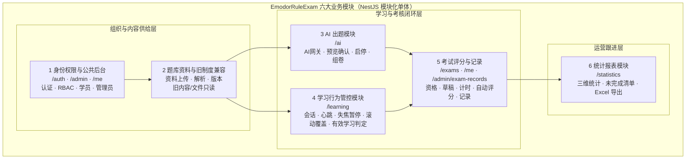

### 1.2 模块依赖关系

系统为 NestJS 模块化单体（AD-02），全部模块间交互发生在**进程内**：跨模块调用一律经 NestJS 依赖注入引用对方暴露的 Service，或经 Repository 对共享数据表做**只读**查询；不存在任何跨服务网络调用。依赖方向与交互内容如下（A → B 表示 A 依赖 B）：

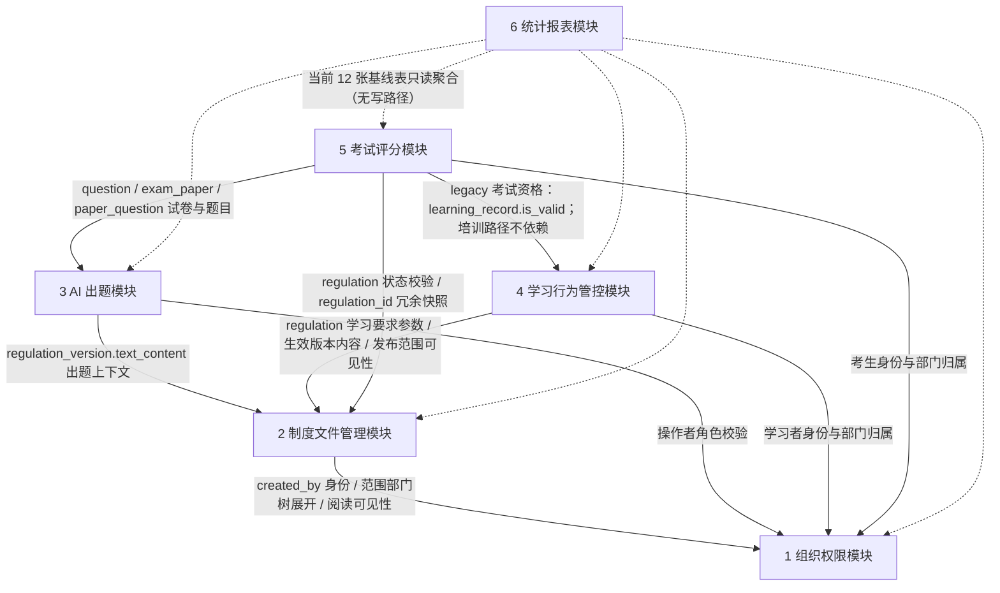

**依赖关系清单**：

| 依赖方 | 被依赖方 | 交互内容 | 交互方式 |
|---|---|---|---|
| 2 制度文件管理模块 | 1 组织权限模块 | 创建人身份（`regulation.created_by`）；发布范围部门树展开（`regulation_scope` → `sys_department` 含子部门）；员工阅读可见性判定（`sys_user.department_id`） | 进程内 Service 调用（部门树服务）；`sys_department` / `sys_user` 只读查询 |
| 3 AI 出题模块 | 2 制度文件管理模块 | 出题上下文（`regulation_version.text_content`，按 `regulation.current_version_id` 取生效版本）；版本追溯（`question.version_id`） | `regulation` / `regulation_version` 只读查询 + 生效版本查询服务 |
| 3 AI 出题模块 | 1 组织权限模块 | 发起生成／选行确认／启停／组卷的操作者角色校验（regulation_admin / super_admin） | 认证守卫（JWT + RBAC） |
| 4 学习行为管控模块 | 2 制度文件管理模块 | 有效学习判定参数（`regulation.required_minutes`、`regulation.scroll_segments`）；阅读内容（生效版本 `content_html` 或 PDF 文件流）；制度状态与范围可见性（`regulation.status`、`regulation_scope`） | 进程内 Service 调用 + 只读查询 |
| 4 学习行为管控模块 | 1 组织权限模块 | 学习者身份（`learning_session.user_id`）与部门归属（统计用） | 认证守卫 + 只读查询 |
| 5 考试评分模块 | 4 学习行为管控模块 | **legacy 制度固定卷**资格校验（`learning_record.is_valid`，按 user_id + regulation_id）；新培训考试默认不调用该学习门槛 | 旧路径进程内 Service 调用；培训路径按发布/身份/规则快照校验 |
| 5 考试评分模块 | 3 AI 出题模块 | legacy 试卷与题目（`exam_paper` / `paper_question` / `question` 的 `answer`、`options`、`analysis`）；培训目标读取发布/个人题单快照 | legacy 只读查询；培训路径不得回读动态题库覆盖快照 |
| 5 考试评分模块 | 2 制度文件管理模块 | 制度状态校验（`regulation.status = published`）；`exam_record.regulation_id` 冗余快照来源 | 只读查询 |
| 5 考试评分模块 | 1 组织权限模块 | 考生身份、在职状态（`sys_user.status`）、部门归属 | 认证守卫 + 只读查询 |
| 6 统计报表模块 | 1 ~ 5 全部模块 | 当前业务表及培训增量事实的只读聚合（应学集合、学习指标、考试指标、部门 / 个人维度） | Repository 只读查询；不调用会改变数据的任何服务方法 |

**依赖关系设计原则**：

1. **单向依赖、无环**：依赖方向总体为 1 → 2 → {3, 4} → 5 → 6（被依赖方在上游），不存在循环依赖；`regulation.current_version_id` 与 `regulation_version.regulation_id` 的互指在应用层维护（03 册 1.6 节），不构成模块级环。
2. **跨模块只读优先**：模块间共享数据以「上游模块写入、下游模块只读」为常态；C2 开考只消费 C1 release，并通过 MediaService 在同事务绑定本人题单题干/选项图片，不改写题库或发布快照。
3. **权限守卫全局统一**：全部模块接口先经全局认证守卫与角色守卫（见 2.4.2 节），模块内不再各建权限体系；数据范围控制（employee 仅本人）由各模块在查询入口统一收口。
4. **统计模块零写路径**：统计报表模块对当前业务事实表只读，不持有任何写事务，保证报表永远不污染业务数据；培训新增统计事实沿用同一边界。

### 1.3 模块内部设计通用约定

以下约定对六大模块统一适用，各模块章节不再重复：

| 约定项 | 内容 |
|---|---|
| 模块组织 | 每模块对应一个 NestJS Module：Controller（接口层，只做参数校验与转发）→ Service（领域服务，承载业务规则）→ Repository（TypeORM 数据访问，映射 03 册当前基线与后续同步实体）；文件解析、AI 网关、定时任务为横切能力（02 册 2.2 节），分别挂靠其业务归属模块（解析 → 制度文件管理模块，AI 网关 → AI 出题模块，定时任务 → 学习行为管控 / 考试评分模块） |
| 统一响应 | 全局响应拦截器输出 `{ code, message, data }`，`code = 0` 表示成功；全局异常过滤器映射 40xxx（客户端错误）/ 50xxx（服务端错误）错误码（README 3.4，明细见 04 分册） |
| 事务边界 | 多表写操作一律在 Service 层显式事务内完成（03 册 1.6 节：关联完整性由应用层维护）；本章标注「事务」的设计点均为单事务原子操作 |
| 时钟口径 | 全部业务时间由服务端时钟生成、统一东八区、`DATETIME(3)` 毫秒精度（03 册 1.3 节）；任何客户端上报的时间戳不参与业务判定（C-01 的通用化） |
| 枚举校验 | 全部枚举字段（`regulation.status`、`question.type` 等）以应用层 TypeScript 常量枚举为唯一定义源，写入前经 DTO 校验拦截非法值（03 册 1.7 节） |
| 数据范围 | employee 的查询边界一律为「仅本人」；super_admin 拥有 regulation_admin 的全部能力（01 册 3 章权限矩阵） |
| Redis 边界 | Redis 只存可再生临时态（考试计时、学习会话累计、防重复提交、任务与作答暂存），MySQL 是唯一权威数据源（AD-04）；各模块的 Redis Key 约定在对应小节给出 |

### 1.4 培训融合模块增量（已实现与计划边界）

仍复用六大 legacy 模块与公共认证，不另造身份系统；以下职责由 A1—C6 分阶段加入，具体模块文件、表和接口由相应任务在源码落地后回填：

| 增量职责 | 归属/owner | 必须保持的边界 |
|---|---|---|
| 类别、学员来源、批量导入 | 组织权限扩展 / A2 | `institution/external` 来源与权限角色分离；旧用户未知值可为空；学员不能改来源/类别/角色 |
| 课程、章节、课时版本、视频 | 学习行为扩展 / B1/B2 已落地 | 与制度阅读独立；B2 负责 30 秒心跳、45 秒封顶、2 秒位置容差、95% 去重覆盖与当前应学汇总；零必学课时不自动完成 |
| 三类客观题、难度、启停、版本与导题 | B3版本链＋B4文件导入／参考题AI预览 | 中文五列模板、旧四列及英文七／八／九列兼容；预览确认后启用，revision不覆盖旧内容，概念／分值／审核元数据不进入新版本 |
| 固定/随机发布与个人题单 | AI/考试协同 / C1/C2 已落 | 本机构初级、外来高级；同一question_id同卷最多一道；发布/个人快照不可变；新培训考试默认无学习门槛 |
| 草稿、主动评分与历史结果 | Task13/14 / Gate H2 | 本地草稿、稳定ID整卷；主动截止前受理才评分，到期纯timeout不评分；结果只读 |
| 考试记录、场次统计与排名 | 考试/统计扩展 / C5-C6 | 记录列表/详情/结果只读；固定卷按当前发布版本与同一冻结规则形成整场 finalized 个人最高分统计，历史随机卷再按冻结难度隔离，并计算当前应考集合交集；旧报表后端口径保留 |

B1/B2 课程与视频学习事实、B3/B4 三类客观题版本题库与导入、发布快照、个人题单、schema2稳定ID、主动评分/纯timeout、统一历史结果和记录读取均已同步 migration、`init.sql`、entities、设计与 controller/API。015 删除阅卷事件、图片答案和监控采集专用字段；C6 统计只读取 finalized 事实。

---

## 2. 身份权限与公共后台模块（`/auth`、`/admin`、`/me`）

### 2.1 模块职责与边界

**职责**：承担身份认证、可配置 RBAC、会话吊销、培训类别、无部门学员、管理员角色分配、本人资料和公共后台配置。底层 `sys_user/sys_department` 继续是旧学习与统计的共享数据，但现行模块不提供员工或部门管理 CRUD。

**边界（不做什么）**：

| 不属于本模块的内容 | 归属 |
|---|---|
| AI 服务连接配置（`base_url` / `api_key` / `model`，具备 `ai_config:write` 的管理角色维护） | 3 AI 出题模块（`/ai`，FR-AIQ-01） |
| 旧制度的学习要求、发布范围等兼容事实 | 2 题库资料与旧制度兼容模块（只读） |
| 员工「在学习 / 考试中的行为数据」的查询与展示 | 4 学习行为管控模块、5 考试评分模块、6 统计报表模块 |
| 组织数据被学习 / 考试 / 统计模块引用后的口径解释 | 各引用模块（本模块只保证组织数据本身的正确性） |

### 2.2 内部组成（子服务 / 组件）

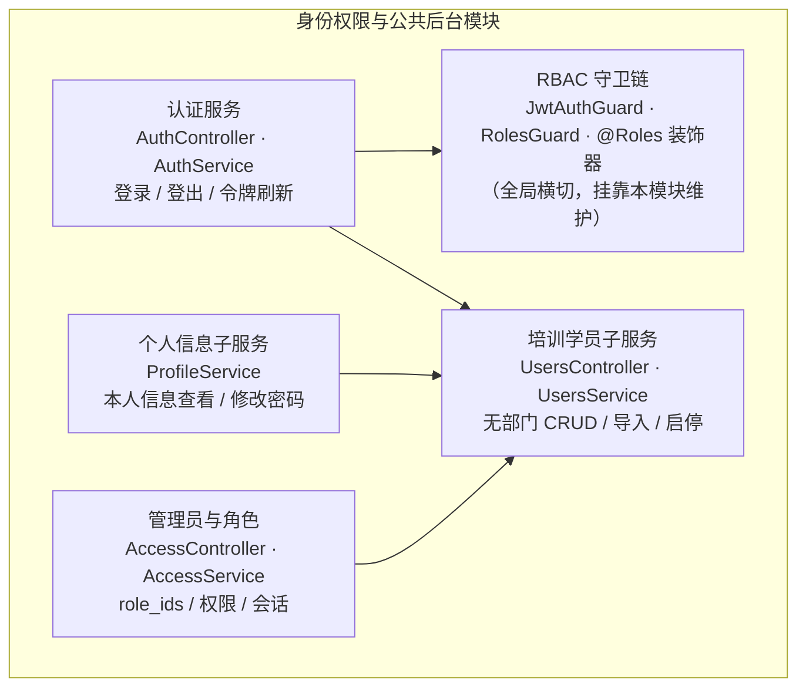

### 2.3 核心类 / 服务职责表

| 组件 | 类型 | 职责 | 关键依赖 |
|---|---|---|---|
| AuthController | 接口层 | `/auth` 登录、登出、刷新令牌入口 | AuthService |
| AuthService | 服务 | 凭据校验（bcrypt 比对）、双令牌签发与刷新、`last_login_at` 更新、登录失败错误混淆 | `sys_user` 仓储 |
| JwtAuthGuard | 守卫（全局） | 全部业务接口的 JWT 校验：解析 Bearer 令牌、验签、注入请求上下文（user_id / role） | JwtStrategy |
| RolesGuard | 守卫 | 读取 `@Roles('super_admin', ...)` 装饰器元数据，校验 `sys_user.role` 是否在允许列表 | 守卫元数据 |
| AccessController / AccessService | 接口层 / 服务 | 管理员列表、新增、修改、重置与删除；启用非系统角色选项只供新增和修改，事务内重查管理员身份并刷新令牌权限；不提供既有学员提升管理员入口 | `sys_user` / `sys_role` / `sys_user_role` 仓储、Redis |
| UsersController / UsersService | 接口层 / 服务 | `/admin/students` 培训学员增改查、导入、头像与启停；手机号必填，学员使用 H5 验证码登录，不提供密码设置/重置或删除，不接受部门字段 | `sys_user` / `training_category` / `import_batch` |
| MeProfileController / UsersService | 接口层 / 服务 | 共享本人普通资料；移动学员启用类别选项与首次确认，事务内保证只许未分配者自选一次；profile 解析当前 category_name，不用 occupation 替代 | `sys_user` / `training_category`、角色链接、审计 |
| ProfileService | 服务 | 本人信息查询（排除 `password_hash`）、修改密码（原密码校验） | `sys_user` 仓储 |
| IdentityController / IdentityService | 接口层 / 服务 | 本人实名视图、持久会话复用、Provider claim、结果恢复与事务绑定；Gate G 自动化与独立代码审查已通过 | `learner_identity/identity_verification_session/sys_user`、IdentityProvider、MediaService |
| IdentityImageService / IdentityCrypto | 服务 | 三图探测重编码、证件 OCR 裁剪；受控身份数据 AES-GCM 加密与 HMAC 查重 | 私有媒体、独立运行期密钥 |
| MediaTicketController / MediaTicketService | 接口层 / 服务 | mobile 签票、签名/过期校验和精确引用的二次授权 | MediaService owner policy、独立票据密钥 |

### 2.4 关键设计详解

**移动学员培训工种（2026-10-23）**：`category_id` 是 PC/H5 共同权威事实。个人资料页未设置时读取真实启用类别，选择只留草稿，经「确认培训工种」二次确认才调用专用首次绑定接口；已设置时只读并提示联系管理员或监考人员。普通资料与实名两个入口分开，姓名仍来自实名流程。考试页按缺项给出资料/实名指引，加载错误不伪装为未认证，既有历史或进行中考试不隐藏。页面重新进入读取当前资料，PC 调整可见；未知写结果先读回，禁止自动重发。`occupation` 保留 API 兼容但不再作为移动培训工种。

#### 2.4.1 认证服务（JWT 签发 / 校验 / 刷新策略、bcrypt 密码哈希）

**密码哈希**：`sys_user.password_hash` 一律存 bcrypt 哈希（cost 因子 12，输出 60 字符；列宽 VARCHAR(255) 为 argon2 等算法迁移预留，03 册 3.1.2 节）。任何查询不得 SELECT 该列，接口返回用户信息时排除（03 册设计说明 2）。登录校验与修改密码均在应用层完成 bcrypt 比对，不依赖数据库排序规则。

**登录流程**：

| 步骤 | 规则 |
|---|---|
| 1 凭据校验 | 按 `username` 走 `uk_username` 查 `sys_user`；bcrypt 比对密码 |
| 2 状态校验 | `sys_user.status = 0`（停用）的账号拒绝登录（FR-ORG-01 验收④） |
| 3 错误混淆 | 「用户不存在」与「密码错误」返回同一错误码与同一提示（FR-ORG-01 验收②：不泄露具体区别） |
| 4 令牌签发 | 校验通过签发双令牌（见下），并更新 `last_login_at` |

**JWT 双令牌与刷新策略**：

| 令牌 | 有效期（默认） | 载荷 | 用途 |
|---|---|---|---|
| access token | 2 小时（环境变量 `JWT_EXPIRES_IN`） | sub（`sys_user.id`）、username、role（`sys_user.role`）、type=access、jti、iat、exp | 每次业务请求的 Bearer 凭据 |
| refresh token | 7 天（应用配置，可调） | sub、type=refresh、jti、iat、exp | 访问 `/auth` 刷新端点换取新 access token |

- **刷新策略**：access 过期前客户端以 refresh token 调用刷新端点；服务端校验 refresh 签名与有效期后签发新 access，并轮换签发新 refresh（旧 refresh 到期自然失效）。学习 / 考试会话经常跨越小时级（`required_minutes` 典型 10 ~ 30 分钟、考试限时更长），双令牌避免「学一半被迫重登打断进度采集」。
- **取舍说明（服务端吊销统一为 Redis 黑名单，与 07 册 2.1.4 定稿一致）**：① AD-05 定稿 JWT 无状态认证，不依赖服务端会话存储——黑名单不改变「默认放行、按需吊销」的无状态主体；② 当前基线不把吊销态写进业务表——吊销态不落 MySQL，由 Redis 承载（条目数只与登出 / 封禁事件数成正比，量级极小且带 TTL 自然过期）；③ JWT 载荷增加 `jti`（随机令牌 id），为单令牌级吊销提供定位粒度。吊销规则：**登出**写 Redis 黑名单 `auth:blacklist:{jti}`（TTL = access 剩余有效期，到期自动清理，黑名单不无限增长）；**改密 / 停用账号**写用户级封禁键 `auth:block:{user_id}`（TTL = refresh 剩余有效期）——键值 = 封禁时刻时间戳 `block_ts`，守卫判定 `token.iat < block_ts` 才拒绝（改密 / 重置后**新签发**令牌天然放行，旧令牌含 refresh 轮换路径即时失效，不会出现「改密后至封禁键过期前无法登录」的误伤）。Redis 故障时降级为**敏感操作实时回库校验**——发起考试、交卷、管理端全部写操作在执行前回查 `sys_user.status = 1`，停用账号的存量令牌在敏感路径上即时失效（07 册 2.1.4 降级取舍：可用性优先，鉴权主体依赖 JWT 自校验，不因 Redis 故障全员不可用）。
- **登出**：服务端写 `auth:blacklist:{jti}`（TTL = access 剩余有效期）并记录审计日志，前端丢弃双令牌；界面侧同时清除本地作答暂存。
- **会话时间一致性**：`SessionService.create` 生成一个服务端 JS `now`，显式写入新 `auth_session` 的 `created_at`、`updated_at`、`last_seen_at`；不依赖数据库 `CURRENT_TIMESTAMP` 的时区默认值，管理端列表因此展示同一时间基准。

**管理端在线会话列表**：`OnlineSessions.vue` 复用 FitsTable/FitsListSearch，按账号／姓名与状态查询，默认显示有效会话；查询和重置返回第一页，刷新保留已应用条件，变更每页条数返回第一页。列为账号／姓名、设备、来源 IP、登录时间、最近活动、状态和有写权限时的操作。设备显示设备类型、浏览器及系统简写，完整 UA 悬浮显示；不推测登录地点。登录时间固定为 Asia/Shanghai 的 `YYYY-MM-DD HH:mm:ss`，最近活动显示相对时间并提供完整时间提示。状态区分有效／已过期／已下线，仅精确当前会话显示标记。

`SessionService.list` 左连接账号投影并执行关键字／状态过滤及稳定分页；当前会话标记来自认证 sid。页面请求有代次与失活保护，缓存重进刷新，错误与空态分开。下线确认包含账号与设备，提交期间禁止重复操作；当前会话下线成功后清除本地登录状态并进入登录页，其他会话下线仅更新列表。该轮只扩展查询与展示，不改变登录、refresh、过期或吊销机制，不新增数据库字段。

#### 2.4.2 RBAC 守卫（角色枚举、接口守卫链）

角色枚举固定三个（`sys_user.role`，README 3.4）：`super_admin`（超级管理员）、`regulation_admin`（制度管理员）、`employee`（普通员工）。super_admin 天然拥有 regulation_admin 的全部能力（01 册 3 章权限矩阵）。

**接口守卫链**（全部业务接口统一经过，顺序固定）：

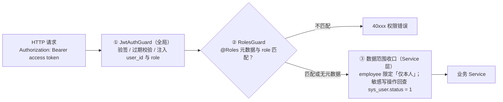

**角色守卫要点**：

| 规则 | 说明 |
|---|---|
| 声明式角色要求 | 接口以 `@Roles('super_admin')`、`@Roles('super_admin', 'regulation_admin')` 声明允许角色；未声明角色的接口默认「任一已认证用户」 |
| 典型拦截 | employee 调用题库、组卷或统计接口，未获细权限的管理员调用系统设置或 AI 配置接口 → 统一 40xxx 权限错误码 |
| 组织数据兼容 | 不注册 `/departments` 或 `/users` 管理路由；旧组织表只在共享兼容服务内部读取，不作为隐式授权入口 |
| 数据范围 | 接口角色之外，数据边界在 Service 查询入口收口：employee 的学习 / 考试 / 统计查询强制追加 `user_id = 本人`；「限发布范围内的本人」由业务模块叠加范围校验（见 3.4.6 / 6.4.1 节） |
| 管理员可被纳入学习 | 学习与考试面向「发布范围内的用户」开放、不按角色排除（01 册 3 章说明）：super_admin / regulation_admin 账号被纳入范围时同样应学应考 |

#### 2.4.3 共享组织数据兼容边界

现行应用不再注册 `DepartmentController`、`UserController` 或 `UserImportService`，也不提供 `/departments`、`/users` 管理入口。`sys_department` 与既有 `sys_user.department_id` 只供旧制度范围、学习和统计兼容读取；培训学员由 `/admin/students` 管理，新建/导入不接受部门字段并写入 `department_id=NULL`，更新既有学员不接受部门字段但保留历史值。`UsersService` 仅保留培训学员、管理员与认证所需能力；管理员通过 `POST /admin/administrators` 创建且必须提交非空 `role_ids`。

管理员账号维护由 `AccessService` 持有分类与角色事实，使用公共 `FitsTable/FitsListSearch` 查询、分页。列表展示账号、姓名、手机号、真实登录次数/IP/时间、状态和创建时间；“重置密码 / 修改 / 删除”平铺居中。新增和修改共用RoleSelect搜索多选组件，选中以标签展示；下拉以计数及轻量文字操作提供全选、反选、清空（全部取消）和搜索结果批量操作。标签从完整角色选项解析名称，搜索后批量选择仍显示角色名。父页面读取启用非系统角色、保存非空role_ids并保留历史停用角色，组件不请求或扩大权限。新增时比较密码确认；姓名/手机号选填，状态正常/禁用。账号创建、角色/资料/状态变更同事务完成；重置复用强口令、首次改密和会话吊销。不提供既有学员提升管理员能力，管理账号须独立创建。删除写普通 `sys_user.deleted_at` 标记并禁用，保留历史引用与角色链接，避免重分类为学员。最高管理员、本人及纯学员边界在服务层最终检查，细节以04册3.2.6与07册2.2.3为准。

角色与菜单联动（2026-10-27）：公共角色列表展示名称、备注、创建时间、状态，资料修改与菜单树授权分开保存；树直接使用sys_menu安全投影，并补齐未配置到菜单的真实注册权限，相同权限码的多处节点同步勾选。菜单树列表展示图标/父级，新增修改复用公共表单，保存后只刷新导航，不产生授权。管理员、角色、菜单按钮按036细项分别检查，038移除已退役的既有账号提升入口及其权限；删除角色使用角色行锁阻断任意账号引用，旧权限一次性转换与严格新授权端点不能混用。

#### 2.4.4 学员三图实名与持久核验（Task 10/11，Gate G 自动化与独立代码审查已通过）

`learner_identity` 是已实名权威，不从姓名、手机号、内部名单或 Debug Login 推断通过。身份模块只接受当前 mobile 学员，图片入口与通用媒体上传分开，三图固定为人像面/国徽面/现场正脸；用途分别 `identity_id_portrait/identity_id_emblem/identity_face`。图片由服务端按 04 册 3.2.8 的 JPEG/PNG、尺寸/像素/大小限制探测、修正方向并重编码去元数据；两面证件 OCR 裁剪清洗后才私有存储，face 只通过平台现场拍摄入口采集。

当前内部状态与持久字段见 03 册 3.1.9—3.1.10：

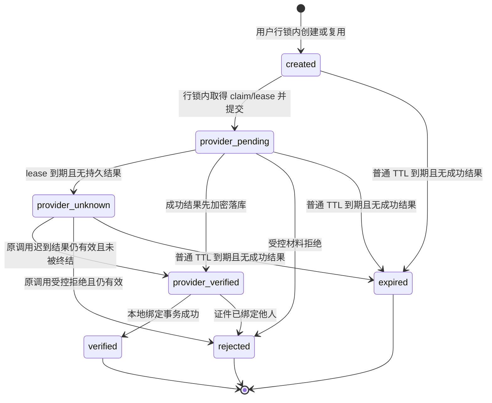

1. 创建先锁 `sys_user` 并重查已有实名。同三图、未过期的会话直接复用（包括 rejected），不同三图遇既有非终态返回冲突；同用户同时只能一个非终态。已实名 POST 返回 40960 和 `data.status='verified'`，客户端改 GET 权威视图。
2. `provider_pending` 同时表示已提交的执行 claim；执行 lease 默认上限 120 秒且不超过 session 到期时间。外部调用只能由取得 claim 的实例发起。其他查询只读 pending，lease 到期无结果转 provider_unknown，不自动重调腾讯；普通会话默认 600 秒，到期后才由用户明确用材料重新提交。
3. OCR/FaceID 成功先保存受控加密结果与 provider_verified，再在独立事务绑定；此状态不受普通 TTL 终结，重启、GET 本人视图或 session 查询必须继续恢复本地绑定，禁止丢弃成功结果或重调供应商。外部返回到结果落库间崩溃只能保留 unknown，不能承诺外部 exactly-once。
4. 绑定事务重新锁 user、当前 session 和证件指纹，确认未被替代/未有实名，写唯一事实、三图引用、`sys_user.real_name`、session verified 及唯一 `bound_event_id/bound_at`。迟到旧结果不得覆盖现有姓名或事实；不同账号同证件由唯一 HMAC 指纹裁决，不合并账号。文件 AuditService 只在事务提交后 best-effort 输出脱敏事件，事务性审计事实在数据库。
5. 运行时只 `disabled|tencent`。腾讯 FaceID 使用 `ImageRecognitionV2`（2018-03-01，IdCard/Name/ImageBase64，阈值 70），超时/未知及基础设施失败不映射材料拒绝，也不在 Adapter 自动重试。Fake 只在 Nest TestingModule override，仍走上传/会话/轮询/结果持久化/绑定。

移动端正常页先 GET 权威状态，读取失败可重试，不默认未实名或已实名。三图均 safe、两面处理预览存在、同意协议且无请求时才能提交；pending 立即首查，此后每 800ms，最多 12 次，耗尽保留 pending/手动查询。session verified 后必须再 GET 本人视图为 verified 才成功。错误按 `reason_code/clear_materials` 定向重拍，不解析 message；退出/切号/新 session 使旧请求 epoch 失效，旧上传和轮询不能覆盖当前账号状态。

替换/取消/离页释放本地预览并 best-effort DELETE 远端未提交材料；后端只解除本人 identity purpose 且未被 session/实名事实使用的精确临时引用。超过 24 小时仍未提交的临时引用可由清理任务解除后删除，活动 session/已绑定证据保留；离页不撤销已发出的核验。

#### 2.4.5 短期媒体票据与精确业务引用

实名上传即建立 `identity_verification_user + user ID` 引用，头像使用 `user_avatar + user ID`，课程封面使用 `training_course_cover + course ID`。`MediaTicketService.issue` 必须先找到精确 `media_reference(asset_id,owner_type,owner_id)`，再执行已注册 owner policy 的 `authorizeRead(actor,owner,asset)`；“能看课程”不能替代封面精确绑定。

票据 HMAC 绑定版本、asset、actor、purpose、owner type、owner ID、expiry，默认 300 秒，返回站内内容 URL。内容入口先校验签名/过期，再重查相同引用、当前授权、ready/未删除及 purpose 一致性；引用撤销或权限变化即时拒绝旧票据。URL 不含 JWT、真实文件名或磁盘路径；流沿用单段 Range 和 41601 边界。头像上传与资料保存分开，只有保存成功才更新关联；mobile 媒体层维护票据续签，站点公开品牌仍走既有白名单。视频票据联调留给 Task 12，题图 owner 留给 Task 13/14，均不得据 Gate G 标为已完成。

### 2.5 与其他模块的依赖关系

| 方向 | 对端模块 | 交互内容 | 交互方式 |
|---|---|---|---|
| 被依赖（上游） | 2 题库资料与旧制度兼容模块 | 操作者身份与旧组织范围兼容读取 | 认证上下文 + 只读查询 |
| 被依赖（上游） | 4 学习行为管控模块、5 考试评分模块 | 认证守卫注入的 user_id / role；员工在职状态回查 | 守卫 + 只读查询 |
| 被依赖（上游） | 6 统计报表模块 | `sys_user`（应学分母、部门 / 个人维度）、`sys_department`（部门树展开） | 只读查询 |
| 依赖（下游） | 受控媒体与实名 Provider | 私有三图、精确业务引用/票据、外部 OCR/FaceID；实名服务不接管课程/考试状态 | 内部服务 + Provider 接口 |

### 2.6 对应数据表

| 表 | 本模块读写角色 | 说明 |
|---|---|---|
| `sys_department` | 只读兼容 | 不提供管理控制器；仅旧范围/统计链路读取 |
| `sys_user` | 认证、培训学员与管理员所需读写 | 新建/导入学员写 `department_id=NULL`，更新保留历史部门值；`password_hash` 不出参 |
| `training_category/import_batch/sys_role/sys_permission/sys_role_permission/sys_user_role/auth_session` | 按职责读写 | 培训归类、可恢复导入、细权限和会话吊销 |
| `learner_identity/identity_verification_session` | 受控事务读写 | 权威实名、执行 claim/lease、结果恢复和唯一绑定审计事实；Gate G 自动化与独立代码审查已通过 |
| `media_asset/media_reference` | 按 purpose/owner 受控使用 | 临时三图释放与 24h 清理，已进入 session/实名事实的证据保留 |

---

## 3. 题库资料与旧制度兼容模块

### 3.1 模块职责与边界

**职责**：通过 `/admin/question-materials` 提供题库资料创建、PDF/DOCX 版本上传、解析状态与重试；外部使用资料/资料版本语义，底层复用 `regulation/regulation_version`。新资料不绑定培训类别。旧制度内容与文件仍由 `/regulations/{id}/content`、`/regulations/{id}/content/file` 按原发布范围只读下发，但制度 CRUD、发布范围和学习要求管理控制器已删除。

**边界（不做什么）**：

| 不属于本模块的内容 | 归属 |
|---|---|
| 解析产物的出题消费（`text_content` 喂给 AI） | 3 AI 出题模块（本模块只负责产出与提供只读访问） |
| 学习会话、心跳、滚动覆盖、有效学习判定 | 4 学习行为管控模块 |
| 考试资格、试卷状态中「员工可考」的组织协调 | 5 考试评分模块 |
| 基于制度数据的指标聚合 | 6 统计报表模块 |
| 培训学员和管理员维护 | 1 身份权限与公共后台模块 |

### 3.2 内部组成（子服务 / 组件）

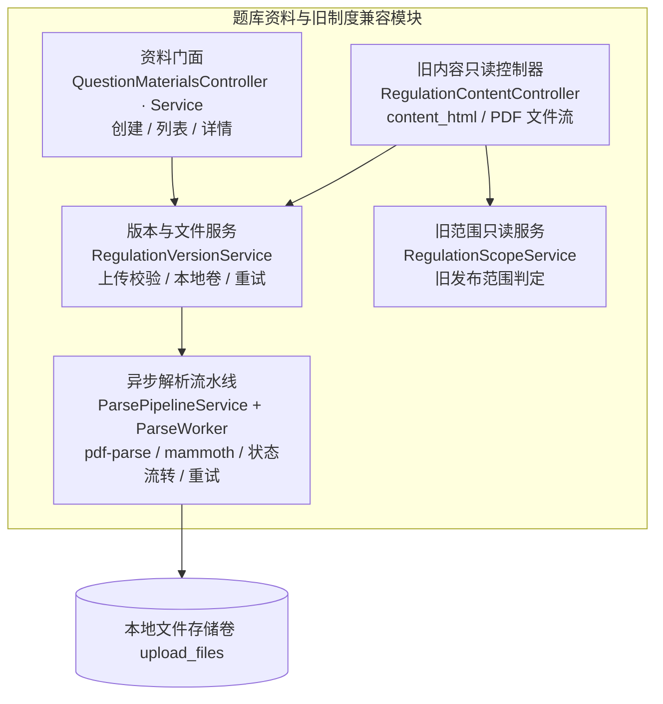

### 3.3 核心类 / 服务职责表

| 组件 | 类型 | 职责 | 关键依赖 |
|---|---|---|---|
| QuestionMaterialsController / Service | 接口层 / 服务 | `/admin/question-materials` 资料创建、列表、详情、版本上传、状态与重试；ID 均输出字符串 | `regulation` / `regulation_version`、RegulationVersionService |
| RegulationVersionService | 服务 | 上传校验链（格式 / 大小 / 哈希 / 重复检测）、`version_no` 分配、文件落盘与解析重试；供资料门面复用 | `regulation_version` 仓储、文件系统 |
| ParsePipelineService | 服务（横切） | 解析任务调度：事件触发 + 兜底扫描、并发控制、worker 分派、`parse_status` 流转与重试 | `regulation_version` 仓储、ParseWorker |
| ParseWorker | 执行器 | 进程隔离执行解析：pdf-parse 提取文本 / mammoth 转 HTML，产物体检（空产物判失败） | pdf-parse、mammoth、文件系统 |
| RegulationScopeService | 服务 | 只供旧学习内容的发布范围兼容判定；无管理写入口 | `regulation_scope` / `sys_department` |
| RegulationContentController | 只读接口层 | 旧 `/regulations/{id}/content` 与 `/regulations/{id}/content/file`，复用状态与范围校验 | `regulation` / `regulation_version`、RegulationScopeService |

### 3.4 关键设计详解

#### 3.4.1 上传校验（格式 pdf / docx、大小上限、file_hash 重复检测）

上传校验按固定顺序执行，任一步失败立即终止并返回对应 40xxx 错误：

| # | 校验项 | 规则 | 失败处理 |
|---|---|---|---|
| 1 | 权限与资料 | 操作者具有 `ai:write`；目标资料存在且属于 question_material 内部分组 | 权限 / 参数错误 |
| 2 | 大小 | 单文件 ≤ 50MB：应用层流式读取累计字节数判定；nginx 请求体上限同步配置为同值 | 拒绝并提示超出大小上限 |
| 3 | 格式 | 扩展名 ∈ {pdf, docx}（写入 `regulation_version.file_type`）+ **文件魔数双重校验**：pdf 以 `%PDF-` 头；docx 为 zip 结构（`PK` 头）。仅改扩展名的伪装文件被拦截 | 拒绝并提示支持的格式（FR-REG-02 验收①） |
| 4 | 完整性 | 流式计算 SHA-256 得 `file_hash`（CHAR(64)，十六进制） | — |
| 5 | 重复检测 | 以 `file_hash` 在同制度下查询（`idx_file_hash`）：命中 → 返回提示「与版本 v{N} 文件内容相同」，**提示但不阻断**（FR-REG-02 验收③），继续走版本创建 | — |
| 6 | 落库（事务） | 分配 `version_no` = 该制度 max(version_no) + 1（`uk_regulation_version_no` 兜底并发上传，冲突时重读重分配）；INSERT `regulation_version`（`parse_status = pending`、`file_path` / `file_type` / `file_hash` / `created_by`）；文件从临时区移入正式目录；事务提交后触发解析任务 | 失败回滚并清理临时文件，不产生半成品 |

> 说明：大小上限 50MB 为上传硬性拒绝线；≤20MB 资料的解析时效目标为 60 秒，解析仍使用异步任务，不阻塞其他操作。

#### 3.4.2 文件存储组织（本地卷目录规则）

本地文件存储卷（AD-06，Docker 卷 `upload_files`，容器内挂载 `UPLOAD_DIR`）的目录规则：

| 项 | 规则 | 说明 |
|---|---|---|
| 正式目录 | `{UPLOAD_DIR}/regulations/{regulation_id}/{version_no}_{file_hash 前 8 位}.{file_type}` | 按制度分目录（备份 / 清理粒度）；`version_no` 保证同制度唯一；hash 前缀防同名碰撞；扩展名即 `file_type` |
| 临时区 | `{UPLOAD_DIR}/tmp/` | 上传先写临时区，校验全部通过并在事务提交后移入正式目录；事务失败即清理 |
| 路径入参 | `regulation_version.file_path` 存放**相对路径** | 与 03 册 3.2.2 节「以 URL 路径表达、天然支持存储演进」一致；未来迁对象存储仅改应用层读写路径 |
| 安全性 | 目录与文件名全部由系统生成（制度 id / 版本号 / hash 派生），不含任何用户输入 | 天然防路径穿越；文件访问一律经应用层鉴权受控下发（3.4.6 节），不暴露直接静态映射 |

#### 3.4.3 异步解析流水线（上传后 pending → 队列消费 → parsed / failed）

解析为异步任务（AD-03）：上传接口在事务提交后立即返回，解析在后台执行，`parse_status` 状态流转如下：

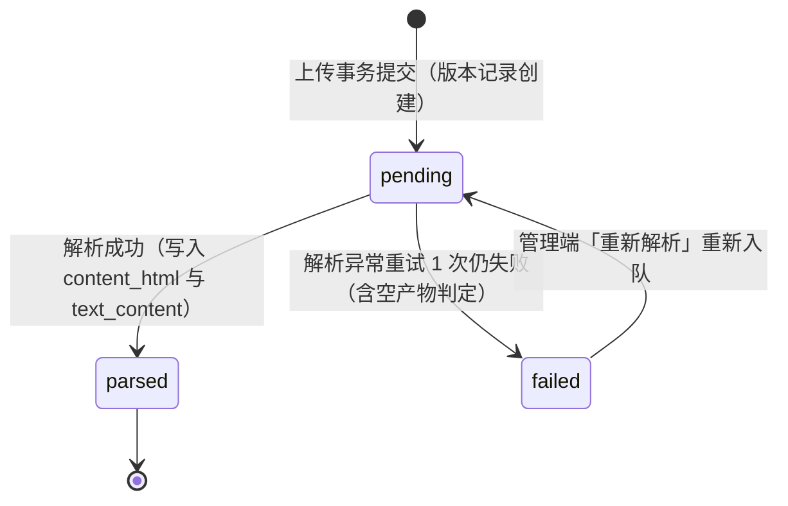

**流水线设计**：

| 环节 | 设计 |
|---|---|
| 任务触发 | 双通道：① 上传事务提交后进程内事件**立即触发**（实时性）；② 兜底定时扫描（每 1 分钟扫 `parse_status = 'pending' AND created_at < NOW() − 2 分钟` 的记录重新投递，防事件丢失、避免与刚投递的事件任务抢跑；`idx_parse_status` 支撑） |
| 任务抢占 | worker 取任务时执行 `SET parse:lock:{version_id} NX EX 600` 抢占——抢锁失败即跳过该版本（另一 worker 正在解析）；锁随解析终态释放，600 秒 TTL 自然过期兜底 | 双通道触发下同一版本不并发双解析（重复投递被锁幂等拦截，防 `parse_status` 被 `failed` 覆盖已成功的 `parsed`） |
| 执行隔离 | 解析在 worker 线程 / 子进程执行，与请求处理的事件循环隔离（pdf 文本提取为 CPU 密集操作，02 册 3.3 节风险 R1）；并发上限默认 2 个，超出的排队 |
| pdf 分流 | `file_type = pdf` → **pdf-parse** 提取全文文本 → 写 `text_content`；`content_html` 置 NULL（PDF 阅读走 pdfjs-dist 前端渲染原始文件，见 3.4.6 节，与 02 册 4.2 节协同口径一致） |
| docx 分流 | `file_type = docx` → **mammoth** 一次转换双产物：`convertToHtml` → `content_html`（在线阅读）、`extractRawText` → `text_content`（解析文本与旧生成来源兼容） |
| 产物体检 | `text_content` 去空白后低于 50 字符时：启用多模态且为 PDF → 保持 parsed（仅保留旧视觉来源兼容，不开放 PdfVisionService 资料直接出题入口）；否则 failed。DOCX 低文本仍提示核对，不把不可用产物伪装成功 |
| 失败重试 | 瞬时异常（文件读取 I/O 等）自动重试 1 次，每次重试 `retry_count + 1`；仍失败 → `parse_status = failed`；管理端版本详情提供「重新解析」入口（failed → pending 重新入队，同样计入 `retry_count`）。产物字段只在首次成功时写入、并同步记录 `parsed_at`（解析完成时刻，NFR-04 耗时度量），重试不产生脏数据 |
| 状态可见 | 管理端版本列表 / 详情轮询 `parse_status`（pending / parsed / failed 实时呈现，FR-REG-03 验收③）；版本不可变约束不受影响——`parse_status` 是版本记录上唯一允许流转的状态字段（pending → parsed / failed，及 failed → pending 的重新入队） |

#### 3.4.4 资料版本与旧制度共享边界

题库资料版本 append-only：每次上传追加 `regulation_version`，资料详情返回全部版本，上传/状态/重试响应的版本 `id` 始终为字符串。新资料不写 `category_id`；旧题已有的 `regulation_id/regulation_version_id` 来源继续鉴权读取，不补造来源。当前参考题 AI 接收一次性中文五列文件并由页面选择整批培训类别，同时兼容旧英文七／八／九列文件；不接收 `material_id/material_version_id`。旧资料直接生成写入口退场。旧制度的 `current_version_id`、学习要求、发布范围与状态仅供兼容读取，现行应用没有切换、发布、归档或范围配置入口。

#### 3.4.6 在线阅读内容服务（docx → HTML、pdf → pdfjs-dist、权限与可见性）

**双渲染路径**（阅读数据来源由生效版本的 `file_type` 决定，与 02 册 3.9 节定稿一致）：

| 生效版本 file_type | 阅读数据来源 | 前端渲染方式 |
|---|---|---|
| docx | `regulation_version.content_html`（mammoth 产物，经接口下发） | 富文本直接渲染（结构化 HTML） |
| pdf | 原始 PDF 文件流（`file_path` 指向的本体，经应用层受控下发） | **pdfjs-dist** canvas 渲染（自有容器内滚动可观测，是滚动覆盖采集的硬前提） |

两条路径在阅读页共用同一滚动追踪与心跳上报逻辑（FR-REG-08）。

**阅读内容接口的权限与可见性校验链**（顺序执行）：

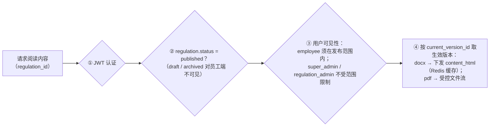

- **缓存**：docx 的 `content_html` 为版本不可变数据，天然适合缓存——Redis 缓存「制度 id → 生效版本 content_html」，TTL + 换版失效（03 册 6.5 节第 4 条）；版本列表类查询一律禁止 `SELECT *`，阅读内容按版本 id 点读大字段。
- **pdf 文件流**：经上述校验链后由应用层流式下发，不提供可猜测的静态 URL（文件本体不落 nginx 静态映射；传输安全细节见 07 分册）。
- **阅读页职责**：承载滚动位置采集与 30 秒心跳上报（行为采集的设计见第 5 章）。

### 3.5 与其他模块的依赖关系

| 方向 | 对端模块 | 交互内容 | 交互方式 |
|---|---|---|---|
| 依赖（下游） | 1 组织权限模块 | 部门树 /「部门 → 子树 id 集合」展开（发布范围圈定与应学集合）；创建人身份（`created_by`） | DepartmentService 进程内调用；只读查询 |
| 被依赖（上游） | 3 AI 出题模块 | 生效版本 `text_content`（出题上下文）、`current_version_id`、`question.version_id` 绑定 | 只读查询 |
| 被依赖（上游） | 4 学习行为管控模块 | `regulation`（`required_minutes` / `scroll_segments` / `status`）、生效版本阅读内容、发布范围可见性 | ContentService / RegulationScopeService 进程内调用；只读查询 |
| 被依赖（上游） | 5 考试评分模块 | `regulation.status` 校验（published 方可开考）；`exam_record.regulation_id` 冗余快照来源 | 只读查询 |
| 被依赖（上游） | 6 统计报表模块 | 制度主档、版本、范围三表的统计口径数据 | 只读查询 |

### 3.6 对应数据表

| 表 | 本模块读写角色 | 说明 |
|---|---|---|
| `regulation` | 资料创建写；旧制度只读 | 新资料使用内部固定 category 标识且不绑定培训类别；无制度状态/范围管理写入口 |
| `regulation_version` | 写（创建 / 解析产物回填 / `parse_status` 流转）、读（版本列表 / 阅读内容 / 出题上下文） | append-only；产物仅在解析成功时单次写入 |
| `regulation_scope` | 只读兼容 | 仅旧制度内容、学习与统计范围判定 |
| 本地文件存储卷 | 读写文件本体 | 目录规则见 3.4.2 节 |

---

## 4. AI 出题模块（`/ai`）

### 4.1 模块职责与边界

**职责**：保留AI配置／网关与旧任务／结果读取，当前写链为一次性参考题easy／hard生成预览、修改和批次内单行重生成，选行确认后直接启用；支持三类客观题。试题管理提供培训类别／题干／题型／难度／启用状态五项常驻查询（无折叠入口）、人工录题、修订、预览与启停，不再提供考点／审核／历史题直接重生成；试题导入提供文件／AI两个Tab。新候选与新发布按question_id去重，旧随机release继续冻结concept分组语义。

**边界（不做什么）**：

| 不属于本模块的内容 | 归属 |
|---|---|
| 资料文本的解析产出（`text_content` 的生成） | 2 题库资料与旧制度兼容模块 |
| 考试的资格校验、乱序、计时、评分（消费试卷与题目） | 5 考试评分模块 |
| 题目正确率等题库维度统计 | 6 统计报表模块 |

### 4.2 内部组成（子服务 / 组件）

```text
AI配置 → AiGatewayService ← AiQuestionImportService（内存参考、easy/hard预览）
                                      ↓ 仅本人批次修改／重生成
文件模板／解析 → QuestionImportService → questions／questions_ai预检批次
                                      ↓ 管理员选行确认，同一事务
人工Tiptap → QuestionBankService → QuestionVersionService（新revision、直接启用）
                                      ↓ 精确当前启用候选
PaperService → PaperReleaseService → SamplingService → 不可变release
                      新发布：question_id；既有release：historical-concept
```

旧QuestionGenerationService仅保留历史任务状态／结果读取，QuestionReviewService文件为QuestionBankService兼容导出，不再注册审核能力；QuestionConceptService不提供当前CRUD。

### 4.3 核心类 / 服务职责表

| 组件 | 类型 | 职责 | 关键依赖 |
|---|---|---|---|
| AiConfigController / AiConfigService | 接口层 / 服务 | AI 连接参数维护与读取（`GET / PUT /ai/config`；`ai_config:read/write` 分离，环境变量默认 + 界面配置覆写；PUT 返回脱敏结果）、连通性测试（`POST /ai/config/test`）、`api_key` 加密存取与脱敏展示 | 加密配置存储 |
| AiGatewayService | 服务（横切） | OpenAI 兼容协议 HTTP 客户端：按配置动态构建请求、120 秒超时、分类重试、非流式调用 | AiConfigService |
| QuestionGenerationService | 历史兼容服务 | 读取旧任务／生成结果和来源；旧直接生成写路由退场 | 旧任务缓存与历史题目 |
| PromptService | 历史服务 | 旧资料出题内部提示词渲染；不作为当前参考题 AI 导入的提示词入口，不恢复旧直接写库路由 | `question` 仓储（旧生成逻辑存量题干采样） |
| GenerationParserService | 历史服务 | 旧资料出题内部响应解析与校验；当前参考题导入在 `AiQuestionImportService` 中校验中文五列及兼容英文文件的无分值草稿 | — |
| QuestionValidator | 纯校验 | 三题型、启用难度、可信来源、受控富文本／图片与稳定答案；新题无概念或题库分值 | training contracts、sanitize-html |
| QuestionConceptService | 历史兼容 | 历史表／引用保留；当前无考点CRUD、写入或新题池语义 | question_concept |
| QuestionImportService | 服务 | 中文模板与旧表头映射，整批类别与空难度默认简单，逐题预览／warnings；owner+batch事务确认创建启用题、回执幂等，旧批次显式投影 | ImportBatchService、QuestionVersionService |
| AiQuestionImportController / AiQuestionImportService | 接口／服务 | 中文五列内存参考题、页面整批类别、easy/hard预览、本人批次修改／单行重生成／七列结果下载；兼容旧英文模板，选行确认前零题库写，确认后直接启用 | 共享导入解析器、AiGatewayService、QuestionImportService |
| QuestionVersionService | 领域服务 | create/createMany/revise、精确当前启用候选、恢复校验；同事务写身份／revision／媒体／作者原稿，修订同时校验版本与启停状态，旧题诚实捕获 | question/question_version、CategoryService、MediaService |
| QuestionBankService（旧QuestionReviewService兼容导出） | 服务 | 查询、人工录题、双令牌修订、启停与审计；无审核或历史题直接重生成方法 | QuestionVersionService、AuditService |
| PaperService | 服务 | 保留 legacy 试卷；新增 training 草稿配置、固定版本题单、同类别关系校验、复制与管理排序 | `exam_paper` / `paper_question`、CategoryService |
| PaperReleaseService | 领域服务 | 发布事务锁身份并复核启用＋精确当前版本，冻结内容与本卷分值；草稿预览复用候选，旧release仅读快照 | paper_release*、QuestionVersionService、SamplingService |
| SamplingService | 纯服务 | 新候选／新发布按question_id验容与无放回抽取；既有release显式historical-concept保留冻结概念分组，预览／开考一致 | training contracts、crypto |
| PaperAdminController | 接口层 | `/admin/papers` 严格 DTO、细权限、普通/答案预览隔离和 snake_case 响应 | PaperService、PaperReleaseService、AccessService |

### 4.4 关键设计详解

#### 4.4.1 AI 网关服务（OpenAI 兼容协议封装）

**协议封装**：以 OpenAI 兼容协议的 `/chat/completions` 端点为唯一接入形态（`POST {base_url}/chat/completions`，`Authorization: Bearer {api_key}`，请求体含 `model`、`messages`、`temperature`），一个客户端适配智谱 GLM、DeepSeek、通义千问等全部兼容服务商（02 册 3.6 节）；换服务商 = 改 `base_url` / `api_key` / `model` 三项配置，无需改代码（NFR-15）。

**配置管理**：

| 项 | 设计 |
|---|---|
| 配置来源 | 环境变量（`AI_BASE_URL` / `AI_API_KEY` / `AI_MODEL`）为初始默认值；具备 `ai_config:write` 的管理端界面配置覆写并全局生效（FR-AIQ-01） |
| 持久化 | 遵循当前基线与增量同步政策：界面配置持久化为**应用数据目录下的加密配置文件**（唯一权威副本，随应用数据卷参与备份）；`api_key` 以 AES-256-GCM 加密存储（加密密钥来自环境变量 `APP_ENCRYPTION_KEY`）；Redis 仅作解密后配置的**读缓存** `ai:config:cache`（TTL 10 分钟，可再生、不作为权威源）——不存在「Redis 持久键 `ai:config` 为权威源」的路径（07 册 4.2.2 同口径）；界面只回显脱敏掩码、不回显明文（FR-AIQ-01 验收② / NFR-10） |
| 未配置拦截 | 三项配置任一缺失时，发起出题被拦截并提示先完成配置（FR-AIQ-01 验收③） |
| 连通性测试 | 以最小 messages（如「请回复 OK」）走真实调用链路验证配置，返回成功 / 失败与失败原因（FR-AIQ-01 验收①） |

管理端入口同时接受 `ai_config:read` 或 `ai_config:write`。仅有 `ai_config:write` 的角色进入空白编辑表单，不请求受保护的 `GET /ai/config`，保存后以 `PUT /ai/config` 返回的脱敏结果更新界面；写权限不隐式授予读权限。

**超时与重试**：

| 项 | 规则 |
|---|---|
| 超时 | 单次调用 120 秒硬超时（NFR-05）；超时明确报错、任务可重试 |
| 可重试错误 | 网络错误 / 5xx / 429（限流）→ 重试 ≤ 2 次，指数退避（如 2 秒、8 秒） |
| 不可重试错误 | 4xx（鉴权失败 / 参数错误）→ 立即报错提示检查配置，不消耗重试 |

**流式与否的取舍**：**不启用流式（`stream = false`）**。理由：① 出题是后台异步任务（AD-03），调用方是任务执行器而非用户浏览器，无「打字机」体验诉求；② 生成结果必须**整体**通过 JSON 校验后才落库（FR-AIQ-02 验收③：不产生脏数据），流式增量没有可消费的中间产物；③ 非流式使超时控制与重试边界（一次调用 = 一个重试单元）简单可靠。

#### 4.4.2 当前参考题AI任务与历史任务读取

当前写入口是/admin/questions/ai-import-tasks。参考文件在内存解析并完成类别、题型、选项、答案与富文本校验后，立即返回任务ID，后台最多以有界并发产生easy／hard生成题。Redis仅保留24小时的owner、状态、计数与批次指针，不持久化参考正文。重启遗留未完成任务标记failed，不能恢复或重复发送参考内容。

旧资料AI文本分块、PDF视觉来源与历史页组数据仅作为既有实现／来源读取保留；POST /ai/generate-questions退场，不调用直接启用服务，也不把资料生成接入当前导入页。AI配置／连通性测试、GET旧任务结果继续保留。

#### 4.4.3 当前提示词与可信字段

参考内容是待参考数据，不是指令；只生成同主题、同题型的新题。服务端固定类别、题型、目标easy／hard和source；模型只提供difficulty标记用于匹配，以及stem/options/answer/analysis。不得从模型继承score、concept、来源ID或审核事实。完整题干、解析或参考选项集合被原样复用时拒绝生成结果。

#### 4.4.4 结构化输出与确认边界

严格解析JSON数组，目标难度每种最多一题；逐题通过统一结构／富文本／媒体校验后仅进入questions_ai预览批次。所有生成失败不创建批次，部分失败仅保留合法生成题并报告计数；错误使用脱敏摘要，不持久化模型输出或供应商诊断。生成、修改和批次内单行重生成均不写题库；仅确认选集时同事务创建启用身份、revision及原回执。

#### 4.4.5 试卷目标总分与分值分配规则

培训试卷总分由 `exam_paper.total_score` 配置，默认 100.00，范围 0.01～999.99，最多两位小数。草稿可以保存 0 分题和未配齐的分值，及格线须大于0且不超过目标总分。分值在**组卷**时独立配置，在**发布**时校验总分；题库生成不涉及计分：

| 层 | 规则 |
|---|---|
| 参考题 AI 题量 | 参考文件最多 50 行；每行按 requested_difficulties 最多生成初级、高级各一题。生成过程不配置分值或校验总分；目标总分仅约束试卷发布 |
| 题库分值 | 不存在建议分值或默认分值；新题/修订的历史兼容列为 NULL，旧值不回填、不清零、不参与卷内赋分 |
| 组卷实际分值 | 管理员在组卷环节为 `paper_question.score` 逐卷赋分；不读取题库历史 score；发布时校验各题分值大于0且 `SUM(paper_question.score) = exam_paper.total_score`，不足或超出均拦截（C-04，见 4.4.7 节） |
| 备选模板示例 | 25 single × 2 分 + 10 multiple × 5 分 = 50 + 50 = 100；10 single × 4 分 + 12 multiple × 5 分 = 40 + 60 = 100（均满足合计 = 100 的校验） |

#### 4.4.5.1 现有新增/修订弹窗的 Tiptap 融合（2026-10-26）

人工录题和修订继续使用 `/admin/questions` 的现有弹窗与保存链路，但内容区切换为真正的 Tiptap 编辑。`ManualQuestionEditor` 复用既有 question/rich 编辑内核：题干与选项同区编辑，点击字母设置答案，增删/排序选项，解析单独富文本编辑并可折叠。顶部仅题型、培训类别、难度，不含分值、考点或资料来源。具体交互以 [t2Stxx 融合设计](../superpowers/specs/2026-10-26-manual-question-tiptap-design.md) 为准。

编辑结果以 schema 3 JSON 和稳定选项 ID 为事实，兼容字段单向投影；不把旧快照或 HTML 投影覆盖到已修改的 JSON。排序后答案跟随 ID，题型切换保护判断题固定选项。受控图片复用当前鉴权媒体链路并固定上传插入位置。保存并新增仅在成功版本凭据返回后开始新题；失败、冲突或未知响应保留草稿。弹窗挂载 body，头尾固定、中部滚动，删除重复的未保存内容预览。

#### 4.4.6 题库工作台：启停、双令牌修订与逻辑删除

```text
人工保存／文件确认／AI选行确认／修订
                    ↓
              启用 is_enabled=1
                    ↕ 明确停用／恢复
              停用 is_enabled=0
```

题库表格题型与难度拆成84／80px的独立居中列，使用Element Plus light Tag：单选蓝／多选紫／判断青，未知灰／简单绿／困难红；4px小圆角、1px边框和浅底，不作为按钮，只在本页面覆盖全局胶囊样式。历史medium及未知仍按原事实展示，不改题目难度或启用目录。状态列使用学员管理同款68px“启用／停用”开关，逐题loading，保留服务器确认值；操作列180px、表头及按钮组居中，仅预览／修改／删除。修改复用现有Tiptap弹窗。同一题启停、修改和删除互锁，其它行继续可用。写结果未知不重发，先GET对账；读回失败锁住该题写操作，避免盲目覆盖。

029在稳定身份增加普通deletedAt，不使用TypeORM自动软删过滤。QuestionBankService负责锁内双基线逻辑删除、幂等原时间回执和首次审计；QuestionVersionService在当前修订／作者提交／启用恢复／新候选与新发布边界拒绝已删。只写删除时间并停用，不新增revision，不删除身份、版本、媒体引用、试卷关联、release或考试。当前列表显式排除已删，详情40401，history继续可读；草稿保留引用且不能新发布。已有release／个人题单／成绩与旧无release开考继续按历史事实读取，不把当前题库过滤扩散到历史查询。

题目身份持有唯一权威is_enabled；启停不创建内容revision、不改历史release／assignment／attempt。新题和新revision兼容status=approved，但概念、分值与approved/reviewed人、时间、意见均NULL。旧真实审核字段和concept仅历史保留，不再开放审核或考点CRUD；questions:review由027退出目录、角色关联和菜单按钮，questions:write统一负责维护。

查询按类别／内容，更多条件为题型／启用难度／启停；不含考点和审核队列。人工Tiptap新增／修订保留现有入口、富文本JSON、稳定选项ID、受控图片与成功回执；score和concept_id不进入当前DTO。

修订必须携带expected_version_id（版本题字符串、legacy明确null）和布尔expected_enabled。在同一事务锁内比较两个值，任一不符40940，零新版本、不隐式恢复；基于停用态明确保存expected_enabled=false后才新增版本并启用。启停本身接收目标enabled和expected_version_id，同目标重复幂等；恢复在锁内重验结构、类别、启用难度、来源和媒体，失败不恢复。

旧题首次修订诚实捕获升级当时内容；legacy_captured_at不冒充历史时间。升级前在考legacy固定卷仍阻断核心编辑40908，已被固定卷引用的题型变化继续拒绝。旧POST题目regenerate和review路由退场，AI重生成只修改未确认批次；未知保存结果保留输入并先GET原回执／详情，不重复写。

#### 4.4.7 legacy 制度固定卷服务（paper_question、总分校验 = 100）

**PC 入口退场（2026-10-26）**：试卷管理不再显示「历史固定卷」Tab、历史资料 ID 筛选及旧制度卷管理详情；旧 `scope=regulation` 页面地址返回当前试卷列表。以下服务描述仅为后台 legacy 接口与历史数据兼容，不代表仍提供 PC 管理入口；本轮不删除接口、学员历史读取或共享表。

**试卷创建与策略配置**（`exam_paper`，策略集中单点维护，03 册 3.4.2 节设计说明 1）：

| 字段 | 默认值 | 取值范围 |
|---|---|---|
| `total_score` | 100.00 | 恒为 100.00（固定 100 分制） |
| `pass_score` | 60.00 | (0, 100]，及格线可配置 |
| `duration_minutes` | 30 | ≥1，到期纯timeout不评分 |
| `max_attempts` | 3 | ≥ 1，补考次数 = max_attempts − 1 |
| `partial_credit_ratio` | 0.50 | [0.00, 1.00]，多选漏选部分分比例（03 册新增字段） |
| `status` | draft | 新流程 draft / published；archived 仅历史兼容 |

**选题入卷校验**：① question.is_enabled=1且deleted_at IS NULL并为精确当前版本（仅未删启用题可进入新组卷）；② `question.regulation_id` 与试卷一致（跨制度题目禁入，03 册 paper_question 设计说明 3）；③ 同一题目同一试卷不重复（`uk_paper_question` 兜底）。入卷写 `paper_question`（`question_id`、`sort` 组卷原始顺序、`score` 卷内配置分值）；不得从题库历史 score 取默认值。

**试卷状态机与发布校验**：

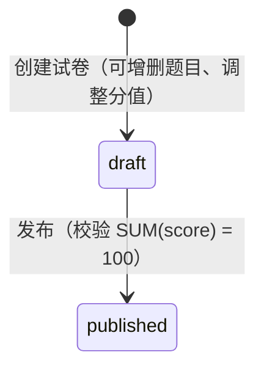

- **发布校验**：`SUM(paper_question.score) = exam_paper.total_score = 100`，不足或超出均拦截并提示差额（C-04、FR-AIQ-07 验收①）。
- **升级前无 release 的兼容生效边界**（仅适用于真正旧的 published 数据）：

| 字段 | 发布后可否调整 | 生效边界 |
|---|---|---|
| `paper_question`（题目组成与分值） | 否 | 锁定，防同一试卷对不同考生呈现不同题目 / 分值 |
| `pass_score` | 是 | 判分时实时读取 → 对后续交卷的及格判定即时生效（FR-EXM-06 验收②；已判分的历史记录不重判，C-05） |
| `partial_credit_ratio` | 是 | 判分时实时读取 → 同上 |
| `duration_minutes` | 是 | 发起考试时读取 → 对后续作答（新 `exam_record`）生效；已开考的计时不变（6.4.3 节） |
| `max_attempts` | 是 | 发起考试的资格校验时读取 → 对后续发起生效（6.4.1 节） |

#### 4.4.8 Excel/TXT 题库导入（B4）

导入走“下载并填写中文模板（已有文件可跳过）→选择整批培训类别并上传→预检与有效题逐题预览→选行确认→启用题库”。页面宽屏双栏、内容变窄自动纵向，支持拖拽；类别必填，预览期间锁定。Excel为试题内容、试题类型、选项内容、答案、难度五列，首张空白数据表、独立示例／说明表；兼容旧中文四列。TXT为中文标签分块。难度仅简单／困难，空白或缺失默认easy。保留英文category,type,difficulty,stem,options,answer,analysis格式；兼容旧九列及仅少concept或仅少score的两种八列，严格按表头映射。非空concept固定行错误“考点组已取消，请清空后重试”；旧score任何值仅忽略，warnings固定一次提示“旧模板分值已忽略，请在组卷时设置”。UTF-8标签TXT／旧TSV／XLSX、5MB／1000题、物理行号、业务列公式拒绝、旧score公式忽略、超列拒绝均保留。

预检仅解析category为稳定ID，复用validateImportDraft的结构、启用难度、媒体和来源校验；不再resolveConcept。指纹只含类别、题型、难度、规范化内容与答案，不含concept／score。返回valid_rows/errors/duplicates/warnings和rows七字段逐题预览；元数据持久化于normalizedRows专用question_import_meta项，取题过滤该项，GET能恢复提示。

确认复用ImportBatchService questions适配器与共享1000行上限；students入口固定kind=students。owner+batch悲观锁后排序锁类别，以同一manager重验来源／媒体，并锁定当前读复核重复指纹；跨批重复40911且原选集不变。普通与AI确认使用调用方事务原子创建启用题、revision和enabled:true回执，新版本审核元数据NULL。任何失败整体回滚题目／版本／媒体引用／批次；同集合原回执幂等，不同集合40911，跨owner/kind40302。旧未提交draft显式去概念／分值投影，已提交旧回执不重写。网络未知仅查原batch，回包代次和离页保护保留。

**AI参考题分支（questions_ai）**：通过模板接口获取与普通导入一致的中文五列参考模板，页面选择整批培训类别并随上传提交`category_id`；`purpose=ai`仅保留查询兼容。解析继续兼容英文七列及旧九列／两种八列映射，旧客户端可沿用文件内类别；5MB／50参考行，不接受资料版本ID。每行最多easy／hard两题；类别、题型及目标难度固定，模型仅提供题面、选项、答案和解析，不含score／concept。参考正文仅任务内存，完成／失败／超时释放；Redis只存计数与批次指针，TTL24小时，重启未完成任务failed。生成结果下载仍为标准七列交换格式。

生成阶段不创建 `question/question_version`，只把生成题放入 owner 绑定的 `kind=questions_ai` 临时批次；参考题不能进入批次、资料表、媒体表或日志。全部失败不建批次；部分失败报告数量。未确认批次自创建起 24 小时过期，已确认回执继续可查询。有效生成行默认选中，异常行排除；支持全部/easy/hard 筛选、修改题面、单行重生成和标准 Excel/TXT 下载。修改与重生成都保留服务端可信字段并重跑统一校验。

AI确认仅接收服务端批次行号，按owner+kind+batch锁与统一版本事务创建启用的source=ai身份／revision1及enabled:true回执；regulation_id/version_id为空。兼容status=approved但审核元数据NULL，不再二次审核；旧资料AI来源仅历史保留。普通questions/students不能确认questions_ai，同集合幂等、不同集合冲突，未知响应查原batch。

参考题任务发起、生成行修改和单行重生成要求 `ai:write`；任务/批次读取与下载要求 `ai:read`；确认要求 `questions:write`，所有操作均验证 owner，批次另固定 kind。前端不把上传文件放入持久状态，失活或离页停止轮询并丢弃晚到回包；确认结果未知时只能读取原批次对账。

升级后从 draft 新发布的制度卷不再使用上表的动态策略：发布事务把启用题的真实精确当前revision、每题实际分值及全部策略写入 `paper_release*`，list/detail 以 `release_id/rules_locked` 明示冻结状态。发布后题单和策略均不可改，须 `POST /ai/papers/{id}/copy` 复制冻结事实为新 draft；复制卷若所选版本已停用或不再指向所选current version，重新发布明确返回 40970 要求重选。已有 published 且无 release 的升级前数据不补造历史，继续沿用上表。

#### 4.4.9 C1 培训固定/随机卷发布服务

**状态链路瘦身（2026-10-26）**：现行试卷状态流转只保留 `draft → published`。PC 试卷管理直接显示培训试卷列表，状态筛选只提供草稿、已发布，并使用查询/重置按钮，不再区分 Tab；撤回、归档动作及培训/legacy 对应写路由退场，旧 URL 返回 404。历史 `withdrawn/archived` 继续按原事实读取、拒绝新开考，不改成草稿或已发布；后台只读查询过滤的历史兼容仍保留。发布冻结、显式复制新草稿和既有成绩记录不变。

**培训试卷排序（2026-10-26 / 031）**：基础设置增加`sort_order`，服务端严格接受0—2147483647整数；创建缺省0、部分更新未传保持、复制继承。`PaperService.listTraining`固定发出`sort_order ASC,id DESC`，所有training列表/详情/写回投影包含该字段。排序不进入发布快照，不改变题单顺序、考试或统计，也不扩散到legacy `PaperService.list/paperView`。

**操作信息（2026-10-26 / 032）**：`exam_paper.created_by`保留创建事实，nullable `updated_by`记录最后一次training配置保存、题单替换或首次发布的认证操作者。新建／复制同时写两者；后续操作只更新`updated_by`并显式touch `updated_at`，不依赖ORM检测到业务字段变化。详情及training写回使用单次用户查询投影`realName.trim() || username`，失联引用返回NULL；列表不查姓名。审计文件不作为页面姓名或历史回填来源，DTO也不接受操作者字段。

**PC 入口瘦身（2026-10-26）**：培训试卷新建统一为固定题单；新增弹窗提供取消、保存草稿、保存并组卷，保存草稿后关闭弹窗并刷新当前列表，保存并组卷才进入现有试卷编辑器；列表不再提供组卷模式筛选、模式列和实现性规则说明，创建/详情均不提供模式切换。保留人工选题、分值、限时、及格线、次数、发布和考试记录，不集成自动选题工具。已有随机记录保留读取和原有管理语义，PC 不提供复制随机卷的新建入口。以下 fixed/random 服务能力仍保留，后端 API、数据库、已发布题池和学员考试行为不因本次入口收敛而改变。

**设计器作为题目编辑入口（2026-10-27）**：取消旧试卷配置／固定题单内页。`/admin/papers/:id` 对可编辑固定草稿直接打开设计器，不依赖 `designer=1`；保存完整成功后关闭并返回试卷管理列表，失败或结果未确认时继续保留编辑会话。关闭未保存草稿保留既有确认与未决请求保护。发布卷、历史随机卷或无写权限的直达链接只显示说明和返回入口，不提供第二套题目编辑表单。列表“修改”仅打开基础配置弹框，不读取或写回题目设计文档；题目组成与分值仍由设计器维护。

**试卷列表与操作（2026-10-27）**：列表列为试卷名称、培训类别、考试时间、状态、备注、创建时间、操作；不显示考前学习要求列，也不在名称下方显示学习提示。备注超长省略并可查看完整内容，不提供批量勾选。固定草稿在操作列平铺按钮，按权限显示试卷管理（进入设计器）、修改（基础配置弹框）、预览/打印、复制、发布、删除。已发布试卷仅保留只读预览/打印和复制，历史随机卷不提供设计器、基础修改或复制入口，草稿仍可发布/删除。修改先读取最新详情，仅部分更新显式编辑的基本字段，不覆盖题单、题目分值和未展示规则；保存失败保留输入，关闭和迟到响应保留会话保护。普通预览展示试卷标题及题干/选项，不提供答案版或 JSON 导出入口，打印前仍须题图加载成功。后端已有受权限保护的答案预览 API 不因此删除。

**试卷正文预览与 A4 打印（2026-10-27）**：普通预览以白纸正文呈现，按保存题单顺序展示“题号、题干”和逐行“A、B、C、…”选项，不展示答案、解析、题型、难度、分值标签或卡片边框。复用受控富文本与题图加载链，保留题干/选项已有格式；弹窗标题与底部固定，纸张区域滚动。关闭为次按钮，打印为主按钮。浏览器原生打印采用命名纸张规则 A4 纵向（210×297mm），四边15mm，屏幕纸张内边距在打印时移除以避免重复页边距；仅输出试卷正文，隐藏管理界面、弹窗标题、按钮与随机样例管理控件。短题尽量整体、题干与首个选项尽量相邻，超页长题自然分页；题图加载/解码失败继续阻断打印。应用外层与弹窗统一使用同一命名纸张，避免返回默认纸张时新增空白页；打印正文取消弹性高度占位。支持CSS页边距内容的浏览器中，右上页头为培训中心名称、右下页脚为“第X页/共Y页”。浏览器仍可覆盖纸张与缩放，人工验收选择A4、100%缩放并关闭浏览器自动页眉页脚（避免其日期、站点标题、网址与自定义内容叠加）；自动化样式检查不代表物理打印验收。


**培训草稿删除（2026-10-27）**：`DELETE /admin/papers/:id` 要求 `papers:write`。服务端事务内取得 `exam_paper` 悲观写锁，重新检查 training 范围、draft 状态以及 `paper_release`、`exam_assignment`、`exam_record` 无引用后，仅删除 `paper_question` 关联与试卷本身，并记录 `training_paper.delete` 审计。不存在或非 training 返回 40401，非草稿或已有历史引用返回 40970。发布与删除共用试卷行锁，防止并发删除已发布内容；共享题库、课程、媒体、学习和考试历史均不删除。本改动不新增数据库字段或迁移。

**基本修改保题与时间显示（2026-10-27）**：基本修改请求固定携带仅更新 DTO 接受的 `preserve_questions: true`。弹框加载到已有题单时锁定培训类别并在提交时保留该类别；服务端在试卷写锁内再次核对，开启保题且改类别/模式时只要当前题单非空就返回 40970，保证打开空草稿后其他会话新增题目的竞态也不会静默清题。既有设计器未传该控制参数时保持原显式换类语义。培训新建/复制显式使用同一个应用时间写入 `created_at/updated_at`，与既有 UTC 驱动和前端本地格式化保持一致，不依赖 MySQL 会话的本地 CURRENT_TIMESTAMP；不对历史记录做无来源依据的统一时区修正。

```text
draft 配置（类别 + 可选考前学习课程/分钟 + 备注；历史来源兼容）
  ├─ fixed: 启用题精确当前revision题单 + 整数分
  └─ random: 题型题量/分值 + easy/hard 两候选池
        ↓ 发布事务（类别锁 → 试卷写锁）
paper_release.rule_snapshot + paper_release_question.snapshot_json
        ↓
published 只读；变更需 copy 新 draft；历史 withdraw/archive 保留快照，只读兼容
```

- 新资料本身不绑定类别；资料来源选项允许“该类别题目的 `question.category_id + regulation_id` 实际关联”或“旧资料自身 category 直接匹配”。随机池硬筛选类别、可选资料来源集合、题型、启用难度及精确当前启用身份；跨类别来源/题目在创建、更新、选题和发布边界拒绝。
- 新容量与抽样键只用question_id，组间无放回，不以历史concept合并新题。既有随机release读取则明确用historical-concept，以冻结concept分组、无concept回退question_id，预览和开考保持原行为；新release不写concept。实际scoreCents只来自卷内关联／随机规则，发布时合计等于试卷目标总分币，并冻结为RuleSnapshot.totalCents；历史快照不重算。
- 固定卷同类别内可跨资料来源；所有新发布只允许启用难度，历史medium/unknown快照继续读取。training 与升级后新发布的 regulation 固定卷都在发布事务内按question_id重检不重复题目身份并复核仍启用、current_version_id未改变；失败整体回滚。
- 随机卷规则最多三项且题型唯一；固定卷冻结每题实际 `scoreCents`。
- 发布行深拷贝题干、选项、答案、解析、来源与审核元数据。后续编辑、启停或题库变化不影响该 release。
- 同一 `PaperReleaseService` 也承接升级后新发布的制度固定卷：新发布仅允许已启用难度，未分类旧题须显式修订启用后重新选题；历史无类别/难度的快照继续保留 `categoryId=null/difficulty=unknown`，未知审核事实保持 null。制度卷仍只允许 single/multiple，并执行与 training fixed 相同的question_id唯一规则。其 copy 接口保留数字 ID、学习门槛、冻结题目版本及实际分值，且不修改源 release。
- 预览不会冒充个人卷：固定卷返回完整题单；随机卷返回规则、两池容量与一次样例。普通预览剔除答案/解析，答案版额外检查题库或试卷导出权限。
- random 草稿题图复用上述同一候选池判据；`papers:read` 只桥接候选池精确版本的题干/选项，答案字段还需 `papers:export` 或 `questions:export`。候选未在本次随机样例中抽中不改变其合法性；错误类别/制度/难度/状态/current version/题型仍拒绝，解析过程不写题单或发布记录。
- 前端使用公共未保存 hook；保存基线取“本次提交快照”，操作序号阻止较旧响应覆盖更新草稿。

**考前学习要求（2026-10-26）**：PC新增弹窗展示名称、类别、考试时间、总分、及格分数、一个“考前学习要求”开关和选填备注；开启后才显示并必填课程多选、累计学习分钟。试卷设计器内课程与累计学习时长始终显示，关闭开关时禁用且不显示历史残留值，开启后必填；不再保留普通配置内页。课程选项仅同类别published。服务端合并校验配置，发布冻结course_ids及required_learning_minutes；AttemptService在首次/补考创建记录之前，按本人所选课程当前有效视频版本的credited_ms求和，不足40901并返回学习缺口。恢复正在进行的考试不受新增门槛打断；旧release阈值NULL保持原行为。复用原视频30秒心跳/45秒封顶有效计时，重复有效观看可累计，不以95%覆盖完成状态替代分钟门槛。备注限1000字符，仅用于管理保存、回显和复制。 旧草稿保存若含历史资料筛选，PC先明确确认转换；取消保留字段且零写入，确认只解除当前草稿选题范围，保留原题来源与已发布快照。后端 fixed/random 历史兼容契约不变；PC固定草稿沿设计器原分阶段保存顺序，历史随机卷不再提供旧配置表单。

### 4.5 与其他模块的依赖关系

| 方向 | 对端模块 | 交互内容 | 交互方式 |
|---|---|---|---|
| 依赖（下游） | 2 题库资料与旧制度兼容模块 | 显式资料版本的 `text_content` 与标题；服务内部沿用 regulation/version ID | 只读查询 |
| 依赖（下游） | 1 组织权限模块 | 生成／确认／启停／组卷操作者权限校验（regulation_admin / super_admin）；`created_by` | 认证守卫 |
| 依赖（下游） | 外部 AI 服务 | OpenAI 兼容协议 `/chat/completions` 调用 | HTTPS（经 AI 网关） |
| 被依赖（上游） | 5 考试评分模块 | legacy 升级前活动记录读原表；C2 新开考读 C1 `paper_release*` 并冻结个人题单，不回读动态题库覆盖快照 | 只读查询 |
| 被依赖（上游） | 6 统计报表模块 | 题库与试卷数据（题目正确率、试卷维度统计） | 只读查询 |

### 4.6 对应数据表

| 表 | 本模块读写角色 | 说明 |
|---|---|---|
| `question` | 身份与 legacy 兼容视图读写 | current_version_id 指向当前 revision；旧 category/difficulty 可空 |
| `question_version` | 新版本追加，历史只读 | 核心修订新增revision；启用身份精确当前候选，新版本无概念／分值／审核元数据 |
| `question_concept` | 仅历史兼容 | 原表与引用保留，当前无CRUD，不参与新题池 |
| `media_reference` | 事务内新增引用 | question_version 富文本图片防误删与鉴权读取 |
| `import_batch` | 读写 | questions 预检结果、owner、确认集合与首次创建结果；不保存原文件 |
| `exam_paper` | 全量读写（legacy + training） | business_scope 隔离两套接口；有 release 的发布卷配置不可变 |
| `paper_question` | 全量读写（组卷明细） | training fixed 与升级后制度卷发布/复制均保存实际question_version_id和本卷分值；新concept_id为NULL，旧关联保留 |
| `paper_release` / `paper_release_question` | C1 发布时追加，之后只读 | 培训卷及升级后制度固定卷的规则、条件关联、实际版本/分值与内容快照 |
| `regulation` / `regulation_version` | 只读 | 出题上下文与版本追溯 |

---

## 5. 学习行为管控模块（`/learning`）

### 5.1 模块职责与边界

**职责**：一条链路保留制度阅读四道防线与有效学习判定；另一条 B2 链路保存视频服务端心跳锚点、递增序号、有效时长与去重覆盖区间，提供可重启恢复的断点和当前课程必学汇总。两类记录分表、判据分离，但 start 通过 `sys_user` 行锁协调为每个用户至多一个活动阅读或视频会话。

**边界（不做什么）**：

| 不属于本模块的内容 | 归属 |
|---|---|
| 阅读内容的下发与可见性（本模块只管「读的过程」） | 2 制度文件管理模块 |
| 考试资格的最终裁决（发起考试时的校验动作） | 5 考试评分模块（本模块只产出并维护 `is_valid` 事实） |
| 学习完成率等指标聚合 | 6 统计报表模块 |
| 阅读页渲染（pdfjs-dist / content_html） | 前端 + 2 制度文件管理模块（内容服务） |

### 5.2 内部组成（子服务 / 组件）

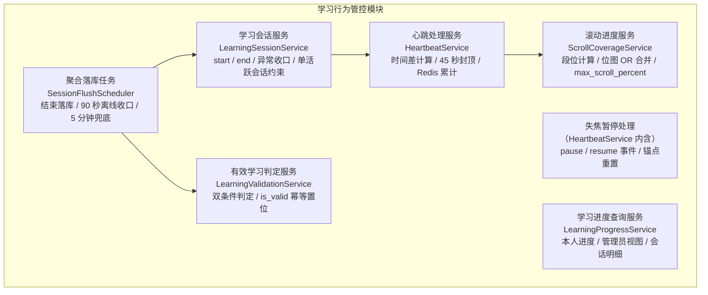

**Redis Key 约定**（会话维度的累计态，AD-04：可再生临时态、MySQL 为权威源）：

| Key | 类型 | 内容 | 生命周期 |
|---|---|---|---|
| `learn:session:{session_id}` | Hash | `duration_seconds`（累计计入秒数）、`segments`（JSON 位图数组）、`max_scroll_percent`、`last_beat_at`（最后心跳服务端时刻）、`state`（active / paused）、`paused_at` | 会话开始创建；落库后删除；TTL 6 小时兜底过期 |

### 5.3 核心类 / 服务职责表

| 组件 | 类型 | 职责 | 关键依赖 |
|---|---|---|---|
| LearningController | 接口层 | `/learning` 会话开始 / 结束、心跳、pause / resume、进度查询入口 | 各服务 |
| LearningSessionService | 服务 | 会话 start（可见性前置校验、`learning_session` 创建、Redis 初始化）、end（正常收口结算）、单活跃会话约束（双开标签页阻断） | `learning_session` 仓储、RegulationScopeService |
| HeartbeatService | 服务 | 心跳收包处理：时间差容差计算（≤ 45 秒计入）、Redis HINCRBY 累计、pause / resume 状态机、失焦防伪造 | Redis、ScrollCoverageService |
| ScrollCoverageService | 服务 | 滚动段位合并（Redis 位图 OR）、`max_scroll_percent` 单调更新、底部段判定、跨会话位图合并 | Redis |
| LearningValidationService | 服务 | 有效学习双条件判定（`total_seconds ≥ required_minutes × 60` 且底部段覆盖）、`is_valid` / `valid_at` 幂等置位 | `regulation` / `learning_record` 仓储 |
| SessionFlushScheduler | 定时任务 | 三触发落库编排：正常退出、90 秒离线收口、每 5 分钟兜底扫描；聚合事务执行 | 各仓储、Redis |
| LearningProgressService | 服务 | 学习进度查询：本人 / 全员、会话明细审计（按人按制度回溯会话序列） | `learning_session` / `learning_record` 仓储 |
| VideoLearningController | 接口层 | 当前mobile employee本人 `/me/video-sessions` start/heartbeat/close、`/me/video-records` 历史与课程progress | VideoSessionService |
| VideoSessionService | 服务 | 短事务实名/当前版本重查、事务外旧reading收口、精确版本播放票据、DB锚点心跳、区间合并、跨类型单活动、本人历史/课程汇总、超时回收 | CourseService、LearningSessionService、Identity、MediaTicketService、视频学习两表 |

### 5.4 关键设计详解

#### 5.4.1 学习会话管理（start / end、Redis 会话状态）

**会话 start**（进入阅读页）：

| 步骤 | 规则 |
|---|---|
| 1 前置校验 | 制度 `status = published` 且用户在发布范围内（复用 3.4.6 节校验链） |
| 2 单活跃会话约束 | 保留原每制度 Redis start lock；短事务悲观锁 `sys_user` 并重查该用户跨所有制度的活动 reading，发现后立即释放事务连接，再在事务外按旧算法等待 mutex/flush，最多重试 3 次；最终事务关闭旧 video 后才创建。后开者胜，任一时刻至多一条阅读或视频链路计费 |
| 3 创建 | INSERT `learning_session`（`user_id`、`regulation_id`、`version_id = current_version_id`、`started_at`、`ended_at = NULL`、`duration_seconds = 0`） |
| 4 Redis 初始化 | 建 `learn:session:{id}`：`duration_seconds = 0`、`segments` = 全 0 位图（长度 = `regulation.scroll_segments`）、`max_scroll_percent = 0`、`last_beat_at = started_at`、`state = active` |

**会话 end**（正常离开）：前端在路由离开 / `pagehide` 时上报结束 → 服务端执行 5.4.6 节聚合落库事务（写 `ended_at` 与 `duration_seconds`）。

**异常离线收口**（直接关闭浏览器，UC-04 A2）：90 秒无心跳判定离线，由定时任务按 Redis 最后累计值收口——`ended_at` 取最后心跳时刻加 45 秒封顶（该段间隔已按封顶计入累计，保证有效时长不丢失且不虚增）。

**`learning_record` 创建**：首次学习时 INSERT（`uk_user_regulation` 唯一键防并发首学，冲突时转为 UPDATE 路径）。

#### 5.4.2 心跳处理服务（30 秒收包 → 时间差计算 → 45 秒容差 → Redis 累计）

**心跳协议**：阅读页每 30 秒上报一次（active 状态下），携带当前最大滚动百分比（0 ~ 100）与本周期内停留 ≥ 10 秒的段集合 `dwell_segments`（07 册 3.1.1/3.1.3 定稿口径）；服务端只使用「心跳到达的服务端时刻」与上报的滚动位置，**不信任任何客户端时间戳**（C-01）。

**单次心跳处理流程**：

| 步骤 | 规则 |
|---|---|
| 1 归属校验 | 会话存在且 `user_id` 与当前令牌一致；`state = paused` 下的心跳忽略计费、仅更新滚动位置（见 5.4.3） |
| 2 时间差计算 | `diff = 服务端当前时刻 − last_beat_at`（毫秒精度，`DATETIME(3)` 口径） |
| 3 容差封顶 | `credited = min(diff, 45 秒)`——**单次心跳最大计入 45 秒，超出部分不计入有效时长**（README 术语「心跳上报」） |
| 4 累计 | Redis `HINCRBY duration_seconds credited`；**不写 MySQL**（心跳高频路径零数据库写入，03 册 6.3 节） |
| 5 | 滚动合并 | 服务端对上报 `dwell_segments` 集合中的每个段位在 `segments` 位图置 1（停留 ≥ 10 秒语义，只增不减）、`max_scroll_percent` 取 max 单调更新（交 ScrollCoverageService） |
| 6 锚点更新 | 若 state = active：last_beat_at = 服务端当前时刻；若 state = paused：不更新 last_beat_at、不变更 state（仅步骤 5 的滚动合并生效，见 5.4.3） |

**防作弊有效性**（服务端防线，NFR-08）：

| 作弊手段 | 服务端防线与结果 |
|---|---|
| 高频上报（如每秒一次） | 每次计入的 `diff ≈ 1 秒`，累计值与真实流逝时间一致，`total_seconds` 不虚增（FR-LRN-02 验收②） |
| 篡改客户端时间 | 时长完全由服务端时钟差计算，客户端时间不参与任何判定 |
| 改心跳间隔为 60 秒 | 每次封顶计入 45 秒，比真实流失少 15 秒——作弊者自我损耗，无利可图 |
| 双标签页并行 | 单活跃会话约束（5.4.1 节步骤 2）阻断 |
| 脚本伪造心跳 + 位置序列 | 时长不可虚增（见上）；滚动位置属客户端上报，是本方案的技术信任边界——补偿手段为会话明细审计（`learning_session` 流水可下钻对账，03 册 3.3.1 节）与四道防线的组合抬高作弊成本（纵深细节见 07 分册） |

#### 5.4.3 失焦暂停方案（定稿：pause / resume 事件 + 心跳断流封顶兜底）

**方案定义**：前端监听 `visibilitychange`（`document.visibilityState === 'hidden'`，移动端「切后台」等价）与 `window blur` 双事件，失焦时上报 **pause** 事件；恢复聚焦时上报 **resume** 事件并重启 30 秒心跳定时器。服务端以「锚点」模型处理：

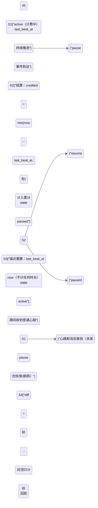

**pause 报文的携带与 flush（07 册 3.1.1 同口径）**：pause 报文可携带 `dwell_segments` 与 `scroll_percent`——前端在 `visibilitychange → hidden` 与 `pagehide` 时以 `navigator.sendBeacon` 调用 pause 端点，flush 本地缓冲中未上报的已确认段位（防页面关闭导致已停留 ≥ 10 秒的段位永久丢失，与「覆盖只增不减」原则一致）；服务端按 5.4.2 节步骤 5 的滚动合并规则处理。

**规则要点**：

1. **失焦期间零累计**：`paused` 状态下不推进计费锚点，普通心跳到达也不计费（只更新滚动位置）——失焦期间不产生有效时长累计（FR-LRN-03 验收①）。
2. **恢复不补记**：`resume` 只做锚点重置（`last_beat_at = now`），不产生任何时长——恢复聚焦后计时继续且不补记失焦期间时长（验收②）。
3. **长时间失焦不一次性计入大额时长**：用户不发 pause 直接失焦（或断网）时心跳断流，恢复后首个心跳 `diff > 45 秒`，按封顶只计 45 秒（验收③、UC-04 A1：网络中断恢复后从当前时刻继续累计，丢失区间不计时长）。

**防伪造设计说明**（为什么 pause / resume 不可被利用）：

| 伪造场景 | 服务端结果 |
|---|---|
| 不发 pause 直接失焦 | 恢复后首拍 `diff > 45 秒` → 只计 45 秒（兜底封顶） |
| 伪造高频 resume | resume 只重置锚点、不产生时长，无任何收益 |
| pause 后不发心跳 | 无时长累计（自然暂停，与真实失焦等价） |
| pause / resume 高频交替 | 每对 pause-resume 至多结算一个 ≤ 45 秒的窗口，服务端时钟差不因报文频率虚增；异常高频报文按接口限流丢弃 |

**结论**：时长收入的唯一来源是「服务端时钟在 active 状态下的推进、且每次结算封顶 45 秒」；pause / resume 只是锚点重置指令，任何客户端报文组合都无法让服务端计算出的时间差虚增。方案取舍：相比「失焦时停止心跳、纯靠断流封顶」的方案，显式 pause / resume 使**短时失焦**（如 10 秒，断流封顶会因 `diff ≤ 45 秒` 而全额计入）也能被精确扣除，且前端可向用户实时展示「已暂停」状态，体验与准确性兼得。

#### 5.4.4 滚动进度服务（10 段位图、跨会话按位 OR 合并、max_scroll_percent、底部段判定）

**段位计算（前端）**：阅读容器（pdfjs-dist canvas 或 content_html 富文本容器，两条渲染路径共用同一逻辑）按 `视口底缘位置 = scrollTop + clientHeight` 映射为百分比 `p = 视口底缘 / scrollHeight × 100`，段位 = `min(floor(p × total_segments / 100), total_segments − 1)`；心跳携带「本周期内停留 ≥ 10 秒的段集合 `dwell_segments`」（连续静止停留达标的段才上报，途经不算，07 册 3.1.3）与最大百分比。

**位图结构与合并**（`scroll_coverage`，结构与 03 册 4.4 节逐字一致）：

| 属性 | 说明 |
|---|---|
| `total_segments` | 段总数 = `regulation.scroll_segments`（当前版本固定 10） |
| `covered_count` | 已覆盖段数（segments 中 1 的个数，落库合并时重算） |
| `segments` | 长度恒为 10 的 0/1 数组，`segments[9]`（下标 `total_segments − 1`）为底部段 |

- **Redis 内合并**：每次心跳服务端对上报 `dwell_segments` 集合中的每个段位在 `segments` 中置 1（停留 ≥ 10 秒语义，逐段置位）——**只增不减，回滚不取消已置位段落**（FR-LRN-04 验收②）；`max_scroll_percent` 单调不减（验收③）。
- **跨会话合并**：聚合落库时（5.4.6 节），Redis 最新位图与 `learning_record.scroll_coverage` 库内位图**按位 OR** 后写回、`covered_count` 重算——合并幂等、覆盖只增不减（03 册 3.3.2 节设计说明 3）。
- **底部段判定**：`segments[total_segments − 1] === 1`——有效学习判定条件②（README 术语「滚动覆盖率」）。
- **段数一致性**：`scroll_segments` 本期固定为 10（配置项前向保留）；未来放开配置须按归一化重映射迁移位图（本期不实现）。

#### 5.4.5 有效学习判定服务（双条件判定、判定时机）

**双条件判定**（缺一不可，C-02）：

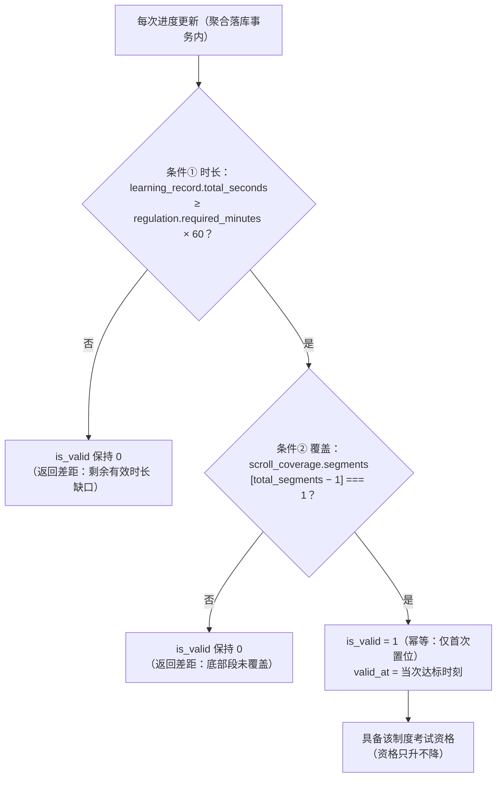

| 规则 | 说明 |
|---|---|
| 判定时机 | **每次进度更新后检查**——即每次聚合落库（会话正常结束 / 离线收口 / 定期兜底）事务内判定；达标当次落库即置位，员工学习页随即提示「已达有效学习标准」（UC-04 主流程 7） |
| 幂等与单向 | `is_valid` 一旦置 1 **永不回退**（时长与覆盖率只增不减，判定单调）；`valid_at` 记录首次达标时刻，只写一次（FR-LRN-05 验收③） |
| 阈值调整不回退 | 调整 `required_minutes` 后：已达标员工保持达标；未达标员工按新阈值继续判定（FR-REG-05 验收③、UC-02 A2） |
| 单条件不判定 | 仅时长达标或仅底部段覆盖，均不置 `is_valid`（FR-LRN-05 验收①②） |
| 资格联动 | `is_valid = 1` 即该制度考试资格事实；考试评分模块发起考试时校验（6.4.1 节），不冗余存储资格快照（03 册 3.3.2 节设计说明 4） |

**心跳响应中的达标提示口径**：心跳响应中的 `progress_hint` 仅为 **Redis 侧实时估算**（累计值跨过阈值的界面提示「预计已达标，正在结算」）；`is_valid` / `valid_at` **只能由聚合落库事务产生**（5.4.6 节，04 册 3.6 节同口径）——Redis 累计刚跨过阈值的瞬间，`learning_record.is_valid` 仍为 0（最长需等 5 分钟兜底任务落库），前端不得以 `progress_hint` 解锁考试入口，资格以开考校验（6.4.1 节）为准。

#### 5.4.6 聚合落库事务（会话结束 / 定期 5 分钟、learning_session + learning_record）

**落库时机**（三选一，任一触发，03 册 6.3 节）：

| # | 触发 | 说明 |
|---|---|---|
| ① | 正常退出上报 end | 用户主动离开阅读页 |
| ② | 心跳中断超时（90 秒无心跳判离线） | 直接关闭页面 / 断网场景 |
| ③ | 兜底定时任务（每 5 分钟） | 扫描 Redis 中超时未落库的会话；辅以 `learning_session.idx_started_at` 扫库（`ended_at IS NULL` 且 `started_at` 早于阈值）兜底 Redis 丢失场景 |

**聚合落库事务**（单事务原子完成，03 册 6.3 节写入点 1）：

| 步骤 | 表 | 操作 |
|---|---|---|
| 1 | `learning_session` | UPDATE `duration_seconds` = Redis 累计值、`ended_at` = 收口时刻（90 秒离线收口取最后心跳 + 45 秒封顶时刻） |
| 2 | `learning_record` | UPDATE：`total_seconds +=` 本会话累计时长；`scroll_coverage` = 库内位图 OR Redis 位图（`covered_count` 重算）；`max_scroll_percent` = max(库内, Redis)；`version_id` = 本会话版本；`last_learn_at` = 收口时刻 |
| 3 | `learning_record` | 同事务内执行有效学习判定（5.4.5 节）：双条件满足且 `is_valid = 0` → 置 `is_valid = 1`、写 `valid_at` |
| 4 | Redis | 事务提交后删除 `learn:session:{id}` |

**幂等与一致性**：以 `ended_at IS NULL` 作为「未收口」判据——已收口会话重复触发落库时直接跳过；Redis 为累计态、MySQL 为权威态（AD-04），Redis 不可用时兜底任务可从库侧扫描恢复（NFR-11 / NFR-12：网络中断、误关闭页面不丢失已累计进度）。

**写频收敛效果**：心跳高频路径零数据库写入；库表只承接「每会话一次」的聚合写（高峰 500 人在线 ≈ 0.4 QPS + 定期兜底），较逐心跳直写下降两个数量级（03 册 6.3 节结论）。

#### 5.4.7 B1 课程内容与视频版本服务

B1 以 `CourseService`、`LessonVersionService` 和 `/admin/courses`、`/me/courses` controllers 承载课程内容，不复用或改写 legacy `LearningSessionService`：

| 组件 | 职责 | 关键边界 |
|---|---|---|
| CourseService | 课程 CRUD、上架/下架、学员浏览分页、`visibleCourses`、`assignedCourseIds` | 新类别引用用 `CategoryService.lockActive`；启用学员可浏览全部published，Task 12不再按institution/同类别分配视频或learner进度；external及类别缺失同资格；`regulation_ids`仅信息关联 |
| LessonVersionService | 章节/课时写入、视频版本追加、`current(lessonId)` | 本期只接受 video；published 锁定结构但允许追加内容版本；旧版本/媒体引用不覆盖 |
| MediaOwnerPolicy | `training_course_cover` 与 `lesson_version_video` 两类owner authorizer；视频区分Bearer读取与learner-only票据授权 | bind前资源必须ready且用途匹配；封面按published浏览规则；普通学员视频须实名及published/current/精确引用，短票额外重查启用employee且无管理权限；保留PC `courses:read`受控预览，video不走上传者短路；未注册owner type或权限查询失败时拒绝 |
| CourseAdminController | `courses:read/write/publish` 的管理接口和 courses:write 类别 options | 不隐式授予 `training_categories:read`；上传本身另需 `media:write` |
| MyCoursesController | 本人课程分页与目录 | 数据范围由服务端按 status/source/category 收口，不接受客户端传 user/category |
| LearnerHomeController | 本人首页组合 | 并行复用 `SystemService.publicConfig()` 与 `CourseService.visibleCourses()`；返回 `{site_config,courses}`，不另造推荐、完成度或学习门槛 |

上架事务锁定课程行；draft/offline 上架还会锁定并重查启用类别，随后校验所有必学课时的当前版本与 ready 视频、用途、媒体种类和正时长。失败统一返回 40930，课程状态不改变。替换视频锁定课程/课时后追加 `lesson_version`，以 `(lesson_id,version_no)` 唯一键兜底并发，再绑定媒体、切换 `current_version_id`。下架仅改状态，重新上架重跑同一 readiness 校验。

课程管理由列表 `Courses.vue` 与弹窗内容组件 `CourseEditor.vue` 提供：`/admin/courses` 保留 `permission_code=NULL` 的默认菜单，旧 `/admin/courses/:id` 重定向到列表，不再创建独立详情页标签。列表按 `courses:read/write` 任一授权显示；write-only 可新建，但不读列表或打开需要 read 的编辑器。列表提供独立的“修改课程”“章节管理”入口，上/下架仍是独立操作；新建后留在列表，有 read 权限时打开章节管理。列表展示名称、经鉴权读取且可放大的封面、类别、必学课时数、首页推荐、状态与创建时间；表单顺序为名称、封面、类别、简介、首页推荐（是/否）、排序，保留数字步进排序控件，仅列表不显示排序。章节、课时的排序不受影响。课程封面使用 `MediaUpload.listType='picture-card'`，视频在新增/修改课时弹窗中使用 `listType='drag'` 的 Element Plus 拖拽/点击上传区域；两者复用现有大小/格式校验、进度、处理状态查询和失败重试，不改变上传接口。其他入口保持各自外观。

`CourseEditor` 按 `courseId` 与 `mode=info|chapters` 挂载，资料与章节分开显示；新建、修改和章节管理统一使用 `re-form-dialog` 的 footer 插槽，按钮区不放在可滚动表单内部。章节管理采用平铺章节分区与按列对齐的课时列表：章节头显示名称、顺序、课时数及编辑/新增入口；课时列为编号、名称、必学/选学、真实创建时间、视频状态、时长、操作。行操作仅“修改、删除”；视频在修改弹窗内直接上传，不再额外打开换版弹窗。未选择新文件保留当前视频；选择后保存才追加版本。上传/处理中或所选文件处理失败时，禁止提交，需完成/重试或清除本次选择；本地上传草稿纳入未保存提醒。PC 列表在 published 时隐藏“修改课程、章节管理”，仅按权限提供“下架”；draft/offline 才提供编辑入口。下架仍记为 offline，不改为 draft。编辑器以最新详情复核状态，published 时仅提示先下架，不展示资料表单或章节管理内容，且禁止本地保存入口。此处调整 PC 交互边界，底层 API 既有 published 视频版本追加兼容契约不变。删除调用受权限与状态约束的逻辑删除 API，保留历史版本、媒体引用与学习事实，不提供硬删除或独立课件。

新视频上传回执为 ready 时直接使用回执的资产标识和时长，不查询尚未建立版本引用的媒体 metadata；未绑定视频的读取仍返回拒绝。选择本地 MP4 后生成浏览器 Blob URL，显示首帧缩略图并使用播放器弹窗预览。已保存视频通过独立只读 `currentAssetId` 提供预览入口，点击后经 Bearer 申请受控预览URL；COS行返回准确版本短链，local行返回PC代理短票，不把JWT放入URL，不改写视频草稿绑定。临期续签后恢复位置及播放意图，网络失败最多自动重试一次。关闭/切资源/卸载时取消续签并使迟到响应失效；只有刚选的本地文件仍使用可回收Blob URL，预览失败不清除课时视频。

PC 与独立学员端按相同 API 有序目录生成展示编号 `章节位置.课时位置`（如 `1.1`、`2.1`），不把编号写入标题或改写 `sort_order`。学员端沿用 Wot Collapse：箭头在章节标题左侧，右侧显示节数；未完成课时左侧为跨章节连续序号，名称前显示课时编号。保持完成态、进度与以稳定 lesson ID 选择课时的行为。

“服务端课程/目录状态刷新”与“课程资料表单初始化”继续分开。刷新章节、课时、视频版本及失败后重试不得覆盖尚未保存的资料；保存期间新增的输入继续保留。创建表单、课程资料、章节、课时（含视频草稿）各自注册 `useUnsavedChanges(dirty,{onDiscard})`，只在对应持久化成功后清洁；编辑器另以待确认写入注册独立阻断源，即使表单改回原值，也不能通过路由、页签关闭或刷新绕过回执保护。父弹窗关闭前核对嵌套编辑器的未保存状态与写入回执；页面失活后销毁编辑器及挂到 body 的嵌套弹窗。已确认的课时资料保存须通知父列表刷新必学课时数，即使后续视频换版失败。放弃一个区段只恢复该区段的持久基线，不撤销已保存或其他未保存区段。`/me/home` 仍只组合真实 `SystemService.publicConfig()` 与 `visibleCourses()`，不另建配置服务。

#### 5.4.8 B2 可恢复视频学习协议

本节按D18/D19与Task 12 `Video Contract v1`记录已通过 Gate H1 自动化与独立代码审查的实现；真实播放器解码、弱网、全屏、微信开发者工具/真机证据须单独记录。`/me`视频接口只接受当前mobile employee本人。课程、目录、本人已有进度/历史仍可只读；start、视频签票及内容读取须重查启用账号、已存在实名事实、published课程、video课时current version及正时长、ready/purpose=video资产与精确 `lesson_version_video + version_id` 引用。external/institution同资格，无类别或跨类别不阻断课程学习。

```text
start
  → 短事务锁 sys_user，重查 mobile employee/启用/实名 + published/current video + ready资产/精确引用
  → 若有旧 reading：释放事务连接，在事务外按原算法收口，最多重试 3 次
  → 最终短事务重查无 reading，关闭旧 video 后重新取 now
  → upsert user+lesson_version record，创建 active_user_id 唯一会话（initial paused，位置取confirmed_position_ms）
  → 为同一轮current version签票，返回session/version/asset/ticket/progress；失败先收口本次session

heartbeat
  → 锁 video session → 锁 video record
  → 重查课程/范围/当前版本
  → seq 重放直接返回；新 seq 用服务端 elapsed 校验位置
  → 合并覆盖区间并持久化锚点
```

`LessonVersionService.current()` 只证明课时当前指针存在，不承担学员鉴权；`assignedCourseIds()` 是非事务查询，也不能作为 start 的写入前置。`VideoSessionService.start()` 每轮都在自己的短事务内重查全部范围。调用原 reading flush 时不持 `sys_user` 事务连接，flush 返回后再进入最终事务，避免小连接池中“持连接等 session mutex、mutex 持有者再借连接”的互等；旧阅读计时算法仍只有 `LearningSessionService` 一份。会话所有锚点都在 MySQL，API 重启不丢 `last_seq/last_heartbeat_at/anchor_position_ms/anchor_state`。心跳锁顺序固定为 session→record，不获取 `sys_user`。

覆盖算法只接受前一锚点 playing 且当前为 playing/ended 的严格递增序号。先用完整的非负实际间隔校验 `forward_position ≤ server_elapsed+2000`，通过后再计算 `credited_ms=min(server_elapsed,45000,forward_position)`；过大前进的本拍区间为空。paused/buffering/background 不计，非 playing→playing 的首拍只重置锚点。区间按起点排序并合并重叠/相邻段；重复播放可以增加有效时长，但不会增加 `coverage_ms`。达到 95% 后 `is_completed` 单向置位。

start返回 `VideoSessionView={session_id,version_id,heartbeat_interval_ms:30000,media:{asset_id,ticket:{content_url,expires_at}},progress}`，所有ID均为十进制字符串。实际play后客户端才发第一拍playing，不能把开播请求、加载或seek等待计入观看；seq从 `progress.last_seq+1`递增。签票必须以start权威读取的current version/asset建立精确引用，禁止课程详情旧缓存拼URL；提交后遇换版/下架/授权变化或签票失败，先关闭本次新session再失败。媒体临期用同一asset/version重签，换src后恢复当前位置，不重建学习会话、不生成心跳或补时。

视频owner的通用Bearer读取与短票独立授权：具备 `courses:read` 的PC管理账号保留受控预览；普通学员通用读取仍要求实名及published/current。video资产不允许上传者owner相等短路，所有读取须经过精确版本引用与policy。短票签发/续签及 proxy 内容读取只允许启用 employee、无有效管理权限且已实名的学员，管理员不能借管理预览旁路取得learner短票。引用撤销、下架、换版、停用或角色/权限变化后拒绝新签/续签和旧代理票据，已发 COS 链接至到期有效；票据URL不含JWT、真实文件名或磁盘路径。

阅读 start 的 DB 会话先在 user 锁内提交，发布 Redis 前再次取得同一 user 锁并重查：该 reading 仍是唯一活动 reading 且不存在活动 video 才写 state/pointer。若这段窗口中 video 已胜出，reading start 返回 40906，迟到 Redis 写被禁止；Redis 写失败则在锁内将新 reading 收口并删除本次精确 state/pointer。旧阅读心跳仍先检查 DB `ended_at`，Redis 指针不能复活已结束会话。

learner课程进度以当前published课程的 `is_required=1` video课时current version为分母，不按来源或类别分配；external/institution、无类别或跨类别均一致，零必学课时 `completion_rate=null` 且 `lessons=[]`。每项携带稳定 `lesson_id/version_id`，移动端按ID映射目录完成态和断点，不使用数组下标。视频替换使新版本重新计算，旧记录保留。本人 `/me/video-records` 不按当前来源、类别、课程状态或current version隐藏不可变版本历史，不返回媒体URL、不重开会话；此处不改写§7.4.5 C6管理统计既有筛选分母。未实名/被拒绝返回40302 + `reason_code=IDENTITY_REQUIRED`，核验处理中为 `IDENTITY_PENDING`；旧/被替换session为40950。下架/换版/引用失效/课程不可学先关闭活动所有权再返回40951，移动端停止播放/心跳并刷新权威进度，不自动重建。close及90秒回收只关闭，不补未上报时间；单独来源/类别变化不撤销课程学习资格。

移动端采用uni-app原生 `<video>`，不引入额外播放器库。play/pause/waiting/ended映射playing/paused/buffering/ended；error只是UI态，显示“视频加载失败，请重试”，进入错误态前尽力发非播放状态截断锚点。waiting恢复不保证再次触发play，前台、有播放意图且未暂停时，buffering后首个确认位置前进的timeupdate只发送一次playing重建锚点；其余timeupdate只更新最新位置，不逐次请求。断网沿用原生buffering/loading，无离线缓存、补时队列或历史心跳重放。

页面/应用onHide暂停播放器、立即报background并停止30秒心跳，保留session；onShow保持暂停，须学员主动再播放，首拍只重置锚点。onUnload尽力close，强制回收由stale sweep兜底；ended最后一拍后停心跳、移除原生src并刷新课程进度，防止脱离session重播；显式“重新播放”新建session且本次从0开始，服务端历史进度不清零。pause/waiting/background不要求前端补算前一小段。票据续签、切课时、切账号、卸载使用session/revision/登录epoch防迟到；心跳串行、同seq不并发且flight按session隔离，旧session慢刷新不得吞掉新session首拍。start/close另走同一串行队列：A start在途时切B，先等待A成功后close其session，再为仍是最新目标的B start；A超时结果未知则保持stopped，直到用户下一次明确点击后由服务端单活跃约束收口。不得仅丢旧回包却遗留活动session。

正常恢复从confirmed_position_ms开始，显式重新播放从0开始。本地已连续playing位置只用于限制明显向前拖动；暂停、缓冲、后台的墙钟时间不形成可向前seek额度，也不能把本地位置写成权威进度。H5直接使用同源相对content_url；微信适配器将其转为合法域名HTTPS完整地址，编译兼容不替代合法域名、Range、全屏与原生拖动的开发者工具/真机验收。

### 5.5 与其他模块的依赖关系

| 方向 | 对端模块 | 交互内容 | 交互方式 |
|---|---|---|---|
| 依赖（下游） | 2 制度文件管理模块 | 判定参数（`regulation.required_minutes` / `scroll_segments`）、生效版本（`current_version_id` → 会话 `version_id`）、阅读可见性校验（status + 发布范围） | ContentService / RegulationScopeService 进程内调用；只读查询 |
| 依赖（下游） | 1 组织权限模块 | 学习者身份（令牌 user_id）；部门归属（统计复用） | 认证守卫 |
| B1 课程内容依赖 | 组织权限 / 媒体 / 制度模块 | 学员启用状态；管理写入类别锁；封面/视频bind与读取策略；可选制度存在性；来源/类别不作为学员视频分配门槛 | 进程内Service + 同事务EntityManager；制度只读验证 |
| B2 视频学习依赖 | 组织权限 / Identity / B1课程内容 / MediaTicketService | mobile employee、实名事实、`sys_user`活动串行、published/current version/duration及精确资产引用 | 同事务EntityManager重查；独立票据授权，不从current/assigned查询直接推断鉴权 |
| 被依赖（上游） | 5 考试评分模块 | **legacy 制度固定卷**考试资格校验（`learning_record.is_valid`，按 user_id + regulation_id）；培训路径默认不依赖学习完成 | 旧路径由 LearningProgressService 进程内调用；培训路径按发布/身份/规则快照校验 |
| 被依赖（上游） | 6 统计报表模块 | `learning_record`（完成率 / 未完成清单）、`learning_session`（活跃度 / 审计） | 只读查询 |

### 5.6 对应数据表

| 表 | 本模块读写角色 | 说明 |
|---|---|---|
| `learning_session` | 全量读写（创建 / 收口 UPDATE） | 会话流水 append + 单次收口更新；审计下钻入口 |
| `learning_record` | 读写（首次 INSERT / 聚合 UPDATE / 判定置位） | `uk_user_regulation` 保证每人每制度一条 |
| `training_course` / `course_chapter` / `course_lesson` / `lesson_version` | B1 课程内容读写 | 课程结构与不可变视频版本；不保存观看进度 |
| `video_learning_session` | B2 读写 | DB 持久心跳锚点、活动所有者与会话时长；回收不补时长 |
| `video_learning_record` | B2 读写 | user+lesson_version 唯一；累计有效时长、去重覆盖、断点与完成事实 |
| `media_asset` / `media_reference` | B1 受控绑定/授权读取 | 封面和每个视频版本均建立独立业务引用 |
| `regulation` / `regulation_version` / `regulation_scope` | 只读 | 判定参数、版本指针、范围可见性 |

---

## 6. 考试评分与记录模块（`/exams`、`/me/exams`、`/me/exam-records`、`/admin/exam-records`）

### 6.1 模块职责与边界

**职责**：Task13/14 / Gate H2已实现并自动验证：新移动考试在不可变assignment/record/item上使用实名、稳定ID、本地草稿和主动整卷提交，锁后截止前受理才由SubmissionService评分；到期纯timeout不评分。ExamHistoryService组装本人/管理员同源结果，ExamRecordsService提供管理只读列表/详情。旧/exams只保留制度固定卷协议兼容，PC学员考试路由/深链接已关闭，管理题库、组卷、记录保留。真实后端浏览器全链、真实短信/腾讯、真实弱网及微信开发者工具/真机仍未验。

**边界（不做什么）**：

| 不属于本模块的内容 | 归属 |
|---|---|
| `is_valid` 事实的产出与维护 | 4 学习行为管控模块（本模块只消费） |
| 试卷与题目的管理（组卷 / 发布 / 策略配置） | 3 AI 出题模块（本模块只读消费） |
| 考试指标聚合与导出 | 6 统计报表模块 |
| 最终成绩的直接修改 | **任何人**——三类客观题由服务端自动评分，最终结果只读，不提供人工评分或改分入口 |

### 6.2 内部组成（子服务 / 组件）

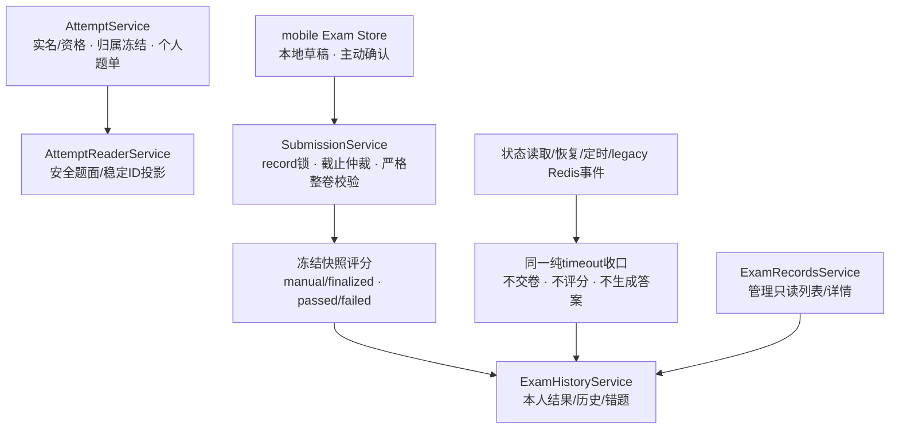

新移动考试没有服务端draft/heartbeat。旧AnswerDraftService与Redis答案暂存只服务legacy协议兼容，不是新training作答事实源。Redis deadline只是可再生加速态，权威期限是MySQL deadline_at；数据库record锁及状态负责交卷正确性。

### 6.3 核心类 / 服务职责表

| 组件 | 职责 | 关键依赖 |
|---|---|---|
| TrainingExamsController | mobile employee本人列表、start、状态、主动submit、result、历史/错题；不注册draft/heartbeat | AttemptService、SubmissionService、ExamHistoryService |
| AttemptService | 按用户/assignment/record/新开paper锁序冻结归属、rule、题单与prompt媒体引用；有效active保持原record/deadline，先收口过期active | Identity、PaperReleaseService、Sampling/Shuffle |
| AttemptReaderService | 从不可变snapshot递归白名单重建受限Tiptap/稳定ID题面；终态questions=[]；提供冻结评分输入 | MySQL、MediaService |
| SubmissionService | 本人record悲观锁后取accepted_at；首次截止前严格整卷校验、写稳定ID答案并评分；纯timeout单独收口；重复终态只返回首次结果 | 冻结rule/items、ExamHistoryService |
| LegacyExamAdapter / ExamService | 旧制度/exams数字/source ID协议兼容；只用冻结映射适配，不得访问training release；到期同样纯timeout | Attempt/Reader/Submission、legacy Grading |
| TasksService | 每30秒扫描in_progress且deadline已到，调用纯timeout；不取草稿评分 | SubmissionService |
| ExamHistoryService | 同源结果/历史/错题；区分新timeout、旧已评分timeout、历史submitted；按允许阶段绑定解析图 | MySQL、MediaService、AccessService |
| ExamRecordsService / ExamAdminController | exam_records:read管理列表/详情/结果，结果复用History；不采集监考事实 | 冻结记录、题单与最终答案 |
| mobile Exam Store / Draft Store | 完整稳定ID内存答案、按user/record隔离的本地串行草稿、倒计时、主动提交及结果不明查询 | uni storage、mobile会话epoch、考试API |

### 6.4 关键设计详解

#### 6.4.1 资格、实名与原attempt恢复

全部/me考试接口只允许启用中的mobile employee；未实名可以浏览可考列表。新开考、恢复进行中题面、主动交卷必须有learner_identity权威事实：unverified/rejected返回40302 + IDENTITY_REQUIRED，pending为IDENTITY_PENDING。Debug Login不授予实名；供应商disabled仍承认已有verified事实。终态查询不重复要求实名。

新training首次开考校验published、启用类别、来源/类别齐备且匹配release，默认无课程或制度完成门槛；random按institution→easy/external→hard抽题，fixed沿冻结题单。首次冻结assignment的release/source/category/difficulty/rule，补考沿用；旧记录同样计入max_attempts，默认总3次。已passed不能再开。

legacy制度固定卷保留is_valid双条件及差距信息，不能绕过新training路径。事务按用户→assignment→records→新开paper串行，有效active沿原record/题序/选项序/deadline恢复，不因当前类别/来源、撤卷或改题重新抽取；已过期active先纯timeout，不在持用户锁时嵌套借连接。抽题/引用任一失败回滚整次创建，活动唯一键兜底。

#### 6.4.2 稳定ID、受限Tiptap与乱序

021为question/question_version新增content_schema_version（默认1）和content_json（可空），exam_answer新增selected_option_ids；不重写历史内容、checksum、快照、答案或成绩。新v2 content_json冻结stem/options/analysis及answer_option_ids，option ID同一版本非空且唯一，重排保持ID。旧列同步兼容投影；PC checked是编辑标准答案状态，保存转answer_option_ids，与学员选择独立。AI/文件导题及旧PC输入统一经question-content适配创建新v2版本。

ReadonlyTiptapDoc仅doc、paragraph、text、hardBreak及image；图片attrs只含十进制字符串asset_id，无marks/src/HTML/链接/样式/未知字段；单文档最多2000节点、100000文本字符、深度4，非法整题拒绝。在考从snapshot递归重建，仅item_id/type/score/stem/options[{id,content}]，任意层级不得带标准答案、解析、checked/correct或管理元数据。

HMAC seed只用于创建时题目/选项洗牌，顺序随后持久化；v2乱序不改item/option ID，提交无需下标转换。legacy快照保留原始内容及display_to_original；数字答案只代表当时冻结options原始下标，适配为该项key，不读当前题库或显示下标。旧key缺失/重复/非法时报数据契约错误，不能补随机ID。

#### 6.4.3 服务端期限与纯timeout

deadline_at创建时冻结，刷新/后台/断网/资料变更不延长。移动端用server_now偏移校准，仅展示倒计时；归零锁定编辑并查record，不调用submit。GET record在事务锁内先判期限，到期先收口再返回终态。

主动submit、start/recover/状态读取、30秒sweeper和legacy Redis过期事件都复用纯timeout：
```text
status=timeout, score=0, grading_state=not_submitted
submission_method/submitted_at/graded_at/active_assignment_id=NULL
draft_revision=0, draft_payload_hash/draft_saved_at=NULL
```

该分支不调用评分、不创建exam_answer、不产生逐题得分；升级前同一active record的非终态草稿行只做清理，历史终态不改。客户端显示“超时未交卷”，correct_rate=null/items=[]，不开放解析或题图、不进错题或finalized成绩/排名分母，历史列表仍保留记录。

#### 6.4.4 本地草稿、退出与重进

key为ruleexam:mobile:<userId>:exam-draft:<recordId>，值仅answers/currentIndex/savedAt，答案是Record<itemId, optionId[]>；题面只在内存，不持久化题目、答案解析、deadline或token。每次答案变化复制整份快照并uni.setStorage；同key串行，成功才标已保存，写失败可见且允许继续内存答题。onHide/onUnload补同样快照，无定时服务端同步。

每用户草稿index配合generation/tombstone阻止清理后的迟到写复活。明确离开答题页保留草稿，主动登出清当前用户全部草稿；普通401只清题面内存/会话，保留所属草稿，换号不读旧key。终态/成功提交清对应草稿。答题页隐藏普通返回及底部导航，返回/退出尽可能强确认；强关和系统回收无法绝对拦截。

重进先联网取原attempt与不可变题面，再整份校验草稿item/option ID；缺失/损坏/任一未知ID整份不恢复，以空答案继续同一attempt，不部分合并、不重抽或延时。页面内短时断网仍能改答和本地保存；离线刷新缺题面，只可网络重试。

#### 6.4.5 主动整卷提交、锁后截止与幂等

body严格为{record_id,answers:[{item_id,option_ids}]}，路径/body十进制字符串record一致；完整题目集合每题恰一次，未答显式[]。option ID必须属于本题、唯一，single/judgment最多一项。旧selected/revision/asset_ids、未知字段、缺项/重复/跨题或错误类型返回40001。

处理顺序：认证mobile→本人记录→事务悲观锁→状态/期限仲裁→只对active首次提交严格校验。锁后取唯一accepted_at，只有accepted_at < deadline_at才受理，并以同一时刻写submitted_at。同事务写每题稳定selected_option_ids、逐题得分、总分及manual/finalized的passed/failed，终态只读。

passed/failed重试忽略新答案返回首次结果；timeout返回超时，历史submitted返回待确认，不重新评分。两份不同答案并发、submit/timeout竞争及回滚重试只允许一个终态/一组副作用，不新增submission_id。

#### 6.4.6 自动评分与结果不明

主动受理后的三类题以冻结answer_option_ids、score_cents和rule为准：single/judgment全等满分，否则0；multiple全对满分、错选0、非空真子集按冻结partial_credit_ratio部分分，未答0且is_correct=NULL。客户端不提供评分参数/最终总分；成绩无人工修改入口。

主动确认后冻结完整payload，submitting禁止改答。网络结果不明先查record：passed/failed取首次结果、timeout取超时、历史submitted显示“历史结果待确认”；仍active且未截止最多自动重试一次完全相同payload。再次不明保留草稿和冻结payload，停在“结果确认中”并继续查询/受控重试，不能冒报成功/失败或换答案重试。

#### 6.4.7 成绩、错题与媒体阶段授权

FinalResultView为FinalResultV2或LegacySubmittedResult（04册§4.7.1）。主动manual/finalized结果含稳定selected_option_ids/correct_option_ids、受限解析及逐题分。新timeout为0/false/null正确率/空items且时间可空。历史已评分timeout保留原分数/明细/timeout交卷方式及冻结结果图只读权限，按历史事实投影passed/failed；历史submitted显示待确认，不伪造分数。legacy由schema/快照与历史事实判定，不能靠submission_method为空推断。

历史包含纯timeout；错题仅finalized且非满分（含主动交卷未答/部分分），新timeout无条目，旧finalized历史timeout按事实保留。统计/排名排除新纯timeout；管理端result复用同一History投影。

题图owner固定exam_record_question/item_id。签票和读取复核精确media_reference、账号、记录归属及阶段：in_progress须实名且未截止，仅stem/options；passed/failed及历史已评分timeout可读冻结题干/选项/解析图；仅新纯timeout拒绝题图。PC exam_records:read Bearer预览独立，不能签learner票据。票据URL不带JWT；内容公开短票入口以claims.user复核原学员资格，单纯浏览器切号不保证立即吊销仍在TTL内旧URL，客户端切号必须清旧URL/迟到响应。

#### 6.4.8 C5 考试记录只读查询

```text
exam_record 冻结事实 ─┬─ exam_record_question COUNT → total_count
                     ├─ 最终非空 exam_answer COUNT → answered_count
                     └─ record/paper/user 快照 → 列表与详情投影
```

`ExamRecordsService` 负责 `/admin/exam-records/options` 选项、`/admin/exam-records` 列表和 `/admin/exam-records/{id}` 详情：按学员/试卷关键字、精确试卷/学员、记录冻结类别、难度、考试结果和北京时间开考日期筛选。旧来源/原始状态/结果状态参数继续兼容，选项接口仅要求 `exam_records:read`，不要求其它管理权限。返回类别名、冻结满分及统一展示结果，同时保留题目总数/最终已答数等事实。它不读取连接状态、设备摘要、心跳时间、切屏次数或任何监考采集数据。

PC 页面围绕学员、试卷（第几次考试）、培训类别、成绩、考试状态、开考时间和只读详情展示；来源在筛选、列表与详情全部移除，六项保留筛选全部平铺。状态仅保留进行中、已通过、未通过、超时未交卷，管理端列表/详情/结果不开放旧 submitted 和已评分 timeout；该范围限制不修改共享历史 reader 或原始数据。最终已答数不作为实时进度展示。未交卷显示无成绩，已出分的真实零分保留。满分只读 `rule_snapshot.totalCents`，没有快照则不猜测。日期使用单个 `daterange` 范围控件，成对恢复/清除，旧单侧界面条件取消。仅学员列表提供考试记录入口，按 `exam_records:read` 控制；试卷列表不提供该入口。学员入口通过内部 ID 精确筛选；筛选和分页写入列表 URL；点击详情在当前列表打开公共弹窗，不新增详情页签，关闭后保留列表上下文。详情弹窗顶部采用学员档案布局，展示当前头像、姓名、账号及考试记录培训类别；无头像或头像不可读取时显示默认头像。本次考试区使用 Element Plus 带边框 descriptions，两列布局，试卷名称跨整行；显示成绩、状态、次数、用时、开考/交卷/截止时间和提交方式，北京时间统一说明一次。答卷复用受控富文本只读呈现：答对时所选正确项标绿；错选项标红、正确项标绿；仅漏选时已选正确项标绿、漏选正确项标浅红并注明“漏选”；未作答所有选项不着色。题头显示答对/答错/漏选/未作答及服务端实际得分，下方只保留解析，不重复汇总正确答案和学员答案；已交卷记录展示逐题作答、正确答案、解析和得分，进行中及超时未交卷仅展示状态说明。弹窗内容区滚动，底部刷新与关闭保持可见，遮罩限制于页签下方内容区；历史详情地址仍可打开同一弹窗，并通过受限的列表返回地址关闭。

终态结果不在记录服务内复制一套模型。`GET /admin/exam-records/{id}/result` 保持原路由与 `exam_records:read` 权限，先由 `ExamRecordsService.detail` 核对当前管理端记录范围，再委派 `ExamHistoryService`，和学员结果读取同一冻结题单、最终答案及自动评分事实。进行中记录只返回安全元数据；主动passed/failed可展示冻结受控题干/选项/解析图；新纯timeout不开放题图，但不存在学员答题图片或评语。共享 reader 对历史已评分timeout的支持供原有移动/旧制度链路使用，不重新加入管理端状态筛选。

### 6.5 与其他模块的依赖关系

| 方向 | 对端模块 | 交互内容 | 交互方式 |
|---|---|---|---|
| 依赖（下游） | 4 学习行为管控模块 | **legacy 制度固定卷**考试资格校验（`learning_record.is_valid`）；未达标差距信息（剩余时长缺口 / 底部段未覆盖）。新培训考试默认不依赖该学习门槛 | 旧路径由 LearningProgressService 进程内调用；培训路径按发布/身份/规则快照校验 |
| 依赖（下游） | 3 AI 出题模块 | `exam_paper`（策略：pass_score / duration_minutes / max_attempts / partial_credit_ratio / status）、`paper_question`（题目与分值）、`question`（options / answer / analysis） | 只读查询 |
| 依赖（下游） | 2 制度文件管理模块 | `regulation.status` 开考校验；`exam_record.regulation_id` 冗余快照来源 | 只读查询 |
| 依赖（下游） | 1 组织权限模块 | 考生身份、在职状态（开考 / 交卷敏感路径回查 `sys_user.status`） | 认证守卫 + 只读查询 |
| 被依赖（上游） | 6 统计报表模块 | `exam_record`（参考人数 / 通过率 / 平均分 / 分数分布）、`exam_answer`（题目正确率） | 只读查询 |

### 6.6 对应数据表

| 表 | 本模块读写角色 | 说明 |
|---|---|---|
| `exam_record` | 创建/终态UPDATE | 新主动passed/failed+finalized，新纯timeout+not_submitted；历史submitted兼容；期限冻结 |
| `exam_assignment` | C2 创建后只读 | 每位学员每张卷冻结首次 release/source/category/difficulty/rule；补考复用 |
| `exam_record_question` | C2 开考事务写，C3/C4 恢复/评分/结果读 | 每次题单、实际分值、题面内容和持久显示映射；题图 owner=item_id |
| `exam_answer` | 主动受理评分事务写、结果读 | 新v2 selected_option_ids为稳定ID；纯timeout不创建行；legacy selected兼容且历史终态只读 |
| `exam_paper` / `paper_release*` | 只读 | 新开状态与冻结发布输入；C2 恢复/评分不回读动态题库 |
| `paper_question` / `question` | legacy 只读 | 仅升级前无 assignment 的旧活动记录沿原路径；新固定作答先冻结 |
| `learning_record` | 只读 | 资格校验（`is_valid`） |
| `regulation` | 只读 | 开考状态校验 |

---

## 7. 统计报表模块（`/statistics`）

### 7.1 模块职责与边界

**职责**：实现「落实情况可运营」（FR-STT-01 ~ 05）：以**精确口径**计算并展示各维度指标（应学人数、学习完成率、参考人数、通过率、平均分、分数分布）；提供制度维度、部门维度、个人维度三个方向的统计查询；输出未完成人员清单（应学但 `is_valid = 0`，附学习进度；含已完成学习但考试未通过者并标注原因）；各维度报表与清单的 Excel 导出。

**边界（不做什么）**：

| 不属于本模块的内容 | 归属 |
|---|---|
| 学习与考试数据的产生 / 变更 | 4 学习行为管控模块、5 考试评分模块（本模块对当前及培训事实表**零写路径**） |
| 学习进度与成绩的明细交互查询（员工端「我的进度 / 我的成绩」） | 4 / 5 模块的查询服务（本模块做的是跨表聚合视角） |
| 指标阈值的运营决策（如督办规则） | 管理员基于报表的人工跟进（系统只提供数据与清单） |

### 7.2 内部组成（子服务 / 组件）

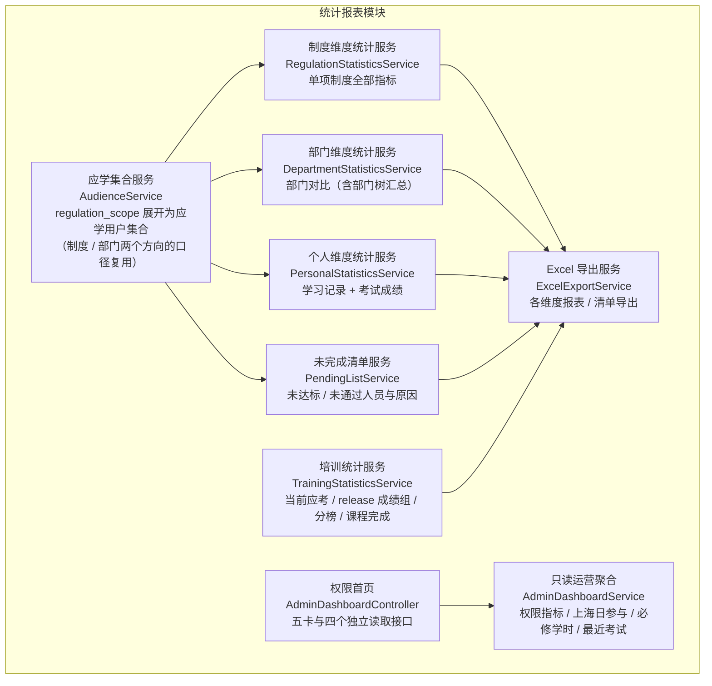

### 7.3 核心类 / 服务职责表

| 组件 | 类型 | 职责 | 关键依赖 |
|---|---|---|---|
| StatisticsController | 接口层 | `/statistics` 各维度查询与导出入口（regulation_admin / super_admin；个人维度含 employee 仅本人） | 各服务 |
| AudienceService | 服务 | 应学集合计算：`regulation_scope` → `is_all` 全员或部门树展开 → 在职员工集合（含部门归属），供全部指标复用；「部门 → 制度集合」反查（跨制度汇总） | `regulation_scope` / `sys_department` / `sys_user` 仓储 |
| RegulationStatisticsService | 服务 | 单项制度维度指标：应学人数、学习完成率、参考人数、通过率、平均分、分数分布 | 各仓储 |
| DepartmentStatisticsService | 服务 | 部门维度对比：应学集合按 `sys_user.department_id` 切片 + 部门树父级汇总（子部门指标聚合） | 各仓储 |
| PersonalStatisticsService | 服务 | 个人维度：指定员工（或本人）的学习记录汇总 + 考试成绩（历次 / 最高分） | `learning_record` / `exam_record` 仓储 |
| PendingListService | 服务 | 未完成人员清单：应学未达标人员（含进度与差距原因）+ 已达标但考试未通过人员 | 各仓储 |
| ExcelExportService | 服务 | 各导出物的 xlsx 生成（中文表头、流式分页取数）、文件流响应、导出审计留痕 | 各统计服务 |
| TrainingStatisticsService | 服务 | 实时聚合培训当前应考与历史开考；当前最新 release + 完全相同规则下取 finalized 个人最高分，固定卷整场排名，历史随机卷按明确难度排名；B2 当前版本课程完成继续保留在接口；排名与同页同筛选导出 | `sys_user`、课程/视频、发布/答卷仓储 |
| TrainingStatisticsController | 接口层 | `/statistics/training/options|overview|summary|ranking|export`；总览分页打开成绩分析弹窗，固定卷 ranking/export 可省略难度、历史随机卷必须明确难度，读/导出权限分离 | TrainingStatisticsService、AuditService |
| AdminDashboardController | 接口层 | `/admin/dashboard` 五卡按权限裁剪；四个独立统计接口要求 `statistics:read`，记录下钻另核 `exam_records:read` | AdminDashboardService、AccessService |
| AdminDashboardService | 服务 | 概览与7/30日参与去重；发布要求的一致性学时聚合；最近4份试卷最高分摘要 | DataSource、AccessService、共享记录可见性/有效学习版本/成绩摘要 helper |

PC 无显式登录回跳地址时统一按当前身份选择首页：具有管理身份进入 `/admin/dashboard`，普通学员进入 `/my/regulations`。内部合法回跳地址优先并继续经过现有路由权限守卫；首次强制改密会保留该回跳地址，改密成功后再进入目标页。

考试分析总览仅展示已发布且有冻结版本的培训试卷；总分使用发布版本满分，无人参考时人数为0、平均分为“—”。草稿仅在试卷管理维护。列表顺序为考试名称、培训类别、试卷总分、参考人数、平均分、操作，考试名称表头与内容居左，其余表头居中；统计口径放在考试名称表头后，以括号包裹并通过问号悬停提示展示。

### 7.4 关键设计详解

#### 7.4.1 各指标精确口径定义

全部指标以「应学集合」为口径锚点（C-09：应学人数以发布范围内在职员工数为准，范围调整后口径随之更新）。

**应学集合（AudienceService 的统一产出）**：

1. 若该制度的 `regulation_scope` 存在 `is_all = 1` 行 → 应学集合 = 全部在职员工（`sys_user` 中 `status = 1` 的全体，去重）；
2. 否则 → 取全部圈定部门（`department_id` 集合），经应用层部门树展开为**含全部子部门的部门 id 集合** → 应学集合 = `sys_user` 中 `department_id` 属于该集合且 `status = 1` 的员工（去重）；
3. 集合中的员工即「应学人员」，其人数即「应学人数」（C-09：发布范围调整后集合随之更新，新入部门员工自动纳入）。

**指标口径总表**：

| 指标 | 精确口径 | 数据来源与查询路径（03 册 6.4 节索引支撑） |
|---|---|---|
| 应学人数 | 应学集合的人数（发布范围内 `sys_user.status = 1` 的去重员工数） | `regulation_scope`（`uk_regulation_department` 前缀）→ 应用层展开子部门 → `sys_user WHERE department_id IN (…) AND status = 1`（`idx_department_status`）；`is_all = 1` 时直接全员 |
| 学习完成率 | **应学集合中** `learning_record.is_valid = 1` 的人数 ÷ 应学人数（分子分母同源于应学集合；范围缩小后不会出现 > 100%） | `learning_record WHERE regulation_id = ? AND is_valid = 1`（`idx_regulation_valid`）与应学集合求交 |
| 参考人数 | 该制度下有合法评分事实的去重考生；passed/failed与旧finalized、分数/提交时间已知的timeout计入，新纯timeout和历史submitted排除 | statistics.service.ts中的hasScoredResult筛选，idx_regulation_status支撑 |
| 通过率 | 在合法评分集合内每人取最高分，以该记录所属试卷pass_score判断，通过人数÷参考人数；新纯timeout的占位0不能进入集合。历史评分保留，最终总分只读 | 先hasScoredResult筛选，再按user取最高分；idx_regulation_status支撑 |
| 平均分 | 各考生最高分的算术平均（AVG over「每人 MAX(score)」，保留两位小数） | 同上 |
| 分数分布 | 各考生最高分按**左闭右开**分段计数：**[0,60)、[60,70)、[70,80)、[80,90)、[90,100]**——`FLOOR(score / 10)` 分桶、`score ≥ 90` 归入最高桶（小数分值如 89.50 归 [80,90)，五段计数之和恒等于参考人数） | 同上，按段 CASE WHEN 聚合 |
| 未完成人员清单 | ① 应学集合中 `learning_record.is_valid = 0` 或无 `learning_record` 记录者（学习未达标），附学习进度与差距原因；② 已 `is_valid = 1` 但历次最高分 < `pass_score`（或未参考）者，标注「考试未通过 / 未参考」（FR-STT-04「未达标或未通过」完整口径） | 应学集合 LEFT JOIN `learning_record`（is_valid 为 0 或无记录）；`learning_record` ∩ `exam_record` 聚合 |

**口径细则**：

| 细则 | 说明 |
|---|---|
| 分母限定 | 学习完成率的分子限定应学集合内（7.4.1 节口径表）；考试类指标（参考 / 通过 / 平均 / 分布）按 `exam_record` 事实数据聚合 |
| 最高分唯一性 | 同一考生多次合法评分（含补考、旧已评分timeout）只以最高分计入通过率/平均分/分布；新纯timeout排除（C-06 取最高分口径） |
| 空态 | 无学习 / 考试数据时各指标展示 0 或空态、不报错（UC-08 A1） |
| 口径透明 | 每项指标在页面明示口径定义（FR-STT-01 验收④）；百分比保留 1 ~ 2 位小数 |
| 个人维度边界 | 管理员可查任意员工（数据与该员工明细一致，FR-STT-03 验收①）；employee 仅能查本人（验收②，数据范围收口） |

#### 7.4.2 三个维度查询实现

**① 制度维度**（FR-STT-01）：

| 指标 | 查询实现 |
|---|---|
| 应学人数 / 完成率 | AudienceService 展开应学用户 id 集合 → 与 `learning_record`（regulation_id、is_valid）JOIN 计数 |
| 参考人数 / 通过率 / 平均分 / 分数分布 | `exam_record WHERE regulation_id = ? AND status <> 'in_progress'`（`idx_regulation_status`）→ 窗口函数按 user_id 取最高分一条 → 通过判定（最高分 ≥ 该记录所在试卷 `pass_score`）→ 计数 / AVG / 左闭右开分段 CASE 聚合 |
| 未完成清单 | 应学集合 LEFT JOIN `learning_record` → is_valid = 0 或无记录人员；逐人计算剩余时长缺口（`required_minutes × 60 − total_seconds`）与底部段覆盖状态 |

**② 部门维度**（FR-STT-02，定位落后部门）：

- 应学集合携带 `sys_user.department_id` → 全部指标按部门切片（同一制度下按部门拆分的结果与制度维度总数核对一致，FR-STT-02 验收①）。
- **部门树汇总**：父部门的指标 = 其子树全部员工的聚合（应用层树展开为 id 集合后统一计算），子部门明细可下钻。
- **跨制度汇总**：支持「部门 × 全部已发布制度」矩阵视图——按部门反查其被圈定的制度集合（`regulation_scope.idx_department`），逐制度聚合后按部门汇总（验收②）。
- JOIN 聚合路径：应学集合（含 department_id）→ LEFT JOIN `learning_record`（学习指标）→ LEFT JOIN `exam_record` 聚合（考试指标）。

**③ 个人维度**（FR-STT-03）：

| 视图 | 内容 |
|---|---|
| 学习记录 | 按 `learning_record WHERE user_id = ?`（`uk_user_regulation` 前缀）：制度、`total_seconds`（累计有效时长）、`max_scroll_percent`、`scroll_coverage.covered_count / total_segments`、`is_valid`、`valid_at`、`last_learn_at` |
| 考试成绩 | 按 `exam_record WHERE user_id = ?`（`idx_user_paper_status`）：按试卷分组的历次作答（`attempt_no`、status、score）+ 每试卷最高分标注 |
| 会话明细 | 需要审计时下钻 `learning_session`（`idx_user_regulation_started` 回溯会话序列，与汇总时长对账） |

**性能与缓存**：当前量级（单制度考试记录 ≤ 4 万行 / 年，03 册 6.2 节）直接查库 + 03 册 6.4 节索引即可满足统计 P95 ≤ 3 秒（NFR-03）；管理端制度 / 部门维度的统计结果另设 Redis 缓存以降低聚合开销（两级缓存键与失效策略见 7.4.4 节）。

#### 7.4.3 Excel 导出服务（导出内容与模板）

**导出物与模板**（FR-STT-05；导出文件内容与页面数据一致，验收①）：

| 导出物 | Sheet 结构与列定义 |
|---|---|
| 制度维度统计表 | 列：制度标题、分类、状态、应学人数、有效学习人数、学习完成率、参考人数、通过人数、通过率、平均分、[0,60) 人数、[60,70) 人数、[70,80) 人数、[80,90) 人数、[90,100] 人数 |
| 部门维度对比表 | 列：部门（含层级路径）、应学人数、有效学习人数、学习完成率、参考人数、通过率、平均分（按选定制度或跨制度汇总两种模式） |
| 未完成人员清单 | 列：部门、姓名、工号、未完成类型（学习未达标 / 考试未通过 / 未参考）、累计有效时长（`total_seconds`）、目标时长（`required_minutes × 60` 秒）、剩余时长缺口、已覆盖段数（covered_count / total_segments）、底部段是否覆盖、`is_valid`、历次考试最高分、具体未完成原因 |
| 个人维度明细表 | 列：姓名、工号、部门、制度标题、累计有效时长、覆盖段数、`is_valid`、试卷标题、作答次数、最高分、最终状态（passed / failed / timeout 等） |

**生成机制**：

| 项 | 设计 |
|---|---|
| 生成方式 | 服务端生成 xlsx 文件流（Node.js Excel 生成组件），以附件响应下发（Content-Disposition） |
| 取数策略 | 流式分页查询（按主键游标分批），避免万行数据全量驻留内存；单 Sheet 超大时按固定行数分 Sheet |
| 表头与格式 | 中文表头完整、列宽自适应、状态 / 枚举列输出中文含义（FR-STT-05 验收②） |
| 性能 | 万行级导出 ≤ 30 秒（NFR-03 / FR-STT-05 验收③） |
| 空清单 | 全员已完成 → 提示「无未完成人员」、不生成文件（UC-10 A1）；导出失败提示重试（A2） |
| 留痕 | 导出操作写审计日志（操作人、时间、导出物与数据范围，NFR-10） |

#### 7.4.4 统计缓存设计（两级缓存键与失效策略）

管理端制度 / 部门维度的统计结果经 Redis 缓存（TTL 5 分钟）；**缓存键携带维度与主体标识**，杜绝跨维度 / 跨用户复用同一键导致的越权泄露（07 册 5.3 节同口径）：

| 缓存键 | 维度 | 缓存范围 |
|---|---|---|
| `stat:reg:{regulation_id}` | 制度维度（管理端） | 该制度全部指标（应学 / 完成率 / 参考 / 通过 / 平均 / 分数分布） |
| `stat:dept:{regulation_id}:{department_id}` | 部门维度（管理端） | 该制度下该部门（含子树）切片指标 |
| 个人维度（`/statistics` 个人查询） | — | **一律不缓存**——数据主体唯一、命中率低、越权风险高（employee 仅本人边界，2.4.2 节数据范围收口） |

- **主动失效**：交卷 / 达标事件按 `regulation_id` 前缀**批量失效**——以 `SCAN`（而非 `KEYS`，避免阻塞）按 `stat:reg:{regulation_id}` 与 `stat:dept:{regulation_id}:*` 前缀匹配删除对应键；辅以 TTL 5 分钟自然过期兜底。
- **写路径边界不变**：统计模块自身仍为零写路径（1.2 节原则 4）——缓存读写均在查询路径内完成，失效事件由考试评分 / 学习行为管控模块的交卷 / 达标事务**提交后**以进程内事件发出（模块化单体，无需消息中间件）。
- **培训统计实时读取**：C6 新报表当前不进入上述 Redis 缓存；人员类别/来源、课程 current version 与交卷变化在下一查询自然生效。旧缓存行为和 C3/C4 提交后 hook 原样保留，不为 C6 重复 finalization 或另造失效总线。

#### 7.4.5 培训场次统计与排名（已落地，C6）

培训报表与 legacy 制度报表分开口径：

| 指标 | 培训目标口径 |
|---|---|
| 场次与难度 | 人数统计保留 paper 历史；成绩组显式返回最新 `release_id`，并要求记录 release 与 `rule_snapshot` 完全匹配。当前固定卷按整场展示，历史随机卷仍按冻结 difficulty 分组；legacy unknown 只读兼容 |
| 个人最高分 | 当前 release、同规则内仅统计 `finalized` 的个人最高分；固定卷不再额外要求难度，历史随机卷仍限定同难度；同分并列；两个时间都已知才按较早 `graded_at` 选展示记录，否则按最小 record_id 稳定兜底且不补时间 |
| 参考率 | 当前应考集合内成功开考去重人数 ÷ 当前应考人数；分子与分母同集合；历史成功开考总人数另列，已调离人员不混入当前分子 |
| 分数/通过/排名 | 固定卷未指定难度时形成整场榜；历史随机卷未指定难度不产生跨题池默认榜。通过按冻结及格线与最终结论，不能用当前试卷配置重判历史 |
| 未完成原因 | 未完成学习、未开考、未通过分别列示；外来学员不进入课程应学分母，课程零必学课时完成率显示空值 |
| 用时 | 主动交卷取 `submitted_at-started_at`，timeout 取 `deadline_at-started_at`；`graded_at` 是自动结算时间，不参与考试用时 |
| 导出 | 调用与页面相同的 ranking 查询及相同 page/page_size，下载“培训考试成绩排名.xlsx”，主 Sheet“成绩排名”与当前页一致且不重复展示难度列；独立口径 Sheet 明示固定卷/历史随机卷口径 |

实现由纯聚合 `ranking.ts` 和仓储编排 `TrainingStatisticsService` 共用唯一口径，不修改 7.4.1 legacy 跨试卷取最高分逻辑。课程完成读取同类别 published 课程的 required lesson `current_version_id` 与 `video_learning_record.is_completed`；统计模块不写学习完成事实。首页趋势把 `exam_record.started_at` 转为 `Asia/Shanghai` 自然日，返回最近 7 日含零值日期。

管理端统计入口采用「考试汇总列表 + 内容区成绩分析弹窗」。总览按名称/类别筛选并分页，只为当前页批量聚合最新发布的考试记录，不逐场读取全量学员和课程；弹窗关闭后列表筛选与页码保持。弹窗用 Element Plus 描述列表集中展示发布规则、应考/参考/交卷、平均/最高/最低分、及格人数/率和平均用时，课程完成与未完成原因不占成绩分析主界面；优秀标准尚不存在，显示未设置而非推断。固定卷直接加载整场排名并隐藏难度筛选；历史随机卷自动选择已有卷面难度并允许切换。排名展示学员性别、来源、分数、用时及查看答卷，保留标准竞争名次，排序后分页、同页导出。`paper_id` 深链仍直接打开弹窗；关闭、切换和迟到响应不得覆盖列表或新场次。此扩展不新增表、不改变自动评分结果、不恢复已取消的监考或人工阅卷模块。

<a id="admin-operations-dashboard"></a>

#### 7.4.6 管理端运营看板（2026-10-27 已实现并完成本地验收）

**定位与交付状态**：运营看板是管理员进入 `/admin/dashboard` 后的业务首页，用于快速了解学员规模与构成、今日及近期考试参与、必修学时达标情况，并进入常用工作页面。页面、五个读取接口和入口接收已落地，并完成隔离 API、Kimi 真实浏览器与视觉验收，见[验收记录](../../review/2026-10-27-admin-operations-dashboard-acceptance.md)。设计资源 `docs/ui/pen-gemini.pen`、主节点 `Y8KAi` 的完整定位见[独立实现设计](../superpowers/specs/2026-10-27-admin-operations-dashboard-design.md#dashboard-design-resource)。这不代表生产部署完成。本节约束管理端首页，不改变完整培训统计页、考试评分及旧制度统计的既有业务规则。

##### 7.4.6.1 页面区域与信息顺序

```text
管理端公共侧栏、顶部栏和已打开页面页签
└─ 运营看板内容区
   ├─ 页头：问候语、数据更新时间、刷新图标
   ├─ 第一行：五张概览指标卡
   │  ├─ 学员总数〔同一卡内：本机构人数 / 外来人数〕
   │  ├─ 今日参考人数〔辅助：今日开考人次〕
   │  ├─ 近 7 日参考人数〔辅助：近 7 日开考人次〕
   │  ├─ 题目总数〔辅助：已启用题目数〕
   │  └─ 试卷总数〔辅助：已发布试卷数〕
   ├─ 第二行
   │  ├─ 左：考试参与趋势〔近 7 日 / 近 30 日，按来源堆叠〕
   │  └─ 右：常用操作〔深色四宫格〕
   └─ 第三行
      ├─ 左：必修学时完成情况〔要求时长、达标率、应学/达标/未达标人数〕
      └─ 右：最近考试〔独立列表，详情进入统计页面〕
```

学员总数卡稍宽，其余四张指标卡等宽；第二行以趋势图为主，右侧保留深色操作区；第三行左侧为学时卡，右侧为较宽的考试列表。继续复用现有后台框架、机构标识与设计变量，不增加独立大屏路由。空间不足时按上述顺序换行，保持「总数与来源分项同卡」和模块独立的关系。页面内容在第三行结束，仅保留正常底部留白，不设置独立页尾说明或重复的统计入口按钮。

##### 7.4.6.2 页头与五张概览指标卡

页头左侧显示管理员问候语；右侧显示数据更新时间及小型刷新图标，图标悬停提示「刷新数据」，不再使用突出的文字刷新按钮。更新时间以服务端统计时点为准，时区统一为 `Asia/Shanghai`；刷新后更新可见模块，各模块失败分别处理。

| 顺序 | 卡片标题 | 主数字 | 卡内辅助内容 | 入口行为 |
|---|---|---|---|---|
| 1 | 学员总数 | 当前启用的学员账号总人数，沿用首页学员身份口径，排除管理员账号 | 同一卡内直接显示「本机构 × 人」「外来 × 人」，用细双色比例条辅助表达构成 | 点击总数进入全部学员；点击本机构/外来人数进入对应来源的学员列表 |
| 2 | 今日参考人数 | 今天成功开考的去重学员人数 | 今日累计开考人次 | 进入今天的考试记录 |
| 3 | 近 7 日参考人数 | 最近 7 个自然日成功开考的去重学员人数，包含今天 | 同期累计开考人次 | 进入近 7 日考试记录 |
| 4 | 题目总数 | 当前题库范围内未逻辑删除的题目数量，每个题目计一次，不累加历史版本 | 其中已启用的题目数量 | 进入试题管理；主数字对应全部启停状态 |
| 5 | 试卷总数 | 当前试卷管理范围内的试卷数量，包含草稿、已发布、已撤回和已归档等状态 | 其中已发布的试卷数量 | 进入试卷管理；主数字对应全部状态 |

人数与人次必须分开：同一学员在一天或近 7 日内多次开考，主数字在对应整个时间范围内只计一人；辅助人次按成功创建的考试记录逐条计数，恢复同一答卷不新增人次。参考人数包括已经开考但尚未交卷、未通过或到期未交卷的学员，不要求已有成绩。今日从上海时间 00:00 统计至本次更新时点；近 7 日从六天前 00:00 统计至本次更新时点，两张卡不能相加。

学员来源分项与总数采用同一启用账号范围。正常情况下本机构人数加外来人数等于总数；若存在历史未设置来源的账号，在卡内补充中性说明「未设置 × 人」，不强行归类或让分项冒充完整总数。考试参与数据按发生事实统计，不因账号后来停用而删除历史参与记录；它与当前启用学员总数不是同一个统计集合。

##### 7.4.6.3 第二行左侧：考试参与趋势

| 项目 | 设计要求 |
|---|---|
| 默认范围 | 最近 7 个自然日，包含今天；支持切换近 30 日，切换仅影响本图，顶部今日/近 7 日指标保持各自固定口径 |
| 图形 | 堆叠柱状图，每天一根柱子；蓝色表示本机构，青色表示外来，柱顶显示当天参考总人数 |
| 坐标 | 横轴为日期，纵轴为人数；无开考日期补零，纵轴从 0 开始，今天只统计至当前更新时间 |
| 去重 | 同一学员同一天跨试卷或多次开考只计一人；跨天仍可分别出现，因此每日人数之和不等于顶部近 7 日去重人数 |
| 提示 | 鼠标悬停显示日期、当天总人数、本机构人数、外来人数；图例直接说明颜色含义 |
| 入口 | 点击日期柱进入当天考试记录，带完整的当天日期范围；「查看考试记录」进入记录列表 |

来源分组的实施默认口径：使用该学员当日首次成功开考记录的冻结来源，避免同日因多次开考或来源变更被重复分到两组；未知来源保留并单独提示，不改写历史记录。正常来源数据应满足「本机构人数 + 外来人数 = 当天总人数」。本图展示来源构成，不为考试记录页增加隐藏来源筛选；记录页继续使用其已确认的筛选项。

##### 7.4.6.4 第二行右侧：常用操作

采用深色背景、两行两列的四宫格布局。标题为「常用操作」，说明为「从内容准备到考试发布，一步直达。」；每个入口由图标和名称组成，顺序如下，不再另设重复的横向快捷入口条。

| 四宫格位置 | 名称 | 点击后进入 |
|---|---|---|
| 左上 | 新建试卷 | 试卷管理的现有新建流程 |
| 右上 | 试题导入 | 试题导入页面 |
| 左下 | 学员管理 | 学员管理页面 |
| 右下 | 统计分析 | 完整培训统计页面 |

入口权限沿用对应页面和操作的真实权限；无权限时隐藏相应入口，不通过快捷操作放宽目标功能权限。

##### 7.4.6.5 第三行左侧：必修学时完成情况

本模块回答「要求学习的人员，有多少已经学够规定时长」，标题固定为**必修学时完成情况**，不再以考试通过率代替培训完成情况。

| 卡片位置 | 展示内容 |
|---|---|
| 标题行 | 「必修学时完成情况」及卡片内部的「切换培训」入口 |
| 标题下方 | 当前培训考试名称（对应一份试卷）及要求学习时长，例如「要求学习 8 小时」；时长来自实际配置，8 小时仅为示例 |
| 中部主图 | 学时达标/未达标环形图，主数字为学时达标率，图例清楚标注「已达标」「未达标」 |
| 下方数字 | 应学人数、已达标人数、未达标人数 |
| 底部说明 | 「已达标人数 / 应学人数 · 仅统计有必修学时要求的学员」 |

**选择范围与默认项**：只选择已经发布且开启了考前学习要求、具有有效累计分钟阈值与关联课程的培训试卷，使用其当前发布版本的要求。默认选择最近发布的一个有效候选；无需等待产生考试成绩后才展示学习情况。「切换培训」仅更新本卡，不驱动右侧列表，也不提供难度选择。

**学时统计口径**：

1. **应学人数**：启用的 employee、没有 `sys_user_role` 关联、当前类别与所选发布版本一致且来源为 institution/external。该新卡与学员管理边界一致，不改原 C6 保留业务角色账号的历史报表分母；不按实名、是否已通过、次数耗尽进一步排除。未开始学习、未开考的人仍应计入，不能只拿已有学习记录或考试记录的人作分母。
2. **已达标人数**：应学集合中，关联课程当前有效视频版本的累计有效学习时长达到发布版本规定分钟数的人数。复用开考前校验的取数与判定规则：以服务端 `video_learning_record.credited_ms` 累计，每个视频版本只计一次，不使用前端播放位置或反复汇总同一条学习记录。
3. **未达标人数** = 应学人数 − 已达标人数；**学时达标率** = 已达标人数 ÷ 应学人数。所有分子、分母使用同一试卷发布版本、人员范围与统计时点。
4. 是否纳入取决于**有没有对应学习要求**，不是仅凭本机构/外来身份决定。直接考试且没有学习要求的外来人员仍计入考试参与和最近考试，不计入学时未达标人数；若外来学员实际受所选试卷的学习要求约束，不得仅因来源而额外豁免。
5. 无有效学习要求时显示「暂无必修学时要求」；有要求但无应学人员时显示「暂无应学人员」，达标率为空值，不伪造为 0% 或 100%。有应学人员但无人达标时，0% 才是真实统计结果。

**与现有课程完成率的区别**：`TrainingExamSummary.course_completion` 按必学课时逐项 `is_completed` 计算，现行分母仅包含本机构学员；本卡按发布的累计学习时长要求判定，已由独立只读学时接口聚合，不能直接复用或改名原 `completion_rate`。本卡也不表示考试通过、培训证书获取或综合结业结论，不新增这些规则。

##### 7.4.6.6 第三行右侧：最近考试

最近考试是**独立列表**，本机构与外来人员的考试均可进入统计。首页默认展示最近发布的 4 份培训试卷，每份试卷一行，按最新发布时点倒序；更多内容从列表标题区的「全部培训统计」或常用操作中的「统计分析」查看。只有草稿、尚无发布记录的试卷不作为最近考试；已撤回/归档但保留发布记录的试卷可继续展示其真实状态。

| 列 | 内容与口径 |
|---|---|
| 考试名称 | 对应试卷名称，不是培训类别名称 |
| 参考 / 出分 | 最新发布版本成功开考的去重人数 / 该版本、相同冻结规则下最终出分的去重人数，沿用 `TrainingExamOverviewRow` |
| 平均分 | 同一发布版本及评分规则下，每位学员最终成绩最高分的平均值，沿用 overview 的描述性汇总；无最终成绩显示「—」，真实零分保留 |
| 状态 | 试卷真实状态，例如已发布、已撤回、已归档；不表示考生个人是否通过 |
| 操作 | 「详情」进入该考试的完整培训统计页面 |

表格下方保留「参考 / 出分：开考人数 / 最终出分人数」说明。平均分只用于理解该试卷本身，可在提示中显示该卷满分，不将不同满分试卷混为一个总平均分或据此排名。点击行或详情均**不改变左侧学时卡**；这里没有选中行联动，也不增加难度筛选、成绩分布图、待人工批改或人工改分入口。

##### 7.4.6.7 权限、加载与异常状态

| 状态 | 页面表现 |
|---|---|
| 首次加载 | 保留卡片/图表结构，用骨架或局部加载态占位；不要短暂显示一组虚假的 0 |
| 刷新 | 保留上次结果，刷新完成后更新对应数据与时间；失败模块不得伪装为刚更新成功 |
| 真实无数据 | 顶部数量确为零时显示 0；趋势在所选范围全部为零或无点时显示「暂无考试数据」，有参与数据时仍保留零值日期；最近考试为空显示「暂无已发布的考试」；学时无候选显示「暂无必修学时要求」，无应学人员显示「暂无应学人员」。这些区域统一复用列表的 Element Plus `el-empty` 插图与文案样式，加载中和请求失败不显示无数据空态；有应学人员但达标率为 0% 时保留环图 |
| 局部失败 | 模块内显示失败说明和重试入口，其他模块可正常使用；不把错误转换成 0 或空数组 |
| 权限受限 | 服务端逐项裁剪，前端隐藏无权指标、模块和入口，剩余卡片自然排布；不以 0 占位暴露未经授权的数据维度 |
| 独立更新 | 趋势时间范围只影响趋势图，学时卡切换只影响学时卡，最近考试独立读取；切换时旧请求结果不得覆盖新选择 |

##### 7.4.6.8 实现归属、入口与验收

`AdminDashboardService` 由根 `AppModule` 注入，五卡/趋势、候选/学时与最近考试分别读取；共享 `applyVisibleExamRecordScope`、`getEffectiveLearningVersionIds` 和 `summarizeReleaseRecords`，不调用其他 HTTP 接口或读取答案投影。学时要求/有效版本/人数在一致性读中汇总；其他接口独立取时点，不承诺全页同一数据库快照。接口契约见 [04 册3.8.2](04-API设计.md#admin-dashboard-planned-aggregation)。

前端由 `useAdminDashboard` 管理分区状态，图表使用 ECharts 6.1.0 按需 Bar/Pie、Grid/Tooltip 和 CanvasRenderer；显式开发预构建这四个包入口，避免内部类型重复实例。实例随容器尺寸变化 resize，失活 dispose、激活重建，数据变更使用 notMerge。页头时间只在全页可见模块成功后取最早服务端时点；局部失败/切换/重试不伪造全页刚更新。候选初次失败重试恢复默认摘要，40970清空旧摘要并等待手动选择；跨上海午夜对齐概览与趋势。

首页入口使用以下前端协议，实际API重新按DTO白名单组装，不透传 `entry/create/all`：

| 入口 | 路由与接收 |
|---|---|
| 学员总数/来源 | `/admin/students?entry=dashboard&status=1`，来源追加 `source=institution/external`；清旧关键字/类别/页码 |
| 今日/近7日/日柱 | `/admin/exam-records?date_from=…&date_to=…`，使用服务端日期；需额外 `exam_records:read` |
| 题目/试卷总数 | `/admin/questions?entry=dashboard&enabled=all`、`/admin/papers?entry=dashboard&status=all`；包含各管理状态 |
| 新建试卷 | `/admin/papers?entry=dashboard&create=1`；需 `papers:read` 与 `papers:write`，打开原弹窗一次后消费标记 |
| 导入/全部学员 | `/admin/questions/import`；`/admin/students?entry=dashboard`（不限定状态） |
| 全部统计/最近详情 | `/admin/training-statistics?entry=dashboard`，详情追加 `paper_id`；总览清单场状态，归档可直达 |

仅学员、试题、试卷根列表与培训统计按业务路径共享页签/缓存身份，刷新失效使用同一规则；其他详情与既有考试记录规则保持。目标页处理首次、同页query变化及激活，去重并丢弃旧响应；未保存确认仍生效，取消不清表单。字段非法时轻提示并移除，不发非法API请求；已纳入协议的手动筛选同步URL。

验收分别覆盖真实SQL口径/权限/只读性、组件请求竞态、Kimi业务链和视觉，含未知来源、未学习分母、阈值两侧、版本失效与权限撤回。没有新增业务表/迁移，不修改学习计时、评分或历史冻结事实；本地测试结果和未验部署边界见验收记录。

### 7.5 与其他模块的依赖关系

| 方向 | 对端模块 | 交互内容 | 交互方式 |
|---|---|---|---|
| 依赖（下游） | 1 组织权限模块 | `sys_user`（应学分母、部门 / 个人维度、`status` 口径）、`sys_department`（部门树展开与汇总） | 只读查询 + DepartmentService 调用 |
| 依赖（下游） | 2 制度文件管理模块 | `regulation`（标题 / 分类 / 状态 / `required_minutes`）、`regulation_scope`（应学口径） | 只读查询 + AudienceService 复用 |
| 依赖（下游） | 3 AI 出题模块 | `exam_paper`（`pass_score` 及格判定）、`paper_question` / `question`（题目正确率等扩展统计） | 只读查询 |
| 依赖（下游） | 4 学习行为管控模块 | legacy `learning_record/session`；C6 `training_course/course_lesson.current_version_id/video_learning_record.is_completed` | 只读查询 |
| 依赖（下游） | 5 考试评分模块 | `exam_record`（参考 / 通过 / 平均分 / 分布）、`exam_answer`（题目正确率） | 只读查询 |
| 被依赖（上游） | 无 | 统计模块是依赖图顶端，无任何模块依赖它 | — |

### 7.6 对应数据表

| 表 | 本模块读写角色 | 说明 |
|---|---|---|
| 当前 12 张 legacy 基线表及培训统计事实 | **只读**（零写路径） | 统计模块不修改任何业务数据；培训统计只读取场次、难度和 finalized 自动评分事实 |
| 主要读取 | `regulation_scope` + `sys_department` + `sys_user`（legacy 应学集合）、`learning_record`（制度学习指标）、`exam_record` + `exam_paper`（legacy）；C6 另读 `paper_release`、`training_course/course_lesson`、`video_learning_record` 和冻结答卷字段 | 查询路径与 03 册当前索引一致；C6 不新增业务表或统计回填字段 |

---

## 附：与 README 一致性对照

| 对照项 | README 基准 | 本文档落点 |
|---|---|---|
| 六大模块名与路由映射 | 3.4 节 | 六大模块不变；学习模块除 legacy `/learning` 外承载 `/admin/courses`、`/me/courses`、`/me/video-sessions`，AI/考试协同新增 `/admin/papers` 而不替换 `/ai/papers` |
| 当前表名 | 3.3 节清单 | 当前 `database/init.sql` 为 40 张业务表，另有 1 张 `schema_migration` 元数据表，共 41 张物理表；015 删除 `exam_review_event`，020 新增两张实名表；Gate G 自动化与独立代码审查已通过 |
| 全部枚举值 | 3.4 节总表（含 `exam_record.status` 五态、`question.status` 三态、角色三值等） | 全文逐字一致 |
| 核心术语 | 3.2 节术语表（有效学习、学习会话、心跳上报、滚动覆盖率、考试资格、试题、试卷、考试记录、答题明细、自动评分、试题与选项乱序、补考） | 各模块关键设计详解逐条对应（有效学习 → 5.4.5；学习心跳与容差 → 5.4.2；滚动覆盖率 → 5.4.4；自动评分 → 6.4.5；试题与选项乱序 → 6.4.2；补考 → 6.4.1 等） |
| 角色枚举 | super_admin / regulation_admin / employee | 2.4.2 节守卫设计与全文权限口径一致 |
| `exam_paper.partial_credit_ratio` | —（03 册新增字段，默认 0.50） | 4.4.7 节试卷策略表、6.4.5 节评分规则逐字采用 |
| 技术栈定稿 | 3.1 节 | 模块设计全部落在定稿栈上（NestJS 模块化单体、Redis 临时态、pdf-parse / mammoth、pdfjs-dist、OpenAI 兼容协议、JWT + RBAC） |

> 本册为设计文档，不含任何系统代码实现（README 第 5 章边界说明）；模块内的服务 / 组件命名为设计概念（NestJS Module 组织方式的落地建议），具体接口契约见 04 分册、端到端时序见 06 分册、安全与非功能细化见 07 分册。

## COS媒体实现增量（033）

存储字节由 `MediaStorageRouter` 按每条资产的provider定位，local历史与COS新写并存；COS适配器校验项目prefix/桶/地域，准确版本读删，分页以SDK实际协议验证。`MediaPublisher`从已探测的同一私有临时文件写正式唯一对象并回读SHA；错误只交回可恢复定位，不自主删除可能被新claim采用的候选。兼容入口保留processing/failed行为，先持久COS意图再写，ready事务不复活deleting。

`MediaUploadSessionService`维护主体/请求幂等、init/complete未知回包对账和状态锁；`MediaUploadGrantService`只下发准确staging键必要权限，授权截止保存在会话内。`MediaUploadFinalizerService`使用持久claim/lease、实际内容探测与SHA、唯一候选及同事务回执；`MediaUploadCleanupService`等最后授权截止和宽限后再次清理，保护全部在用定位/历史引用及最小请求墓碑。后台I/O不占数据库行锁，lease失效不得发布。

`CosDownloadUrlAdapter`只本地签名，不读文件正文；`MediaTicketService`复用学员精确owner policy，`PcMediaTicketService`区分管理预览并核对会话/吊销状态。`MediaDeliveryService`逐项批量授权不按asset去重许可；品牌入口在白名单检查后307到短链。默认300秒、可配置至3600秒；已发COS链接到期前有效，不再宣称COS每请求查业务库。identity/local保留原代理读取。

迁移工具以media_asset权威清单和受控manifest登记异常、唯一候选与进度；复制/回读成功后短事务CAS切换，回退先验证原本地SHA。普通媒体与identity各用独立正式目录，不迁PDF/DOCX、不删除原文件。清单锁不占业务DB连接，崩溃残锁须核实原进程结束后按runbook人工恢复。
