# 06 · 关键流程 —— 预约系统和支付系统

> **文档说明**：2026-10-29 从需求分析第12节迁出，便于单独渲染和继续修改，保留原12.x编号和内部跳转。购买付款已拆为企业、个人两张独立流程图；本文端名称统一使用“PC端”和“小程序端”。
>
> **依据与引用**：[预约系统和支付系统需求分析](01-需求分析-预约系统和支付系统.md)与[讨论决策记录](_drafts/预约系统和支付系统-讨论决策记录.md)。下文的第4.x节、UC编号等指向需求分析，D编号指向讨论决策记录；12.x指本文流程。

---

<a id="booking-payment-flows"></a>

## 12. 关键业务闭环流程图

本节把前文已确认的业务规则画成流程，不增加新的业务决定。矩形表示操作，菱形表示判断，圆角终点表示本次办理结果；蓝色节点连接本节另一张详细流程图。标为“待核实／待处理”的事项仍未办完，不能当成付款、预约或退款成功。

| 流程 | 主要回答的问题 |
| --- | --- |
| [12.1 全流程总览](#flow-overview) | 从购买到到场服务、重考或退款，整条业务怎样衔接 |
| [12.2 企业与个人购买付款](#flow-purchase) | 分别从哪个端、哪个入口购买，怎样付款和开通资格 |
| [12.3 号源建立与日常维护](#flow-schedule) | 怎样开放名额和时段，有人预约后还能改什么 |
| [12.4 个人小程序端：首次购买成功、预约与改期](#flow-booking) | 本人付款后怎样预约、查看预约并更换日期或时段 |
| [12.5 到场签到与培训确认](#flow-attendance) | 定位、照片、人工核验和398元培训前置怎样衔接 |
| [12.6 开考、当天重考与跨天续考](#flow-exam) | 何时扣次数、怎样恢复考试、剩余次数怎样继续使用 |
| [12.7 取消服务退款](#flow-refund) | 申请、审核、人工退钱、结果登记及失败处理怎样闭环 |
| [12.8 异常收款与多收款退回](#flow-payment-exception) | 扣款未显示、重复付款、少付多付及误登记怎样处理 |

### 12.1 全流程总览

<a id="flow-overview"></a>

依据：第4.1、4.4—4.10节，D40、D44—D54。个人和企业都可以买398元或98元；两者的区别主要在报名、付款和初次预约的办理人。

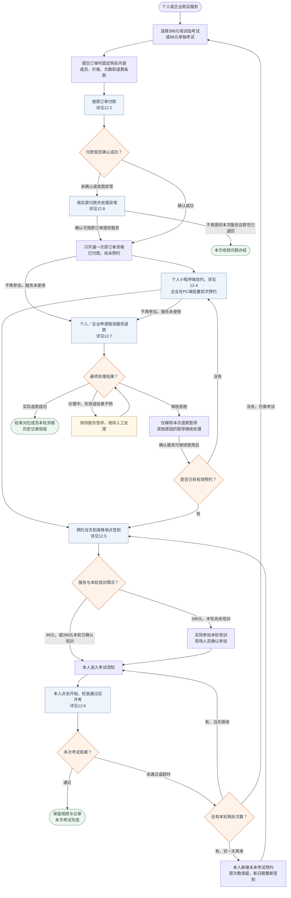

本图的“通过”表示本次考试完成，不额外规定通过后剩余资格如何处理；“重新购买”建立新轮次，不清空旧订单、旧次数或旧成绩。签到后尚未使用服务也可按规则申请退款，详见12.7。

### 12.2 企业与个人购买付款

<a id="flow-purchase"></a>

依据：需求分析第2.2—2.3、3.2—3.3、4.1、4.4—4.6节，UC-AP-01、UC-AP-02；讨论记录D09、D12—D15、D43、D51、D52、D54。以这两份文档的当前有效规则为准。

企业和个人各自从明确入口开始，不设置“购买方是谁”的判断，不共用节点、不连接两张图。这里只画购买到“已付款待预约”；个人预约见12.4，企业批量初次预约按需求分析第4.5节办理。

| 购买链路 | 开始购买的入口 | 已有订单继续付款的入口 |
| --- | --- | --- |
| 企业购买 | **PC端 → 企业账号登录 → 成员报名** | **PC端 → 缴费订单 → 对应订单** |
| 个人购买 | **小程序端 → 首页 → 报名预约**，使用本人手机号验证码登录 | **小程序端 → 我的 → 我的订单／服务 → 本人待付款订单** |

#### 12.2.1 企业购买：PC端

前提：机构已在 **PC端 → 预约管理 → 企业报名** 登记企业名称、联系人和手机号，开通企业账号；企业不自行注册。企业联系人使用该账号办理以下流程。

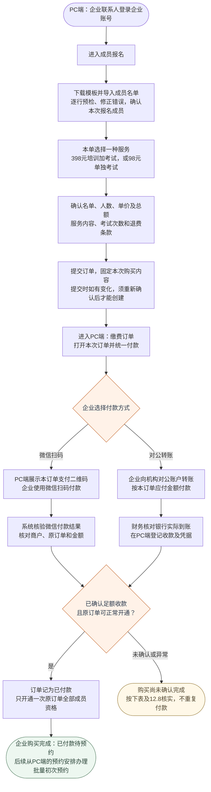

企业需要两种服务时分别下单；同一笔企业订单由企业统一付款，不让员工分别付款。名单存在错误时先修正或重新确认有效成员，不把错误成员带入订单。付款后成员资格不能换人或转让。

```text
待老板确认：首期是否暂不支持对公转账，仅支持微信支付？

建议：
首期企业购买只接入微信扫码支付，对公转账及人工确认到账功能暂不做，
后续有实际需要再补充。
本项为待确认建议，尚未替代现有需求和上图中的对公转账分支。

原因：
对公转账不能在企业转账后直接确认订单已付款。
企业付款后，还需要财务查询机构对公账户，核对是否到账、金额是否正确、
对应哪笔订单，再由有权限的人员在PC端登记并确认收款。
确认前，企业只能等待，不能为成员预约；这会增加付款后的等待时间、
财务逐笔核账和人工审核成本。

建议采用的链路：
PC端生成订单
  → 展示该订单的微信支付二维码
  → 企业扫码付款
  → 系统收到并核验微信付款成功通知
  → 自动标记已付款、开通原订单成员资格
  → 企业可安排预约

正常付款无需等待财务人工核账。
若付款通知延迟，系统查询原微信订单确认结果，
核实前提示“正在核实付款，请勿重复付款”，不承诺所有付款都能瞬时确认。

需要老板确认：
首期企业是否可以统一使用微信扫码付款，暂不提供对公转账？
若同意，再同步删除首期购买流程中的对公转账、人工到账登记与审核分支，
并调整需求分析。
若企业客户必须使用对公转账，则保留该方式，
同时接受人工核账和等待确认的办理流程。
```

#### 12.2.2 个人购买：小程序端

本人使用手机号验证码登录，不选择企业身份，也不使用企业账号。已有企业代付服务的员工无需为该服务再次购买。

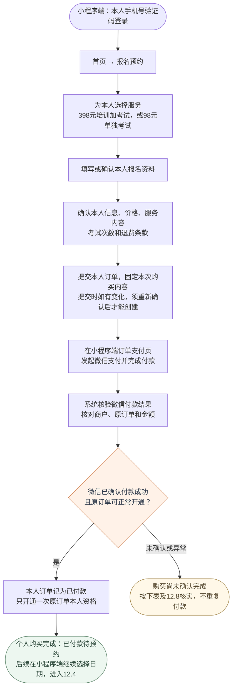

个人购买只开通本人资格；付款成功不等于预约成功，也不保证指定日期有名额。图中不增加个人对公转账或企业名单操作。

#### 购买过程中遇到未付款或异常

以下是两条链路各自适用的处理规则，不在两张图之间连线；详细核实和人工处理见12.8。

| 情况 | 处理与结果 |
| --- | --- |
| 已付款，但本系统尚未确认 | 显示“正在核实付款，请勿重复付款”；核实原交易，不能因为查询失败就当作未付款或另建订单 |
| 确认未付款，原订单未过期 | 从各自的已有订单入口继续付款；不再购买则不产生服务资格 |
| 确认未付款，原订单已过期 | 仍要购买时重新展示并确认当前报价及权益，再创建新订单；保留旧订单，不原地改价；具体过期时长仍未确定 |
| 订单已关闭后发现收款，或金额不符、重复付款 | 先记录真实收款，再按12.8核实；不能直接开通、忽略收款或要求重复付款 |
| 核实后应按原订单提供服务 | 记录收款，只开通一次原订单资格，回到该购买链路的“已付款待预约”结果 |
| 核实后应退回款项 | 按12.8人工退回并登记实际结果；实际退回后该收款问题才算办结，不将办理中写成购买成功 |

微信确认付款成功即可记已付款，不等待微信结算到机构银行卡。企业对公转账须核实银行实际到账；个人或企业的截图都不能代替实际收款核实。两条链路都在提交订单时固定购买内容，到账只激活原订单承诺。

### 12.3 号源建立与日常维护

<a id="flow-schedule"></a>

依据：第4.3节，D26、D44、D45、D48。

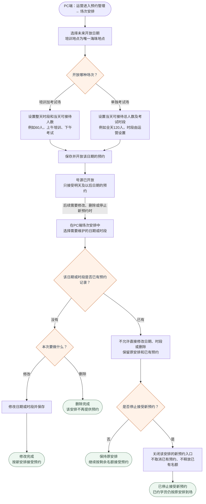

同一日期、同一种场次的各时段共用当天总名额，不给每个时段各配一份全天名额。60人、120人和时段数量只是示例。系统不按时段自动均分名额，不另设营业时间或最晚开考时间；现场人员组织接待与连续重考。每天的总人数上限与每次考试已有的截止时间仍然生效。

号源开放后可正常接受预约；只有运营需要维护时才进入下方修改、删除或停止新预约的分支。停止接受新预约不影响已约学员后续签到、培训和考试。提交预约时的余量检查和人数计算见12.4。

### 12.4 个人小程序端：首次购买成功、预约与改期

<a id="flow-booking"></a>

依据：需求分析第3.3、4.1、4.3—4.4、4.7节，UC-AP-01、UC-AP-03；讨论记录D09、D19、D35—D38、D46、D49、D50。

本图从本人首次购买成功开始，按小程序端的实际办理顺序展示预约、查看和改期。购买付款过程见12.2.2；企业批量初次预约不放入本图，已经参加考试后另约一天的流程见12.6。

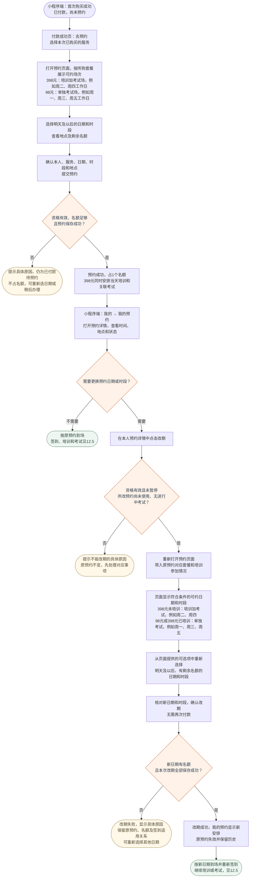

#### 一、页面入口

1. 付款成功后，点击“去预约”。
2. 当时未预约的，从“小程序端 → 我的 → 我的订单／服务 → 本次已购服务”继续预约。
3. 预约成功后，从“我的 → 我的预约”或首页近期安排查看详情。
4. 需要换时间时，在预约详情点击“改期”，重新打开预约页面，不必重新购买。

#### 二、可选日期和时段

1. **398元未培训**：只显示培训加考试场，例如周二、周四工作日。
2. **98元**：只显示单独考试场，例如周一、周三、周五工作日。
3. **398元已培训**：只改未参加的考试，显示单独考试场。
4. 页面按套餐和培训参加情况提供可选项，学员只需选时间。
5. 上述星期是排期示例，实际由运营配置。
6. 只能选择明天及以后、已开放且有剩余名额的日期和时段。

#### 三、首次预约规则

1. 付款成功不等于预约成功，不保证指定日期有名额。
2. 提交预约时，系统再次检查本人资格、日期是否开放及剩余名额。
3. 398元一起安排当天培训和考试，1人只占1个名额。
4. 保存失败不产生预约，也不占名额。
5. 暂不预约时保留已购资格；未使用服务的退款按12.7办理。

#### 四、改期条件

1. 过去日期未到场、未签到的预约，仍可改到未来可约日期。
2. 已签到，但培训和考试都尚未开始的，仍可改期。
3. 398元尚未参加的培训和关联考试，必须一起改期。
4. 398元已参加培训的，只改未参加的考试，保留本轮培训事实。
5. 退款处理中等服务暂停状态，不能改期。
6. 有进行中的考试时，不能通过改期取消或逃避本次考试。

#### 五、改期结果

1. 新安排、原预约变更和名额处理全部成功，才算改期成功。
2. 改期失败，保留原预约、原名额及原签到适用关系，新日期不占位。
3. 改期成功后，未签到且原日期在未来的名额可以释放。
4. 已签到的原日期名额不回补；原签到只保留历史，新日期须重新签到。
5. 改期不额外收费、不自动退款，也不消耗或重置考试次数。

#### 六、与其他操作的区别

1. 已参加过考试、用剩余次数另一天再来，按12.6“预约下次考试”办理，不修改已使用的历史预约。
2. 首期不提供“单独取消预约但保留待约资格”的操作。

### 12.5 到场签到与培训确认

<a id="flow-attendance"></a>

依据：第4.9、4.10节，UC-AP-04，D29、D31、D35—D37、D49、D53、D56。

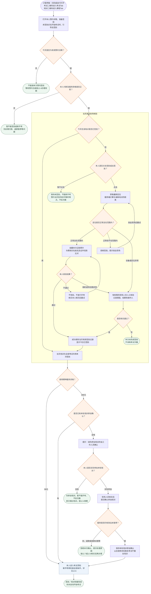

#### 签到与开考规则

1. 考试二维码进入考试Tab，培训二维码进入课程Tab；也可自行打开小程序。二维码只负责跳转页面，不证明到场。
2. 本人在预约详情点击“签到”；未签到时点击“开始考试”，提示“请先完成签到”，提供“去签到”按钮。
3. 打开小程序、扫码、进入Tab或仅定位成功，都不自动记为已签到。
4. 没点就保持未签到；预约当天到场后可以随时再点，不限制预约时段，但仍须满足付款、有效预约和服务资格条件。
5. 定位在范围内、正脸照片比对通过，并由系统成功保存记录后，才显示“今日已签到”。不重复上传身份证。
6. 设备、定位或核验服务异常时，由有权限的现场人员核验本人并记录原因和结果；不是远程签到或跳过培训的入口。
7. 98元学员签到成功后，可进入考试须知；398元还须有工作人员对本轮实际参加培训的确认。
8. 未签到或398元未确认参加培训时，不能新开考，不抽题、不启动倒计时、不扣考试次数。
9. 签到完成后不自动开始考试；本人仍须在考试须知页明确点击“开始考试”，服务端再次检查全部条件。
10. 同一天、同一地点签到一次，培训和当天全部考试共用；换一天参加须有新日期有效预约并重新签到，不能补记过去日期的签到。
11. 进入课程Tab、观看视频、签到成功，都不等于已经参加现场培训；已有进行中的考试按12.6恢复，不重新走新开考流程。
12. 照片比对后删除临时原图，精确经纬度不入库，按需求分析第4.9节保留必要核验结果。

### 12.6 开考、当天重考与跨天续考

<a id="flow-exam"></a>

依据：第4.1、4.10节，UC-AP-04、UC-AP-06，D22—D25、D45、D46、D49、D51、D56。

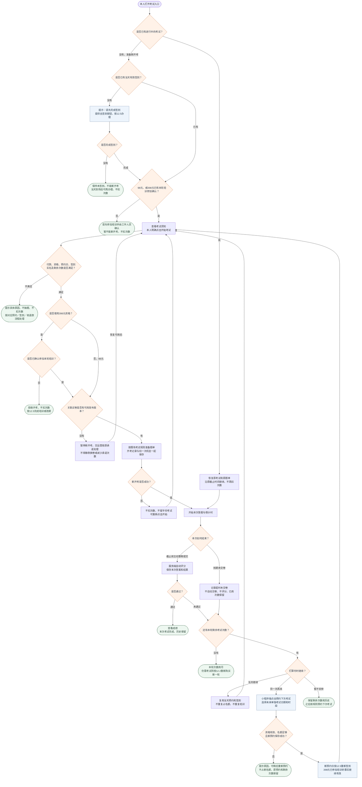

跨天预约下次考试不重复收费、不重置剩余次数；新增预约占目标日期1个名额，原订单、已使用预约及考试历史保留。

进行中考试先按原规则恢复或结束，不能因新开考剩余次数为0而拒绝继续当前考试；也不能用改期、另约或退款删除考试。开考、交卷和超时继续遵守现有考试模块的截止规则；图中不增加营业时间、最晚开考或自动清场限制。试卷不可用时的等价版本安排或退款按第4.1节由运营处理，不自动变更购买内容。

### 12.7 取消服务退款

<a id="flow-refund"></a>

依据：第4.8节，UC-AP-05，D16—D19、D42、D53、D54。本图适用于取消已购服务；多收、重复收取或误转款的退回走12.8，不暂停正常购买的服务。

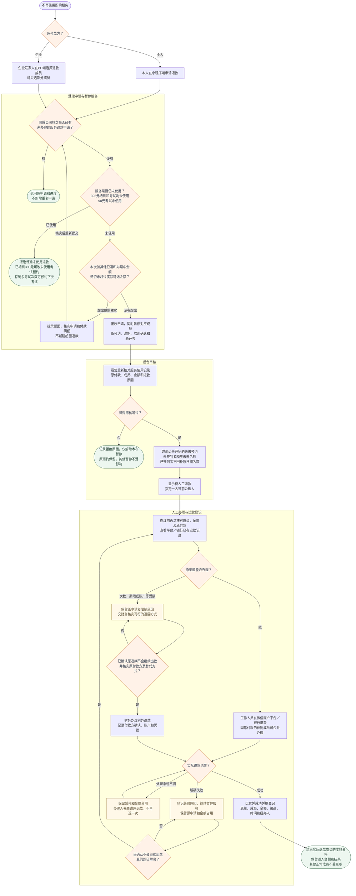

受理、审核、交人办理和录入结果时都要重新检查可退金额，同一申请各阶段只计算一次。退款申请与培训确认／新开考不能同时成功；审核通过不等于已退钱。更换办理人先查原办理记录；结果录错时保留更正记录并复核资格和金额，不能删除原记录重填。人工失败或结果不明不自动恢复服务。

### 12.8 异常收款与多收款退回

<a id="flow-payment-exception"></a>

依据：第4.6.1节，UC-AP-07，D51—D54。每笔异常有处理人、处理经过和下一步动作；只有收款与资格核对一致，或应退的钱实际退回，才标记办结。

异常收款分成以下三张图，分别处理付款核实、登记纠错和实际退钱，避免把不同问题挤在同一张图里。

#### 12.8.1 付款未显示、少付多付和关闭订单后收款

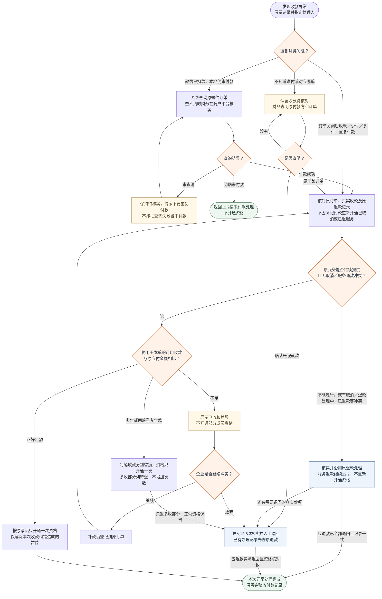

“可用收款”只算仍用于本订单、未退回且未进入退款处理的金额。所有开通或恢复资格的路径都先检查取消和服务退款记录；不能借补记付款解除服务退款的暂停。仅因未付款关闭的订单，确认足额付款且原服务仍可提供时，沿用原购买承诺办理。

#### 12.8.2 银行流水重复登记与收款记错订单

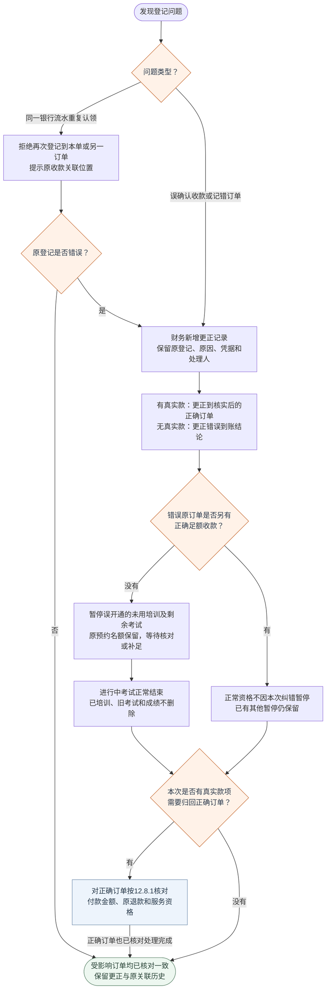

一笔真实银行收款只登记一次、只归属一个订单。没有真实收款时不能凭错误登记退款；错误原订单后续补足时，仍回到12.8.1核对全部条件，只解除收款纠错造成的暂停。纠错办结表示登记和资格已恢复一致，不表示未付款的订单可以继续使用服务。

#### 12.8.3 多收、重复收到或误转款的人工退回

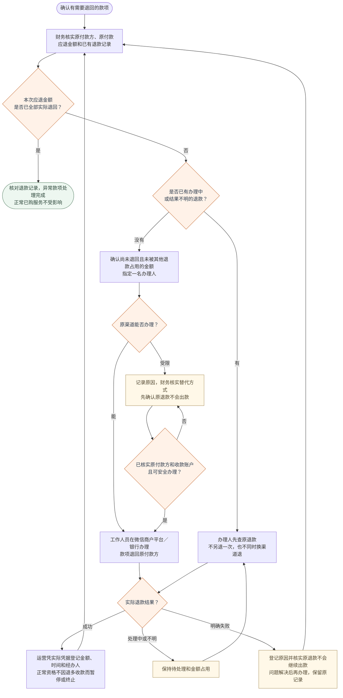

上述退回只纠正收款，不受“已培训不退服务费”限制，也不增加考试次数或转成下一单余额。取消服务、关闭订单不能履行或少付后放弃购买所产生的款项退回，也复用这条人工办理和结果登记链路，但其资格状态仍按原处理原因或12.7执行，不能用本图恢复已取消或已退款资格。款项核对、退款金额保护和凭据要求同样适用，不能另起一笔重复退钱。

本节未替尚未确定的事项作决定：具体付款过期时长、自动关闭安排、多个有效资格的选择顺序、跨次重题及退款法律例外，仍按讨论记录继续确认；不在图中填入假定天数、自动退款或自动换人规则。
