# 06 · 关键流程 —— 制度学习及考试系统（EmodorRuleExam）

> **一句话定位**：本文档以 Mermaid 时序图（sequenceDiagram）、流程图（flowchart）与状态机（stateDiagram-v2）呈现 EmodorRuleExam 的端到端关键流程——制度上传到发布、有效学习判定、考试与自动评分、核心实体状态流转与统计数据流转，是开发人员理解系统动态行为、评审者核对流程正确性与防作弊口径一致性的动态视角基准。
>
> **口径声明**：本文档中全部术语、表名、字段名、枚举值、模块名与 [README.md](README.md) 第 3 章「设计约定速览」**逐字一致**；流程场景对应 [01-需求分析.md](01-需求分析.md) 用例 UC-01 ~ UC-10 与功能 / 非功能需求编号（FR-XX-NN / NFR-NN）及业务约束（C-NN）；数据落点依据 [03-数据库设计.md](03-数据库设计.md)；模块内部设计决策（失焦暂停 pause / resume 锚点重置、心跳 Redis HINCRBY 累计、单活跃会话约束、AI 长文本分块 4000 字符、超时自动交卷 Redis 到期时间 + 30 秒定时扫描、确定性 seed 乱序等）与 [05-模块设计.md](05-模块设计.md) 逐条一致；防作弊细化口径（滚动位图只计停留 ≥ 10 秒的段、切屏两级阈值）遵循 [07-安全与非功能设计.md](07-安全与非功能设计.md) 定稿；架构基座（AD-03 异步任务、AD-04 Redis 临时态 / MySQL 唯一权威源）遵循 [02-系统架构.md](02-系统架构.md)。接口契约明细见 [04-API设计.md](04-API设计.md)。

> **状态边界（2026-10-21）**：本册现有制度上传/阅读/旧固定卷/自动评分/原统计时序是 legacy 基线；[已批准培训融合设计](../superpowers/specs/2026-10-21-training-admin-integration-design.md)的课程视频、发布/个人快照、持久草稿、图片阅卷、监控和培训统计流程是 A1—C7 计划。未有相应 migration/entity/controller 与运行证据前，图中的“计划”节点不能当作已实现。

---

## 1. 流程总览

### 1.1 端到端业务全景图

管理员侧「上传 → 解析 → 配置 → AI 出题 → 审核 → 组卷 → 发布」与员工侧「学习 → 有效学习判定 → 考试 → 评分 → 统计」两条脉络及其交汇点如下：

```mermaid
flowchart LR
    subgraph LANE_A["管理员侧脉络（regulation_admin；super_admin 拥有其全部能力）"]
        direction TB
        A1["① 上传制度文件<br/>PDF / Word（multipart）<br/>file_hash 查重<br/>regulation_version 创建：parse_status = pending"]
        A2["② 异步解析<br/>pdf-parse / mammoth<br/>parse_status：pending → parsed / failed"]
        A3["③ 配置学习要求与发布范围<br/>required_minutes · scroll_segments（10 段）<br/>regulation_scope / is_all"]
        A4["④ AI 出题<br/>OpenAI 兼容协议 · 异步任务<br/>长文本分块（4000 字符）<br/>question：source = ai · status = pending"]
        A5["⑤ 逐题审核<br/>approved / rejected<br/>（可编辑 / 重新生成）"]
        A6["⑥ 组卷<br/>exam_paper + paper_question<br/>20 单选 × 3 分 + 5 多选 × 8 分 = 100 分<br/>pass_score 默认 60 · max_attempts 默认 3<br/>partial_credit_ratio 默认 0.50"]
        A7["⑦ 发布<br/>regulation.status：draft → published<br/>exam_paper.status：draft → published"]
        A1 --> A2 --> A3 --> A4 --> A5 --> A6 --> A7
    end

    subgraph LANE_E["员工侧脉络（employee，限发布范围内的本人）"]
        direction TB
        E1["⑧ 在线学习<br/>learning_session · 30 秒心跳（45 秒封顶）<br/>失焦暂停 · 10 段滚动位图"]
        E2["⑨ 有效学习判定<br/>total_seconds ≥ required_minutes × 60<br/>且底部段覆盖 → is_valid = 1"]
        E3["⑩ 考试<br/>资格校验 · 确定性 seed 乱序<br/>Redis 计时 · 切屏检测（不强制交卷）"]
        E4["⑪ 自动评分<br/>单选唯一 · 多选三档<br/>passed / failed / timeout · 取最高分"]
        E1 --> E2 --> E3 --> E4
    end

    S["⑫ 统计跟进（regulation_admin）<br/>应学人数 · 学习完成率 · 参考人数 · 通过率<br/>平均分 · 分数分布 · 未完成清单 · Excel 导出"]

    A7 -.->|"制度对范围内员工可见、可学习"| E1
    A7 -.->|"试卷发布后可考"| E3
    E2 -.->|"考试资格（is_valid，只升不降）"| E3
    E2 -.->|"学习行为数据（只读聚合）"| S
    E4 -->|"考试事实数据（只读聚合）"| S
```

#### 1.1.1 培训融合目标链路（计划）

旧制度链路继续按上图执行；新培训考试在同一单体内走以下独立语义，避免把课程完成、来源标识和权限角色混在旧字段中：

```text
类别/学员来源（institution 或 external）
        ↓
课程/章节/视频学习（与制度阅读分开；视频 30s 心跳、45s 封顶、2s 位置容差、95% 覆盖）
        ↓
题库版本（题型 + easy/medium/hard + 可选考点/制度版本来源；中级可用于固定/题库组卷，随机混抽留后续）
        ↓
固定/随机发布快照（本机构→初级，外来→高级；同考点同卷最多一道）
        ↓
首次开考冻结来源/类别/难度/规则与个人题单（默认不检查学习门槛）
        ↓
确认草稿持久化 → 主动/超时幂等交卷（服务端 deadline）
        ↓
客观题自动判分；有图片答案 → pending_manual（不出最终总分）
        ↓
授权阅卷人逐题 0..满分评分（审计 + 乐观版本）→ 服务端汇总 → finalized 只读
        ↓
按场次/难度/最终个人最高分统计、排名与当前应考集合交集
```

目标默认值：100 分、60 分及格、30 分钟、总作答 3 次（含首次）、多选漏选 0.5；图片题单题最多 9 张；监控 5 秒轮询，90 秒无心跳仅“连接待确认”。这些是计划契约，具体表/API 由 A1—C6 逐任务落地。

**步骤说明**：

| 阶段 | 节点 | 关键动作与数据落点 | 对应需求 |
|---|---|---|---|
| ① 上传 | A1 | 上传 PDF / Word（multipart）→ 校验链（类型 / 魔数 / 大小 / SHA-256）→ `file_hash` 查重（提示不阻断）→ `regulation_version` 创建（`parse_status = pending`） | FR-REG-02 |
| ② 解析 | A2 | 异步解析（pdf-parse 提取 PDF 文本 / mammoth 将 Word 转 HTML）→ `content_html` / `text_content` → `parse_status = parsed / failed` | FR-REG-03 |
| ③ 配置 | A3 | `required_minutes`、`scroll_segments`；发布范围 `regulation_scope`（按部门圈定）或 `is_all`（全员） | FR-REG-05 / FR-REG-06、UC-02 |
| ④ AI 出题 | A4 | 选择制度+类别+难度；文本优先、扫描 PDF 视觉兜底；事务创建 question 身份 + pending revision，模型不能改类别/难度/真实来源版本 | FR-AIQ-02、UC-03 |
| ⑤ 审核 | A5 | 审核当前 revision 并记录实际操作者/时间；编辑或重生成新增 pending revision，旧 revision 不覆盖；仅当前 approved 可进入新候选池 | FR-AIQ-03 ~ 05、UC-03 |
| ⑥ 组卷 | A6 | `exam_paper` + `paper_question` 组卷，100 分制（默认 20 单选 × 3 分 + 5 多选 × 8 分），策略可配置 | FR-AIQ-07 |
| ⑦ 发布 | A7 | 试卷发布（总分校验 SUM = 100）与制度发布（前置校验：`parsed` 版本 + 发布范围） | FR-AIQ-07 / FR-REG-07、UC-01 |
| ⑧ 学习 | E1 | 会话（`learning_session`）+ 30 秒心跳（单次最大计入 45 秒）+ 失焦暂停 + 10 段滚动位图 | FR-LRN-01 ~ 04、UC-04 |
| ⑨ 判定 | E2 | 双条件判定（时长阈值 + 底部段覆盖）→ `learning_record.is_valid = 1`（幂等置位、不可逆） | FR-LRN-05、UC-04 |
| ⑩ 考试 | E3 | 资格校验（`is_valid` + `attempt_no ≤ max_attempts` + 并发锁）→ 确定性 seed 乱序下发 → Redis 计时 → 切屏检测 | FR-EXM-01 ~ 04、UC-05 / UC-06 |
| ⑪ 评分 | E4 | 幂等交卷 / 超时自动交卷（`timeout`）→ 自动评分（单选唯一；多选全对满分 / 错选 0 / 漏选 `partial_credit_ratio`）→ `passed / failed`，补考取最高分 | FR-EXM-05 ~ 07、UC-06 / UC-07 |
| ⑫ 统计 | S | 行为数据只读聚合 → 三维统计（应学人数 / 完成率 / 通过率 / 平均分 / 分数分布）→ 未完成清单与 Excel 导出 | FR-STT-01 ~ 05、UC-08 / UC-10 |

**关键规则**：

| # | 规则 | 出处 |
|---|---|---|
| 1 | 制度发布前置：存在 `parse_status = parsed` 的版本且已配置发布范围；试卷发布前置：题目分值合计 = 100 分 | C-04、FR-REG-07 / FR-AIQ-07 |
| 2 | 有效学习双条件缺一不可：累计有效时长 ≥ `required_minutes` × 60 且滚动覆盖位图覆盖到底部段 | C-02、FR-LRN-05 |
| 3 | 学习时长以服务端累计为准（单次心跳最大计入 45 秒）；`is_valid` 一旦置 1 永不回退 | C-01、03 册 3.3.2 |
| 4 | AI revision 必须审核后才可进入候选；人工录入首 revision 由录入管理员确认。候选按类别/题型/难度精确读取当前 approved version | C-03 |
| 5 | legacy 客观题最终总分不可直接修改；计划中的图片题仅在最终结算前受控逐题评分，审计/乐观版本校验后由服务端汇总，最终结算后只读；新培训按场次/难度取已完成批改个人最高分 | C-05 / C-06 |
| 6 | 归档即止：制度 / 试卷 `archived` 后员工端不可见、不可再学习或发起新作答，历史数据保留并计入统计 | C-08 |

### 1.2 两条脉络的交汇点

| 交汇点 | 供给方 | 消费方 | 语义 |
|---|---|---|---|
| 交汇一：制度发布 | 管理员侧 ⑦ | 员工侧 ⑧ | `regulation.status = published` 后对发布范围内员工可见、可学习；`draft / archived` 对员工端不可见 |
| 交汇二：试卷发布 | 管理员侧 ⑦ | 员工侧 ⑩ | `exam_paper.status = published` 后可发起考试；`archived` 试卷不可再发起新作答 |
| 交汇三：考试资格 | 员工侧 ⑨ | 员工侧 ⑩ | **legacy 制度固定卷**以 `learning_record.is_valid = 1` 为发起前置；新培训考试默认不启用该学习门槛，改由发布/类别/来源/次数/身份/期限校验与首次题单快照约束 |
| 交汇四：统计闭环 | 员工侧 ⑧⑨⑪ 的行为数据 | 管理员侧运营 | `learning_session` / `learning_record` / `exam_record` / `exam_answer` 只读聚合 → 报表与 Excel 导出 → 未完成人员督办跟进 |

### 1.3 组织基座准备流程（UC-09）

组织数据（部门树 `sys_department`、员工账号 `sys_user`）是发布范围圈定与应学人数统计的前置基座。super_admin 通过 Excel 批量导入员工（两阶段：预校验 + 批量写 + 冲突降级）：

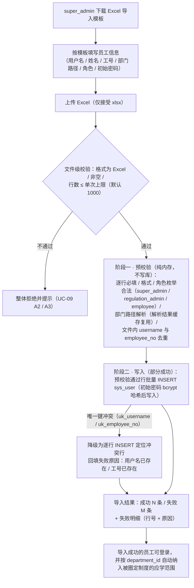

**步骤说明**：① 下载模板并按中文表头填写；② 上传后先做文件级校验（非 Excel / 空 / 超上限整体拒绝）；③ 阶段一在内存中拦截全部可预知错误（必填、格式、角色枚举、部门路径、文件内重复）；④ 阶段二批量写入，仅剩「库内唯一键冲突」由唯一索引兜底、逐行降级定位；⑤ 返回成功 / 失败计数与行级明细。

**关键规则**：非法行整行失败且不影响其他行（部分成功语义，FR-ORG-04 验收②）；导入成功的员工按其 `department_id` 自动纳入被圈定制度的应学范围（UC-09 后置条件）；批量导入属管理端敏感操作，写审计日志（NFR-10）。

### 1.4 用例覆盖对照

| 用例 | 名称 | 本文档落点 |
|---|---|---|
| UC-01 | 上传并发布制度 | §2.1（阶段一 / 二 / 三 / 七）、§5.1 |
| UC-02 | 配置学习要求 | §2.1（阶段三）、§5.5（阈值调整不回退） |
| UC-03 | 发起 AI 出题并逐题审核 | §2.1（阶段四 / 五）、§2.4、§5.3 |
| UC-04 | 员工有效学习 | §3.1、§3.2、§3.3 |
| UC-05 | 获得考试资格 | §3.4（资格衔接）、§4.1（资格校验链） |
| UC-06 | 参加考试并自动评分 | §4.1、§4.2、§4.3、§5.4 |
| UC-07 | 补考 | §4.1（补考循环）、§5.4 |
| UC-08 | 查看单项制度统计 | §6.1、§6.2 |
| UC-09 | Excel 批量导入员工 | §1.3 |
| UC-10 | 导出未完成人员清单 | §6.1、§6.3 |

---

## 2. 制度上传到发布全流程（UC-01 / UC-02 / UC-03）

### 2.1 端到端时序图

覆盖「上传 multipart → file_hash 查重 → regulation_version 创建 pending → 异步解析 → parsed / failed → 配置学习要求与范围 → 发起 AI 出题 → 长文本分块调用大模型 → 题目入库 pending → 逐题审核 approved → 组卷总分校验 → 试卷发布 → 制度发布」的完整时序：

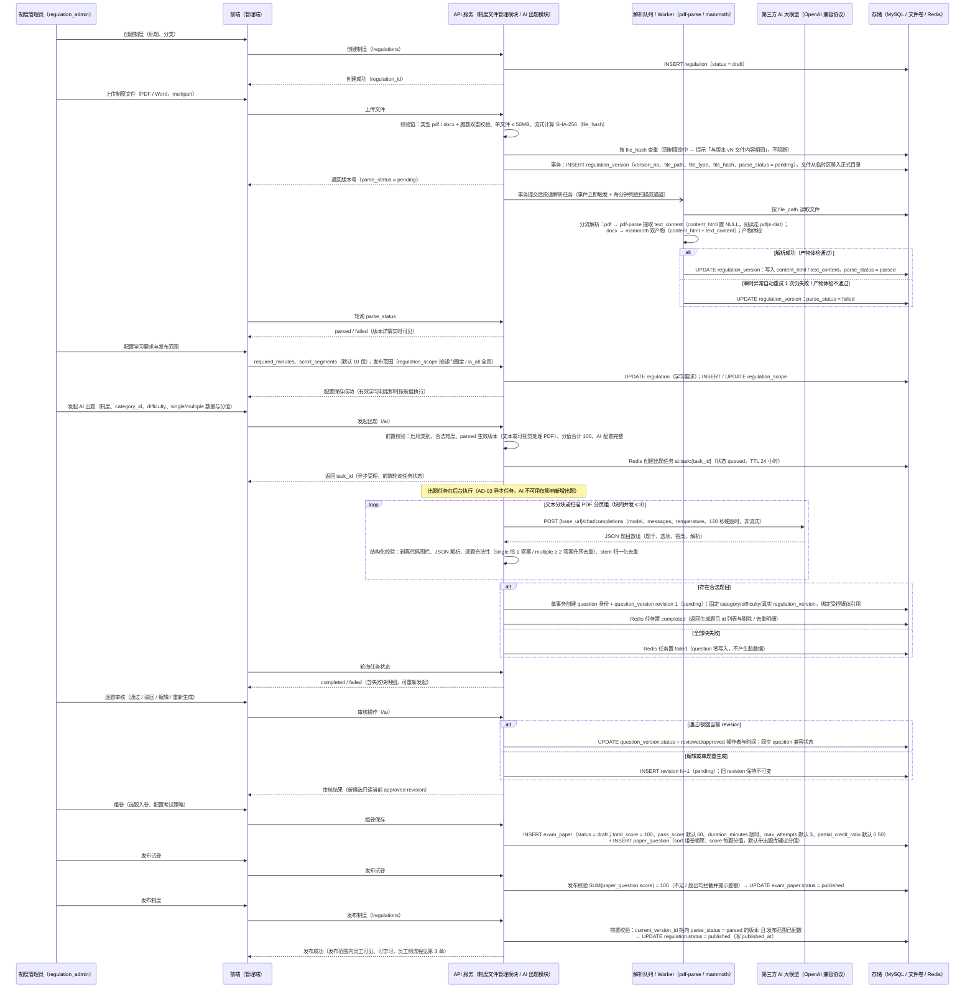

### 2.2 步骤说明

| 阶段 | 步骤 | 说明 | 对应场景 |
|---|---|---|---|
| 一 制度创建与文件上传 | 消息 1 ~ 10 | 创建 `regulation`（`status = draft`）→ 上传 multipart 文件 → 校验链（类型 + 魔数、≤ 50MB、SHA-256 `file_hash`）→ 查重提示不阻断 → 事务创建 `regulation_version`（`parse_status = pending`，`version_no` = 同制度 max + 1，`uk_regulation_version_no` 兜底并发）→ 事务提交后投递解析任务 | UC-01 主流程 1 ~ 2、A1 |
| 二 异步解析 | 消息 11 ~ 16 | worker 进程隔离执行（并发上限 2）：pdf 走 pdf-parse（`content_html` 置 NULL，PDF 阅读由 pdfjs-dist 前端渲染原始文件）；docx 走 mammoth（`convertToHtml` → `content_html`、`extractRawText` → `text_content`）；产物体检后置 `parsed / failed` | UC-01 主流程 3、A2；FR-REG-03 |
| 三 配置学习要求与发布范围 | 消息 17 ~ 19 | `required_minutes`（非法值 `≤ 0` 拦截）、`scroll_segments`（默认 10 段）；范围按部门圈定（`regulation_scope`，含子部门展开）或 `is_all` 全员（互斥表达） | UC-01 主流程 4 ~ 5、UC-02 |
| 四 AI 出题 | 消息 20 ~ 29 | 校验启用类别/难度/真实生效版本/100 分/AI 配置 → Redis 异步任务 → 文本分块或 PDF 视觉页组 → 结构校验 → 单事务创建题目身份和 pending revision；类别/难度不取模型输出 | UC-03 主流程 1 ~ 3、B3 |
| 五 题目审核 | 消息 30 ~ 32 | 审核当前 revision 并写实际操作者/时间；四题型编辑或 single/multiple 重生成创建 pending revision N+1，旧版本不覆盖；旧题首次动作先诚实捕获 | UC-03 主流程 4 ~ 6；FR-AIQ-03 ~ 06 |
| 六 组卷与试卷发布 | 消息 33 ~ 37 | 组卷（`exam_paper` + `paper_question`，选题校验：`question.status = approved` 且 `regulation_id` 与试卷一致）→ 发布校验总分 = 100 → `exam_paper.status = published` | FR-AIQ-07、C-04 |
| 七 制度发布 | 消息 38 ~ 40 | 前置校验（生效版本 `parsed` + 范围已配置）→ `regulation.status = published`（写 `published_at`）→ 范围内员工可见、可学习 | UC-01 主流程 6 ~ 7、A3；FR-REG-07 |

### 2.3 关键规则

| # | 规则 | 出处 |
|---|---|---|
| 1 | 上传校验链固定顺序：角色与制度 → 大小（≤ 50MB）→ 格式（扩展名 + 魔数双重校验）→ 完整性（SHA-256 `file_hash`）→ 重复检测（提示但不阻断） | 05 册 3.4.1 |
| 2 | 版本 append-only 不可变：`file_path` / `file_type` / `file_hash` 与解析产物一经创建只读；`parse_status` 是版本记录上唯一允许流转的状态字段 | 03 册 3.2.2 |
| 3 | 解析异步（AD-03）：上传接口事务提交后立即返回；任务触发双通道（事件立即触发 + 每分钟兜底扫描 `pending` 超时记录）；解析在 worker 线程 / 子进程执行、与请求事件循环隔离 | 05 册 3.4.3 |
| 4 | 产物体检：文本不足时，启用多模态的 PDF 保持 parsed 并在 AI 出题时逐页视觉理解；其他文件/未启用视觉仍 failed。产物只在首次成功时写入 | 05 册 3.4.3、B3 |
| 5 | 分值模板：默认 20 道 single × 3 分 + 5 道 multiple × 8 分 = 100 分；模板参数可调，应用层校验 `singleCount × singleScore + multipleCount × multipleScore = 100` | 05 册 4.4.5 |
| 6 | 长文本分块：超过 4000 字符启用；优先按段落 / 标题边界切块；相邻块 200 字符重叠；按各块字符数占比分配题量；块间并发 ≤ 3；块级失败块级重试（≤ 2 次），不拖累其他块 | 05 册 4.4.2 |
| 7 | AI 网关：单次调用 120 秒硬超时（NFR-05）；网络错误 / 5xx / 429 重试 ≤ 2 次（指数退避）；4xx 立即报错不消耗重试；非流式调用（结果整体校验后才落库） | 05 册 4.4.1 |
| 8 | 不产生脏数据：任何生成结果先经结构化校验，合法题目才进入落库事务；任务失败（全部块失败）时 `question` 表零写入 | FR-AIQ-02 验收③ |
| 9 | B3 审核事实同时写 question_version 的 approved/reviewed 操作者与时间及审计日志；旧记录未知值保持 null，legacy_captured_at 只表示升级时捕获 | 05 册 4.4.6 |
| 10 | 试卷发布后锁定 `paper_question`（题目组成与分值）；`pass_score` / `partial_credit_ratio` / `duration_minutes` / `max_attempts` 发布后仍可调，按各自生效边界对后续作答生效 | 05 册 4.4.7 |
| 11 | 制度发布与出题相互独立、仅共享前置（存在 `parsed` 版本）：制度也可先发布（员工先学习）、后组卷发布试卷；本文时序仅呈现一种典型编排 | UC-01 / UC-03 前置条件 |

### 2.4 异常分支

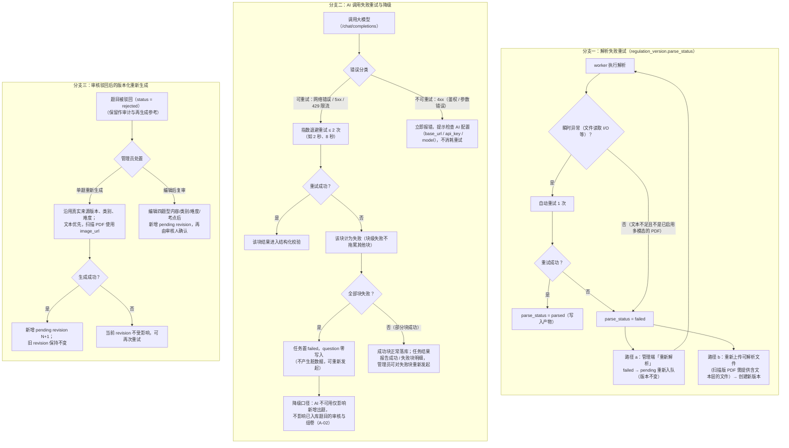

**分支说明**：

| 分支 | 触发 | 处置 | 关键约束 |
|---|---|---|---|
| 一 解析失败 | 瞬时异常重试 1 次仍失败；产物体检不通过（空产物 / 低于 50 字符） | `parse_status = failed`，版本详情提示；可「重新解析」重新入队（`failed → pending`）或重新上传新版本 | 解析失败版本不能被设为生效版本，制度发布被拦截（UC-01 A2）；发布前置校验兜底 |
| 二 AI 调用失败 | 服务不可用 / 超时 / 返回格式异常 | 可重试错误指数退避 ≤ 2 次；块级失败不拖累其他块；全部块失败任务置 failed 零写入 | 文本不足的 PDF 走视觉输入，不把“无文本层”直接等同不可出题；真实提供商未配置时只以 Mock 闭环验收 |
| 三 驳回重生成 | 管理员对表述或答案不满意 | 成功新增 pending revision；失败保持当前 revision；类别/难度/来源版本固定 | 重新生成复用 AI 网关与 PdfVisionService；仅当前 approved version 进入新候选 |

---

## 3. 有效学习判定流程（UC-04 / UC-05）

### 3.1 学习会话与心跳时序图

覆盖「会话开始（单活跃约束）→ 心跳 30 秒 → 服务端时间差计算 45 秒封顶 → 失焦 pause / resume 锚点 → 会话结束落库 → learning_record 聚合 → 双条件判定 → is_valid = true 幂等置位」：

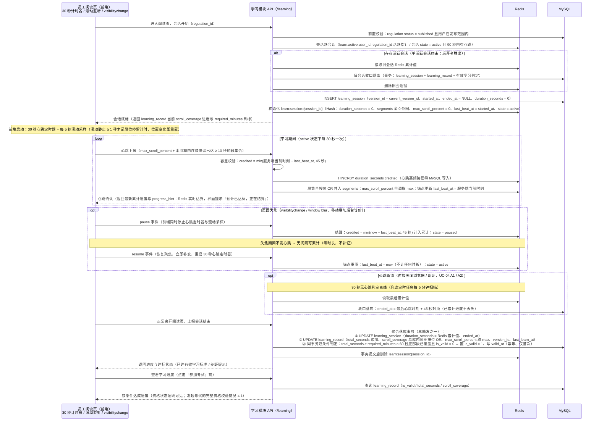

**步骤说明**：

| 阶段 | 步骤 | 说明 | 对应场景 |
|---|---|---|---|
| 一 会话开始 | 消息 1 ~ 9 | 前置校验（`published` + 范围内）→ 单活跃会话约束检查（存在活跃会话则先收口旧会话，后开者胜出，阻断双标签页并行刷时长）→ INSERT `learning_session` → Redis 初始化 `learn:session:{session_id}`（`duration_seconds` / `segments` / `max_scroll_percent` / `last_beat_at` / `state`） | FR-LRN-01、UC-04 主流程 1 |
| 二 心跳循环 | 消息 10 ~ 15 | 每 30 秒心跳（携带最大滚动百分比与本周期停留 ≥ 10 秒的段集合）→ 服务端时间差计算 → 45 秒封顶 → Redis `HINCRBY` 累计（不写 MySQL）→ 位图按位 OR 合并 → 锚点更新 | FR-LRN-02 / FR-LRN-04、UC-04 主流程 2 ~ 4 |
| 三 失焦暂停 | 消息 16 ~ 20 | `pause` 事件：结算一个 ≤ 45 秒窗口后 `state = paused`，前端停发心跳；`resume` 事件：锚点重置 `last_beat_at = now`、计 0 秒，恢复 30 秒节奏 | FR-LRN-03、UC-04 主流程 5 |
| 四 异常收口 | 消息 21 ~ 24 | 90 秒无心跳判离线；`ended_at` 取最后心跳 + 45 秒封顶；已累计进度不丢失 | UC-04 A1 / A2 |
| 五 聚合落库与判定 | 消息 25 ~ 28 | 落库三触发（正常退出 / 90 秒离线收口 / 每 5 分钟兜底扫描）任一触发 → 单事务完成会话收口 + `learning_record` 聚合 + 双条件判定 → `is_valid = 1`（幂等置位）→ 删除 Redis 会话键 | FR-LRN-05、UC-04 主流程 6 ~ 7 |
| 六 进度与资格可见 | 消息 29 ~ 31 | 学习页实时展示双条件达成进度；资格状态对员工透明可见 | UC-05 主流程 1、后置条件 |

**关键规则**：

| # | 规则 | 出处 |
|---|---|---|
| 1 | 时长唯一来源是服务端相邻两次心跳到达时刻的间隔（服务端时钟、毫秒精度），客户端上报的时间戳不参与任何判定 | C-01、07 册 3.1.1 |
| 2 | 单次心跳最大计入 45 秒：`credited = min(diff, 45)`；高频上报不虚增（每次计入 ≈ 真实间隔）；低频上报（如 60 秒 / 次）每轮反而亏 15 秒 | FR-LRN-02、07 册 3.1.2 |
| 3 | 心跳先在 Redis 累计（`HINCRBY` 单命令原子累计），会话结束 / 定期才落库：数据库写频率从逐心跳降至每会话一次（AD-04：Redis 只存可再生临时态，MySQL 是唯一权威源） | 03 册 6.3 |
| 4 | 失焦暂停锚点模型：`pause` 结算封顶后置 `paused`（此后普通心跳只更新滚动位置、不计费）；`resume` 只重置锚点、不产生时长；不发 `pause` 直接失焦时由「断流首拍封顶 45 秒」兜底 | 05 册 5.4.3 |
| 5 | 单活跃会话约束：同一用户同一制度至多一个会话在累计（`learn:active:{user_id}:{regulation_id}` 活跃指针）；旧会话立即收口落库、新会话接管（后开者胜出）；同一用户同时学两个不同制度是允许的 | 05 册 5.4.1、07 册 3.1.4 |
| 6 | 滚动位图只计停留 ≥ 10 秒的段：前端每 5 秒采样、滚动静止 ≥ 1 秒记段位停留计时；30 秒心跳携带「本周期内连续停留已达 ≥ 10 秒的段集合」；途经不算读过（快速拖到底部，途经段不置位，底部段真实停留 ≥ 10 秒才置位） | 07 册 3.1.3 定稿 |
| 7 | 位图只增不减：回滚不取消已置位段落；`max_scroll_percent` 单调不减；跨会话按位 OR 合并、合并幂等 | FR-LRN-04 验收②③、03 册 3.3.2 |
| 8 | 落库幂等：以 `ended_at IS NULL` 作为「未收口」判据，已收口会话重复触发落库直接跳过；Redis 不可用时兜底任务可从库侧扫描恢复（NFR-11 / NFR-12） | 05 册 5.4.6 |
| 9 | 双条件判定在每次聚合落库事务内执行；达标当次落库即置位，`is_valid` 一旦置 1 永不回退，`valid_at` 只写一次；心跳响应只返回 `progress_hint`（Redis 实时估算），`is_valid` / `valid_at` 仅由聚合落库事务产生 | FR-LRN-05 验收③ |

### 3.2 单次心跳的服务端处理决策

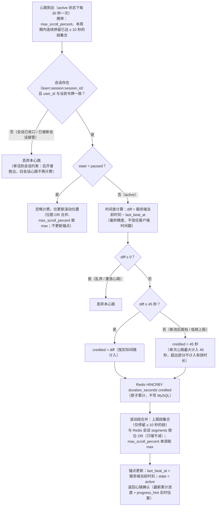

**步骤说明**：① 归属校验（会话存在且令牌一致，否则丢弃）；② `paused` 态心跳只更新滚动位置不计费；③ 时间差 `diff = 服务端当前时刻 − last_beat_at`；④ `diff ≤ 0` 判乱序 / 重放丢弃；⑤ 容差封顶 `credited = min(diff, 45 秒)`；⑥ Redis `HINCRBY` 原子累计；⑦ 段集合按位 OR 合并、`max_scroll_percent` 取 max；⑧ 锚点更新并返回确认。失焦恢复的锚点重置由独立 `resume` 端点完成（见 3.1 失焦暂停），心跳请求体不携带任何恢复标记。

**关键规则**：

| 作弊手段 / 异常场景 | 服务端防线与结果 |
|---|---|
| 高频上报（篡改前端每秒 1 次） | 每次计入 `diff ≈ 1 秒`，累计 = 真实经过时间，`total_seconds` 不虚增（FR-LRN-02 验收②） |
| 篡改客户端时间 / 时间戳 | 时长完全由服务端时钟差计算，客户端时间不参与判定（C-01） |
| 改心跳间隔为 60 秒 | 每次封顶计入 45 秒，每轮亏 15 秒——作弊者自我损耗 |
| 双标签页并行 | 单活跃会话约束：旧会话收口、仅新会话计费 |
| 不发 pause 直接失焦 / 断网 | 恢复后首拍 `diff > 45 秒` → 只计 45 秒（兜底封顶，UC-04 A1） |
| 伪造高频 resume | resume 只重置锚点、不产生时长，无任何收益 |
| 快速拖到底部刷覆盖 | 途经段未静止停留 ≥ 10 秒不置位（07 册 3.1.3） |

### 3.3 滚动覆盖位图更新示意

`learning_record.scroll_coverage`（结构：`total_segments` / `covered_count` / `segments`，长度恒为 10）跨会话按位 OR 合并与底部段判定：

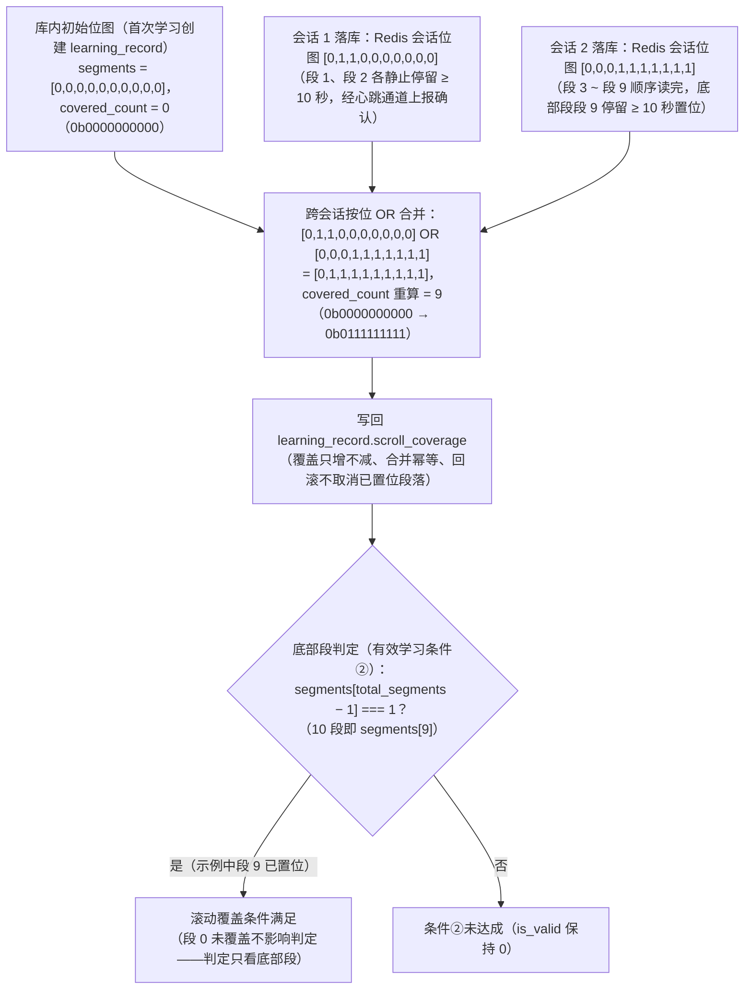

**位图示例**：

| 时点 | segments（下标 0 ~ 9） | 二进制表示 | covered_count | 说明 |
|---|---|---|---|---|
| 首次学习创建 | [0,0,0,0,0,0,0,0,0,0] | 0b0000000000 | 0 | 全 0 初始化（长度 = `regulation.scroll_segments`） |
| 会话 1 落库后 | [0,1,1,0,0,0,0,0,0,0] | 0b0110000000 | 2 | 段 1、段 2 停留 ≥ 10 秒置位 |
| 会话 2 落库后（按位 OR） | [0,1,1,1,1,1,1,1,1,1] | 0b0111111111 | 9 | 底部段（段 9）已置位 → 条件②满足 |

**关键规则**：① 段位置计算：前端按阅读容器滚动高度把视口底缘映射为 0 ~ 100% 再除段取整；② 置位证据链：段的置位当且仅当「静止停留 ≥ 10 秒 + 经心跳通道上报确认」双条件（途经不算读过）；③ 跨会话合并发生在聚合落库时（Redis 最新位图与库内位图按位 OR 后写回，`covered_count` 重算）；④ `max_scroll_percent`（0 ~ 100）与位图并存——前者是展示进度（进度条），后者是判定依据（底部段），二者不可互相替代。

### 3.4 legacy 制度考试资格的衔接（UC-05）

有效学习判定的产物 `learning_record.is_valid` 即旧制度的**考试资格事实**：员工在学习页可实时看到双条件达成进度（累计有效时长 / 目标时长、底部段覆盖状态）；点击「参加考试」时由考试评分模块的 legacy 资格校验链强制校验（见 4.1）：`is_valid = 1` → 允许开考；`is_valid = 0` → 拒绝并返回差距信息（剩余有效时长缺口 = `required_minutes × 60 − total_seconds`、底部段未覆盖）；暂无已发布试卷 → 提示「暂未开考」（UC-05 A1 / A2）。资格不冗余存储快照到旧考试域，考试记录创建时实时校验（资格只升不降）。

新培训考试默认不要求制度阅读或视频课程完成，首次开考读取管理员维护的类别/来源并冻结来源、难度、规则与个人题单；补考沿用该快照。两条路径不能通过把“来源”写入权限角色或用一个 `is_valid` 布尔值混合表达。

---

## 4. legacy 固定卷考试全流程（UC-06 / UC-07）

本节 sequenceDiagram 是当前旧固定卷兼容路径：资格校验包含 `is_valid`、题目从现有 `paper_question` 读取、交卷后客观题自动评分。新培训考试沿 1.1.1 的目标链路由 C1—C4 增量实现，默认关闭学习门槛，必须从冻结个人题单读取，图片题待批改时不产生最终成绩。

### 4.1 考试时序图

覆盖「可考列表 → 资格校验 → 乱序组卷下发（seed）→ 答题心跳与切屏上报 → 交卷 → 幂等校验 → 自动评分 → 结果返回；补考循环与超时自动交卷分支」：

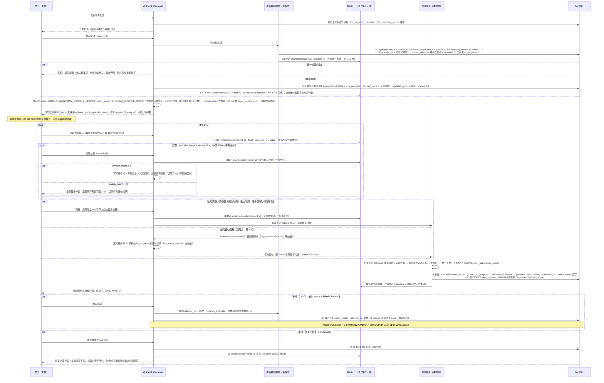

**步骤说明**：

| 阶段 | 步骤 | 说明 | 对应场景 |
|---|---|---|---|
| 一 可考列表 | 消息 1 ~ 3 | 按发布范围与 `published` 状态过滤制度 / 试卷，附带学习进度与资格状态 | UC-05 主流程 1 |
| 二 资格校验与开考 | 消息 4 ~ 11 | 五步校验链任一失败即拒绝；通过后开考事务创建 `exam_record`（`in_progress`、`attempt_no`、`regulation_id` 冗余快照）并写 Redis 截止键 | UC-05 主流程 2 ~ 5、UC-06 主流程 1；FR-EXM-01 |
| 三 乱序下发 | 消息 12 ~ 13 | 确定性 seed 派生（`HMAC-SHA256(EXAM_SHUFFLE_SECRET, exam_record.id)`，EXAM_SHUFFLE_SECRET 为独立环境变量、不参与 JWT_SECRET 90 天轮换）→ 题目序与选项序 Fisher-Yates 洗牌 → 下发乱序试卷（不含 `answer` / `analysis`）与截止时间戳 | UC-06 主流程 2；FR-EXM-02 |
| 四 作答与切屏 | 消息 14 ~ 23 | 逐题暂存（每题变更即暂存 + 每 10 秒全量对齐，防断网丢失）；切屏上报（去抖 = 前端 500ms 事件合并 + 服务端 1 秒窗口二次去抖）→ Redis INCR → `> 3` 前端全屏警告 / `≥ 5` 风控标记 + 审计（人工复核） | UC-06 主流程 3；FR-EXM-04 |
| 五 交卷与评分 | 消息 24 ~ 34 | 主动交卷（`submitted`）或超时自动交卷（`timeout`）→ 幂等校验 → 乱序还原 → 逐题判分 → 单事务落库终态与明细 → 清理 Redis → 即时返回结果 | UC-06 主流程 4 ~ 7；FR-EXM-03 / 05 / 06 |
| 六 补考循环 | 消息 35 ~ 38 | 前次 `failed / timeout` 后再次发起：`attempt_no + 1 ≤ max_attempts`、新记录新 seed 重新乱序、流程同上；多次作答取最高分 | UC-07；FR-EXM-07 |
| 七 断网恢复 | 消息 39 ~ 43 | `in_progress` 记录限时内可继续：同 seed 复现乱序 + Redis 暂存恢复界面，剩余时间按服务端截止时刻照扣 | UC-06 A2 |

**关键规则**：

| # | 规则 | 出处 |
|---|---|---|
| 1 | 资格校验链固定顺序：制度 `published` → 试卷 `published` → `is_valid = 1` → `attempt_no ≤ max_attempts` 且前次终态 ≠ passed → 无并发 `in_progress`（库查 + Redis SETNX 开考锁，`uk_paper_user_attempt` 唯一键兜底并发开考） | 05 册 6.4.1、FR-EXM-01 |
| 2 | 确定性 seed：以考试记录 id 派生、独立环境变量 `EXAM_SHUFFLE_SECRET` 参与（不参与 `JWT_SECRET` 90 天轮换）——同一考生任意时刻重算结果一致（断网重进呈现顺序不变），不同考生各不相同；映射无需持久化，Redis 零占用 | 05 册 6.4.2 |
| 3 | 判分始终以题目原始 `answer` 语义为准：客户端提交呈现位置，服务端用同 seed 重算映射还原为原始下标后落库 `exam_answer.selected`；乱序是确定性双射，不影响判分正确性 | README 术语「试题与选项乱序」、03 册 4.3 |
| 4 | 下发载荷不含 `answer` / `analysis`（防偷答案）；解析只在交卷后的成绩回看中下发 | 05 册 6.4.2 |
| 5 | 切屏两级阈值均不强制交卷：`switch_count ＞ 3` 前端全屏警告震慑；`≥ 5` 写风控标记 + 审计日志、成绩详情高亮提示人工复核；去抖 = 前端 500ms 事件合并 + 服务端 1 秒窗口二次去抖，一次离开记 1 次（切屏存在系统弹窗 / 输入法等误触场景，强制交卷等于变相改分，与 C-05 冲突） | 07 册 3.2.2 |
| 6 | 考试限时是绝对时间：切屏不暂停计时（时间照走 + 计数留痕）；交卷有效性由服务端 `DATETIME(3)` 毫秒精度仲裁「压秒交卷」 | 07 册 3.2.2 / 3.2.3、03 册 1.3 |
| 7 | 交卷幂等三层防护：Redis 防重锁（SETNX）→ 状态机单向（`UPDATE ... WHERE status = 'in_progress'`，影响行数 0 即已被处理）→ 乐观锁（`updated_at` 条件比对） | UC-06 A3、05 册 6.4.5 |
| 8 | 判分输入全部服务端读取：`paper_question.score`、`question.answer`、`exam_paper.partial_credit_ratio`、`exam_paper.pass_score`——客户端无法触碰任何评分参数与规则 | 07 册 3.2.4 |
| 9 | `timeout` 记录正常写入 `score` 并参与及格判定与取最高分口径；未答题目不得分 | FR-EXM-03、03 册 3.4.4 |
| 10 | 补考语义：已 `passed` 的不再发起（防刷分）；每次补考 `attempt_no` 递增且重新乱序；最高分是展示与统计口径（`GROUP BY user_id` 取 `MAX(score)`），`exam_record` 保留历次记录不做物理合并 | C-06、FR-EXM-07 |

### 4.2 交卷评分决策

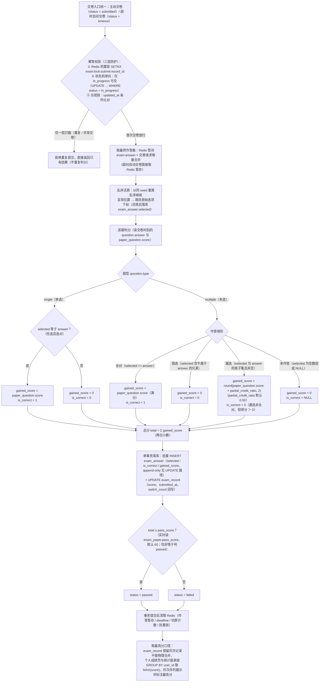

**步骤说明**：① 交卷入口统一（主动 / 超时共用同一评分路径，仅终态标签不同）；② 幂等三层校验，重复交卷直接返回已有结果；③ 合并 Redis 暂存与请求增量得到最终作答集；④ 以同 seed 重算乱序映射，把呈现位置还原为题目原始选项下标；⑤ 逐题判分（单选唯一；多选三档；未答不得分）；⑥ 总分汇总（两位小数）并在单事务内落库明细与终态；⑦ 及格判定（`total ≥ pass_score`，恰好等于判 `passed`）；⑧ 清理 Redis 临时键；⑨ 最高分口径由展示与统计层实现。

**评分规则表**（与 README 术语「自动评分」、03 册 4.2 判分规则逐字一致）：

| 情形 | 判定条件 | gained_score | is_correct |
|---|---|---|---|
| 单选（single）答对 | `selected` 等于 `answer`（恰选且选对） | `paper_question.score` | 1 |
| 单选（single）答错 | `selected` 不等于 `answer` | 0 | 0 |
| 多选（multiple）全对 | `selected == answer` | `paper_question.score`（满分） | 1 |
| 多选（multiple）错选 | `selected` 中存在不属于 `answer` 的元素 | 0 | 0 |
| 多选（multiple）漏选 | `selected` 为 `answer` 的真子集且非空 | `round(paper_question.score × partial_credit_ratio, 2)`（默认 0.50） | 0（漏选非全对，但得分 ＞ 0） |
| 未作答 | `selected` 为 `[]` 或 NULL | 0 | NULL |

> **培训融合评分边界（计划，C3/C4）**：新培训答卷先将确认草稿持久化；客观题沿服务端快照自动判分，已保存图片答案使记录进入 `pending_manual`，此时 `score` / `passed` / `correct_rate` 均为 `null`。授权阅卷人逐图片题评分 0..满分，评分事件保留前后分数、操作者、时间、评语并以乐观版本防并发覆盖；最后一题在同事务汇总最终结果。最终总分无直接编辑入口，结算后只读，待批改不进入排名/统计/补考。

### 4.3 超时自动交卷双触发机制

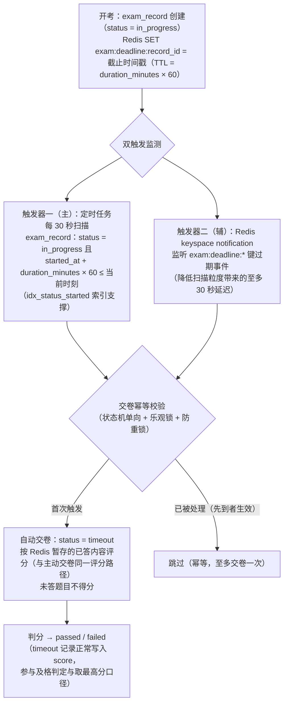

**步骤说明**：① 开考时写 Redis 截止键（TTL 同步）；② 双触发并行监测——定时扫描是可靠性主通道（Redis 故障时由扫描任务独立兜底，AD-04），到期键事件是加速辅通道（把至多 30 秒的扫描延迟压缩到秒级）；③ 两路触发汇合于同一交卷幂等校验（三层防护），先到者生效、后到者跳过，保证同一记录至多交卷一次；④ 超时交卷走与主动交卷完全相同的评分路径，`status = timeout`、按当前已答内容评分、未答题目不得分。

**关键规则**：交卷截止时刻 = `exam_record.started_at + duration_minutes × 60`，以服务端 `DATETIME(3)` 毫秒精度仲裁；`duration_minutes` 调整只对后续作答（新 `exam_record`）生效，已开考记录的 deadline 不变；前端倒计时仅展示用，服务端判定不依赖客户端时钟。

---

## 5. 状态机设计

### 5.1 制度状态机（regulation.status）

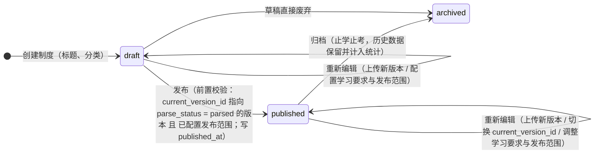

**流转说明**：

| 流转 | 触发与前置条件 | 影响 |
|---|---|---|
| `[*] → draft` | 创建制度（标题必填，分类自定义归类） | 草稿态制度对员工端不可见 |
| `draft → published` | 前置校验：存在 `parse_status = parsed` 的生效版本 + 已配置发布范围（C-04，任一不满足拦截并提示，UC-01 A2 / A3） | 写 `published_at`；范围内员工可见、可学习 |
| `published → archived` | 管理员归档 | 员工端不可见、不可再学习与考试，历史数据保留并计入统计（C-08） |
| `draft → archived` | 草稿直接废弃 | 未发布过，无员工侧影响 |
| 自环（重新编辑） | draft / published 状态下均可：上传新版本、切换生效版本、调整 `required_minutes` / `scroll_segments` / 发布范围 | 见下「重新编辑与新版本影响」；archived 后不再切换（C-08） |

**重新编辑与新版本影响**：① 上传新文件产生新 `regulation_version`（append-only），切换仅更新 `regulation.current_version_id` 指针、不动版本数据；② 切换生效版本后**新**学习会话的 `version_id` 指向新版本，进行中会话不受影响读到结束，`learning_record.version_id` 记录最近一次学习版本；③ 学习进度与考试资格绑定制度（regulation）而非具体版本——切换不清零已有进度；如需要求重新学习，由管理员调整学习要求（如提高 `required_minutes`）或另行发布新制度（C-07）；④ 发布范围调整后应学人数与统计口径随之更新（C-09），已达标记录（含 `is_valid = 1`）保留不删、不回退。

### 5.2 版本解析状态机（regulation_version.parse_status）

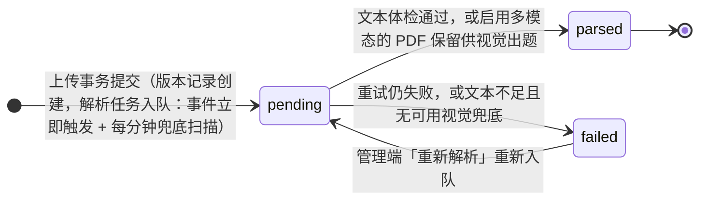

**流转说明**：① pending 上传即入队；② 文本体检通过写产物后 parsed；启用多模态时，扫描 PDF 即使文本不足也 parsed，原 PDF 作为后续视觉来源；③ 读取/解析重试仍失败，或无视觉兜底的低文本产物才 failed；④ failed 可重新解析/上传；⑤文件与成功产物保持版本不可变。

**关键规则**：`parsed` 是发布与出题前置。AI 出题接受非空文本，或 `PdfVisionService.shouldUseVision` 判断可视觉处理的 PDF；单题 regenerate 使用同一来源版本和视觉判断。failed 版本不能生效。

### 5.3 当前题目版本审核状态机（question_version.status）

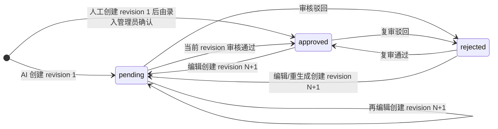

**流转说明**：① AI 题必须 pending 待审核；人工录入创建后由实际录入管理员调用同一 approve 语义确认；② approved/rejected 只更新当前 revision 的审核元数据；③ 编辑与重生成从任意状态创建新的 pending revision，旧 revision 内容与历史确认信息不改；④ 旧题 current_version_id 为空时先捕获升级当时内容为 revision 1，未知审核人/时间保持 null；⑤ legacy in_progress 引用仍阻断核心编辑 40908。四题型结构由统一 validator 校验，富文本媒体绑定 revision。

**关键规则**：`approvedCandidates` 只返回 identity 当前且 category/type/difficulty 精确匹配的 approved revision；旧 approved revision 在新 revision 待审时仍保留但不重新进入候选。后续 C1 发布必须冻结 versionId，B3 不把 legacy paper_question 当版本快照。

### 5.4 考试记录状态机（exam_record.status）

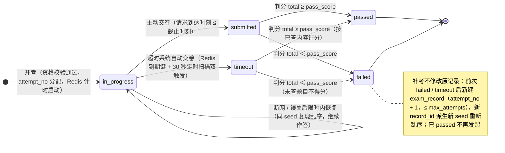

**流转说明**：① 五态语义：`in_progress`（开卷，计时开始，Redis 维护剩余时间）→ `submitted`（主动交卷）/ `timeout`（超时系统自动交卷）→ 判分后落 `passed / failed`——`submitted` 与 `timeout` 是「交卷方式」，`passed` 与 `failed` 是「判分结果」；② 状态流转单向往返（in_progress → 终态后拒绝再交），交卷幂等由状态机 + 乐观锁 + Redis 防重锁三层保证；③ `timeout` 记录正常写入 `score` 并参与及格判定与取最高分口径；④ 补考是**新建记录**而非状态回退：`uk_paper_user_attempt` 唯一键保证 attempt 序列完整，最高分口径由统计层 `GROUP BY user_id` 取 `MAX(score)` 实现。

> 计划中的图片阅卷不扩写 legacy `exam_record.status` 五态：通过新增/同步的阅卷状态表达 `pending_manual` 与 `finalized`，待批改阶段不写最终 `score`/`passed`/排名；最终汇总后结果只读。具体状态字段由 C3/C4 实体与迁移落地后补入。

### 5.5 学习记录有效化（learning_record.is_valid）

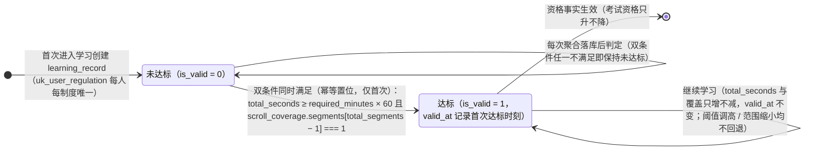

**一次性、不可逆的设计取舍说明**：

| 维度 | 说明 |
|---|---|
| 单调性依据 | `total_seconds` 只累加、`scroll_coverage` 按位 OR 只增不减 → 双条件判定单调，达标后任何后续操作都不可能破坏已满足的条件，「不可逆」是数据性质的必然结果而非额外约束 |
| 阈值调整不回退 | 调高 `required_minutes` 后：已达标员工保持达标、未达标员工按新阈值继续判定（UC-02 A2、FR-REG-05 验收③）——避免「先达标后失效」的追溯混乱 |
| 范围缩小不回退 | 发布范围调整后，范围外员工已有记录（含 `is_valid = 1`）保留不删、不回退；学习完成率分子按「应学集合 ∩ `is_valid = 1`」计算，不出现完成率 ＞ 100% 的口径事故 |
| 资格仲裁简化 | 若资格可回退，将出现「已开考 / 已交卷记录 vs 资格失效」的复杂仲裁；一次性置位使考试资格**只升不降**，考试域只需开考时校验一次、无需资格快照 |
| 审计合规 | `valid_at` 是资格起点（只写一次），与 `learning_session` 会话流水、心跳上报证据链共同构成达标争议时的审计依据 |
| 反向代价与兜底 | 误判风险由双条件的服务端严格判定控制（时长全靠服务端时钟差、覆盖全靠停留 ≥ 10 秒 + 心跳确认）；管理员如确需强制重学，通过提高 `required_minutes` 或发布新制度实现（C-07），不提供回退入口 |

---

## 6. 统计数据流转（UC-08 / UC-10）

### 6.1 数据流转图

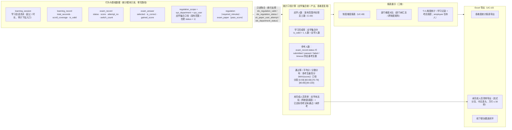

**步骤说明**：① 数据源：学习域（`learning_session` / `learning_record`）与考试域（`exam_record` / `exam_answer`）的行为数据，叠加应学集合口径基座（`regulation_scope` → 部门树展开 / `is_all` 全员 → `sys_user.status = 1`）；② 口径计算：以应学集合为锚点统一计算各指标（学习完成率分子分母同源，范围调整后口径随之更新）；③ 报表展示：制度 / 部门 / 个人三个维度（部门维度按 `sys_user.department_id` 切片 + 部门树父级汇总，跨制度支持「部门 × 全部已发布制度」矩阵）；④ Excel 导出：各维度报表与未完成人员清单导出，形成线下督办闭环。

**关键规则**：统计模块对当前业务事实表及培训增量事实**只读、零写路径**，报表永远不污染业务数据；legacy 制度报表继续按原跨试卷取最高分口径，计划中的培训报表按考试场次/难度、已完成批改个人最高分和当前应考集合与历史成功开考交集计算。待批改不当零分，空应考集合的参与率为空；当前量级直接查库 + 索引支撑即可满足统计 P95 ≤ 3 秒（NFR-03），预留「Redis 缓存 + 交卷/阅卷事件触发失效」演进路径；空态展示 0 或空态、不报错（UC-08 A1）；每项指标在页面明示口径定义。

### 6.2 统计口径速查表

| 指标 | 精确口径 | 主要数据来源 |
|---|---|---|
| 应学人数 | 发布范围内在职员工数（`is_all = 1` 全员；否则圈定部门含子部门中 `sys_user.status = 1` 的去重员工数） | `regulation_scope` + `sys_department` + `sys_user` |
| 学习完成率 | 应学集合中 `learning_record.is_valid = 1` 的人数 ÷ 应学人数 | `learning_record`（`idx_regulation_valid`） |
| 参考人数 | 该制度下 `exam_record.status ∈ {submitted, passed, failed, timeout}` 的去重考生数 | `exam_record`（`idx_regulation_status`） |
| 通过率 | 各考生最高分 ≥ `pass_score` 的人数 ÷ 参考人数（每人最高分 = 该制度下全部作答的 `MAX(score)`，跨试卷取最高） | `exam_record`（`uk_paper_user_attempt` 前缀 + 回表） |
| 平均分 | 各考生最高分的算术平均（两位小数） | 同上 |
| 分数分布 | 各考生最高分按闭区间分段计数：[0-59]、[60-69]、[70-79]、[80-89]、[90-100] | 同上 |
| 未完成人员清单 | ① 应学集合中 `is_valid = 0` 或无 `learning_record` 记录者（附剩余时长缺口、底部段覆盖状态）；② 已 `is_valid = 1` 但历次最高分 ＜ `pass_score` 或未参考者（标注「考试未通过 / 未参考」） | 应学集合 LEFT JOIN `learning_record` ∩ `exam_record` 聚合 |
| 题目正确率（扩展） | 跨全部考试按题聚合 `exam_answer.is_correct` | `exam_answer`（`idx_question`） |

> **培训统计（计划，C6）**：新增考试场次视图后，统计粒度为 `paper/release + difficulty`；个人最高分只取 `finalized` 记录，同分并列；参考率分子取当前应考集合与历史成功开考人员交集，历史成功开考总人数另列；不同难度不合成默认榜。旧制度/部门/个人报表继续按上表 legacy 口径。

### 6.3 Excel 导出闭环

| 项 | 设计 |
|---|---|
| 导出物 | 制度维度统计表、部门维度对比表、未完成人员清单、个人维度明细表（列定义见 05 册 7.4.3） |
| 一致性 | 导出文件内容与页面数据一致（UC-10 主流程 4）；中文表头与字段完整、状态 / 枚举列输出中文含义 |
| 生成机制 | 服务端生成 xlsx 文件流（附件响应）；流式分页取数（按主键游标分批）避免万行全量驻留内存 |
| 性能 | 万行级导出 ≤ 30 秒（NFR-03 / FR-STT-05 验收③） |
| 空清单 | 全员已完成 → 提示「无未完成人员」、不生成文件（UC-10 A1）；导出失败提示重试（A2） |
| 留痕 | 导出操作写审计日志（操作人、时间、导出物与数据范围，NFR-10） |
| 督办闭环 | 清单含部门、姓名、工号、学习时长进度、覆盖状态、考试状态与未完成原因 → 管理员线下跟进督办 |

---

## 附：一致性对照与用例覆盖

### 附一：与基准文档一致性对照

| 对照项 | 基准落点 | 本文档体现 |
|---|---|---|
| 当前 12 张表名 | README 3.3 | legacy 部分逐字一致，本步骤不改动；培训增量表按 migration/init/entity/设计/API 同步政策加入 |
| 全部枚举值 | README 3.4 + B3 | §5 状态机覆盖 regulation / regulation_version / 当前 question_version / exam_record；question.status 为当前版本兼容值 |
| 核心术语 | README 3.2 | 心跳上报（30 秒/次、45 秒封顶）、滚动覆盖率（10 段位图、底部段）、有效学习（双条件）、考试资格（is_valid）、自动评分（多选三档）、试题与选项乱序（确定性 seed）、切屏检测（switch_count）、补考（取最高分）等逐条对应 |
| 用例覆盖 | 01 册第 5 章 | UC-01 ~ UC-10 全覆盖（见 1.4 对照表） |
| 字段与索引 | 03 册 | 落库事务、Redis Key、唯一键（uk_user_regulation / uk_paper_user_attempt / uk_record_question）、兜底扫描索引（idx_parse_status / idx_started_at / idx_status_started）逐字采用 |
| 模块设计决策 | 05 册 | 失焦暂停 pause / resume 锚点重置（5.4.3）、心跳 Redis HINCRBY 累计（5.4.2）、单活跃会话约束（5.4.1）、AI 长文本分块 4000 字符（4.4.2）、超时自动交卷双触发（6.4.3）、确定性 seed 乱序（6.4.2）、交卷幂等三层（6.4.5）、统计口径（7.4.1）逐条一致 |
| 防作弊细化口径 | 07 册 | 滚动位图只计停留 ≥ 10 秒的段（3.1.3 定稿，与 05 册 5.4.4 位图合并机制衔接）、切屏两级阈值 ＞ 3 警告 / ≥ 5 留痕复核不强制交卷（3.2.2）、作答暂存节奏每题变更即暂存 + 每 10 秒全量对齐（3.2.4） |
| 架构决策 | 02 册 | AD-03（解析 / AI 出题异步任务）、AD-04（Redis 临时态 / MySQL 唯一权威源）、AD-06（本地文件存储卷） |

### 附二：流程图清单

| # | 章节 | 类型 | 主题 |
|---|---|---|---|
| 1 | §1.1 | flowchart LR | 端到端业务全景图（两条脉络与交汇点） |
| 2 | §1.3 | flowchart TB | 组织基座准备（Excel 批量导入员工，UC-09） |
| 3 | §2.1 | sequenceDiagram | 制度上传到发布全流程（UC-01 / 02 / 03） |
| 4 | §2.4 | flowchart TB | 异常分支（解析失败重试 / AI 失败降级 / 驳回重生成） |
| 5 | §3.1 | sequenceDiagram | 有效学习判定（会话 / 心跳 / 失焦 / 落库 / 判定，UC-04） |
| 6 | §3.2 | flowchart TB | 单次心跳的服务端处理决策 |
| 7 | §3.3 | flowchart TB | 滚动覆盖位图跨会话按位 OR 合并示意 |
| 8 | §4.1 | sequenceDiagram | 考试全流程（资格 / 乱序 / 作答 / 交卷 / 补考 / 恢复，UC-05 / 06 / 07） |
| 9 | §4.2 | flowchart TB | 交卷评分决策（幂等 / 还原 / 判分 / 及格 / 最高分） |
| 10 | §4.3 | flowchart TB | 超时自动交卷双触发机制 |
| 11 | §5.1 | stateDiagram-v2 | 制度状态机（regulation.status） |
| 12 | §5.2 | stateDiagram-v2 | 版本解析状态机（regulation_version.parse_status） |
| 13 | §5.3 | stateDiagram-v2 | 当前题目版本审核状态机（question_version.status） |
| 14 | §5.4 | stateDiagram-v2 | 考试记录状态机（exam_record.status） |
| 15 | §5.5 | stateDiagram-v2 | 学习记录有效化（learning_record.is_valid） |
| 16 | §6.1 | flowchart LR | 统计数据流转（UC-08 / UC-10） |

> 本册为设计文档，不含任何系统代码实现（README 第 5 章边界说明）；图中参与方（解析队列 / Worker、第三方 AI 大模型、Redis、MySQL）为逻辑角色，物理上全部交互发生在 NestJS 模块化单进程内或经 HTTPS 出站调用（AD-02 / AD-03 / AD-04）。
