# 06 · 关键流程 —— 安全培训考试系统（EmodorRuleExam）

> **一句话定位**：本文档以 Mermaid 时序图（sequenceDiagram）、流程图（flowchart）与状态机（stateDiagram-v2）呈现 EmodorRuleExam 的端到端关键流程——培训类别与学员、课程视频、出题资料解析、AI 出题、三类客观题考试、自动评分、记录与统计；legacy 制度阅读和固定卷只作为兼容链路保留。
>
> **口径声明**：本轮用户批准的[瘦身计划](../superpowers/plans/2026-10-22-training-demo-slimming.md)优先于旧分册中被取消的扩展目标。数据落点依据 [03-数据库设计.md](03-数据库设计.md)，模块内部决策依据 [05-模块设计.md](05-模块设计.md)，安全口径依据 [07-安全与非功能设计.md](07-安全与非功能设计.md)。学习时长、视频覆盖、服务端截止时间、答案隔离、确定性 seed、幂等交卷与环境变量密钥等既有红线不因前台瘦身而放宽。

> **状态边界（2026-10-22）**：现行管理端已删除图片作答题、人工阅卷、实时监控/切屏采集、制度管理、员工管理和部门管理。题型严格为 `single / multiple / judgment`，题干、选项和解析中的普通受控图片继续保留。试题管理与试题导入职责分开，参考题 AI 生成使用一次性文件；资料上传解析保留；整批资料 AI 的直接生成写入口退场，仅保留旧任务／结果读取。旧制度阅读、旧固定卷及历史统计依赖只在后端兼容，不重新暴露管理 CRUD。原统计页面仅隐藏且旧 URL 回业务首页。独立mobile H5已实现至Task13/14 / Gate H2自动验证，真实后端浏览器全链、真实供应商/弱网、微信开发者工具与真机仍未验。

---

## 1. 流程总览

培训试卷状态流程为「草稿 → 已发布 → 草稿（撤回） → 再发布」。撤回恢复当前卷编辑入口，草稿预览反映修改，重新发布新增冻结版本。草稿期间不接受新开考，原已开始考试仍沿原版本恢复/交卷，历史成绩不变；已有assignment补考继续使用原冻结卷，新学员使用最新发布版本。041将既有training withdrawn兼容回草稿，不影响legacy/archived。归档及legacy状态写入口继续退场。

PC 试卷管理直接展示当前培训试卷列表，不再保留「培训考试／历史固定卷」双 Tab、历史资料 ID 筛选和旧制度卷管理详情。旧 `scope=regulation` 链接回试卷列表；后台 legacy 接口与历史考试数据本轮保留。

### 1.0 固定卷设计与无损往返（2026-10-23）

PC 管理端入口于 2026-10-26 收敛为「创建试卷 → 选题和编辑 → 设置分值及考试配置 → 预览发布」；不要求选择组卷模式，也不集成自动选题工具。随机创建、固定卷切换为随机卷、复制随机卷入口不开放；既有随机记录及后端抽题/冻结/考试链路保留。

```text
现有题库表单 create/revise ──同事务同步──> 精确版本考试内容 + 作者原稿
                                                       ↓ assemble
固定草稿 → 完整PaperDesigner → 批量题目commit/回执 → 配置与布局 → 有序题单
                ↑                    ↓ 响应不明先GET原回执             ↓
                └──────────── 精确版本重开 ─────────────────────── 固定卷发布
                                                                  ↓
          客户端能力校验 → 冻结个人题单 → schema2/3安全投影 → 稳定ID主动整卷评分
```

题库原表单只应用可无损表达的修改；未改正文、选项身份、图片及布局保留，失败不建立部分revision。设计器库中未修改题复用原版本；库中修改题另存副本，题序变化不建副本。新建／修订／启用恢复／新发布使用启用的easy/hard，旧medium快照不重写。schema3需要能力头3，旧客户端在开考写入前被拒；到期读取仍先收口纯timeout。完整保存链路、异常重试、视觉比对与证据等级登记于[本次验收记录](../../review/main-question-designers-acceptance-2026-10-23.md)。

带资料来源的库题未改时复用原版本和真实来源；改成副本后按人工题保存，提交前在副本原稿清空`regulation_id/regulation_version_id`且不带来源题identity，来源题/版本保持不变。若试卷仍带非空资料筛选，这类无来源人工副本在任何HTTP写入前被宿主拒绝，管理员显式清空筛选后才继续commit/配置/题单；不能假造AI来源或静默改试卷筛选来绕过约束。复制试卷本身则深拷贝布局，副本与源布局独立。

### 1.1 端到端业务全景图

管理端「培训基础数据 → 试题导入→AI生成预览→选行确认并启用→组卷发布」与学员侧「课程学习 → 考试 → 自动评分 → 记录」两条脉络及其交汇点如下：

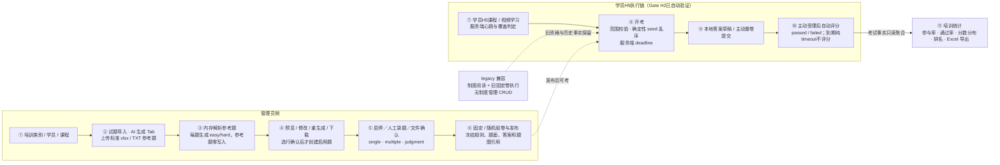

#### 1.1.1 现行培训闭环

新培训考试在同一单体内走以下语义，避免把课程完成、题目来源和权限角色混为一谈：

```text
类别/学员来源（institution 或 external）
        ↓
课程/章节/视频学习（与制度阅读分开；视频 30s 心跳、45s 封顶、2s 位置容差、95% 覆盖）
        ↓
题库版本（single/multiple/judgment + 启用easy/hard；历史medium只读＋真实历史资料来源；新题无考点／分值）
        ↓
固定/随机发布快照（本机构→初级，外来→高级；新发布按question_id去重，既有release保留冻结抽样语义）
        ↓
首次开考冻结来源/类别/难度/规则与个人题单（默认不检查学习门槛）
        ↓
本地草稿 → 主动整卷提交（锁后accepted_at < deadline）；到期纯timeout不评分
        ↓
三类客观题由服务端自动判分并直接形成最终结果
        ↓
按场次/难度/最终个人最高分统计、排名与当前应考集合交集
```

目标默认值：100 分（可配置0.01～999.99，最多两位小数）、60 分及格（不得超过目标总分）、30 分钟、总作答 3 次（含首次）、多选漏选 0.5。发布冻结规则与候选版本，首次开考继续冻结个人归属、规则、题单和显示映射；本地答案、服务端倒计时、主动交卷和纯timeout均沿用冻结事实。系统不采集切屏或设备连接状态。

**步骤说明**：

| 阶段 | 节点 | 关键动作与数据落点 | 对应需求 |
|---|---|---|---|
| ① 培训基础 | A0 | 维护培训类别、学员与课程；管理员账号由单次原子接口创建并同时绑定至少一个启用业务角色 | 账号与学习管理 |
| ② 参考题上传 | A1 | 试题导入 AI Tab 先选培训类别，再上传与普通导入一致的中文五列Excel／标签TXT；兼容旧英文七列、九列及两种八列（concept非空拒绝、score仅warnings），≤5MB、≤50 参考行；只保留任务内存 | AI 参考题 |
| ③ AI 生成 | A2 | 每题最多一对 easy/hard；可信类别、题型和目标难度由服务端固定，参考题不落库，生成题无分值 | AI 参考题 |
| ④ 预览与确认 | A3 | 生成题专用批次可筛选、修改、单行重生成与下载；选中有效行确认后原子创建启用题并返回enabled:true，source=ai且无永久制度版本 | AI 参考题 |
| ⑤ 题库维护 | A4 | 人工保存、文件及AI选行确认均直接启用；修订双令牌校验，启停不改历史。题干／选项／解析保留受控图片 | 题库管理 |
| ⑥ 组卷发布 | A5 | 固定/随机卷发布时冻结规则与题目版本；资料分类中立，试卷来源按本类别题目的实际来源关联，旧类别资料兼容 | 试卷管理 |
| ⑦ 视频学习 | E1 | 后端视频会话 30 秒心跳、单次最多 45 秒、2 秒位置容差、95% 去重覆盖；旧 Vue 学员端无课程入口，不替代旧制度阅读 | 视频学习 |
| ⑧—⑩ 考试评分 | E2—E4 | 服务器冻结题单/稳定ID/截止时间；本地草稿，主动截止前受理才评分；到期纯timeout，补考沿冻结归属 | 考试与记录 |
| ⑪ 统计 | S | 按场次、来源、类别和明确难度只读聚合最终成绩，提供分布、排名与 Excel 导出 | 培训统计 |

**关键规则**：

| # | 规则 | 出处 |
|---|---|---|
| 1 | 旧资料直接生成／历史题直接重生成写入口退场，AI配置和旧任务／结果仅读保留；当前参考题AI无永久资料来源、确认前零题库写 | AI来源与写入口边界 |
| 2 | 新候选只取启用题的精确当前版本，按类别／题型／启用难度／来源／媒体规则校验；新版本兼容approved、审核元数据NULL | C-03 |
| 3 | 题型严格为单选、多选、判断；普通题图保留，图片答案与人工评分分支不存在 | 客观题契约 |
| 4 | 学习与视频时长只认服务端；旧制度的 `is_valid` 双条件与新培训默认无学习门槛是两条独立语义 | C-01 / C-02 |
| 5 | 最终总分只能由服务端自动评分产生，不提供直接编辑入口；统计只读取终态成绩 | C-05 / C-06 |
| 6 | 服务端deadline_at、本地草稿、主动整卷幂等及纯timeout保留；不采集切屏、连接状态或设备摘要 | 考试契约 |

### 1.1.2 管理端导航结果（5 根、17 页面）

```text
业务首页（直接页面）
学习管理
  ├─ 培训类别
  ├─ 学员管理
  └─ 课程管理
考试管理
  ├─ 试题管理（查询、人工录题、修订、预览、启用／停用）
  ├─ 试卷管理
  ├─ 试题导入（文件导入 / AI 生成）
  └─ 考试记录
统计分析（直接页面，复用培训统计）
系统设置（默认收起）
  ├─ AI 服务配置
  ├─ 管理员
  ├─ 角色权限
  ├─ 网站配置
  ├─ 字典配置
  ├─ 菜单配置
  ├─ 在线会话
  └─ 操作记录
```

管理员不显示“我的学习”；学员原有课程、视频、阅读、考试和成绩能力不因此删除。出题资料没有独立菜单，试题列表不再承载资料维护或整批生成。`/admin/questions` 以 `questions:read OR questions:write` 访问，`/admin/questions/import` 要求 `questions:write`；只缓存导入页，返回试题管理时重新加载列表，确保确认后能看到新增启用题。前向迁移 017 按 route_path 复用四个标准入口 ID，动态定位考试目录，保持其它自定义菜单不变；旧迁移 checksum 不改。已取消功能从侧栏、首页快捷入口、路由和缓存标签一并清除，过期 URL 回业务首页；原统计报表页面仅隐藏。

管理端菜单页的名称统一由外层导航标题栏和标签页展示，内容区不再重复显示“管理台 / 系统治理”等眉题、页面大标题和概述段落，直接呈现查询、表单、业务数据与必要操作。课程名、试卷名等实际对象名称、状态、业务分区标题、字段说明、错误与风险提示及弹窗标题保留；移除页头时不删除其同排操作按钮，也不保留空白占位。

网站配置采用与试题导入页一致的布局：一张白色主卡片内顶部放“品牌展示 / 关于我们”两个下划线页签，下方切换内容，不增加侧栏菜单或重复外层卡片。品牌页签保留Logo及学员首页轮播，关于我们页签提供配置表单。常规字段为机构名称、平台简介、展示版本、联系邮箱、公众号、联系电话，服务条款复用现有Tiptap富文本编辑器；页签内容不重复显示“品牌展示/关于我们”标题，仅保留右侧独立撤销/保存操作区并收紧间距；两卡各自保存、撤销与加载状态，保存响应仅更新对应卡片，切换页签保留各自未保存内容，离开整个页面才汇总提示两个未保存状态，权限沿用配置写权限。H5关于我们读取公开网站配置并复用Logo，联系方式空值隐藏，公众号可复制、联系电话可拨号，邮箱在H5唤起邮件；服务条款页独立读取并安全渲染保存的富文档。加载失败可重试，未发布条款显示空状态，不把静态预览条款当作线上内容。显式静态预览继续使用既有fixture。

管理端访问过的业务页面统一由公共标签页组件承载：左侧固定“首页”且不可关闭，其后按访问顺序展示可关闭的业务标签；右侧操作菜单提供刷新、关闭当前、关闭其它、关闭左侧、关闭右侧和关闭所有。批量关闭只移除可关闭的业务标签，关闭所有后回到首页；存在未保存编辑时继续走统一离开确认，刷新继续通过现有缓存失效机制重建当前页面。公共组件只负责标签展示和操作意图，不复制参考系统的 Router 工具链、缓存仓库或配色，也不接管各页面的数据请求。

左侧导航支持在 232px 展开态与 68px 紧凑态之间切换，折叠偏好保存于当前浏览器；收起后隐藏品牌文字、轮播和侧栏页脚，一级菜单改为约 60×60px 的“图标在上、12px 文字在下”结构，子菜单继续通过折叠菜单弹层访问。展开/收起按钮位于顶部栏最左侧，当前页面名称紧随其右，两者共享同一垂直中线；切换侧栏宽度时页面名称不移动到内容区，也不重复渲染页面标题。

含列表的管理端页面统一采用“带标签的查询区 → 业务操作区 → 表格 → 右对齐分页”结构；无查询条件、无业务操作或无需分页时不渲染空区域。列表为空时，空状态插图与说明放在表格的 `empty` 区域，不在表格外重复展示，也不与表格原生“暂无数据”并存；加载中不展示空状态。菜单树和全量小列表不虚设分页，统计分析仅对难度排名列表使用该结构。公共布局不接管请求、权限或分页状态，也不提供搜索显隐、列设置、通用刷新、通用导出、全屏等列表工具；页面原有的业务刷新和统计导出仍按业务能力保留。公共布局沿用本系统主题，不继承参考组件的配色。

### 1.2 两条脉络的交汇点

| 交汇点 | 供给方 | 消费方 | 语义 |
|---|---|---|---|
| 交汇一：资料与题库 | 历史资料来源版本 | 历史来源查询／组卷来源过滤 | 保留真实资料与不可变版本关联，不恢复旧资料直接生成写入口；资料本身不承担发布范围或学习要求 |
| 交汇二：试卷发布 | 管理员侧 ⑥ | 学员侧 ⑧ | `exam_paper.status = published` 后可发起考试；历史撤回或归档记录禁止新开考，已开始记录可恢复；培训试卷恢复撤回发布，归档及 legacy 状态写入口继续退场 |
| 交汇三：考试资格 | 学员与发布快照 | 学员侧 ⑧ | 新培训考试按类别、来源、次数、账号状态和冻结规则校验；legacy 制度固定卷仍以 `learning_record.is_valid = 1` 为前置 |
| 交汇四：统计闭环 | 学员侧 ⑦—⑩ 的行为数据 | 管理员侧统计 | 视频完成、终态考试记录与答案明细只读聚合为培训统计；旧制度报表后端保留但前端入口隐藏 |

### 1.3 学员与管理员账号准备流程

`sys_user` 仍是学员与管理员的共享账号底座，但现行管理端不再提供员工或部门 CRUD。学员维护按培训类别与来源展开；管理员通过原子接口创建，不要求先创建学员再提升角色：

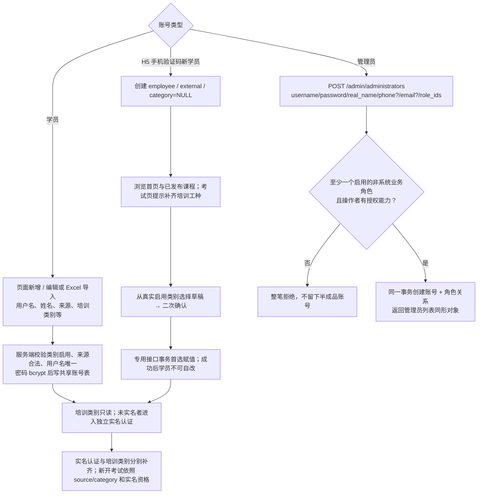

**关键规则**：① 学员接口不再接受或返回部门字段；② 管理员 `role_ids` 至少一项，只能选择启用的非系统业务角色；③ 管理员账号和角色关系在同一事务提交，任何一步失败均整体回滚；④ 学员与管理员的改密、停用、令牌吊销和超级管理员保护继续有效；⑤ 历史组织字段可为旧学习/固定卷兼容保留，但没有部门或员工管理入口。

**培训工种补充（2026-10-23）**：PC 类别和 H5 工种均为 `category_id`，不使用旧 occupation 文本。已分配者（含模板导入）不再显示可切换工种；只有空类别普通 mobile 学员可首次确认，同值重放幂等、不同值拒绝。后续由具备 `students:write` 的人员在 PC 调整并记录前后值，既有 assignment 和考试历史不改。保存结果未知时先查询权威资料再展示，不盲重试。课程全 published 浏览/实名播放不按来源或类别新增限制。

### 1.4 现行流程覆盖对照

| 流程 | 名称 | 本文档落点 |
|---|---|---|
| F-01 | 资料上传、解析与 AI 出题 | §2.1—§2.4 |
| F-02 | 题库启停、人工／文件录题与AI选行确认 | §2.1、§2.5、§5.3 |
| F-03 | 学员与管理员账号 | §1.3 |
| F-04 | 课程与视频学习 | §1.5、§1.6、§5.6、§5.7 |
| F-05 | 组卷、开考、保存与自动评分 | §4.1—§4.3、§5.4 |
| F-06 | 培训统计与导出 | §6.1—§6.3 |
| L-01 | legacy 制度阅读与固定卷 | §3、§4 的兼容说明、§5.1、§5.2、§5.5 |

### 1.5 B1 课程创建、上架与视频换版

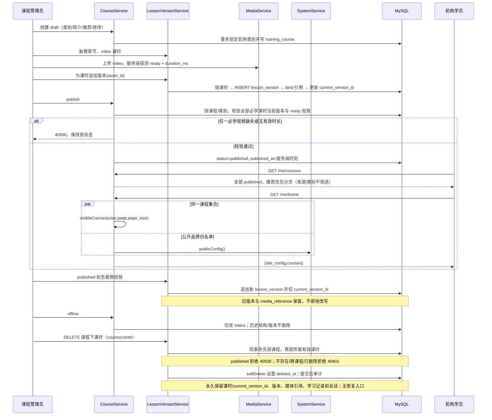

停用账号的课程列表为空；启用学员可浏览全部published课程，external、缺类别或跨类别不阻止列表/详情，只有草稿/下架详情返回40302。Task 12 Video Contract v1进一步替换旧institution/同类别视频分配：来源/类别不额外阻止published课程学习，开播仍须mobile employee本人、实名及current视频版本/ready资产/精确引用。当前课程前端新建/编辑不提交 `regulation_ids`；服务端DTO仍为历史兼容接受，前端省略以保留旧关联。课程不触发旧制度学习门槛，旧Vue学员端也没有培训课程入口。下架后重新上架仍重跑管理侧类别与必学视频校验。

### 1.6 B2 视频会话、并发替换与重启恢复

以下按Task 12冻结契约描述已通过 Gate H1 自动化与独立代码审查的实现；真实播放器解码、弱网、全屏和微信真机仍未通过。浏览/选课时只读，学员主动点击播放后才start；`/me`视频接口只接受当前mobile employee本人。

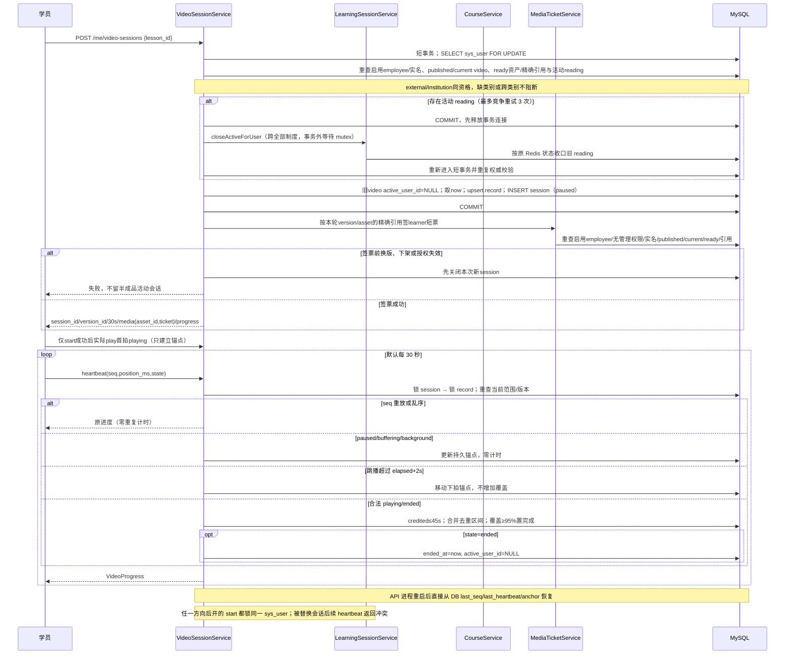

reading start 与 video start 使用同一短事务重查/事务外 flush 循环；等待 reading mutex 时不持数据库连接，旧 reading 结算逻辑不复制。reading 的 DB INSERT 提交后、发布 Redis 前再次锁同一用户并重查活动所有权；若会话已被 video 标记结束，reading 确定不写迟到指针。若 phase2 在真正替换前先完成，reading start 返回 200 仍是合法线性化点，后续 video 会将其正常收口，最终 DB 仍只有一个活动所有者。Redis 发布异常时收口本次 reading 并清理精确 key。反方向 video start 可把旧 reading 正常收口后再创建；若自身创建失败，旧 reading 保持已结束，不伪造时长也不复活。

start初始paused，位置取confirmed_position_ms；30秒心跳只报告递增seq、位置与五态，不报告前端累计时长。非playing→playing首拍不计时；暂停/缓冲/后台立即报状态，close和90秒回收只收口不补时。未实名/处理中分别40302 + IDENTITY_REQUIRED/IDENTITY_PENDING；被替换session为40950，换版/下架/引用失效等先关闭再40951，移动端停止播放/心跳并刷新权威课程进度，不自动start。learner进度按当前published课程required video lessons的current版本汇总，每项带稳定lesson_id/version_id供目录按ID映射；零分母null且lessons为空。来源/类别不筛该分母，既有C6管理统计口径另见§6.2.1。

视频签票/续签及 proxy 内容读取重查 learner-only 资格；通用Bearer读取保留PC `courses:read`受控预览，普通学员仍须实名及published/current，video上传者不能绕过精确引用。票据临期用start返回asset/version重签，只替换src并恢复当前播放器位置，不重建session。角色/权限变化、停用、引用撤销、下架或换版后拒绝续签和旧代理票据；已发 COS 链接等待到期失效。

原生video的play/pause/waiting/ended映射playing/paused/buffering/ended；buffering自然恢复后，在仍有播放意图且前台未暂停时，首个位置前进的timeupdate只重建一次playing锚点，其余timeupdate只更新位置。error仅UI态，尽力发非播放状态后显示简单重试；断网沿用原生loading，不离线补时或重放。onHide暂停、报background并停周期心跳但不close，前台恢复保持暂停；onUnload尽力close。切课时的start/close串行，A start在途切B时先等A成功并close，再start仍最新的B；A超时结果未知则stopped，等用户下一次主动播放。session/revision/登录epoch阻断迟到回包，心跳同seq不并发。

---

### 1.7 学员三图实名、结果恢复与媒体票据（Gate G自动化与独立代码审查已通过）

本节依据 `Identity/Media Contract v1`，记录 Task 10/11 冻结流程和源码边界，不代表腾讯、H5 相机或微信真机已验收。内部状态机见 05 册 2.4.4；账号已实名时 POST session 返回 40960 + `data.status='verified'`，前端应 GET 权威视图。

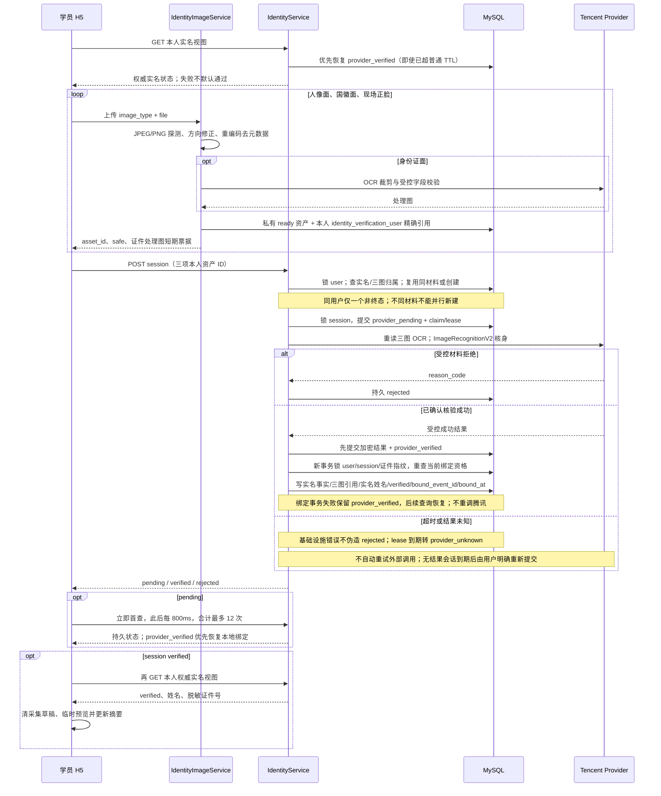

**重试与崩溃边界**：同用户同三资产且未过期时沿用原 session，包含 rejected；不同材料须等待旧非终态终结。claim 在外部调用前提交，查询和跨实例请求不得再次抢调；lease 到期无持久结果为 provider_unknown。供应商返回到结果保存前进程崩溃，系统不能证明核验是否执行，保留 unknown 而不冒险自动重试。普通 600 秒 TTL 仅终结 created/provider_pending/provider_unknown 等无成功结果状态；provider_verified 必须跨 TTL 继续本地绑定。绑定事务再查当前 session/已有事实，迟到旧结果不覆盖姓名；证件 HMAC 唯一冲突拒绝他人绑定，不合并账号。唯一 bound_event_id/bound_at 与业务事实同事务，文件审计仅在提交后 best-effort 输出。

**材料生命周期**：正脸问题只清 face，单面解析失败只清对应面，证件整体无效/过期清两面；未知错误保留材料，分支只看 reason_code/clear_materials。取消、替换、离页清本地预览，并 best-effort DELETE 尚未进入 session/实名事实的本人临时资产；后端再次检查引用后释放。24 小时以上仍仅有临时 user 引用且未提交的材料，由清理任务解除该精确引用再删除；活动 session/实名证据保留。离页、退出、切号使页面 epoch 失效，旧上传/轮询响应不能污染新页面或账号，不撤销已提交的后端核验。

**媒体读取链**：

```text
mobile Bearer + asset/owner
  -> 查精确 media_reference(asset_id, owner_type, owner_id)
  -> 当前 owner policy.authorizeRead(actor, owner, asset)
  -> 签 300 秒 HMAC 票据（版本/asset/actor/purpose/owner/expiry）
  -> 原始内容 URL（不含 JWT/路径）
  -> 校验签名/过期
  -> 重查同一引用 + 当前业务授权 + ready/未删除/purpose
  -> 200 或单段 Range 206；非法 Range 41601
```

实名预览owner为identity_verification_user + user ID，头像为user_avatar + user ID，课程封面为training_course_cover + course ID；旧票据在引用/权限撤销后也拒绝。公开Logo/banner仍走站点白名单。Task 12移动视频播放/票据续签按§1.6冻结契约，考试题图由后续Task 13/14对接；Gate G证据不替代这些阶段验收。

## 2. 出题资料兼容链路与试题导入流程

### 2.1 当前题库写链与资料历史边界

```text
人工Tiptap保存 ───────────────┐
文件中文模板预检→逐题预览→选行确认 ┼→ 启用题库→新组卷／发布→冻结题单
参考题AI→预览／修改／行重生成→确认┘     ↕ 启用／停用
                                    修订：版本＋状态双令牌
```

PDF／Word资料上传、不可变版本和解析仍保留；旧POST /ai/generate-questions、POST /ai/questions/{id}/regenerate和PUT review写路由退场。AI配置、旧任务／结果与历史资料来源可读，不将旧直写入口接到直接启用版本服务。以下§2.5／2.6是当前文件／AI预览确认链，非恢复资料AI页面。

### 2.2 步骤与事务

1. 人工新建直接创建启用identity和revision1；文件／AI先校验并建立owner绑定的questions／questions_ai预览批次，确认前题库零写入。
2. 文件预览提供valid_rows/errors/duplicates/warnings及有效题rows。AI每行最多生成easy／hard两题，修改和行重生成只更新未确认批次。
3. 管理员选行确认，锁owner+kind+batch、排序锁类别，同一manager校验来源／媒体并用锁定当前读去重，再原子写题目／版本／引用与首次回执enabled:true。
4. 修订锁identity，同时匹配expected_version_id与expected_enabled；新版本直接启用，旧版本不覆盖。新版本兼容status=approved但概念／分值／审核元数据NULL。
5. 启停不增内容revision；恢复锁内重验合法性。新发布重新锁定启用身份、复核精确当前版本，按question_id去重并冻结卷内分值与内容。
6. 删除二次确认，DELETE携带显式版本与启停双基线；同一身份锁内先处理已删幂等回执，再比较基线，只写deleted_at并停用，不增revision。当前题库／新候选排除已删；草稿引用留存但发布拒绝，已发布和考试历史照常读取。删除与发布共用身份锁：先删则新发布拒绝，先发布则快照不受后续删除影响。失败只GET当前详情对账，不自动重发写请求。

### 2.3 关键规则

- 当前题库不拥有分值或新业务考点。旧concept／score／review事实、原稿与既有发布／个人题单不迁移重写，分值只属于试卷关联、规则和冻结快照。
- 026只把历史approved映射启用，其它旧状态停用；027只清理questions:review及其角色／菜单关联，questions:write统一负责维护。
- 既有随机release预览与开考显式使用historical-concept：按冻结concept分组、无concept回退question_id。新候选／新release只用question_id且新快照不写concept，不追溯改变旧抽样语义。
- 稳定选项ID、受控富文本／媒体、来源授权、legacy在考核心修订限制和版本捕获边界均保留。资料解析pending／parsed／failed与题库生命周期互不混用。

### 2.4 异常与恢复

- 任何一行创建、版本、引用或回执写入失败整体回滚；已提交同集合重试返回原回执，不同集合40911，跨owner／kind40302。
- 保存／确认响应未知时保留输入并GET原回执或原batch，不换UUID／批次重复写；回包绑定请求代次，离页不能覆盖状态或导航。
- 双管理员同一版本交错启停会使旧expected_enabled编辑40940，零新增／不恢复启用；用户刷新后明确基于停用态保存才能创建新版本并启用。
- AI参考内容只在任务内存，失败／超时／完成释放，重启未完成任务failed；错误只返回脱敏摘要。旧未提交批次显式无概念／无分值投影，已提交旧回执保持原样。

### 2.5 题库文件导入流程（B4）

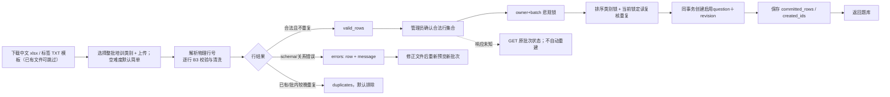

确认事务只接受该批次valid_rows子集，普通与AI确认均直接启用，兼容status=approved但approved_by/approved_at/reviewed_by/reviewed_at/review_reason均NULL。类别锁后锁定当前读去重，跨批重复仅一方创建，另一方40911且保留原选集；同批同集合回原回执，不同集合冲突。owner／kind、来源／媒体及调用方manager校验不放宽，任一题／版本／引用／回执写失败整体回滚。原批次GET保留rows与warnings，新回执enabled:true；未知响应仅查询，离页回包失效。

---

### 2.6 一次性参考题AI预览与启用确认

```text
页面选择整批培训类别＋中文五列XLSX／标签TXT参考文件（≤5MB，≤50行；兼容旧英文七／八／九列）
    ↓ 参考正文只在内存，旧concept非空固定报错，旧score只提示
每行最多easy／hard两题→本人questions_ai批次
    ↓ 逐题预览／修改／批次内单行重生成／七列下载；题库零写入
仅选合法行确认→同一事务创建启用题、revision1、enabled:true回执
    ↓
启用题可供组卷；无第二次审核，历史快照保持不变
```

类别、题型、目标难度和source由服务端固定，prompt／生成draft／预览／导出均无concept或score，模型不能覆盖来源或审核事实。参考正文不进磁盘／数据库／Redis／审计；Redis仅存24小时任务状态与计数，重启遗留任务failed。生成题批次未确认24小时有效，已确认回执继续可读。

全部失败不建批次，部分失败展示有效题。每个任务／批次／行操作验证owner，questions_ai不能借普通questions／students入口确认。生成／修改／行重生成不写题库；确认同集合幂等，任何写失败整批回滚。旧未提交draft显式投影去概念／分值，已提交旧回执不重写。未知响应先GET原batch；失活停止轮询并丢弃迟到回包。

## 3. 有效学习判定流程（UC-04 / UC-05）

### 3.1 学习会话与心跳时序图

覆盖「会话开始（单活跃约束）→ 心跳 30 秒 → 服务端时间差计算 45 秒封顶 → 失焦 pause / resume 锚点 → 会话结束落库 → learning_record 聚合 → 双条件判定 → is_valid = true 幂等置位」：

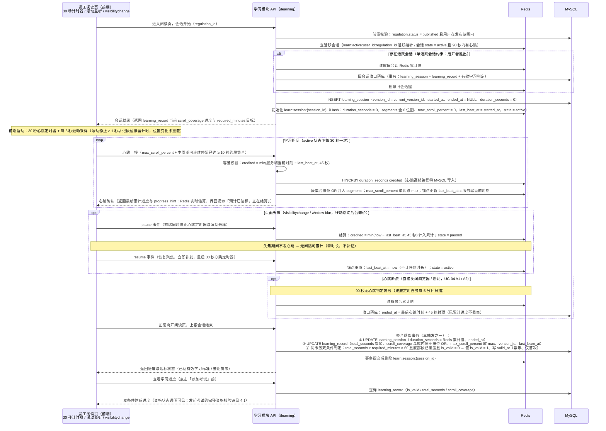

**步骤说明**：

| 阶段 | 步骤 | 说明 | 对应场景 |
|---|---|---|---|
| 一 会话开始 | 消息 1 ~ 9 | 前置校验（`published` + 范围内）→ 单活跃会话约束检查（存在活跃会话则先收口旧会话，后开者胜出，阻断双标签页并行刷时长）→ INSERT `learning_session` → Redis 初始化 `learn:session:{session_id}`（`duration_seconds` / `segments` / `max_scroll_percent` / `last_beat_at` / `state`） | FR-LRN-01、UC-04 主流程 1 |
| 二 心跳循环 | 消息 10 ~ 15 | 每 30 秒心跳（携带最大滚动百分比与本周期停留 ≥ 10 秒的段集合）→ 服务端时间差计算 → 45 秒封顶 → Redis `HINCRBY` 累计（不写 MySQL）→ 位图按位 OR 合并 → 锚点更新 | FR-LRN-02 / FR-LRN-04、UC-04 主流程 2 ~ 4 |
| 三 失焦暂停 | 消息 16 ~ 20 | `pause` 事件：结算一个 ≤ 45 秒窗口后 `state = paused`，前端停发心跳；`resume` 事件：锚点重置 `last_beat_at = now`、计 0 秒，恢复 30 秒节奏 | FR-LRN-03、UC-04 主流程 5 |
| 四 异常收口 | 消息 21 ~ 24 | 90 秒无心跳判离线；`ended_at` 取最后心跳 + 45 秒封顶；已累计进度不丢失 | UC-04 A1 / A2 |
| 五 聚合落库与判定 | 消息 25 ~ 28 | 落库三触发（正常退出 / 90 秒离线收口 / 每 5 分钟兜底扫描）任一触发 → 单事务完成会话收口 + `learning_record` 聚合 + 双条件判定 → `is_valid = 1`（幂等置位）→ 删除 Redis 会话键 | FR-LRN-05、UC-04 主流程 6 ~ 7 |
| 六 进度与资格可见 | 消息 29 ~ 31 | 学习页实时展示双条件达成进度；资格状态对员工透明可见 | UC-05 主流程 1、后置条件 |

**关键规则**：

| # | 规则 | 出处 |
|---|---|---|
| 1 | 时长唯一来源是服务端相邻两次心跳到达时刻的间隔（服务端时钟、毫秒精度），客户端上报的时间戳不参与任何判定 | C-01、07 册 3.1.1 |
| 2 | 单次心跳最大计入 45 秒：`credited = min(diff, 45)`；高频上报不虚增（每次计入 ≈ 真实间隔）；低频上报（如 60 秒 / 次）每轮反而亏 15 秒 | FR-LRN-02、07 册 3.1.2 |
| 3 | 心跳先在 Redis 累计（`HINCRBY` 单命令原子累计），会话结束 / 定期才落库：数据库写频率从逐心跳降至每会话一次（AD-04：Redis 只存可再生临时态，MySQL 是唯一权威源） | 03 册 6.3 |
| 4 | 失焦暂停锚点模型：`pause` 结算封顶后置 `paused`（此后普通心跳只更新滚动位置、不计费）；`resume` 只重置锚点、不产生时长；不发 `pause` 直接失焦时由「断流首拍封顶 45 秒」兜底 | 05 册 5.4.3 |
| 5 | 单活跃会话约束：同一用户同一制度至多一个会话在累计（`learn:active:{user_id}:{regulation_id}` 活跃指针）；旧会话立即收口落库、新会话接管（后开者胜出）；同一用户同时学两个不同制度是允许的 | 05 册 5.4.1、07 册 3.1.4 |
| 6 | 滚动位图只计停留 ≥ 10 秒的段：前端每 5 秒采样、滚动静止 ≥ 1 秒记段位停留计时；30 秒心跳携带「本周期内连续停留已达 ≥ 10 秒的段集合」；途经不算读过（快速拖到底部，途经段不置位，底部段真实停留 ≥ 10 秒才置位） | 07 册 3.1.3 定稿 |
| 7 | 位图只增不减：回滚不取消已置位段落；`max_scroll_percent` 单调不减；跨会话按位 OR 合并、合并幂等 | FR-LRN-04 验收②③、03 册 3.3.2 |
| 8 | 落库幂等：以 `ended_at IS NULL` 作为「未收口」判据，已收口会话重复触发落库直接跳过；Redis 不可用时兜底任务可从库侧扫描恢复（NFR-11 / NFR-12） | 05 册 5.4.6 |
| 9 | 双条件判定在每次聚合落库事务内执行；达标当次落库即置位，`is_valid` 一旦置 1 永不回退，`valid_at` 只写一次；心跳响应只返回 `progress_hint`（Redis 实时估算），`is_valid` / `valid_at` 仅由聚合落库事务产生 | FR-LRN-05 验收③ |

### 3.2 单次心跳的服务端处理决策

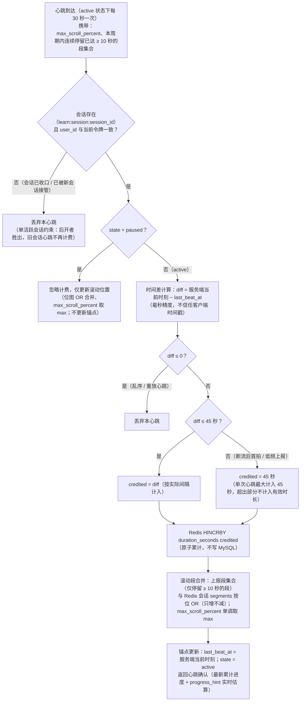

**步骤说明**：① 归属校验（会话存在且令牌一致，否则丢弃）；② `paused` 态心跳只更新滚动位置不计费；③ 时间差 `diff = 服务端当前时刻 − last_beat_at`；④ `diff ≤ 0` 判乱序 / 重放丢弃；⑤ 容差封顶 `credited = min(diff, 45 秒)`；⑥ Redis `HINCRBY` 原子累计；⑦ 段集合按位 OR 合并、`max_scroll_percent` 取 max；⑧ 锚点更新并返回确认。失焦恢复的锚点重置由独立 `resume` 端点完成（见 3.1 失焦暂停），心跳请求体不携带任何恢复标记。

**关键规则**：

| 作弊手段 / 异常场景 | 服务端防线与结果 |
|---|---|
| 高频上报（篡改前端每秒 1 次） | 每次计入 `diff ≈ 1 秒`，累计 = 真实经过时间，`total_seconds` 不虚增（FR-LRN-02 验收②） |
| 篡改客户端时间 / 时间戳 | 时长完全由服务端时钟差计算，客户端时间不参与判定（C-01） |
| 改心跳间隔为 60 秒 | 每次封顶计入 45 秒，每轮亏 15 秒——作弊者自我损耗 |
| 双标签页并行 | 单活跃会话约束：旧会话收口、仅新会话计费 |
| 不发 pause 直接失焦 / 断网 | 恢复后首拍 `diff > 45 秒` → 只计 45 秒（兜底封顶，UC-04 A1） |
| 伪造高频 resume | resume 只重置锚点、不产生时长，无任何收益 |
| 快速拖到底部刷覆盖 | 途经段未静止停留 ≥ 10 秒不置位（07 册 3.1.3） |

### 3.3 滚动覆盖位图更新示意

`learning_record.scroll_coverage`（结构：`total_segments` / `covered_count` / `segments`，长度恒为 10）跨会话按位 OR 合并与底部段判定：

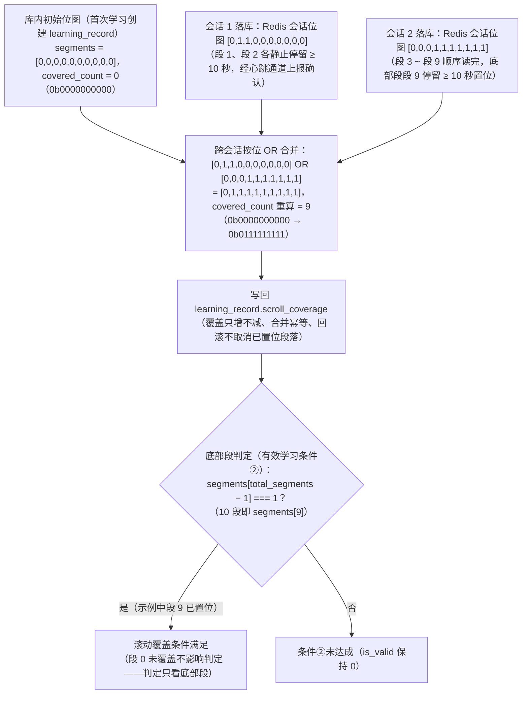

**位图示例**：

| 时点 | segments（下标 0 ~ 9） | 二进制表示 | covered_count | 说明 |
|---|---|---|---|---|
| 首次学习创建 | [0,0,0,0,0,0,0,0,0,0] | 0b0000000000 | 0 | 全 0 初始化（长度 = `regulation.scroll_segments`） |
| 会话 1 落库后 | [0,1,1,0,0,0,0,0,0,0] | 0b0110000000 | 2 | 段 1、段 2 停留 ≥ 10 秒置位 |
| 会话 2 落库后（按位 OR） | [0,1,1,1,1,1,1,1,1,1] | 0b0111111111 | 9 | 底部段（段 9）已置位 → 条件②满足 |

**关键规则**：① 段位置计算：前端按阅读容器滚动高度把视口底缘映射为 0 ~ 100% 再除段取整；② 置位证据链：段的置位当且仅当「静止停留 ≥ 10 秒 + 经心跳通道上报确认」双条件（途经不算读过）；③ 跨会话合并发生在聚合落库时（Redis 最新位图与库内位图按位 OR 后写回，`covered_count` 重算）；④ `max_scroll_percent`（0 ~ 100）与位图并存——前者是展示进度（进度条），后者是判定依据（底部段），二者不可互相替代。

### 3.4 legacy 制度考试资格的衔接（UC-05）

有效学习判定的产物 `learning_record.is_valid` 即旧制度的**考试资格事实**：员工在学习页可实时看到双条件达成进度（累计有效时长 / 目标时长、底部段覆盖状态）；点击「参加考试」时由考试评分模块的 legacy 资格校验链强制校验（见 4.1）：`is_valid = 1` → 允许开考；`is_valid = 0` → 拒绝并返回差距信息（剩余有效时长缺口 = `required_minutes × 60 − total_seconds`、底部段未覆盖）；暂无已发布试卷 → 提示「暂未开考」（UC-05 A1 / A2）。资格不冗余存储快照到旧考试域，考试记录创建时实时校验（资格只升不降）。

新培训考试默认不要求制度阅读或视频课程完成，首次开考读取管理员维护的类别/来源并冻结来源、难度、规则与个人题单；补考沿用该快照。两条路径不能通过把“来源”写入权限角色或用一个 `is_valid` 布尔值混合表达。

---

## 4. 学员移动考试与legacy固定卷兼容流程

Task13/14 / Exam Contract v1 / Gate H2已实现并自动验证。新移动考试走/me、mobile employee实名及稳定ID协议；PC学员考试菜单和/my/exams深链接已关闭，管理题库、组卷、只读记录保留。旧/exams仅是制度固定卷数字协议兼容，不得访问training release。真实后端浏览器全链、真实短信/腾讯、真实弱网、微信开发者工具/真机仍未验。

**可选考前学习要求（2026-10-26）**：管理员开启后选择课程及正整数累计分钟，发布冻结要求。新开考和补考在写assignment/record/items之前合计本人关联课程当前有效video版本的credited_ms，每version一次；未达标40901并告知缺口，达到后继续原资格/次数流程。重复有效观看遵守现有计时，不混用coverage_ms。旧release阈值NULL保持原行为，正在进行考试恢复不新增学习阻断。备注保存于试卷管理配置，不作为学员考试通知。

### 4.1 legacy固定卷兼容边界

legacy继续检查制度/试卷published、learning_record.is_valid、次数与并发，并保留资格差距信息。新开考冻结release或首次legacy_start题面，旧source question ID精确映射本次item ID，显示数字selected经当时冻结映射转换；旧原始域结果形状保留，不能用当前题库替代快照。旧heartbeat/暂存服务只用于该兼容协议，新/me没有服务端draft/heartbeat。

legacy主动提交仍兼容原数字body和已确认暂存；到期事件、恢复及任务清扫统一纯timeout，不取Redis或旧草稿评分。历史已评分timeout、旧submitted与历史分数均只读，不回写新规则。最终评分最高分仅统计合法已评分集合，新纯timeout不进入finalized分母。

### 4.2 新移动考试：本地作答与主动整卷

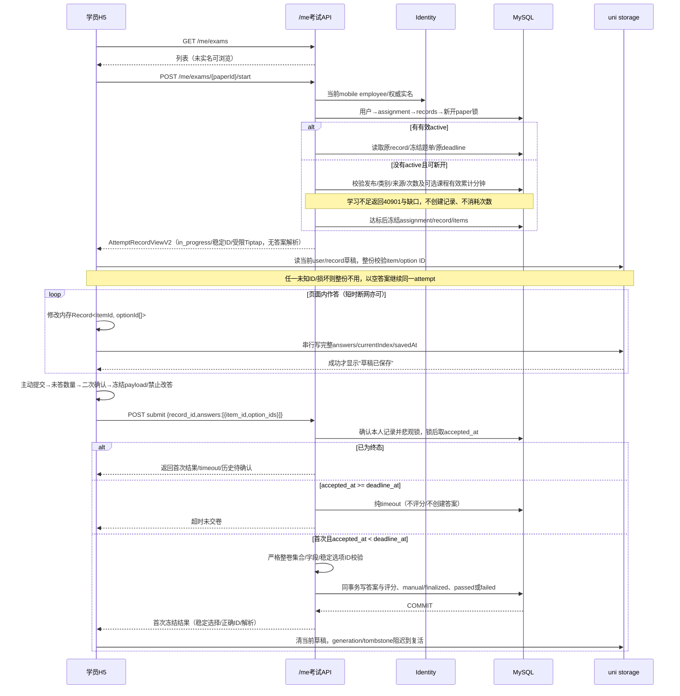

**关键规则**：新开/恢复进行中题面/主动交卷须实名，终态状态及历史读取不额外要求实名；来源/类别变化、撤卷或改题不能改变active的record/snapshot/deadline。新body每题恰一次、未答[]，unknown/duplicate/cross-item或旧selected/revision等非法字段拒绝40001。稳定option ID重排不变，既不转展示下标，也不让前端评分。

**重进与退出**：先联网GET原record，进行中才取不可变题面并核验草稿；离线刷新无题面，只显示重试。题面不存本地，草稿只含answers/currentIndex/savedAt，按ruleexam:mobile:<userId>:exam-draft:<recordId>隔离。明确离开答题页保留草稿，主动登出清当前用户所有草稿，普通401保留所属草稿；换号不读旧key。返回/退出尽可能强确认，系统回收或强关无法绝对阻止。

**结果不明**：冻结payload后先查record；passed/failed进入首次结果、timeout进入超时、历史submitted显示“历史结果待确认”。仍active且未截止最多重试一次完全相同payload，再次不明保留草稿/冻结payload并继续查询，不冒报成绩或改答案后重试。

**结果与媒体**：新manual/finalized与历史已评分timeout可按已知冻结结果返回逐题得分/正确选项/解析；新timeout为score=0、passed=false、correct_rate=null、items=[]。题图按exam_record_question/item_id签短票，签发/读取复核精确引用与阶段：实名/未截止在考仅prompt，passed/failed及历史已评分timeout可读冻结题干/选项/解析图，仅新纯timeout拒绝。PC管理预览独立，不能签learner票据；URL不带JWT。

### 4.3 纯timeout收口（绝不自动交卷）

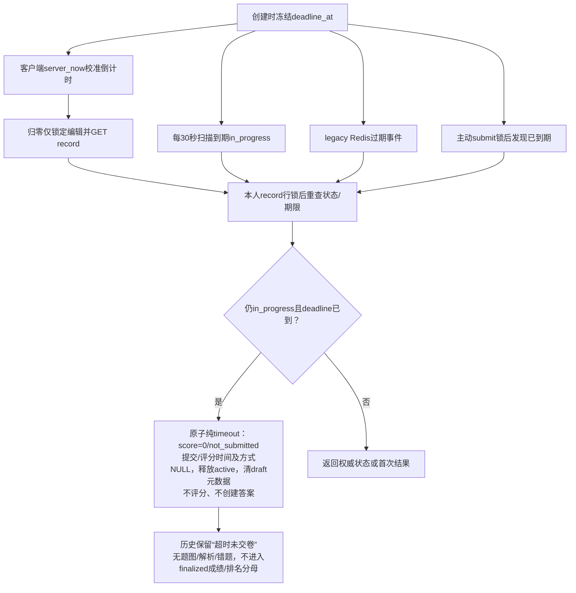

所有到期入口使用同一收口，不能由倒计时、读取、恢复、sweeper或Redis触发submit/评分。升级前active的非终态草稿答案仅清同record，不改历史终态/快照/成绩。submit锁后取唯一accepted_at，严格小于deadline才有效，相等也timeout；不能用请求发出/进入队列时刻或本地点击时间认定成功。

---

## 5. 状态机设计

### 5.1 legacy 制度状态（只读兼容）

现行管理端和管理 API 不再提供制度创建、编辑、发布、范围、学习要求或版本切换。以下状态仅用于解释历史数据、旧学员阅读和旧固定卷资格，不能作为恢复制度管理 CRUD 的依据：

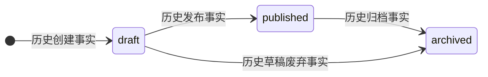

**历史流转说明（只读解释，不是现行操作入口）**：

| 流转 | 触发与前置条件 | 影响 |
|---|---|---|
| `[*] → draft` | 历史创建记录 | 草稿态制度对 legacy 学员端不可见 |
| `draft → published` | 历史发布时要求 parsed 版本与范围 | 写 `published_at`；范围内 legacy 学员可见、可学习 |
| `published → archived` | 历史归档事实 | legacy 学员端不可见、不可再学习与考试，历史数据保留并计入统计（C-08） |
| `draft → archived` | 历史草稿废弃事实 | 未发布过，无 legacy 学员侧影响 |
| 历史自环 | 旧系统曾允许上传版本、切换指针和调整学习要求/范围 | 现行管理端/API 不再提供这些操作；历史事实保持原样 |

**历史版本影响**：既有 `regulation_version` 保持 append-only；历史 current 指针、学习会话版本、进度、资格和范围统计均按已有事实读取，不因前台删除制度管理而重写或清零。新的出题资料版本走第 2 章资料 API，不通过本状态机发布。

### 5.2 出题资料版本解析状态机

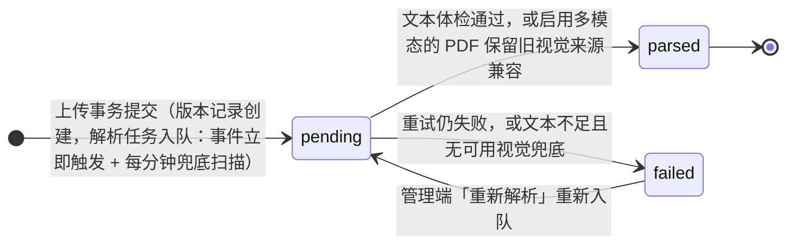

**流转说明**：① pending 上传即入队；② 文本体检通过写产物后 parsed；启用多模态时，扫描 PDF 即使文本不足也 parsed，原 PDF 保留为旧视觉来源兼容，不开放当前直接出题；③ 读取/解析重试仍失败，或无视觉兜底的低文本产物才 failed；④ failed 可重新解析/上传；⑤文件与成功产物保持版本不可变。

**关键规则**：parsed表示资料解析成功，pending／failed仅描述资料版本解析，不是题目审核状态。当前不开放资料直接出题或历史题regenerate写入口；真实旧PDF来源／页组和任务结果仅读保留，资料不提供发布或“当前生效版本”切换。

### 5.3 当前题库身份启停与不可变内容版本

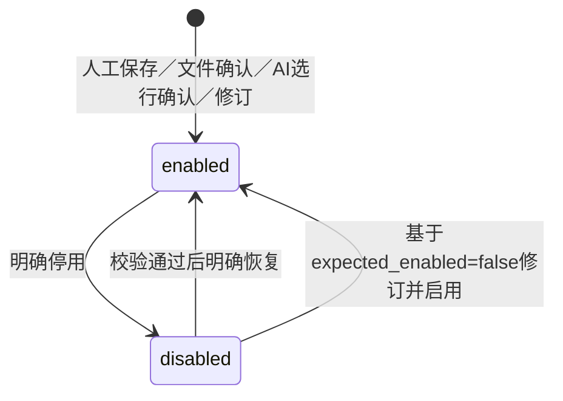

权威状态在question.is_enabled，启停不新增内容revision。修订同时显式提供expected_version_id与expected_enabled，锁内任一不符40940；停用题只有基于所见停用态明确提交才恢复。恢复在同一事务中重验结构、类别、启用难度、来源和媒体；同目标启停幂等，不重复审计。

新题和新revision兼容status=approved，concept_id／score／审核人、时间、意见均NULL；旧pending／rejected由026映射停用，不自动批准旧题。旧版本与真实审核事实只读保留，独立review和历史题直接regenerate路由退场。旧题首次修订诚实捕获，legacy_captured_at不冒充历史时间；legacy在考核心修改40908及引用后题型变化限制保留。

approvedCandidates仅为兼容方法名，新候选实际要求is_enabled=1＋精确current version，匹配类别／题型／启用难度／来源／媒体。random草稿题图复用相同规则且不伪造引用。制度新固定卷仍只消费single/multiple；所有新发布按question_id去重。既有release读取historical-concept，预览与开考按冻结concept或question_id保持历史分组。

#### 5.3.1 C1 培训试卷发布时序

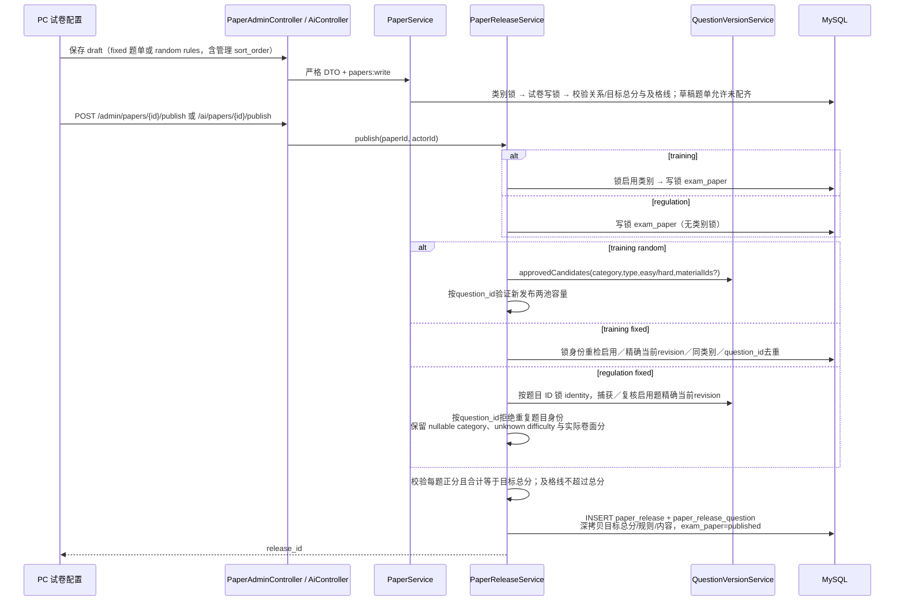

发布失败整个事务回滚，不留空 release、published 状态、旧题捕获版本或题单版本关联；新候选与新发布仅按question_id去重，新release不写concept；既有随机release按冻结concept／question_id保留historical-concept抽样，预览与开考一致。已发布 training 卷的普通/答案预览与升级后制度卷的 legacy detail 都读 release；题库或策略行之后变化不改变冻结读回。制度卷 list/detail 保留数字 ID 与原字段，只新增 `release_id/rules_locked`；有 release 的修改走 `/ai/papers/{id}/copy`。真正升级前 published 无 release 的制度卷保持可见，C2 在其首次新开考时冻结当时事实。历史撤回/归档保留 release，禁止新开；已有 active 可继续恢复。培训新流程为 draft → published → draft（撤回后可修改再发布新版本），归档及 legacy 状态写入口继续退场。

`sort_order`仅在培训试卷管理链路创建、更新、复制和列表投影中流转；列表按小值优先、同值新ID优先。发布不冻结该字段，C2开考及历史legacy链路均不读取它。

操作信息由服务端认证身份维护：新建／复制写创建人和更新人，配置保存、题单替换与首次发布写最后更新人并推进更新时间，创建事实不变。详情一次查询创建／更新两人并返回显示名；历史未知返回空，不能从审计日志或当前操作者补造。

training新建／复制显式以同一个`new Date()`写创建与更新时间，沿用UTC驱动序列化，不使用数据库本地`CURRENT_TIMESTAMP`生成新卷时间；后续配置／题单／首次发布仍显式推进更新时间。不更改历史时间、驱动配置或数据库会话设置。

列表基本修改通过`PUT /admin/papers/{id}`传`preserve_questions=true`；该可选布尔只属于更新DTO，创建拒绝，既不持久化也不进入release。服务端按既有“类别→试卷”锁序取得试卷写锁后，在字段赋值及清题前检查本次类别／模式是否变化，并用同一事务的`PaperQuestion`仓储核对当前题单。有题则40970整笔拒绝，配置、题单、操作者／时间均不变，无成功审计；锁内空卷允许修改。弹框读取空卷后另一会话新增题目也不能绕过；未传或显式false仍保留设计器原有换类／换模式清题语义。

**培训草稿删除（2026-10-27）**：PC确认删除后调用`DELETE /admin/papers/{id}`，后端校验`papers:write`。`PaperService.deleteTraining`在同一事务中取得试卷写锁，重新检查目标属于training且仍为draft；不存在或legacy目标返回40401，其它状态返回40970。随后分别检查`paper_release`、`exam_assignment`、`exam_record`的`paper_id`引用，任一存在均返回40970。无引用才依次删除该卷`paper_question`与`exam_paper`，整体提交后写`training_paper.delete`成功审计并返回统一信封`data:null`；任一步失败则回滚，不写成功审计。类别已停用不阻止删除；共享题库、题目版本、课程、媒体、学习记录、发布快照和考试历史均不清理，不增加软删字段。

删除仅锁试卷，发布仍按“类别→试卷”加锁，共用试卷写锁保证两种顺序：删除先获锁并提交时，发布等待后返回40401，不留下release或题目快照；发布先获锁并提交时，删除等待后返回40970，保留完整发布事实。重复删除已移除目标返回40401；客户端对未知写结果不自动重发，先读取当前列表/详情核对。

#### 5.3.2 C2 原子个人题单与恢复时序

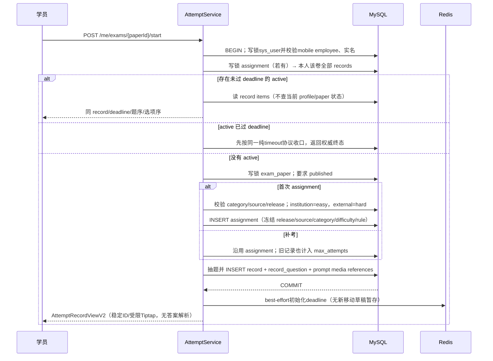

任一抽题、快照或媒体绑定失败都回滚 assignment/record/items。`uk_active_assignment` 保证同一 assignment 至多一个非 NULL 活动指针；终结事务必须清空该指针。start不在用户锁内嵌套借连接；到期active先纯timeout收口，状态读取和30秒sweeper使用相同协议，不评分。题图 owner 固定为 `exam_record_question/item_id`，本人只能读该 item 冻结题干与选项实际引用的资源。

### 5.4 考试记录状态机（exam_record.status）

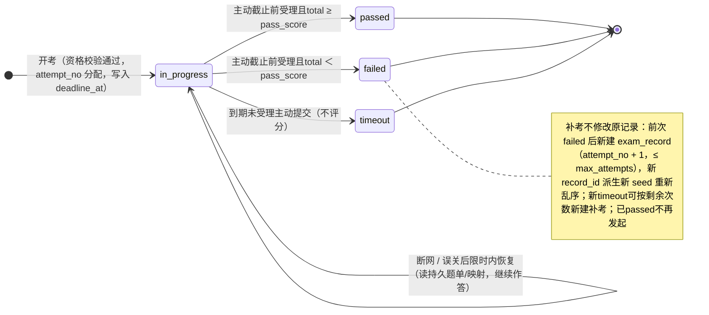

**流转说明**：主动受理形成passed/failed、manual/finalized；到期形成timeout、方式/提交/评分时间NULL、not_submitted/0分且无答案。record锁仲裁不同答案并发与timeout竞争，终态重试只读首次结果。新timeout保留历史但排除finalized统计；旧已评分timeout和submitted只读兼容。补考新建记录并计次，不回退旧终态。

> 新作答仅接受三类客观题并自动终结，`grading_state` 只有 `not_submitted / finalized`。历史数据若仍含旧状态，只按兼容读取处理，不重新开放图片答案或人工评分入口。

### 5.5 学习记录有效化（learning_record.is_valid）

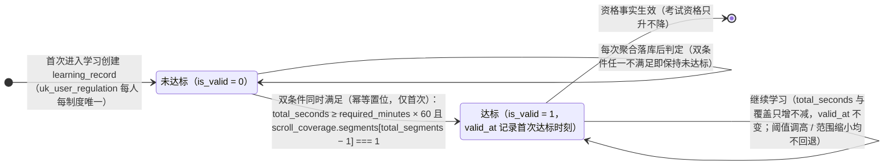

**一次性、不可逆的设计取舍说明**：

| 维度 | 说明 |
|---|---|
| 单调性依据 | `total_seconds` 只累加、`scroll_coverage` 按位 OR 只增不减 → 双条件判定单调，达标后任何后续操作都不可能破坏已满足的条件，「不可逆」是数据性质的必然结果而非额外约束 |
| 阈值调整不回退 | 调高 `required_minutes` 后：已达标员工保持达标、未达标员工按新阈值继续判定（UC-02 A2、FR-REG-05 验收③）——避免「先达标后失效」的追溯混乱 |
| 范围缩小不回退 | 发布范围调整后，范围外员工已有记录（含 `is_valid = 1`）保留不删、不回退；学习完成率分子按「应学集合 ∩ `is_valid = 1`」计算，不出现完成率 ＞ 100% 的口径事故 |
| 资格仲裁简化 | 若资格可回退，将出现「已开考 / 已交卷记录 vs 资格失效」的复杂仲裁；一次性置位使考试资格**只升不降**，考试域只需开考时校验一次、无需资格快照 |
| 审计合规 | `valid_at` 是资格起点（只写一次），与 `learning_session` 会话流水、心跳上报证据链共同构成达标争议时的审计依据 |
| 反向代价与兜底 | 误判风险由双条件的服务端严格判定控制（时长全靠服务端时钟差、覆盖全靠停留 ≥ 10 秒 + 心跳确认）；管理员如确需强制重学，通过提高 `required_minutes` 或发布新制度实现（C-07），不提供回退入口 |

### 5.6 课程状态机（training_course.status，B1）

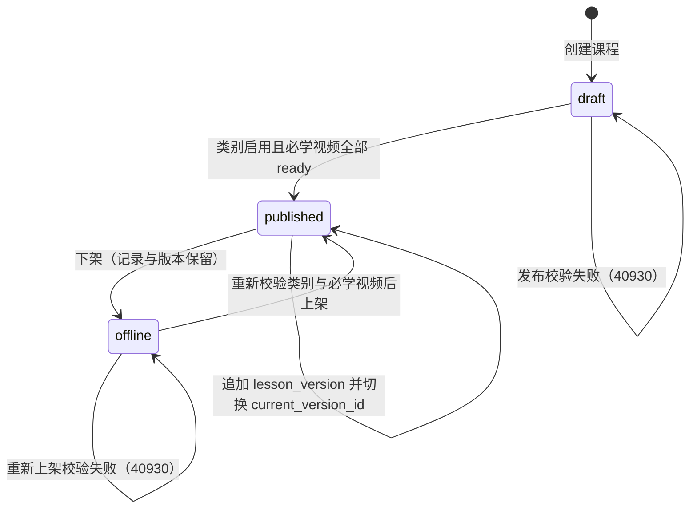

published 状态不允许修改章节/课时结构；如需调整结构先 offline。课程资料可更新，但类别改成新的非空值仍须在同一写事务中锁定并校验启用。B1 不提供硬删除状态，避免提前破坏 B2 学习事实与历史媒体版本。draft/offline 课时允许通过 `DELETE /admin/courses/{id}/lessons/{lessonId}` 逻辑删除；同一事务先锁课程再锁课时，检查状态与归属，只设置 `deleted_at`（及更新时间），不清空版本指针、不解绑媒体、不清理学习事实，不增加恢复入口。TypeORM 默认过滤有效课时，当前目录、必学分母、上架校验、媒体授权、视频开播/心跳和管理统计均排除已删除课时；历史学习记录按本人及不可变版本查询，仍保留。媒体旧票据重读也重查授权。详情课时的创建时间读取持久化 `createdAt`。023 只追加可空列并继承 005 的完整表结构探针；必须先迁移再启用依赖该列的后端，自动化/SQL 契约不等于业务库已升级；本机执行结果另记验收记录。

### 5.7 视频学习会话与完成状态（B2）

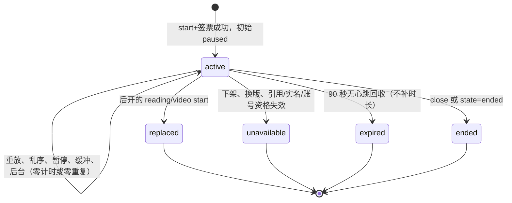

会话终态统一写 `ended_at` 并将 `active_user_id` 置NULL；`video_learning_record.is_completed`与覆盖区间保留。换版新建独立record，旧完成不套用新版本。learner课程汇总只对当前published课程必学video版本计数，external/institution和缺类别同口径；零分母null，不伪造完成。source/category变化本身不使视频失效。onHide的background不结束session，onUnload/90秒回收不补时。

---

## 6. 统计数据流转（UC-08 / UC-10）

### 6.1 legacy 制度统计后端数据流（前端入口隐藏）

下图保留旧制度统计的后端口径，供历史记录兼容与回归使用；当前管理端“统计分析”直接进入 §6.2.1 的培训统计，旧制度/部门/个人报表 URL 回业务首页。

```mermaid
flowchart LR
    subgraph SRC["行为与基础数据（统计模块只读，零写路径）"]
        direction TB
        D1["learning_session<br/>学习会话流水（起止 / 时长，审计下钻入口）"]
        D2["learning_record<br/>total_seconds · scroll_coverage · is_valid"]
        D3["exam_record<br/>status · score · attempt_no · submission_method"]
        D4["exam_answer<br/>selected_option_ids（v2）/ selected（legacy） · is_correct · gained_score"]
        D5["regulation_scope + sys_department + sys_user<br/>应学集合口径（发布范围 × 在职 status = 1）"]
        D6["regulation（required_minutes）·<br/>exam_paper（pass_score）"]
    end

    subgraph CALC["统计口径计算（应学集合统一产出，各维度复用）"]
        direction TB
        C1["应学人数：发布范围内在职员工数（C-09）"]
        C2["学习完成率：应学集合中 is_valid = 1 人数 ÷ 应学人数"]
        C3["参考人数：合法已评分记录去重<br/>新纯timeout/历史submitted排除"]
        C4["通过率 / 平均分 / 分数分布：各考生最高分（MAX(score)）口径<br/>分段 [0-59] [60-69] [70-79] [80-89] [90-100]"]
        C5["未完成人员清单：应学未达标（附差距原因）+<br/>已达标但考试未通过 / 未参考"]
    end

    subgraph VIEW["报表展示（三维）"]
        direction TB
        V1["制度维度报表（UC-08）"]
        V2["部门维度对比（部门树汇总 / 跨制度矩阵）"]
        V3["个人维度统计（学习记录 + 考试成绩；employee 仅本人）"]
    end

    subgraph EXP["Excel 导出（UC-10）"]
        direction TB
        X1["各维度统计报表导出"]
        X2["未完成人员清单导出（流式分页、中文表头、万行 ≤ 30 秒）"]
        X3["线下督办跟进闭环"]
    end

    SRC -->|"只读聚合（索引支撑：idx_regulation_valid / idx_regulation_status / uk_paper_user_attempt / idx_department_status）"| CALC
    CALC --> VIEW
    VIEW --> EXP
    C5 --> X2
```

**步骤说明**：① 数据源：学习域（`learning_session` / `learning_record`）与考试域（`exam_record` / `exam_answer`）的行为数据，叠加应学集合口径基座（`regulation_scope` → 部门树展开 / `is_all` 全员 → `sys_user.status = 1`）；② 口径计算：以应学集合为锚点统一计算各指标（学习完成率分子分母同源，范围调整后口径随之更新）；③ 报表展示：制度 / 部门 / 个人三个维度（部门维度按 `sys_user.department_id` 切片 + 部门树父级汇总，跨制度支持「部门 × 全部已发布制度」矩阵）；④ Excel 导出：各维度报表与未完成人员清单导出，形成线下督办闭环。

**关键规则**：统计模块对业务事实表**只读、零写路径**，报表永远不污染业务数据；legacy 制度报表后端继续按原跨试卷取最高分口径兼容，但前端页面与旧 URL 已隐藏/重定向。当前培训报表按 paper 的历史人数和“最新 release + 完全相同冻结规则 + 明确难度”的 finalized 个人最高分分别计算；空应考集合的参与率为空。培训统计直接查库、不进入 legacy Redis 统计缓存，人员/课程版本/判分变化由下一请求读取；每项指标在页面明示口径定义。

### 6.2 legacy 统计口径速查表

| 指标 | 精确口径 | 主要数据来源 |
|---|---|---|
| 应学人数 | 发布范围内在职员工数（`is_all = 1` 全员；否则圈定部门含子部门中 `sys_user.status = 1` 的去重员工数） | `regulation_scope` + `sys_department` + `sys_user` |
| 学习完成率 | 应学集合中 `learning_record.is_valid = 1` 的人数 ÷ 应学人数 | `learning_record`（`idx_regulation_valid`） |
| 参考人数 | 合法评分事实去重：passed/failed与旧已评分timeout；新纯timeout/历史submitted排除 | statistics.service.ts中的hasScoredResult；idx_regulation_status |
| 通过率 | 各考生最高分 ≥ `pass_score` 的人数 ÷ 参考人数（每人最高分 = 该制度下全部作答的 `MAX(score)`，跨试卷取最高） | `exam_record`（`uk_paper_user_attempt` 前缀 + 回表） |
| 平均分 | 各考生最高分的算术平均（两位小数） | 同上 |
| 分数分布 | 各考生最高分按闭区间分段计数：[0-59]、[60-69]、[70-79]、[80-89]、[90-100] | 同上 |
| 未完成人员清单 | ① 应学集合中 `is_valid = 0` 或无 `learning_record` 记录者（附剩余时长缺口、底部段覆盖状态）；② 已 `is_valid = 1` 但历次最高分 ＜ `pass_score` 或未参考者（标注「考试未通过 / 未参考」） | 应学集合 LEFT JOIN `learning_record` ∩ `exam_record` 聚合 |
| 题目正确率（扩展） | 跨全部考试按题聚合 `exam_answer.is_correct` | `exam_answer`（`idx_question`） |

> **培训统计（已落地，C6）**：人数类字段保留该 paper 按冻结字段筛选后的历史范围；参与率分子取当前应考与历史成功开考用户交集，当前范围外历史人数另列。成绩/分布/排名只取最新 `release_id`、完全相同 `rule_snapshot`、同 difficulty 的 `finalized` 个人最高分，不跨 release/规则合榜；不同难度不产生默认总榜。旧制度/部门/个人报表继续按上表 legacy 口径。

#### 6.2.1 C6 实时培训统计流程

```text
paper_id + 可选类别/来源/难度
  ├─ 当前 sys_user(status/category/source) → 当前应考集合
  ├─ exam_record 冻结 category/source/difficulty → paper 历史开考/终态人数
  ├─ latest paper_release + exact rule_snapshot + difficulty
  │    → finalized → 每人最高分 → 分布/通过率/1,1,3 排名
  └─ published course → required lesson.current_version_id
       → video_learning_record.is_completed → 仅 institution 课程完成率
```

同一用户最高分并列时，优先取较早完成自动结算者；历史未知时间不补造，改按最小 record_id 稳定兜底。排名同分的展示顺序同样不读取用时；考试用时由开始/提交/截止事实计算。未完成原因按“未完成学习 / 未参加考试 / 未通过”分别聚合人数，原因可独立出现；当前培训统计不提供未完成人员明细清单。external 和零必学课时不会被伪造为课程未完成。

#### 6.2.2 运营看板加载、下钻与版本失效

```text
进入/重新激活首页、点击刷新
  ├─ 概览：登录后逐项裁剪 → 五卡与服务端日期
  └─ 有 statistics:read → 并行读取趋势、最近考试、必修候选
       └─ 首次有效候选 → 学时摘要（无候选显示无要求）
            ├─ 发布要求 + 当前有效视频版本 + 应学集合 → credited_ms达标
            ├─ 零应学 → no_audience / 比例null
            └─ 40970 → 清旧选择/数字 → 重读候选 → 等待手动重选
```

首挂载与首激活只触发一批。切7/30日只读趋势，切培训只读摘要，候选搜索/翻页不联动最近考试；首次候选失败的重试仍初始化摘要，趋势切换不能取消该初始化。每区有独立请求代次与错误，失活时废弃旧响应；ECharts实例销毁，再激活重新建立。全页时间只有可见模块全部成功才推进，局部失败保留上次时点，跨午夜仅补读概览/趋势对齐业务日期。

学员/题目/试卷/统计入口先经过未保存保护，再消费 `entry=dashboard` 清旧筛选并应用参数；`create=1` 打开现有弹窗成功后消费，不因刷新/返回重复打开。取消离开保持草稿；同业务路径页签和缓存合并，但不合并不同详情。日期入口使用响应 periods/point.date；统计展示不代表有记录访问权限。最近考试 paper_id 深链独立于学时选择，归档不以当前已发布options判断存在性。

403或权限收回清除旧受限模块；会话被吊销沿401处理退出并清数据。网络失败保留局部重试，不伪装成0；暂无要求、no_audience、无人达标分别显示。上述流程经隔离API与Kimi插件实际操作验证，记录见[验收记录](../../review/2026-10-27-admin-operations-dashboard-acceptance.md)。

### 6.3 Excel 导出闭环

| 项 | 设计 |
|---|---|
| 导出物 | 当前培训统计的明确难度排名与口径说明 Sheet；原制度/部门报表后端兼容但前端不提供入口 |
| 一致性 | 培训导出复用 ranking 同一 filter/page/page_size，主 Sheet 行与当前屏幕页一致，口径 Sheet 明示“历史人数 vs 当前 release 成绩组” |
| 生成机制 | 服务端生成 xlsx 文件流（附件响应）；流式分页取数（按主键游标分批）避免万行全量驻留内存 |
| 性能 | 万行级导出 ≤ 30 秒（NFR-03 / FR-STT-05 验收③） |
| 空清单 | 全员已完成 → 提示「无未完成人员」、不生成文件（UC-10 A1）；导出失败提示重试（A2） |
| 留痕 | 导出操作写审计日志（操作人、时间、导出物与数据范围，NFR-10） |
| 督办闭环 | 清单含部门、姓名、工号、学习时长进度、覆盖状态、考试状态与未完成原因 → 管理员线下跟进督办 |

---

## 附：一致性对照与用例覆盖

### 附一：与基准文档一致性对照

| 对照项 | 基准落点 | 本文档体现 |
|---|---|---|
| 当前表名 | README 3.3 | 12 张 legacy 保持不变；A2—A5、B1—B3、C1/C2 与 020 两张实名表同步加入，当前共 40 张业务表，另有 1 张 migration 元数据表，共 41 张物理表；Gate G/H1/H2分别已自动验证，021增5兼容列不增表 |
| 全部枚举值 | README 3.4 + B1—B3/C1 | §5 状态机覆盖 regulation / regulation_version / 当前 question_version / exam_record / training_course / video_learning_session；question.status 为当前版本兼容值，learning_record.is_valid 为 1/0 布尔口径 |
| 核心术语 | README | 心跳上报（30 秒/次、45 秒封顶）、滚动覆盖率、legacy 有效学习、服务端截止时间、三类客观题自动评分、试题与选项乱序、补考取最高分等逐条对应 |
| 流程覆盖 | 本册 1.4 | F-01 ~ F-06 现行闭环 + L-01 legacy 兼容边界 |
| 字段与索引 | 03 册 | 落库事务、Redis Key、唯一键（含 uk_exam_assignment_paper_user / uk_active_assignment / uk_assignment_attempt / uk_exam_record_question_position）及兜底扫描索引（idx_status_deadline）逐字采用 |
| 模块设计决策 | 05 册 | 失焦暂停 pause / resume 锚点重置（5.4.3）、心跳 Redis HINCRBY 累计（5.4.2）、单活跃会话约束（5.4.1）、参考题AI临时任务与确认前零题库写（4.4.2）、纯timeout多入口同一收口（6.4.3）、确定性 seed 乱序（6.4.2）、training 数据库行锁/终态幂等与 legacy Redis 防重（6.4.5）、统计口径（7.4.1）逐条一致 |
| 安全细化口径 | 07 册 | 滚动位图只计停留 ≥ 10 秒的段、服务端绝对截止时间、作答暂存与幂等提交；不采集切屏、连接状态或设备摘要 |
| 架构决策 | 02 册 | AD-03（解析 / AI 出题异步任务）、AD-04（Redis 临时态 / MySQL 唯一权威源）、AD-06（本地文件存储卷） |

### 附二：流程图清单

| # | 章节 | 类型 | 主题 |
|---|---|---|---|
| 1 | §1.1 | flowchart LR | 端到端业务全景图（两条脉络与交汇点） |
| 2 | §1.3 | flowchart TB | 学员与管理员账号准备（管理员原子创建） |
| 3 | §2.1 | ASCII数据流 | 人工／文件／参考题AI预览确认与启用题库 |
| 4 | §2.4 | 异常规则 | 事务回滚、双令牌冲突、未知回执对账及AI失败 |
| 5 | §3.1 | sequenceDiagram | 有效学习判定（会话 / 心跳 / 失焦 / 落库 / 判定，UC-04） |
| 6 | §3.2 | flowchart TB | 单次心跳的服务端处理决策 |
| 7 | §3.3 | flowchart TB | 滚动覆盖位图跨会话按位 OR 合并示意 |
| 8 | §4.2 | sequenceDiagram | mobile实名开考、本地草稿、主动整卷、锁后截止与评分 |
| 9 | §5.3.2 | sequenceDiagram | 原子个人题单与原attempt恢复 |
| 10 | §4.3 | flowchart TB | 纯timeout收口机制 |
| 11 | §5.1 | stateDiagram-v2 | 制度状态机（regulation.status） |
| 12 | §5.2 | stateDiagram-v2 | 版本解析状态机（regulation_version.parse_status） |
| 13 | §5.3 | stateDiagram-v2 | 当前题库身份启停（question.is_enabled）及不可变版本 |
| 14 | §5.4 | stateDiagram-v2 | 考试记录状态机（exam_record.status） |
| 15 | §5.5 | stateDiagram-v2 | 学习记录有效化（learning_record.is_valid） |
| 16 | §6.1 | flowchart LR | 统计数据流转（UC-08 / UC-10） |
| 17 | §1.5 | sequenceDiagram | B1 课程创建、上架、视频换版与下架 |
| 18 | §5.6 | stateDiagram-v2 | 课程 draft / published / offline 状态机 |
| 19 | §1.6 | sequenceDiagram | B2 视频 start、心跳、双向替换与重启恢复 |
| 20 | §5.7 | stateDiagram-v2 | 视频 active / ended / replaced / unavailable / expired 状态 |
| 21 | §1.7 | sequenceDiagram | Gate G三图上传、Provider claim、持久结果与事务绑定恢复（自动化与独立审查通过，真实供应商/真机另验） |

> 本册为设计文档，不含任何系统代码实现（README 第 5 章边界说明）；图中参与方（解析队列 / Worker、第三方 AI 大模型、Redis、MySQL）为逻辑角色，物理上全部交互发生在 NestJS 模块化单进程内或经 HTTPS 出站调用（AD-02 / AD-03 / AD-04）。

## COS直传、短链续签与存量迁移（033）

```text
申请会话 -> 精确临时授权 -> 浏览器COS直传/续传
  -> complete由后端合并/对账 -> 持久finalizing claim
  -> 有限临时文件探测/SHA -> 正式唯一对象+回读SHA
  -> 同事务ready资产/完成回执 -> 原业务保存事务绑定引用

申请或续签读取 -> 当前身份/状态/精确业务引用
  -> COS普通媒体：准确版本短期GET -> 浏览器直接Range读取
  -> local/实名：原受控代理 -> 每次读取仍复核授权

视频临期 -> 同一asset/version续签 -> 换src后恢复位置/播放状态
  -> 原学习session/seq/心跳不重建、不补时
```

（上图COS分支的每次新链接都授权，已发链接有效期内由COS验证签名；撤权不保证旧链接即时失效。）PC/H5网络失败只自动重试一次；账号epoch、关闭和播放终态使迟到结果失效。不能把5分钟链接有效期解释为只可观看5分钟。

迁移独立于DDL：只读异常清单 -> 持久候选 -> 上传/回读 -> 锁资产CAS -> 业务验样 -> 校验本地副本后可逐条回退。无真实批次授权和外部证据时只交付工具/提案，不声称已迁移。
