# 06 · 关键流程 —— 安全培训考试系统（EmodorRuleExam）

> **一句话定位**：本文档以 Mermaid 时序图（sequenceDiagram）、流程图（flowchart）与状态机（stateDiagram-v2）呈现 EmodorRuleExam 的端到端关键流程——培训类别与学员、课程视频、出题资料解析、AI 出题、三类客观题考试、自动评分、记录与统计；legacy 制度阅读和固定卷只作为兼容链路保留。
>
> **口径声明**：本轮用户批准的[瘦身计划](../superpowers/plans/2026-10-22-training-demo-slimming.md)优先于旧分册中被取消的扩展目标。数据落点依据 [03-数据库设计.md](03-数据库设计.md)，模块内部决策依据 [05-模块设计.md](05-模块设计.md)，安全口径依据 [07-安全与非功能设计.md](07-安全与非功能设计.md)。学习时长、视频覆盖、服务端截止时间、答案隔离、确定性 seed、幂等交卷与环境变量密钥等既有红线不因前台瘦身而放宽。

> **状态边界（2026-10-22）**：现行管理端已删除图片作答题、人工阅卷、实时监控/切屏采集、制度管理、员工管理和部门管理。题型严格为 `single / multiple / judgment`，题干、选项和解析中的普通受控图片继续保留。出题资料收进题库 AI 入口；旧制度阅读、旧固定卷及历史统计依赖只在后端兼容，不重新暴露管理 CRUD。原统计页面仅隐藏且旧 URL 回业务首页。独立 H5 不在本期开发范围。

---

## 1. 流程总览

### 1.1 端到端业务全景图

管理端「培训基础数据 → 出题资料 → AI 出题 → 审核 → 组卷发布」与学员侧「课程学习 → 考试 → 自动评分 → 记录」两条脉络及其交汇点如下：

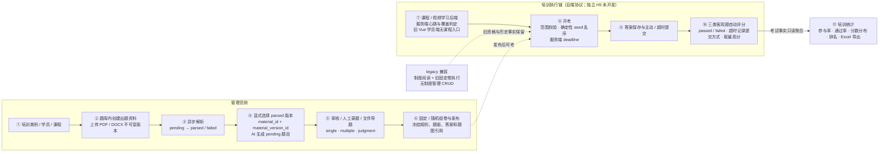

#### 1.1.1 现行培训闭环

新培训考试在同一单体内走以下语义，避免把课程完成、题目来源和权限角色混为一谈：

```text
类别/学员来源（institution 或 external）
        ↓
课程/章节/视频学习（与制度阅读分开；视频 30s 心跳、45s 封顶、2s 位置容差、95% 覆盖）
        ↓
题库版本（single/multiple/judgment + easy/medium/hard + 可选考点/资料版本来源）
        ↓
固定/随机发布快照（本机构→初级，外来→高级；同考点同卷最多一道）
        ↓
首次开考冻结来源/类别/难度/规则与个人题单（默认不检查学习门槛）
        ↓
确认草稿持久化 → 主动/超时幂等交卷（服务端 deadline）
        ↓
三类客观题由服务端自动判分并直接形成最终结果
        ↓
按场次/难度/最终个人最高分统计、排名与当前应考集合交集
```

目标默认值：100 分、60 分及格、30 分钟、总作答 3 次（含首次）、多选漏选 0.5。发布冻结规则与候选版本，首次开考继续冻结个人归属、规则、题单和显示映射；答案保存、服务端倒计时、超时提交和统计均沿用冻结事实。系统不采集切屏或设备连接状态。

**步骤说明**：

| 阶段 | 节点 | 关键动作与数据落点 | 对应需求 |
|---|---|---|---|
| ① 培训基础 | A0 | 维护培训类别、学员与课程；管理员账号由单次原子接口创建并同时绑定至少一个启用业务角色 | 账号与培训管理 |
| ② 资料上传 | A1 | 题库内创建资料 → 上传 PDF/DOCX → 类型、魔数、大小与 SHA-256 校验 → 创建 `pending` 不可变版本；资料与版本 ID 对外均为字符串 | 出题资料 |
| ③ 资料解析 | A2 | 异步解析后流转为 `parsed / failed`；失败可重试，版本不覆盖 | 出题资料 |
| ④ AI 出题 | A3 | 显式选择归属于该资料的 `parsed` 版本，传 `material_id + material_version_id`；文本优先、扫描 PDF 视觉兜底；模型不能改类别、难度或真实来源 | AI 出题 |
| ⑤ 题库审核 | A4 | AI 题审核、人工录题或文件导题统一进入三类客观题题库；题干、选项、解析可绑定受控图片 | 题库管理 |
| ⑥ 组卷发布 | A5 | 固定/随机卷发布时冻结规则与题目版本；资料分类中立，试卷来源按本类别题目的实际来源关联，旧类别资料兼容 | 试卷管理 |
| ⑦ 视频学习 | E1 | 后端视频会话 30 秒心跳、单次最多 45 秒、2 秒位置容差、95% 去重覆盖；旧 Vue 学员端无课程入口，不替代旧制度阅读 | 视频学习 |
| ⑧—⑩ 考试评分 | E2—E4 | 服务器冻结题单与截止时间；持续保存答案；主动或超时提交后自动评分，补考沿用冻结归属并取最高分 | 考试与记录 |
| ⑪ 统计 | S | 按场次、来源、类别和明确难度只读聚合最终成绩，提供分布、排名与 Excel 导出 | 培训统计 |

**关键规则**：

| # | 规则 | 出处 |
|---|---|---|
| 1 | AI 出题必须显式选择归属正确且已 `parsed` 的资料版本；不依赖制度发布、范围或“当前生效版本” | 出题资料契约 |
| 2 | AI revision 必须审核后才可进入候选；候选按类别、题型、难度和来源约束读取当前 approved version | C-03 |
| 3 | 题型严格为单选、多选、判断；普通题图保留，图片答案与人工评分分支不存在 | 客观题契约 |
| 4 | 学习与视频时长只认服务端；旧制度的 `is_valid` 双条件与新培训默认无学习门槛是两条独立语义 | C-01 / C-02 |
| 5 | 最终总分只能由服务端自动评分产生，不提供直接编辑入口；统计只读取终态成绩 | C-05 / C-06 |
| 6 | 服务端 `deadline_at`、答案保存、主动/超时幂等提交保留；不采集切屏、连接状态或设备摘要 | 考试契约 |

### 1.1.2 管理端导航结果（5 根、16 页面）

```text
业务首页（直接页面）
培训管理
  ├─ 培训类别
  ├─ 学员管理
  └─ 课程管理
考试管理
  ├─ 题库管理（资料、AI 出题、录入、导入、审核）
  ├─ 试卷管理
  └─ 考试记录
统计分析（直接页面，复用培训统计）
系统设置（默认收起）
  ├─ AI 服务配置
  ├─ 管理员
  ├─ 角色权限
  ├─ 网站配置
  ├─ 字典配置
  ├─ 菜单配置
  ├─ 在线会话
  └─ 审计日志
```

管理员不显示“我的学习”；学员原有课程、视频、阅读、考试和成绩能力不因此删除。出题资料没有独立菜单。已取消功能从侧栏、首页快捷入口、路由和缓存标签一并清除，过期 URL 回业务首页；原统计报表页面仅隐藏。

### 1.2 两条脉络的交汇点

| 交汇点 | 供给方 | 消费方 | 语义 |
|---|---|---|---|
| 交汇一：资料与题库 | 出题资料版本 | AI 出题 / 题目审核 | 仅显式选择的 `parsed` 版本可生成题目；来源追溯绑定资料与不可变版本，资料本身不承担发布范围或学习要求 |
| 交汇二：试卷发布 | 管理员侧 ⑥ | 学员侧 ⑧ | `exam_paper.status = published` 后可发起考试；撤回或归档只阻止新开考，已开始记录可恢复 |
| 交汇三：考试资格 | 学员与发布快照 | 学员侧 ⑧ | 新培训考试按类别、来源、次数、账号状态和冻结规则校验；legacy 制度固定卷仍以 `learning_record.is_valid = 1` 为前置 |
| 交汇四：统计闭环 | 学员侧 ⑦—⑩ 的行为数据 | 管理员侧统计 | 视频完成、终态考试记录与答案明细只读聚合为培训统计；旧制度报表后端保留但前端入口隐藏 |

### 1.3 学员与管理员账号准备流程

`sys_user` 仍是学员与管理员的共享账号底座，但现行管理端不再提供员工或部门 CRUD。学员维护按培训类别与来源展开；管理员通过原子接口创建，不要求先创建学员再提升角色：

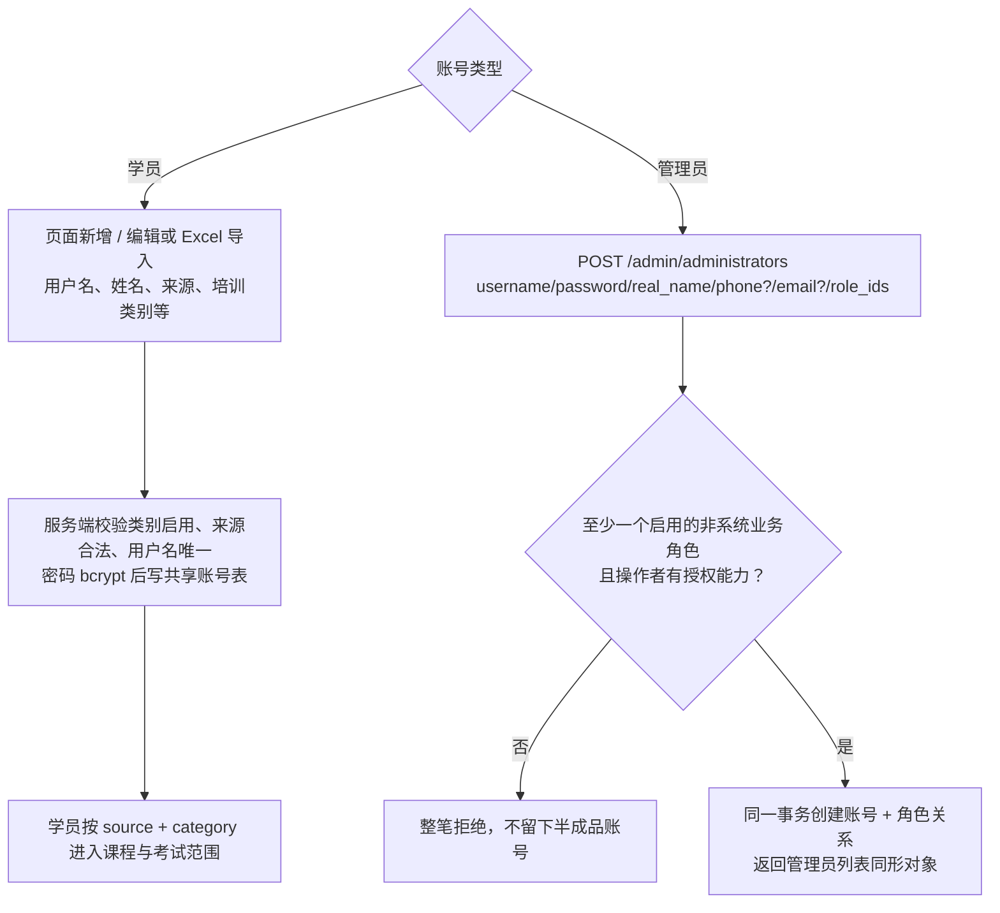

**关键规则**：① 学员接口不再接受或返回部门字段；② 管理员 `role_ids` 至少一项，只能选择启用的非系统业务角色；③ 管理员账号和角色关系在同一事务提交，任何一步失败均整体回滚；④ 学员与管理员的改密、停用、令牌吊销和超级管理员保护继续有效；⑤ 历史组织字段可为旧学习/固定卷兼容保留，但没有部门或员工管理入口。

### 1.4 现行流程覆盖对照

| 流程 | 名称 | 本文档落点 |
|---|---|---|
| F-01 | 资料上传、解析与 AI 出题 | §2.1—§2.4 |
| F-02 | 题目审核、人工/文件录题 | §2.1、§2.5、§5.3 |
| F-03 | 学员与管理员账号 | §1.3 |
| F-04 | 课程与视频学习 | §1.5、§1.6、§5.6、§5.7 |
| F-05 | 组卷、开考、保存与自动评分 | §4.1—§4.3、§5.4 |
| F-06 | 培训统计与导出 | §6.1—§6.3 |
| L-01 | legacy 制度阅读与固定卷 | §3、§4 的兼容说明、§5.1、§5.2、§5.5 |

### 1.5 B1 课程创建、上架与视频换版

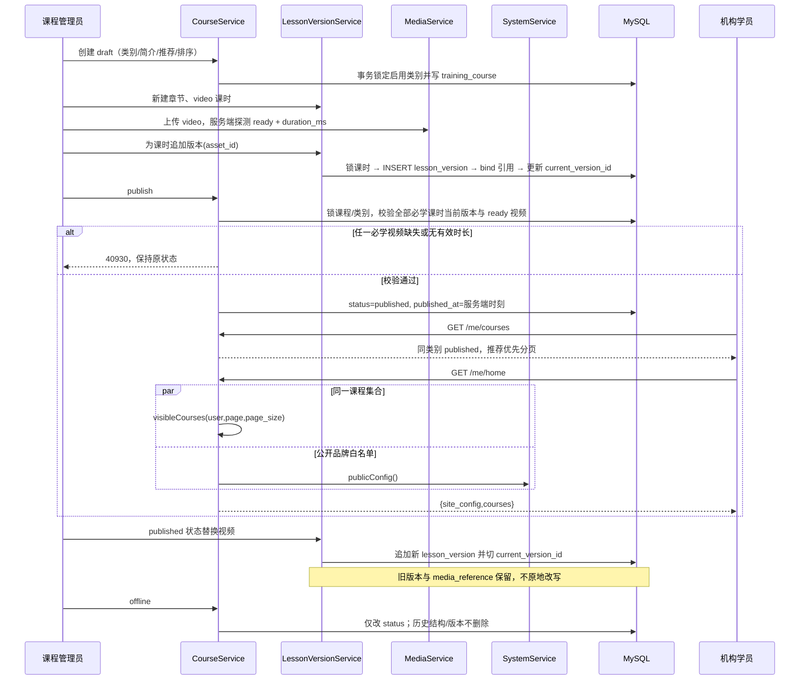

`external`、缺类别或停用账号的可见列表为空；跨类别或下架课程详情返回 40302。当前课程前端新建/编辑不提交 `regulation_ids`；服务端 DTO 仍为历史兼容接受该字段，前端更新时省略它以保留既有旧关联值。课程不触发旧制度学习门槛，旧 Vue 学员端也没有培训课程入口。下架后重新上架必须重跑类别与必学视频校验。

### 1.6 B2 视频会话、并发替换与重启恢复

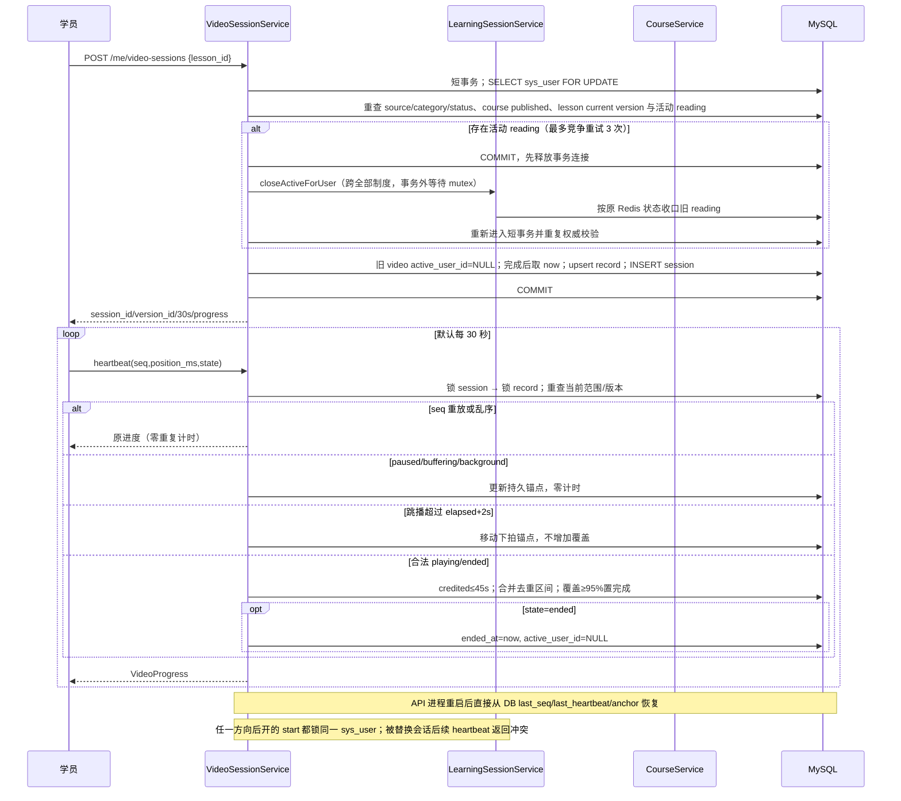

reading start 与 video start 使用同一短事务重查/事务外 flush 循环；等待 reading mutex 时不持数据库连接，旧 reading 结算逻辑不复制。reading 的 DB INSERT 提交后、发布 Redis 前再次锁同一用户并重查活动所有权；若会话已被 video 标记结束，reading 确定不写迟到指针。若 phase2 在真正替换前先完成，reading start 返回 200 仍是合法线性化点，后续 video 会将其正常收口，最终 DB 仍只有一个活动所有者。Redis 发布异常时收口本次 reading 并清理精确 key。反方向 video start 可把旧 reading 正常收口后再创建；若自身创建失败，旧 reading 保持已结束，不伪造时长也不复活。

---

## 2. 出题资料上传、解析与 AI 出题全流程

### 2.1 端到端时序图

覆盖「题库内创建资料 → 上传 multipart → 创建不可变 pending 版本 → 异步解析 → 显式选择 parsed 版本 → 发起 AI 出题 → 长文本分块调用大模型 → 题目入库 pending → 逐题审核 approved → 组卷发布」的完整时序。资料和版本 ID 在 API 中均为字符串；资料没有独立菜单、发布范围、学习要求或生效版本切换：

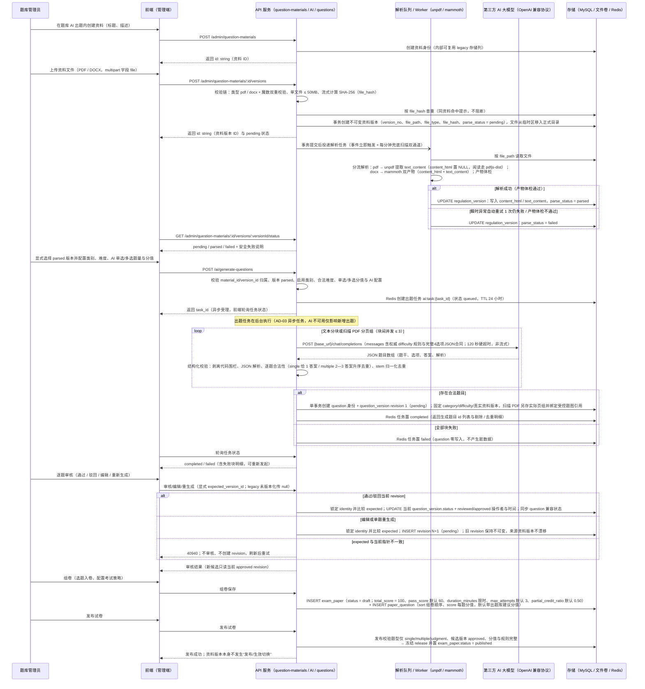

### 2.2 步骤说明

| 阶段 | 步骤 | 说明 | 对应场景 |
|---|---|---|---|
| 一 资料创建与上传 | 消息 1 ~ 10 | `POST /admin/question-materials` 创建资料 → multipart `file` 上传 PDF/DOCX → 类型、魔数、≤ 50MB、SHA-256 校验 → 事务创建 `pending` 不可变版本；所有 ID 字符串化 | 出题资料 |
| 二 异步解析 | 消息 11 ~ 16 | worker 隔离解析 PDF/DOCX；产物体检后置 `parsed / failed`。详情中的 versions 倒序，失败说明必须脱敏；failed 可用原版本 ID 重试 | 出题资料 |
| 三 版本选择 | 消息 17 ~ 18 | 管理员必须在题库中显式选择归属正确的 `parsed` 版本；不依赖 current 指针，也不提供独立发布、范围或学习要求页面 | 题库 AI 入口 |
| 四 AI 出题 | 消息 19 ~ 28 | 请求携带 `material_id + material_version_id`，再校验类别/难度/AI 单选与多选配置 → 文本分块或 PDF 视觉页组 → 结构校验 → 单事务创建 pending revision；判断题通过人工录入或文件导入进入统一题库 | AI 出题 |
| 五 题目审核 | 消息 29 ~ 31 | 审核当前 revision 并写实际操作者/时间；编辑或重生成创建 pending revision N+1，旧版本及真实资料来源不覆盖 | 题库审核 |
| 六 组卷与发布 | 消息 32 ~ 36 | 固定/随机组卷只接受三类 approved 题目；资料分类中立，按本类别题目来源关联，旧类别资料继续兼容；发布冻结规则和题目版本 | 试卷管理 |

资料读接口统一要求 `ai:read`：`GET /admin/question-materials?page&page_size&keyword` 返回 `{items,total,page,page_size}`，`GET /admin/question-materials/:id` 返回资料与倒序 versions，状态接口返回版本归属、`pending / parsed / failed` 与安全失败说明。写接口统一要求 `ai:write`：创建资料、multipart `file` 上传版本和 `POST .../:versionId/retry`。所有资料、版本及任务关联 ID 均按字符串传输。

### 2.3 关键规则

| # | 规则 | 出处 |
|---|---|---|
| 1 | 上传校验链固定顺序：权限与资料 → 大小（≤ 50MB）→ 格式（扩展名 + 魔数双重校验）→ 完整性（SHA-256 `file_hash`）→ 重复检测（提示但不阻断） | 05 册 3.4.1 |
| 2 | 版本 append-only 不可变：`file_path` / `file_type` / `file_hash` 与解析产物一经创建只读；`parse_status` 是版本记录上唯一允许流转的状态字段 | 03 册 3.2.2 |
| 3 | 解析异步（AD-03）：上传接口事务提交后立即返回；任务触发双通道（事件立即触发 + 每分钟兜底扫描 `pending` 超时记录）；解析在 worker 线程 / 子进程执行、与请求事件循环隔离 | 05 册 3.4.3 |
| 4 | 产物体检：文本不足时，启用多模态的 PDF 保持 parsed 并在 AI 出题时逐页视觉理解；其他文件/未启用视觉仍 failed。产物只在首次成功时写入 | 05 册 3.4.3、B3 |
| 5 | 统一题库与组卷只接受 single/multiple/judgment；当前 AI 批量生成支持 single/multiple，judgment 由人工录入/导入。图片只能出现在题干、选项和解析等受控富文本字段 | 客观题契约 |
| 6 | 长文本分块：超过 4000 字符启用；优先按段落 / 标题边界切块；相邻块 200 字符重叠；按各块字符数占比分配题量；块间并发 ≤ 3；块级失败块级重试（≤ 2 次），不拖累其他块 | 05 册 4.4.2 |
| 7 | AI 网关：单次调用 120 秒硬超时（NFR-05）；网络错误 / 5xx / 429 重试 ≤ 2 次（指数退避）；4xx 立即报错不消耗重试；非流式调用（结果整体校验后才落库） | 05 册 4.4.1 |
| 8 | 不产生脏数据：任何生成结果先经结构化校验，合法题目才进入落库事务；任务失败（全部块失败）时 `question` 表零写入 | FR-AIQ-02 验收③ |
| 9 | B3 审核事实同时写 question_version 的 approved/reviewed 操作者与时间及审计日志；旧记录未知值保持 null，legacy_captured_at 只表示升级时捕获 | 05 册 4.4.6 |
| 10 | 有 `paper_release` 的发布卷冻结题目、实际分值与策略，变更须复制新草稿；真正升级前已 published 且无 release 的制度卷仍按旧边界锁题单、允许动态策略 | 05 册 4.4.7 / 4.4.9 |
| 11 | 资料版本与旧制度发布完全解耦：AI 只校验请求中的资料/版本归属及 `parsed` 状态；资料没有 current 切换、发布范围或学习要求 | 出题资料契约 |

### 2.4 异常分支

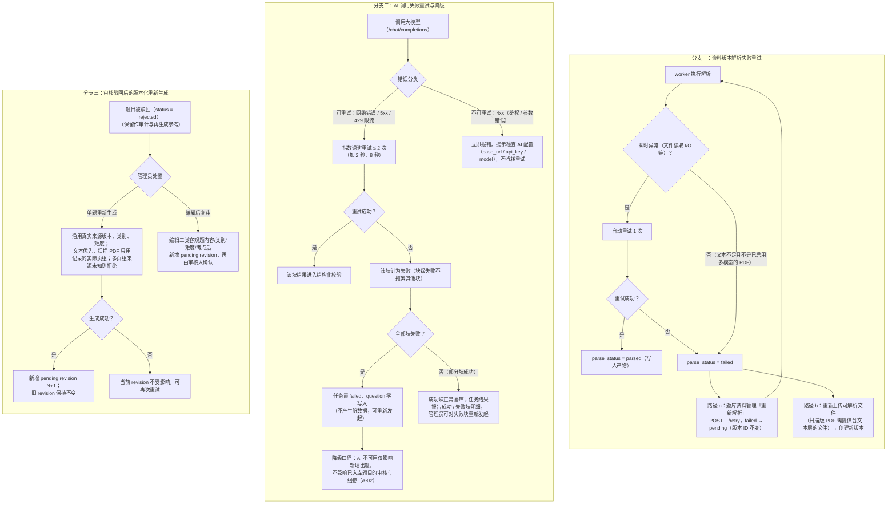

**分支说明**：

| 分支 | 触发 | 处置 | 关键约束 |
|---|---|---|---|
| 一 解析失败 | 瞬时异常重试 1 次仍失败；产物体检不通过（空产物 / 低于 50 字符） | `parse_status = failed`，版本详情显示安全失败说明；可重试原版本或重新上传新版本 | failed 版本不能用于 AI；无需切换“当前生效版本” |
| 二 AI 调用失败 | 服务不可用 / 超时 / 返回格式异常 | 可重试错误指数退避 ≤ 2 次；块级失败不拖累其他块；全部块失败任务置 failed 零写入 | 文本不足的 PDF 走视觉输入，不把“无文本层”直接等同不可出题；真实提供商未配置时只以 Mock 闭环验收 |
| 三 驳回重生成 | 管理员对表述或答案不满意 | 成功新增 pending revision；失败保持当前 revision；类别/难度/来源版本固定 | 重新生成复用 AI 网关与 PdfVisionService；仅当前 approved version 进入新候选 |

### 2.5 题库文件导入流程（B4）

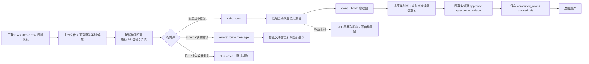

确认事务只接受该批次 `valid_rows` 子集；同一集合重复确认返回首次结果，改换集合返回 40911。类别锁后以锁定当前读重查指纹；两个不同预检批次确认同一道题时，仅先获得类别锁的一方写入，另一方明确返回 40911 并保留原预检集合。跨 owner 或把 students 批次带入 questions 入口返回 40302；旧 students 入口在服务端固定只接受 students 批次。版本写入复用 B3 validator、类别锁、来源/媒体/考点检查，所有事务内媒体查询也使用调用方 manager；`approved_by/approved_at/reviewed_by/reviewed_at` 均为本次确认管理员和同一确认时刻。任何行失败时整批题目、版本、媒体引用与批次状态一起回滚。502/504、传输失败或不可验证信封均进入“查询原批次”状态；回包绑定 batch ID 和页面代次，离页后不能再覆盖页面或导航。

---

## 3. 有效学习判定流程（UC-04 / UC-05）

### 3.1 学习会话与心跳时序图

覆盖「会话开始（单活跃约束）→ 心跳 30 秒 → 服务端时间差计算 45 秒封顶 → 失焦 pause / resume 锚点 → 会话结束落库 → learning_record 聚合 → 双条件判定 → is_valid = true 幂等置位」：

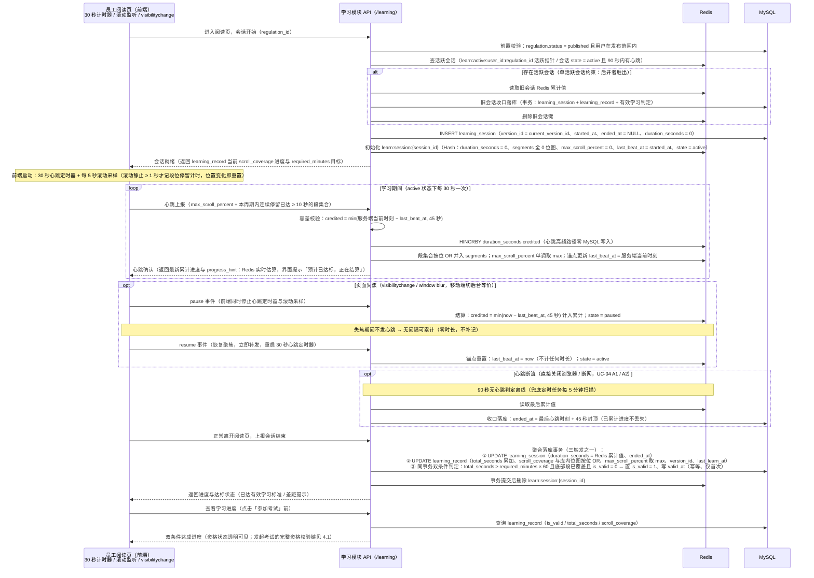

**步骤说明**：

| 阶段 | 步骤 | 说明 | 对应场景 |
|---|---|---|---|
| 一 会话开始 | 消息 1 ~ 9 | 前置校验（`published` + 范围内）→ 单活跃会话约束检查（存在活跃会话则先收口旧会话，后开者胜出，阻断双标签页并行刷时长）→ INSERT `learning_session` → Redis 初始化 `learn:session:{session_id}`（`duration_seconds` / `segments` / `max_scroll_percent` / `last_beat_at` / `state`） | FR-LRN-01、UC-04 主流程 1 |
| 二 心跳循环 | 消息 10 ~ 15 | 每 30 秒心跳（携带最大滚动百分比与本周期停留 ≥ 10 秒的段集合）→ 服务端时间差计算 → 45 秒封顶 → Redis `HINCRBY` 累计（不写 MySQL）→ 位图按位 OR 合并 → 锚点更新 | FR-LRN-02 / FR-LRN-04、UC-04 主流程 2 ~ 4 |
| 三 失焦暂停 | 消息 16 ~ 20 | `pause` 事件：结算一个 ≤ 45 秒窗口后 `state = paused`，前端停发心跳；`resume` 事件：锚点重置 `last_beat_at = now`、计 0 秒，恢复 30 秒节奏 | FR-LRN-03、UC-04 主流程 5 |
| 四 异常收口 | 消息 21 ~ 24 | 90 秒无心跳判离线；`ended_at` 取最后心跳 + 45 秒封顶；已累计进度不丢失 | UC-04 A1 / A2 |
| 五 聚合落库与判定 | 消息 25 ~ 28 | 落库三触发（正常退出 / 90 秒离线收口 / 每 5 分钟兜底扫描）任一触发 → 单事务完成会话收口 + `learning_record` 聚合 + 双条件判定 → `is_valid = 1`（幂等置位）→ 删除 Redis 会话键 | FR-LRN-05、UC-04 主流程 6 ~ 7 |
| 六 进度与资格可见 | 消息 29 ~ 31 | 学习页实时展示双条件达成进度；资格状态对员工透明可见 | UC-05 主流程 1、后置条件 |

**关键规则**：

| # | 规则 | 出处 |
|---|---|---|
| 1 | 时长唯一来源是服务端相邻两次心跳到达时刻的间隔（服务端时钟、毫秒精度），客户端上报的时间戳不参与任何判定 | C-01、07 册 3.1.1 |
| 2 | 单次心跳最大计入 45 秒：`credited = min(diff, 45)`；高频上报不虚增（每次计入 ≈ 真实间隔）；低频上报（如 60 秒 / 次）每轮反而亏 15 秒 | FR-LRN-02、07 册 3.1.2 |
| 3 | 心跳先在 Redis 累计（`HINCRBY` 单命令原子累计），会话结束 / 定期才落库：数据库写频率从逐心跳降至每会话一次（AD-04：Redis 只存可再生临时态，MySQL 是唯一权威源） | 03 册 6.3 |
| 4 | 失焦暂停锚点模型：`pause` 结算封顶后置 `paused`（此后普通心跳只更新滚动位置、不计费）；`resume` 只重置锚点、不产生时长；不发 `pause` 直接失焦时由「断流首拍封顶 45 秒」兜底 | 05 册 5.4.3 |
| 5 | 单活跃会话约束：同一用户同一制度至多一个会话在累计（`learn:active:{user_id}:{regulation_id}` 活跃指针）；旧会话立即收口落库、新会话接管（后开者胜出）；同一用户同时学两个不同制度是允许的 | 05 册 5.4.1、07 册 3.1.4 |
| 6 | 滚动位图只计停留 ≥ 10 秒的段：前端每 5 秒采样、滚动静止 ≥ 1 秒记段位停留计时；30 秒心跳携带「本周期内连续停留已达 ≥ 10 秒的段集合」；途经不算读过（快速拖到底部，途经段不置位，底部段真实停留 ≥ 10 秒才置位） | 07 册 3.1.3 定稿 |
| 7 | 位图只增不减：回滚不取消已置位段落；`max_scroll_percent` 单调不减；跨会话按位 OR 合并、合并幂等 | FR-LRN-04 验收②③、03 册 3.3.2 |
| 8 | 落库幂等：以 `ended_at IS NULL` 作为「未收口」判据，已收口会话重复触发落库直接跳过；Redis 不可用时兜底任务可从库侧扫描恢复（NFR-11 / NFR-12） | 05 册 5.4.6 |
| 9 | 双条件判定在每次聚合落库事务内执行；达标当次落库即置位，`is_valid` 一旦置 1 永不回退，`valid_at` 只写一次；心跳响应只返回 `progress_hint`（Redis 实时估算），`is_valid` / `valid_at` 仅由聚合落库事务产生 | FR-LRN-05 验收③ |

### 3.2 单次心跳的服务端处理决策

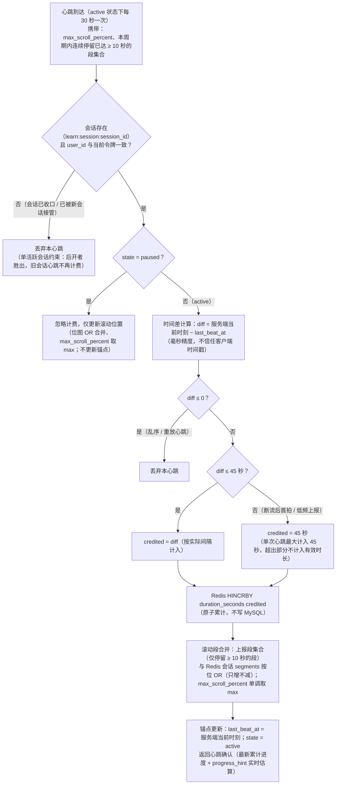

**步骤说明**：① 归属校验（会话存在且令牌一致，否则丢弃）；② `paused` 态心跳只更新滚动位置不计费；③ 时间差 `diff = 服务端当前时刻 − last_beat_at`；④ `diff ≤ 0` 判乱序 / 重放丢弃；⑤ 容差封顶 `credited = min(diff, 45 秒)`；⑥ Redis `HINCRBY` 原子累计；⑦ 段集合按位 OR 合并、`max_scroll_percent` 取 max；⑧ 锚点更新并返回确认。失焦恢复的锚点重置由独立 `resume` 端点完成（见 3.1 失焦暂停），心跳请求体不携带任何恢复标记。

**关键规则**：

| 作弊手段 / 异常场景 | 服务端防线与结果 |
|---|---|
| 高频上报（篡改前端每秒 1 次） | 每次计入 `diff ≈ 1 秒`，累计 = 真实经过时间，`total_seconds` 不虚增（FR-LRN-02 验收②） |
| 篡改客户端时间 / 时间戳 | 时长完全由服务端时钟差计算，客户端时间不参与判定（C-01） |
| 改心跳间隔为 60 秒 | 每次封顶计入 45 秒，每轮亏 15 秒——作弊者自我损耗 |
| 双标签页并行 | 单活跃会话约束：旧会话收口、仅新会话计费 |
| 不发 pause 直接失焦 / 断网 | 恢复后首拍 `diff > 45 秒` → 只计 45 秒（兜底封顶，UC-04 A1） |
| 伪造高频 resume | resume 只重置锚点、不产生时长，无任何收益 |
| 快速拖到底部刷覆盖 | 途经段未静止停留 ≥ 10 秒不置位（07 册 3.1.3） |

### 3.3 滚动覆盖位图更新示意

`learning_record.scroll_coverage`（结构：`total_segments` / `covered_count` / `segments`，长度恒为 10）跨会话按位 OR 合并与底部段判定：

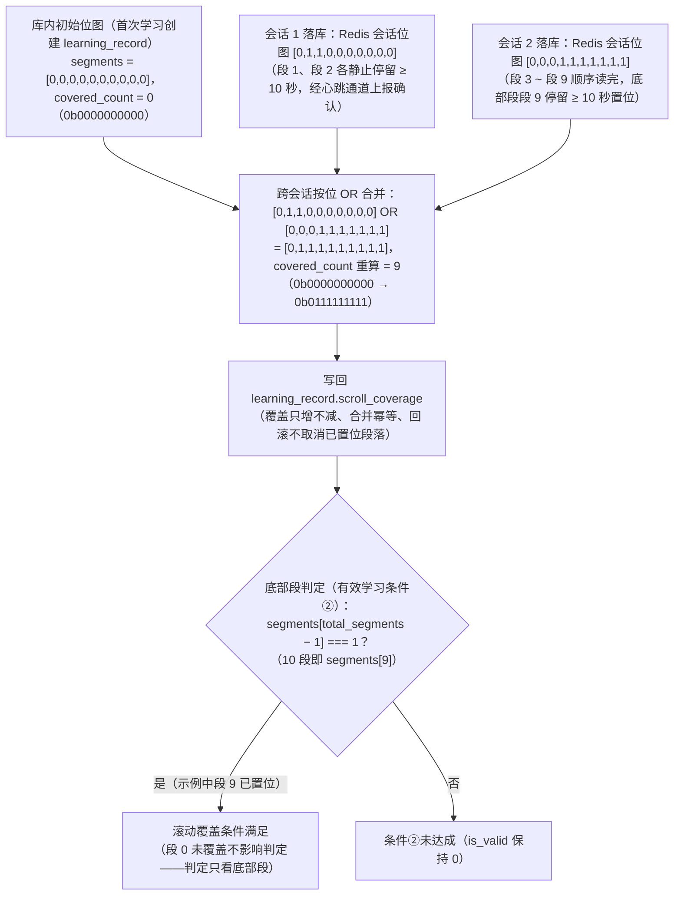

**位图示例**：

| 时点 | segments（下标 0 ~ 9） | 二进制表示 | covered_count | 说明 |
|---|---|---|---|---|
| 首次学习创建 | [0,0,0,0,0,0,0,0,0,0] | 0b0000000000 | 0 | 全 0 初始化（长度 = `regulation.scroll_segments`） |
| 会话 1 落库后 | [0,1,1,0,0,0,0,0,0,0] | 0b0110000000 | 2 | 段 1、段 2 停留 ≥ 10 秒置位 |
| 会话 2 落库后（按位 OR） | [0,1,1,1,1,1,1,1,1,1] | 0b0111111111 | 9 | 底部段（段 9）已置位 → 条件②满足 |

**关键规则**：① 段位置计算：前端按阅读容器滚动高度把视口底缘映射为 0 ~ 100% 再除段取整；② 置位证据链：段的置位当且仅当「静止停留 ≥ 10 秒 + 经心跳通道上报确认」双条件（途经不算读过）；③ 跨会话合并发生在聚合落库时（Redis 最新位图与库内位图按位 OR 后写回，`covered_count` 重算）；④ `max_scroll_percent`（0 ~ 100）与位图并存——前者是展示进度（进度条），后者是判定依据（底部段），二者不可互相替代。

### 3.4 legacy 制度考试资格的衔接（UC-05）

有效学习判定的产物 `learning_record.is_valid` 即旧制度的**考试资格事实**：员工在学习页可实时看到双条件达成进度（累计有效时长 / 目标时长、底部段覆盖状态）；点击「参加考试」时由考试评分模块的 legacy 资格校验链强制校验（见 4.1）：`is_valid = 1` → 允许开考；`is_valid = 0` → 拒绝并返回差距信息（剩余有效时长缺口 = `required_minutes × 60 − total_seconds`、底部段未覆盖）；暂无已发布试卷 → 提示「暂未开考」（UC-05 A1 / A2）。资格不冗余存储快照到旧考试域，考试记录创建时实时校验（资格只升不降）。

新培训考试默认不要求制度阅读或视频课程完成，首次开考读取管理员维护的类别/来源并冻结来源、难度、规则与个人题单；补考沿用该快照。两条路径不能通过把“来源”写入权限角色或用一个 `is_valid` 布尔值混合表达。

---

## 4. legacy 固定卷考试全流程（UC-06 / UC-07）

本节 sequenceDiagram 是当前旧固定卷兼容路径：资格校验继续包含 `is_valid`，旧客户端形状不变。C2 后的新开考先冻结 release；真正升级前 published 无 release 的卷在首次开考捕获题面并标记 `legacy_start`。旧客户端的 source question ID 在入口映射为本次 item ID；新 training 卷不得落入本节 legacy 执行路由。

### 4.1 考试时序图

覆盖「可考列表 → 资格校验 → 乱序组卷下发（seed）→ 答案保存与服务端校时 → 交卷 → 幂等校验 → 自动评分 → 结果返回；补考循环与超时自动交卷分支」：

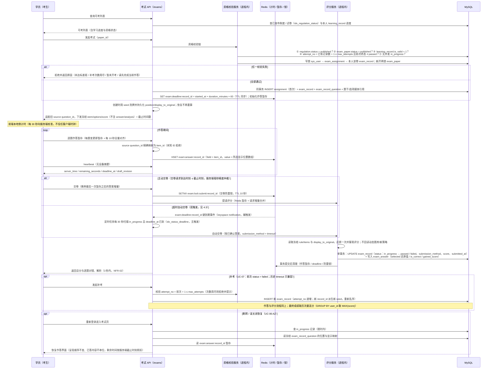

**步骤说明**：

| 阶段 | 步骤 | 说明 | 对应场景 |
|---|---|---|---|
| 一 可考列表 | 消息 1 ~ 3 | 按发布范围与 `published` 状态过滤制度 / 试卷，附带学习进度与资格状态 | UC-05 主流程 1 |
| 二 资格校验与开考 | 消息 4 ~ 11 | legacy 资格语义不变；通过后按用户→assignment→记录→试卷锁序，同事务冻结归属、record、题单/显示映射和媒体引用 | UC-05 主流程 2 ~ 5、UC-06 主流程 1；FR-EXM-01 |
| 三 乱序下发 | 消息 12 ~ 13 | 创建时用确定性 seed 生成顺序并持久化；下发冻结试卷（不含 `answer/analysis`）与截止时间戳，恢复直接读持久映射 | UC-06 主流程 2；FR-EXM-02 |
| 四 作答与校时 | 消息 14 ~ 18 | 每题变更即保存并定期全量对齐；heartbeat 请求体不携带设备摘要，只返回服务端时间、剩余秒数、截止时间和草稿版本 | UC-06 主流程 3；FR-EXM-04 |
| 五 交卷与评分 | 消息 24 ~ 34 | 主动与超时提交均按分数直接形成 `passed / failed`；`submission_method` 记录 `manual / timeout`。两者均经过幂等校验、乱序还原、逐题判分与单事务落库 | UC-06 主流程 4 ~ 7；FR-EXM-03 / 05 / 06 |
| 六 补考循环 | 消息 35 ~ 38 | 前次 `failed` 后再次发起（历史 `timeout` 记录只作兼容读取）：`attempt_no + 1 ≤ max_attempts`、新记录新 seed 重新乱序、流程同上；多次作答取最高分 | UC-07；FR-EXM-07 |
| 七 断网恢复 | 消息 39 ~ 43 | `in_progress` 且未过 deadline 可继续：读冻结题单/显示映射 + 兼容暂存，剩余时间按数据库截止时刻照扣 | UC-06 A2 |

**关键规则**：

| # | 规则 | 出处 |
|---|---|---|
| 1 | legacy 资格语义固定；并发正确性由用户/assignment/记录/试卷数据库锁序及 `uk_exam_assignment_paper_user/uk_active_assignment/uk_*_attempt` 保证，Redis start 锁不参与 | 05 册 6.4.1、FR-EXM-01 |
| 2 | seed 只在 C2 创建事务内生成顺序；`position/display_to_original` 持久化后，恢复与评分均读冻结映射，不受密钥或动态题库变化影响 | 05 册 6.4.2 |
| 3 | 旧客户端提交 source question ID + 显示位置；服务端先精确映射为 item ID，再按该 item 的 `display_to_original` 还原一次并与冻结 answer 比较 | README 术语「试题与选项乱序」、03 册 3.4.4.1 |
| 4 | 下发载荷不含 `answer` / `analysis`（防偷答案）；解析只在交卷后的成绩回看中下发 | 05 册 6.4.2 |
| 5 | 不采集切屏、连接状态或设备摘要；空 body heartbeat 只回传已确认的 `draft_revision`、校准服务端时间并在到期时收口，不写草稿；保存由 `PUT /draft` 完成 | 07 册 3.2.2 |
| 6 | 考试限时是服务端绝对时间，不因页面焦点变化暂停；交卷有效性由服务端 `DATETIME(3)` 毫秒精度仲裁“压秒交卷” | 07 册 3.2.3、03 册 1.3 |
| 7 | 交卷幂等按路径区分：training 在事务内对 `exam_record` 加悲观写锁，终态重复请求直接返回既有结果；legacy 兼容路径继续使用 Redis 防重锁 + 状态条件更新。两条路径都只允许 `in_progress` 首次收口 | UC-06 A3、05 册 6.4.5 |
| 8 | C2 判分输入全部读 `exam_record.rule_snapshot/exam_record_question`；升级前无 assignment 活动记录才沿 legacy 原表路径。客户端无法触碰评分参数与规则 | 07 册 3.2.4 |
| 9 | 超时收口正常写入 `score`，按及格线落 `passed / failed`，并以 `submission_method = timeout` 标识；未答题目不得分。`status = timeout` 仅为历史兼容枚举 | FR-EXM-03、03 册 3.4.4 |
| 10 | 补考语义：已 `passed` 的不再发起（防刷分）；每次补考 `attempt_no` 递增且重新乱序；最高分是展示与统计口径（`GROUP BY user_id` 取 `MAX(score)`），`exam_record` 保留历次记录不做物理合并 | C-06、FR-EXM-07 |

### 4.2 交卷评分决策

主动交卷与 timeout sweeper 都从冻结快照读取三类客观题；training 的持久确认稿与统一 finalizer 使用同一评分边界。历史 `submitted / timeout` 记录可以读取，但新提交只按得分落 `passed / failed`，超时由 `submission_method = timeout` 区分。

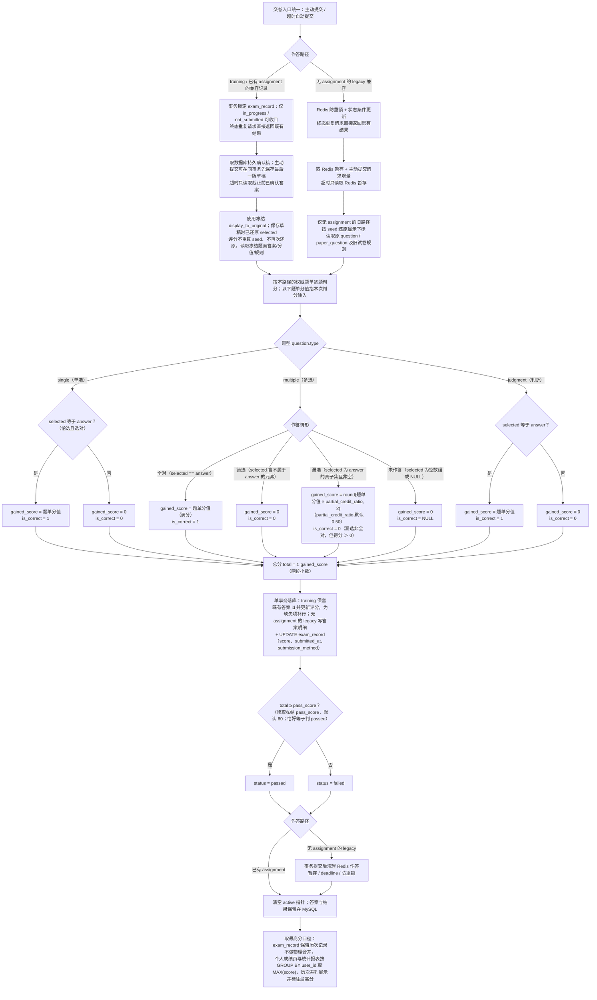

**步骤说明**：① training 与已有 assignment 的兼容记录读冻结题单；无 assignment 的旧路径才读取原表；② 前者依靠数据库行锁与终态实现幂等，后者保留 Redis 防重；③ training 的持久稿在保存时已按冻结映射还原，判分时不重复还原；④ 按本路径的权威答案、分值和规则评分；⑤ 单事务保存逐题分数、最终分与 `passed / failed` 终态，training 清空 active 指针；⑥ 仅无 assignment 的旧路径清理对应 Redis 暂存与防重键。下表的 `paper_question.score` 是旧路径分值名称；training 使用冻结题单分值，不读取动态题库替换快照。

**评分规则表**（与 README 术语「自动评分」、03 册 4.2 判分规则逐字一致）：

| 情形 | 判定条件 | gained_score | is_correct |
|---|---|---|---|
| 单选（single）答对 | `selected` 等于 `answer`（恰选且选对） | `paper_question.score` | 1 |
| 单选（single）答错 | `selected` 不等于 `answer` | 0 | 0 |
| 判断（judgment）答对 | `selected` 等于 `answer` | `paper_question.score` | 1 |
| 判断（judgment）答错 | `selected` 不等于 `answer` | 0 | 0 |
| 多选（multiple）全对 | `selected == answer` | `paper_question.score`（满分） | 1 |
| 多选（multiple）错选 | `selected` 中存在不属于 `answer` 的元素 | 0 | 0 |
| 多选（multiple）漏选 | `selected` 为 `answer` 的真子集且非空 | `round(paper_question.score × partial_credit_ratio, 2)`（默认 0.50） | 0（漏选非全对，但得分 ＞ 0） |
| 未作答 | `selected` 为 `[]` 或 NULL | 0 | NULL |

> **培训评分边界**：确认草稿持久化后，单选、多选、判断题全部沿服务端冻结快照自动判分并直接形成最终结果。`grading_state` 只表达 `not_submitted / finalized`；最终总分、及格结论和排名没有人工编辑入口。

### 4.3 超时自动交卷双触发机制

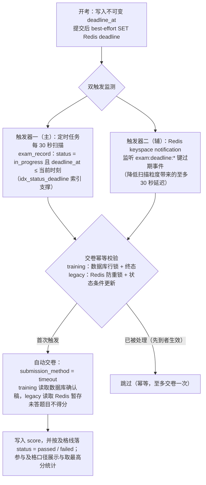

**步骤说明**：① 开考事务写权威 `deadline_at`，Redis 键仅在提交后 best-effort 初始化；② 30 秒数据库扫描是可靠性主通道，Redis 到期事件是辅通道；③ 两路汇合于同一幂等收口；④ C2 snapshot 记录从冻结规则/题单判分，并在终结事务清空 `active_assignment_id`，使补考不被永久活动锁阻塞。

**关键规则**：截止时刻在创建时由 `rule_snapshot.durationMinutes` 计算并写入 `exam_record.deadline_at`，以服务端 `DATETIME(3)` 仲裁；规则或试卷后续调整不改变已开考 deadline，前端倒计时仅展示。

---

## 5. 状态机设计

### 5.1 legacy 制度状态（只读兼容）

现行管理端和管理 API 不再提供制度创建、编辑、发布、范围、学习要求或版本切换。以下状态仅用于解释历史数据、旧学员阅读和旧固定卷资格，不能作为恢复制度管理 CRUD 的依据：

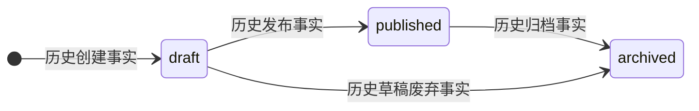

**历史流转说明（只读解释，不是现行操作入口）**：

| 流转 | 触发与前置条件 | 影响 |
|---|---|---|
| `[*] → draft` | 历史创建记录 | 草稿态制度对 legacy 学员端不可见 |
| `draft → published` | 历史发布时要求 parsed 版本与范围 | 写 `published_at`；范围内 legacy 学员可见、可学习 |
| `published → archived` | 历史归档事实 | legacy 学员端不可见、不可再学习与考试，历史数据保留并计入统计（C-08） |
| `draft → archived` | 历史草稿废弃事实 | 未发布过，无 legacy 学员侧影响 |
| 历史自环 | 旧系统曾允许上传版本、切换指针和调整学习要求/范围 | 现行管理端/API 不再提供这些操作；历史事实保持原样 |

**历史版本影响**：既有 `regulation_version` 保持 append-only；历史 current 指针、学习会话版本、进度、资格和范围统计均按已有事实读取，不因前台删除制度管理而重写或清零。新的出题资料版本走第 2 章资料 API，不通过本状态机发布。

### 5.2 出题资料版本解析状态机

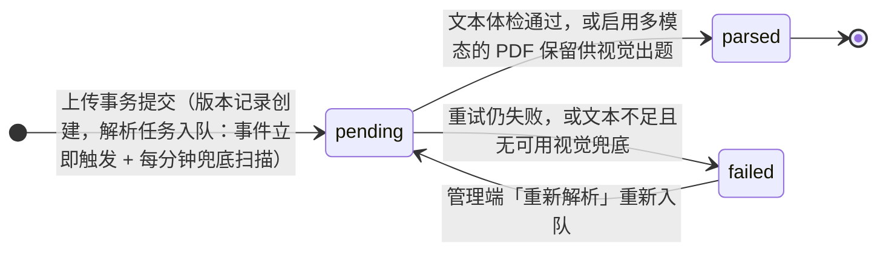

**流转说明**：① pending 上传即入队；② 文本体检通过写产物后 parsed；启用多模态时，扫描 PDF 即使文本不足也 parsed，原 PDF 作为后续视觉来源；③ 读取/解析重试仍失败，或无视觉兜底的低文本产物才 failed；④ failed 可重新解析/上传；⑤文件与成功产物保持版本不可变。

**关键规则**：`parsed` 是 AI 出题前置。AI 接受非空文本，或 `PdfVisionService.shouldUseVision` 判断可视觉处理的 PDF；单题 regenerate 使用同一来源资料版本和视觉判断。failed 版本不能用于生成；资料不提供发布或“当前生效版本”切换。

### 5.3 当前题目版本审核状态机（question_version.status）

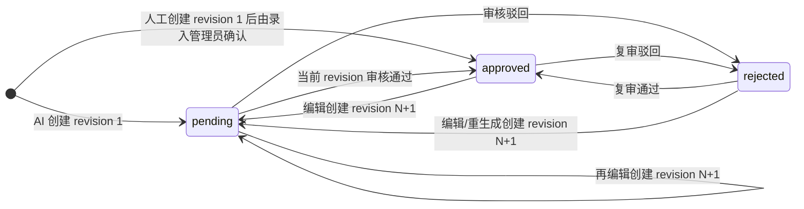

**流转说明**：① AI 题必须 pending 待审核；人工录入创建后由实际录入管理员调用同一 approve 语义确认；② approved/rejected 只更新当前 revision 的审核元数据；③ 编辑与重生成从任意状态创建新的 pending revision，旧 revision 内容与历史确认信息不改；④ 旧题 current_version_id 为空时先捕获升级当时内容为 revision 1，未知类别/难度/审核人/时间保持 null；⑤ 三类版本敏感 HTTP mutation 必须显式传 expected_version_id（legacy 为 null），锁内不一致返回 40940，长时重生成提交时再次比较；⑥ legacy in_progress 引用仍阻断核心编辑 40908，任一固定卷引用都阻断 type 变化。三类客观题结构由统一 validator 校验，题干、选项和解析的富文本媒体绑定 revision；遗留响应和未保存预览先做安全白名单显示清洗，不改写历史。

**关键规则**：`approvedCandidates` 只返回 identity 当前且 category/type/difficulty 精确匹配的 approved revision；发布事务传入同一 EntityManager，使类别复核与候选查询不借用事务外连接。旧 approved revision 在新 revision 待审时仍保留但不重新进入候选。random 草稿预览题图通过同一 `randomPool/approvedCandidates` 链重算当前合法候选，精确版本匹配后才做字段授权，不因样例读取写入题单或发布引用。制度固定卷在选题、发布、开考前仍只接受 single/multiple，开考重检发生在创建 exam_record 前；升级后新发布会真实捕获/复核 current version 并深拷贝，升级前已 published 无 release 的卷不补造历史。

#### 5.3.1 C1 培训试卷发布时序

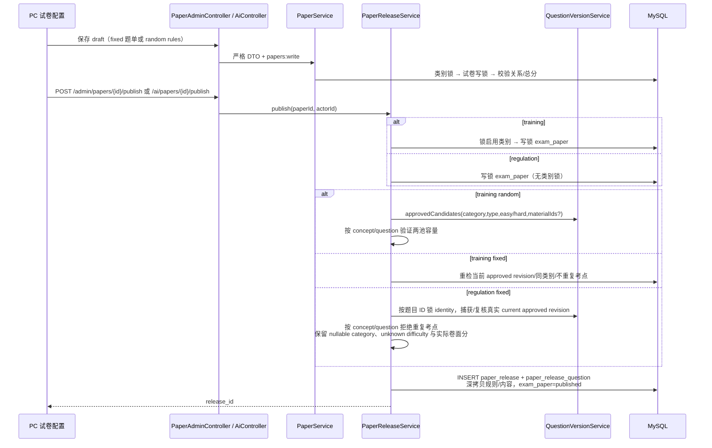

发布失败整个事务回滚，不留空 release、published 状态、旧题捕获版本或题单版本关联；无 concept 题按各自 question_id 独立，不补造考点。已发布 training 卷的普通/答案预览与升级后制度卷的 legacy detail 都读 release；题库或策略行之后变化不改变冻结读回。制度卷 list/detail 保留数字 ID 与原字段，只新增 `release_id/rules_locked`；有 release 的修改走 `/ai/papers/{id}/copy`。真正升级前 published 无 release 的制度卷保持可见，C2 在其首次新开考时冻结当时事实。撤回/归档保留 release，只阻止新开；已有 active 可继续恢复。

#### 5.3.2 C2 原子个人题单与恢复时序

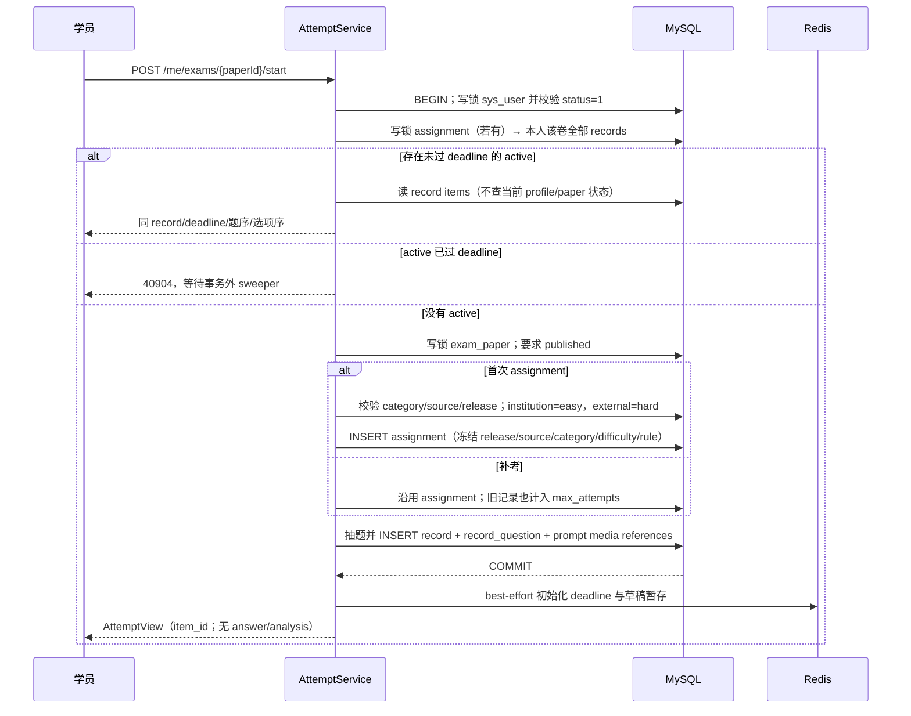

任一抽题、快照或媒体绑定失败都回滚 assignment/record/items。`uk_active_assignment` 保证同一 assignment 至多一个非 NULL 活动指针；终结事务必须清空该指针。C2 start 不在用户锁内调用旧 finalizer，避免同记录/连接嵌套；30 秒 sweeper 在事务外读取冻结规则和题单收口。题图 owner 固定为 `exam_record_question/item_id`，本人只能读该 item 冻结题干与选项实际引用的资源。

### 5.4 考试记录状态机（exam_record.status）

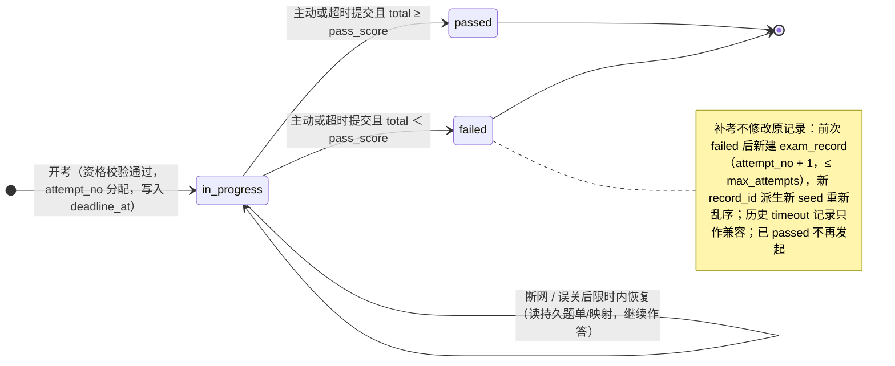

**流转说明**：① 新记录从 `in_progress` 只进入 `passed / failed`；`submission_method` 区分主动与超时，历史 `submitted / timeout` 仅兼容读取；② 终态后拒绝再交，training 由数据库行锁 + 终态幂等保证，legacy 兼容路径另保留 Redis 防重与状态条件更新；③ 超时按已确认答案写入 `score`，未答题不得分，并参与最高分口径；④ 补考是**新建记录**而非状态回退：`uk_paper_user_attempt` 唯一键保证 attempt 序列完整，最高分口径由统计层 `GROUP BY user_id` 取 `MAX(score)` 实现。

> 新作答仅接受三类客观题并自动终结，`grading_state` 只有 `not_submitted / finalized`。历史数据若仍含旧状态，只按兼容读取处理，不重新开放图片答案或人工评分入口。

### 5.5 学习记录有效化（learning_record.is_valid）

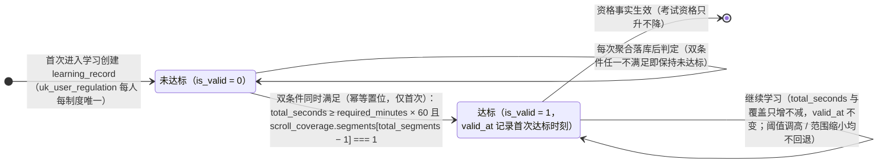

**一次性、不可逆的设计取舍说明**：

| 维度 | 说明 |
|---|---|
| 单调性依据 | `total_seconds` 只累加、`scroll_coverage` 按位 OR 只增不减 → 双条件判定单调，达标后任何后续操作都不可能破坏已满足的条件，「不可逆」是数据性质的必然结果而非额外约束 |
| 阈值调整不回退 | 调高 `required_minutes` 后：已达标员工保持达标、未达标员工按新阈值继续判定（UC-02 A2、FR-REG-05 验收③）——避免「先达标后失效」的追溯混乱 |
| 范围缩小不回退 | 发布范围调整后，范围外员工已有记录（含 `is_valid = 1`）保留不删、不回退；学习完成率分子按「应学集合 ∩ `is_valid = 1`」计算，不出现完成率 ＞ 100% 的口径事故 |
| 资格仲裁简化 | 若资格可回退，将出现「已开考 / 已交卷记录 vs 资格失效」的复杂仲裁；一次性置位使考试资格**只升不降**，考试域只需开考时校验一次、无需资格快照 |
| 审计合规 | `valid_at` 是资格起点（只写一次），与 `learning_session` 会话流水、心跳上报证据链共同构成达标争议时的审计依据 |
| 反向代价与兜底 | 误判风险由双条件的服务端严格判定控制（时长全靠服务端时钟差、覆盖全靠停留 ≥ 10 秒 + 心跳确认）；管理员如确需强制重学，通过提高 `required_minutes` 或发布新制度实现（C-07），不提供回退入口 |

### 5.6 课程状态机（training_course.status，B1）

```mermaid
stateDiagram-v2
    [*] --> draft : 创建课程
    draft --> published : 类别启用且必学视频全部 ready
    draft --> draft : 发布校验失败（40930）
    published --> offline : 下架（记录与版本保留）
    offline --> published : 重新校验类别与必学视频后上架
    offline --> offline : 重新上架校验失败（40930）
    published --> published : 追加 lesson_version 并切换 current_version_id
```

published 状态不允许修改章节/课时结构；如需调整结构先 offline。课程资料可更新，但类别改成新的非空值仍须在同一写事务中锁定并校验启用。B1 不提供硬删除状态，避免提前破坏 B2 学习事实与历史媒体版本。

### 5.7 视频学习会话与完成状态（B2）

```mermaid
stateDiagram-v2
    [*] --> active : start 成功，active_user_id=user_id
    active --> active : 严格递增 heartbeat 持久化锚点/覆盖
    active --> active : 重放、乱序、暂停、缓冲、后台（零计时或零重复）
    active --> ended : close 或 state=ended
    active --> replaced : 后开的 reading/video start
    active --> unavailable : 下架、换版、来源/类别/账号失效
    active --> expired : 90 秒无心跳回收（不补时长）
    replaced --> [*]
    unavailable --> [*]
    expired --> [*]
    ended --> [*]
```

会话终态统一写 `ended_at` 并将 `active_user_id` 置 NULL；`video_learning_record.is_completed` 与覆盖区间保留。换版新建独立 record，旧完成不套用到新版本。课程汇总只对当前必学版本计数；分母为零返回 null，不进入“完成”状态。

---

## 6. 统计数据流转（UC-08 / UC-10）

### 6.1 legacy 制度统计后端数据流（前端入口隐藏）

下图保留旧制度统计的后端口径，供历史记录兼容与回归使用；当前管理端“统计分析”直接进入 §6.2.1 的培训统计，旧制度/部门/个人报表 URL 回业务首页。

```mermaid
flowchart LR
    subgraph SRC["行为与基础数据（统计模块只读，零写路径）"]
        direction TB
        D1["learning_session<br/>学习会话流水（起止 / 时长，审计下钻入口）"]
        D2["learning_record<br/>total_seconds · scroll_coverage · is_valid"]
        D3["exam_record<br/>status · score · attempt_no · submission_method"]
        D4["exam_answer<br/>selected · is_correct · gained_score"]
        D5["regulation_scope + sys_department + sys_user<br/>应学集合口径（发布范围 × 在职 status = 1）"]
        D6["regulation（required_minutes）·<br/>exam_paper（pass_score）"]
    end

    subgraph CALC["统计口径计算（应学集合统一产出，各维度复用）"]
        direction TB
        C1["应学人数：发布范围内在职员工数（C-09）"]
        C2["学习完成率：应学集合中 is_valid = 1 人数 ÷ 应学人数"]
        C3["参考人数：exam_record.status ∈ submitted / passed / failed / timeout 的去重考生数"]
        C4["通过率 / 平均分 / 分数分布：各考生最高分（MAX(score)）口径<br/>分段 [0-59] [60-69] [70-79] [80-89] [90-100]"]
        C5["未完成人员清单：应学未达标（附差距原因）+<br/>已达标但考试未通过 / 未参考"]
    end

    subgraph VIEW["报表展示（三维）"]
        direction TB
        V1["制度维度报表（UC-08）"]
        V2["部门维度对比（部门树汇总 / 跨制度矩阵）"]
        V3["个人维度统计（学习记录 + 考试成绩；employee 仅本人）"]
    end

    subgraph EXP["Excel 导出（UC-10）"]
        direction TB
        X1["各维度统计报表导出"]
        X2["未完成人员清单导出（流式分页、中文表头、万行 ≤ 30 秒）"]
        X3["线下督办跟进闭环"]
    end

    SRC -->|"只读聚合（索引支撑：idx_regulation_valid / idx_regulation_status / uk_paper_user_attempt / idx_department_status）"| CALC
    CALC --> VIEW
    VIEW --> EXP
    C5 --> X2
```

**步骤说明**：① 数据源：学习域（`learning_session` / `learning_record`）与考试域（`exam_record` / `exam_answer`）的行为数据，叠加应学集合口径基座（`regulation_scope` → 部门树展开 / `is_all` 全员 → `sys_user.status = 1`）；② 口径计算：以应学集合为锚点统一计算各指标（学习完成率分子分母同源，范围调整后口径随之更新）；③ 报表展示：制度 / 部门 / 个人三个维度（部门维度按 `sys_user.department_id` 切片 + 部门树父级汇总，跨制度支持「部门 × 全部已发布制度」矩阵）；④ Excel 导出：各维度报表与未完成人员清单导出，形成线下督办闭环。

**关键规则**：统计模块对业务事实表**只读、零写路径**，报表永远不污染业务数据；legacy 制度报表后端继续按原跨试卷取最高分口径兼容，但前端页面与旧 URL 已隐藏/重定向。当前培训报表按 paper 的历史人数和“最新 release + 完全相同冻结规则 + 明确难度”的 finalized 个人最高分分别计算；空应考集合的参与率为空。培训统计直接查库、不进入 legacy Redis 统计缓存，人员/课程版本/判分变化由下一请求读取；每项指标在页面明示口径定义。

### 6.2 legacy 统计口径速查表

| 指标 | 精确口径 | 主要数据来源 |
|---|---|---|
| 应学人数 | 发布范围内在职员工数（`is_all = 1` 全员；否则圈定部门含子部门中 `sys_user.status = 1` 的去重员工数） | `regulation_scope` + `sys_department` + `sys_user` |
| 学习完成率 | 应学集合中 `learning_record.is_valid = 1` 的人数 ÷ 应学人数 | `learning_record`（`idx_regulation_valid`） |
| 参考人数 | 该制度下 `exam_record.status ∈ {submitted, passed, failed, timeout}` 的去重考生数 | `exam_record`（`idx_regulation_status`） |
| 通过率 | 各考生最高分 ≥ `pass_score` 的人数 ÷ 参考人数（每人最高分 = 该制度下全部作答的 `MAX(score)`，跨试卷取最高） | `exam_record`（`uk_paper_user_attempt` 前缀 + 回表） |
| 平均分 | 各考生最高分的算术平均（两位小数） | 同上 |
| 分数分布 | 各考生最高分按闭区间分段计数：[0-59]、[60-69]、[70-79]、[80-89]、[90-100] | 同上 |
| 未完成人员清单 | ① 应学集合中 `is_valid = 0` 或无 `learning_record` 记录者（附剩余时长缺口、底部段覆盖状态）；② 已 `is_valid = 1` 但历次最高分 ＜ `pass_score` 或未参考者（标注「考试未通过 / 未参考」） | 应学集合 LEFT JOIN `learning_record` ∩ `exam_record` 聚合 |
| 题目正确率（扩展） | 跨全部考试按题聚合 `exam_answer.is_correct` | `exam_answer`（`idx_question`） |

> **培训统计（已落地，C6）**：人数类字段保留该 paper 按冻结字段筛选后的历史范围；参与率分子取当前应考与历史成功开考用户交集，当前范围外历史人数另列。成绩/分布/排名只取最新 `release_id`、完全相同 `rule_snapshot`、同 difficulty 的 `finalized` 个人最高分，不跨 release/规则合榜；不同难度不产生默认总榜。旧制度/部门/个人报表继续按上表 legacy 口径。

#### 6.2.1 C6 实时培训统计流程

```text
paper_id + 可选类别/来源/难度
  ├─ 当前 sys_user(status/category/source) → 当前应考集合
  ├─ exam_record 冻结 category/source/difficulty → paper 历史开考/终态人数
  ├─ latest paper_release + exact rule_snapshot + difficulty
  │    → finalized → 每人最高分 → 分布/通过率/1,1,3 排名
  └─ published course → required lesson.current_version_id
       → video_learning_record.is_completed → 仅 institution 课程完成率
```

同一用户最高分并列时，优先取较早完成自动结算者；历史未知时间不补造，改按最小 record_id 稳定兜底。排名同分的展示顺序同样不读取用时；考试用时由开始/提交/截止事实计算。未完成原因按“未完成学习 / 未参加考试 / 未通过”分别聚合人数，原因可独立出现；当前培训统计不提供未完成人员明细清单。external 和零必学课时不会被伪造为课程未完成。

### 6.3 Excel 导出闭环

| 项 | 设计 |
|---|---|
| 导出物 | 当前培训统计的明确难度排名与口径说明 Sheet；原制度/部门报表后端兼容但前端不提供入口 |
| 一致性 | 培训导出复用 ranking 同一 filter/page/page_size，主 Sheet 行与当前屏幕页一致，口径 Sheet 明示“历史人数 vs 当前 release 成绩组” |
| 生成机制 | 服务端生成 xlsx 文件流（附件响应）；流式分页取数（按主键游标分批）避免万行全量驻留内存 |
| 性能 | 万行级导出 ≤ 30 秒（NFR-03 / FR-STT-05 验收③） |
| 空清单 | 全员已完成 → 提示「无未完成人员」、不生成文件（UC-10 A1）；导出失败提示重试（A2） |
| 留痕 | 导出操作写审计日志（操作人、时间、导出物与数据范围，NFR-10） |
| 督办闭环 | 清单含部门、姓名、工号、学习时长进度、覆盖状态、考试状态与未完成原因 → 管理员线下跟进督办 |

---

## 附：一致性对照与用例覆盖

### 附一：与基准文档一致性对照

| 对照项 | 基准落点 | 本文档体现 |
|---|---|---|
| 当前表名 | README 3.3 | 12 张 legacy 保持不变；A2—A5、B1 四张、B2 两张、B3 两张、C1 两张发布快照与 C2 两张个人考试表同步加入，当前共 36 张业务表，另有 1 张 migration 元数据表；B4 不新增表 |
| 全部枚举值 | README 3.4 + B1—B3/C1 | §5 状态机覆盖 regulation / regulation_version / 当前 question_version / exam_record / training_course / video_learning_session；question.status 为当前版本兼容值，learning_record.is_valid 为 1/0 布尔口径 |
| 核心术语 | README | 心跳上报（30 秒/次、45 秒封顶）、滚动覆盖率、legacy 有效学习、服务端截止时间、三类客观题自动评分、试题与选项乱序、补考取最高分等逐条对应 |
| 流程覆盖 | 本册 1.4 | F-01 ~ F-06 现行闭环 + L-01 legacy 兼容边界 |
| 字段与索引 | 03 册 | 落库事务、Redis Key、唯一键（含 uk_exam_assignment_paper_user / uk_active_assignment / uk_assignment_attempt / uk_exam_record_question_position）及兜底扫描索引（idx_status_deadline）逐字采用 |
| 模块设计决策 | 05 册 | 失焦暂停 pause / resume 锚点重置（5.4.3）、心跳 Redis HINCRBY 累计（5.4.2）、单活跃会话约束（5.4.1）、AI 长文本分块 4000 字符（4.4.2）、超时自动交卷双触发（6.4.3）、确定性 seed 乱序（6.4.2）、training 数据库行锁/终态幂等与 legacy Redis 防重（6.4.5）、统计口径（7.4.1）逐条一致 |
| 安全细化口径 | 07 册 | 滚动位图只计停留 ≥ 10 秒的段、服务端绝对截止时间、作答暂存与幂等提交；不采集切屏、连接状态或设备摘要 |
| 架构决策 | 02 册 | AD-03（解析 / AI 出题异步任务）、AD-04（Redis 临时态 / MySQL 唯一权威源）、AD-06（本地文件存储卷） |

### 附二：流程图清单

| # | 章节 | 类型 | 主题 |
|---|---|---|---|
| 1 | §1.1 | flowchart LR | 端到端业务全景图（两条脉络与交汇点） |
| 2 | §1.3 | flowchart TB | 学员与管理员账号准备（管理员原子创建） |
| 3 | §2.1 | sequenceDiagram | 出题资料上传、解析、AI 出题与审核 |
| 4 | §2.4 | flowchart TB | 异常分支（解析失败重试 / AI 失败降级 / 驳回重生成） |
| 5 | §3.1 | sequenceDiagram | 有效学习判定（会话 / 心跳 / 失焦 / 落库 / 判定，UC-04） |
| 6 | §3.2 | flowchart TB | 单次心跳的服务端处理决策 |
| 7 | §3.3 | flowchart TB | 滚动覆盖位图跨会话按位 OR 合并示意 |
| 8 | §4.1 | sequenceDiagram | 考试全流程（资格 / 乱序 / 作答 / 交卷 / 补考 / 恢复，UC-05 / 06 / 07） |
| 9 | §4.2 | flowchart TB | 交卷评分决策（幂等 / 还原 / 判分 / 及格 / 最高分） |
| 10 | §4.3 | flowchart TB | 超时自动交卷双触发机制 |
| 11 | §5.1 | stateDiagram-v2 | 制度状态机（regulation.status） |
| 12 | §5.2 | stateDiagram-v2 | 版本解析状态机（regulation_version.parse_status） |
| 13 | §5.3 | stateDiagram-v2 | 当前题目版本审核状态机（question_version.status） |
| 14 | §5.4 | stateDiagram-v2 | 考试记录状态机（exam_record.status） |
| 15 | §5.5 | stateDiagram-v2 | 学习记录有效化（learning_record.is_valid） |
| 16 | §6.1 | flowchart LR | 统计数据流转（UC-08 / UC-10） |
| 17 | §1.5 | sequenceDiagram | B1 课程创建、上架、视频换版与下架 |
| 18 | §5.6 | stateDiagram-v2 | 课程 draft / published / offline 状态机 |
| 19 | §1.6 | sequenceDiagram | B2 视频 start、心跳、双向替换与重启恢复 |
| 20 | §5.7 | stateDiagram-v2 | 视频 active / ended / replaced / unavailable / expired 状态 |

> 本册为设计文档，不含任何系统代码实现（README 第 5 章边界说明）；图中参与方（解析队列 / Worker、第三方 AI 大模型、Redis、MySQL）为逻辑角色，物理上全部交互发生在 NestJS 模块化单进程内或经 HTTPS 出站调用（AD-02 / AD-03 / AD-04）。
